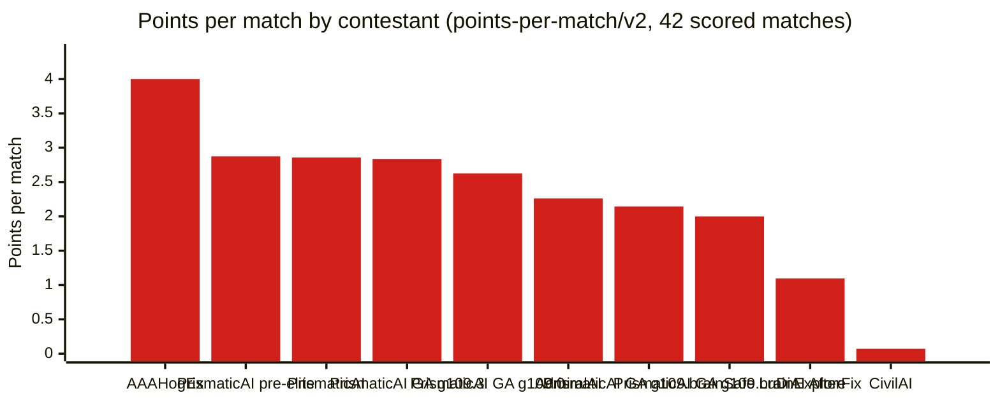
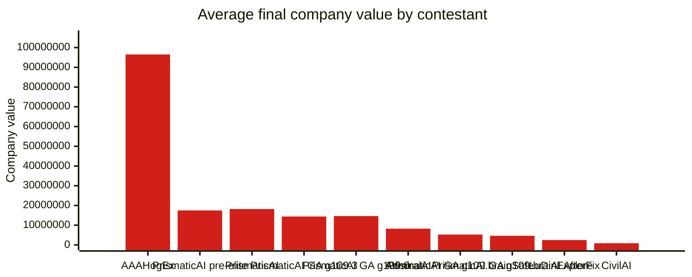
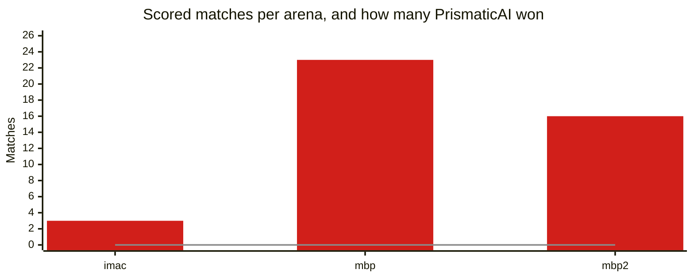

# battle-20261120T064620-0741aa05

Derived from `battle-20261120T064620-0741aa05.json` by `tools/research/ai-battle/battle.py report`; do not edit.

- Edition `0741aa05aad7e45c`: PrismaticAI and referee at `cbd774f94108d495482a04435618a1effe17f9fc`, base set `opengfx-8.0.tar`
- 20-year free-for-all from 1960, map 256x256 temperate, breakdowns 1
- 42 scored match(es) on `imac` (20261119-master-gdf1e05e7d8), `mbp` (20261120-master-m7a925f73d1), `mbp2` (20261119-master-gdf1e05e7d8)
- Replays: 1 of 1 identical to their original on another arena

| # | Contestant | Played | Wins | Points | Points/match | Avg rank | Avg final value | Squirrel errors | Matches with anomalies |
|---|---|---|---|---|---|---|---|---|---|
| 1 | AAAHogEx | 42 | 42 | 168 | 4.0 | 1.0 | 96.5 M | 0 | 0 |
| 2 | PrismaticAI pre-elite | 8 | 0 | 23 | 2.875 | 2.12 | 17.5 M | 0 | 0 |
| 3 | PrismaticAI | 7 | 0 | 20 | 2.857 | 2.14 | 18.2 M | 0 | 3 |
| 4 | PrismaticAI GA g109.3 | 6 | 0 | 17 | 2.833 | 2.17 | 14.4 M | 0 | 1 |
| 5 | PrismaticAI GA g109.0 | 8 | 0 | 21 | 2.625 | 2.38 | 14.6 M | 0 | 4 |
| 6 | AdmiralAI | 42 | 0 | 95 | 2.262 | 2.74 | 8.2 M | 0 | 2 |
| 7 | PrismaticAI GA g109.brainSafe | 7 | 0 | 15 | 2.143 | 2.86 | 5.2 M | 0 | 0 |
| 8 | PrismaticAI GA g109.brainExplore | 6 | 0 | 12 | 2.0 | 3.0 | 4.6 M | 0 | 0 |
| 9 | LuDiAI AfterFix | 42 | 0 | 46 | 1.095 | 3.9 | 2.5 M | 0 | 1 |
| 10 | CivilAI | 42 | 0 | 3 | 0.071 | 4.93 | 852.3 k | 0 | 4 |

```mermaid
---
config:
  xyChart:
    width: 900
    height: 360
  themeVariables:
    xyChart:
      plotColorPalette: "#d11f1a, #8a8a8a, #0b0b0b, #ece4d6"
---
xychart-beta
    title "Final company value per scored match: winner vs best PrismaticAI"
    x-axis ["m-0001", "m-0002", "m-0003", "m-0004", "m-0005", "m-0006", "m-0007", "m-0008", "m-0009", "m-0010", "m-0011", "m-0012", "m-0013", "m-0014", "m-0015", "m-0016", "m-0017", "m-0018", "m-0019", "m-0020", "m-0021", "m-0022", "m-0023", "m-0024", "m-0025", "m-0026", "m-0027", "m-0028", "m-0036", "m-0037", "m-0038", "m-0039", "m-0040", "m-0041", "m-0042", "m-0043", "m-0044", "m-0060", "m-0061", "m-0063", "m-0065", "m-0068"]
    %% series: Winner | Best PrismaticAI
    %% links: battle-20261120T064620-0741aa05.md?col=Match&filter=m-0001 | battle-20261120T064620-0741aa05.md?col=Match&filter=m-0002 | battle-20261120T064620-0741aa05.md?col=Match&filter=m-0003 | battle-20261120T064620-0741aa05.md?col=Match&filter=m-0004 | battle-20261120T064620-0741aa05.md?col=Match&filter=m-0005 | battle-20261120T064620-0741aa05.md?col=Match&filter=m-0006 | battle-20261120T064620-0741aa05.md?col=Match&filter=m-0007 | battle-20261120T064620-0741aa05.md?col=Match&filter=m-0008 | battle-20261120T064620-0741aa05.md?col=Match&filter=m-0009 | battle-20261120T064620-0741aa05.md?col=Match&filter=m-0010 | battle-20261120T064620-0741aa05.md?col=Match&filter=m-0011 | battle-20261120T064620-0741aa05.md?col=Match&filter=m-0012 | battle-20261120T064620-0741aa05.md?col=Match&filter=m-0013 | battle-20261120T064620-0741aa05.md?col=Match&filter=m-0014 | battle-20261120T064620-0741aa05.md?col=Match&filter=m-0015 | battle-20261120T064620-0741aa05.md?col=Match&filter=m-0016 | battle-20261120T064620-0741aa05.md?col=Match&filter=m-0017 | battle-20261120T064620-0741aa05.md?col=Match&filter=m-0018 | battle-20261120T064620-0741aa05.md?col=Match&filter=m-0019 | battle-20261120T064620-0741aa05.md?col=Match&filter=m-0020 | battle-20261120T064620-0741aa05.md?col=Match&filter=m-0021 | battle-20261120T064620-0741aa05.md?col=Match&filter=m-0022 | battle-20261120T064620-0741aa05.md?col=Match&filter=m-0023 | battle-20261120T064620-0741aa05.md?col=Match&filter=m-0024 | battle-20261120T064620-0741aa05.md?col=Match&filter=m-0025 | battle-20261120T064620-0741aa05.md?col=Match&filter=m-0026 | battle-20261120T064620-0741aa05.md?col=Match&filter=m-0027 | battle-20261120T064620-0741aa05.md?col=Match&filter=m-0028 | battle-20261120T064620-0741aa05.md?col=Match&filter=m-0036 | battle-20261120T064620-0741aa05.md?col=Match&filter=m-0037 | battle-20261120T064620-0741aa05.md?col=Match&filter=m-0038 | battle-20261120T064620-0741aa05.md?col=Match&filter=m-0039 | battle-20261120T064620-0741aa05.md?col=Match&filter=m-0040 | battle-20261120T064620-0741aa05.md?col=Match&filter=m-0041 | battle-20261120T064620-0741aa05.md?col=Match&filter=m-0042 | battle-20261120T064620-0741aa05.md?col=Match&filter=m-0043 | battle-20261120T064620-0741aa05.md?col=Match&filter=m-0044 | battle-20261120T064620-0741aa05.md?col=Match&filter=m-0060 | battle-20261120T064620-0741aa05.md?col=Match&filter=m-0061 | battle-20261120T064620-0741aa05.md?col=Match&filter=m-0063 | battle-20261120T064620-0741aa05.md?col=Match&filter=m-0065 | battle-20261120T064620-0741aa05.md?col=Match&filter=m-0068
    y-axis "Company value" 0 --> 160000000
    bar [101791067, 129245829, 103210961, 99299683, 91248151, 65522209, 76692522, 92488386, 70720269, 100235818, 66676137, 94733262, 84528505, 71145716, 72827566, 90236531, 66785748, 68482963, 73216007, 78130436, 73873592, 63755180, 82356162, 77151102, 87035923, 80578601, 87520564, 85371487, 119508161, 130773213, 127305799, 123166401, 142163413, 145629167, 138866247, 123354674, 145475067, 131224931, 103105375, 95380753, 94474050, 98541392]
    line [24339124, 20795095, 10408609, 11103516, 22164139, 17822225, 18728509, 17058544, 3804758, 1248710, 14529467, 12889106, 9527529, 10821749, 2910765, 505590, 10658652, 18104759, 20004413, 13745623, 6204593, 7714231, 15081919, 17264857, 9402288, 11488337, 2366425, 5446978, 14229216, 16689712, 15056331, 5993450, 1735535, 13773538, 30641384, 29669017, 22244607, 16273636, 11346655, 5027623, 10129883, 5647529]
```

<!-- battle-charts:begin -->
<!-- derived from battle-20261120T064620-0741aa05.json by `battle.py render`; `battle.py check` fails when it is stale -->

<!-- battle-charts:end -->

| Seed | Original | Replay | Arenas | Identical |
|---|---|---|---|---|
| 1415981354 | m-0013 | m-0064 | mbp2 / mbp | yes |

| Match | Arena | Seed | Winner | Value | Last | Anomalies |
|---|---|---|---|---|---|---|
| m-0001 | mbp | 89388311 | AAAHogEx | 101.8 M | CivilAI | - |
| m-0002 | mbp | 89388311 | AAAHogEx | 129.2 M | LuDiAI AfterFix | - |
| m-0003 | mbp | 89388311 | AAAHogEx | 103.2 M | CivilAI | - |
| m-0004 | mbp | 89388311 | AAAHogEx | 99.3 M | CivilAI | CivilAI: no_vehicles |
| m-0005 | mbp | 89388311 | AAAHogEx | 91.2 M | CivilAI | - |
| m-0006 | mbp | 309299235 | AAAHogEx | 65.5 M | CivilAI | - |
| m-0007 | mbp | 309299235 | AAAHogEx | 76.7 M | CivilAI | - |
| m-0008 | mbp | 309299235 | AAAHogEx | 92.5 M | CivilAI | - |
| m-0009 | mbp | 309299235 | AAAHogEx | 70.7 M | CivilAI | - |
| m-0010 | imac | 309299235 | AAAHogEx | 100.2 M | CivilAI | - |
| m-0011 | imac | 309299235 | AAAHogEx | 66.7 M | CivilAI | CivilAI: fleet_drop:53->34 |
| m-0012 | imac | 1415981354 | AAAHogEx | 94.7 M | CivilAI | PrismaticAI: fleet_drop:64->39 |
| m-0013 | mbp2 | 1415981354 | AAAHogEx | 84.5 M | AdmiralAI | LuDiAI AfterFix: fleet_drop:133->73 |
| m-0014 | mbp2 | 1415981354 | AAAHogEx | 71.1 M | CivilAI | PrismaticAI GA g109.0: fleet_drop:85->50; CivilAI: fleet_drop:49->23 |
| m-0015 | mbp2 | 1415981354 | AAAHogEx | 72.8 M | CivilAI | - |
| m-0016 | mbp2 | 1415981354 | AAAHogEx | 90.2 M | CivilAI | - |
| m-0017 | mbp2 | 1415981354 | AAAHogEx | 66.8 M | CivilAI | - |
| m-0018 | mbp2 | 1520910473 | AAAHogEx | 68.5 M | CivilAI | PrismaticAI: fleet_drop:59->38 |
| m-0019 | mbp2 | 1520910473 | AAAHogEx | 73.2 M | CivilAI | CivilAI: fleet_drop:19->11 |
| m-0020 | mbp2 | 1520910473 | AAAHogEx | 78.1 M | CivilAI | - |
| m-0021 | mbp2 | 1520910473 | AAAHogEx | 73.9 M | CivilAI | - |
| m-0022 | mbp2 | 1520910473 | AAAHogEx | 63.8 M | CivilAI | - |
| m-0023 | mbp2 | 1520910473 | AAAHogEx | 82.4 M | CivilAI | - |
| m-0024 | mbp2 | 1003035419 | AAAHogEx | 77.2 M | CivilAI | - |
| m-0025 | mbp2 | 1003035419 | AAAHogEx | 87.0 M | CivilAI | - |
| m-0026 | mbp2 | 1003035419 | AAAHogEx | 80.6 M | CivilAI | - |
| m-0027 | mbp2 | 1003035419 | AAAHogEx | 87.5 M | CivilAI | AdmiralAI: fleet_drop:289->175 |
| m-0028 | mbp2 | 1003035419 | AAAHogEx | 85.4 M | CivilAI | - |
| m-0036 | mbp | 1999628348 | AAAHogEx | 119.5 M | CivilAI | - |
| m-0037 | mbp | 1999628348 | AAAHogEx | 130.8 M | CivilAI | - |
| m-0038 | mbp | 1999628348 | AAAHogEx | 127.3 M | CivilAI | PrismaticAI GA g109.0: fleet_drop:125->72 |
| m-0039 | mbp | 1999628348 | AAAHogEx | 123.2 M | CivilAI | - |
| m-0040 | mbp | 1999628348 | AAAHogEx | 142.2 M | CivilAI | - |
| m-0041 | mbp | 1999628348 | AAAHogEx | 145.6 M | CivilAI | - |
| m-0042 | mbp | 822342402 | AAAHogEx | 138.9 M | CivilAI | - |
| m-0043 | mbp | 822342402 | AAAHogEx | 123.4 M | CivilAI | AdmiralAI: fleet_drop:360->244 |
| m-0044 | mbp | 822342402 | AAAHogEx | 145.5 M | CivilAI | PrismaticAI GA g109.0: fleet_drop:109->70 |
| m-0060 | mbp | 1500274608 | AAAHogEx | 131.2 M | CivilAI | PrismaticAI: fleet_drop:76->37 |
| m-0061 | mbp | 1500274608 | AAAHogEx | 103.1 M | CivilAI | - |
| m-0063 | mbp | 1500274608 | AAAHogEx | 95.4 M | CivilAI | - |
| m-0064 (replay) | mbp | 1415981354 | AAAHogEx | 84.5 M | AdmiralAI | LuDiAI AfterFix: fleet_drop:133->73 |
| m-0065 | mbp | 1500274608 | AAAHogEx | 94.5 M | LuDiAI AfterFix | PrismaticAI GA g109.3: fleet_drop:93->57 |
| m-0068 | mbp | 1337042964 | AAAHogEx | 98.5 M | CivilAI | PrismaticAI GA g109.0: fleet_drop:82->50 |
