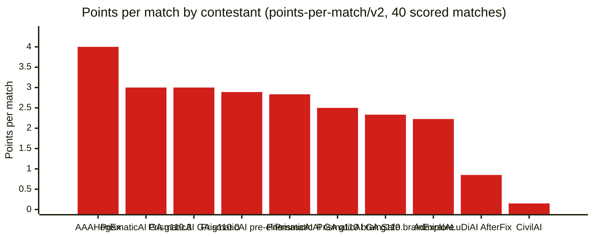
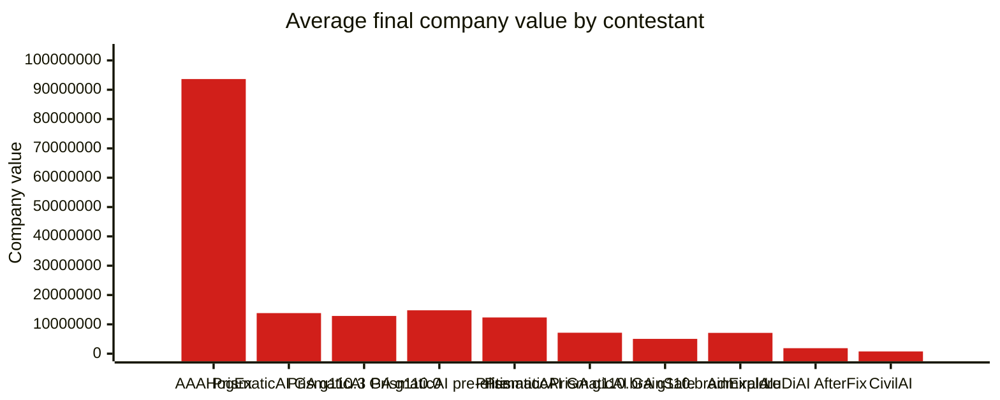
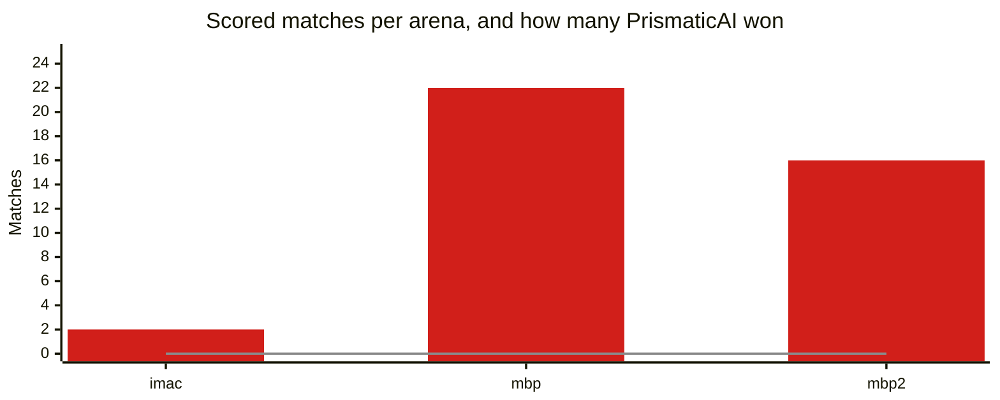

# battle-20261120T065527-551ec0cb

Derived from `battle-20261120T065527-551ec0cb.json` by `tools/research/ai-battle/battle.py report`; do not edit.

- Edition `551ec0cb3f2e5caa`: PrismaticAI and referee at `cbd774f94108d495482a04435618a1effe17f9fc`, base set `opengfx-8.0.tar`
- 20-year free-for-all from 1960, map 256x256 temperate, breakdowns 1
- 40 scored match(es) on `imac` (20261119-master-gdf1e05e7d8), `mbp` (20261120-master-m7a925f73d1), `mbp2` (20261119-master-gdf1e05e7d8)
- Replays: 1 of 1 identical to their original on another arena

| # | Contestant | Played | Wins | Points | Points/match | Avg rank | Avg final value | Squirrel errors | Matches with anomalies |
|---|---|---|---|---|---|---|---|---|---|
| 1 | AAAHogEx | 40 | 40 | 160 | 4.0 | 1.0 | 93.6 M | 0 | 0 |
| 2 | PrismaticAI GA g110.3 | 6 | 0 | 18 | 3.0 | 2.0 | 13.8 M | 0 | 0 |
| 3 | PrismaticAI GA g110.0 | 7 | 0 | 21 | 3.0 | 2.0 | 12.9 M | 0 | 3 |
| 4 | PrismaticAI pre-elite | 9 | 0 | 26 | 2.889 | 2.11 | 14.8 M | 0 | 0 |
| 5 | PrismaticAI | 6 | 0 | 17 | 2.833 | 2.17 | 12.3 M | 0 | 1 |
| 6 | PrismaticAI GA g110.brainSafe | 6 | 0 | 15 | 2.5 | 2.5 | 7.1 M | 0 | 0 |
| 7 | PrismaticAI GA g110.brainExplore | 6 | 0 | 14 | 2.333 | 2.67 | 5.0 M | 0 | 0 |
| 8 | AdmiralAI | 40 | 0 | 89 | 2.225 | 2.77 | 7.1 M | 0 | 3 |
| 9 | LuDiAI AfterFix | 40 | 0 | 34 | 0.85 | 4.15 | 1.9 M | 0 | 1 |
| 10 | CivilAI | 40 | 0 | 6 | 0.15 | 4.85 | 762.1 k | 0 | 7 |

```mermaid
---
config:
  xyChart:
    width: 900
    height: 360
  themeVariables:
    xyChart:
      plotColorPalette: "#d11f1a, #8a8a8a, #0b0b0b, #ece4d6"
---
xychart-beta
    title "Final company value per scored match: winner vs best PrismaticAI"
    x-axis ["m-0001", "m-0002", "m-0003", "m-0004", "m-0005", "m-0006", "m-0007", "m-0008", "m-0009", "m-0010", "m-0011", "m-0013", "m-0014", "m-0015", "m-0016", "m-0017", "m-0018", "m-0019", "m-0020", "m-0021", "m-0022", "m-0023", "m-0024", "m-0025", "m-0026", "m-0027", "m-0028", "m-0036", "m-0037", "m-0038", "m-0039", "m-0040", "m-0041", "m-0042", "m-0043", "m-0044", "m-0049", "m-0053", "m-0054", "m-0055"]
    %% series: Winner | Best PrismaticAI
    %% links: battle-20261120T065527-551ec0cb.md?col=Match&filter=m-0001 | battle-20261120T065527-551ec0cb.md?col=Match&filter=m-0002 | battle-20261120T065527-551ec0cb.md?col=Match&filter=m-0003 | battle-20261120T065527-551ec0cb.md?col=Match&filter=m-0004 | battle-20261120T065527-551ec0cb.md?col=Match&filter=m-0005 | battle-20261120T065527-551ec0cb.md?col=Match&filter=m-0006 | battle-20261120T065527-551ec0cb.md?col=Match&filter=m-0007 | battle-20261120T065527-551ec0cb.md?col=Match&filter=m-0008 | battle-20261120T065527-551ec0cb.md?col=Match&filter=m-0009 | battle-20261120T065527-551ec0cb.md?col=Match&filter=m-0010 | battle-20261120T065527-551ec0cb.md?col=Match&filter=m-0011 | battle-20261120T065527-551ec0cb.md?col=Match&filter=m-0013 | battle-20261120T065527-551ec0cb.md?col=Match&filter=m-0014 | battle-20261120T065527-551ec0cb.md?col=Match&filter=m-0015 | battle-20261120T065527-551ec0cb.md?col=Match&filter=m-0016 | battle-20261120T065527-551ec0cb.md?col=Match&filter=m-0017 | battle-20261120T065527-551ec0cb.md?col=Match&filter=m-0018 | battle-20261120T065527-551ec0cb.md?col=Match&filter=m-0019 | battle-20261120T065527-551ec0cb.md?col=Match&filter=m-0020 | battle-20261120T065527-551ec0cb.md?col=Match&filter=m-0021 | battle-20261120T065527-551ec0cb.md?col=Match&filter=m-0022 | battle-20261120T065527-551ec0cb.md?col=Match&filter=m-0023 | battle-20261120T065527-551ec0cb.md?col=Match&filter=m-0024 | battle-20261120T065527-551ec0cb.md?col=Match&filter=m-0025 | battle-20261120T065527-551ec0cb.md?col=Match&filter=m-0026 | battle-20261120T065527-551ec0cb.md?col=Match&filter=m-0027 | battle-20261120T065527-551ec0cb.md?col=Match&filter=m-0028 | battle-20261120T065527-551ec0cb.md?col=Match&filter=m-0036 | battle-20261120T065527-551ec0cb.md?col=Match&filter=m-0037 | battle-20261120T065527-551ec0cb.md?col=Match&filter=m-0038 | battle-20261120T065527-551ec0cb.md?col=Match&filter=m-0039 | battle-20261120T065527-551ec0cb.md?col=Match&filter=m-0040 | battle-20261120T065527-551ec0cb.md?col=Match&filter=m-0041 | battle-20261120T065527-551ec0cb.md?col=Match&filter=m-0042 | battle-20261120T065527-551ec0cb.md?col=Match&filter=m-0043 | battle-20261120T065527-551ec0cb.md?col=Match&filter=m-0044 | battle-20261120T065527-551ec0cb.md?col=Match&filter=m-0049 | battle-20261120T065527-551ec0cb.md?col=Match&filter=m-0053 | battle-20261120T065527-551ec0cb.md?col=Match&filter=m-0054 | battle-20261120T065527-551ec0cb.md?col=Match&filter=m-0055
    y-axis "Company value" 0 --> 164000000
    bar [83819269, 90290110, 65384106, 109805931, 84974815, 62469123, 66027573, 54378316, 68215960, 75013213, 77227982, 136177916, 148747753, 117989604, 103737780, 133956440, 99240822, 78082834, 94753941, 98149299, 105061717, 98933593, 78537245, 82459753, 81929661, 95973635, 96816556, 103119234, 91001363, 72451903, 82951017, 98491467, 85250099, 102616563, 95239608, 110672050, 61617425, 83728335, 126588065, 143881877]
    line [16689596, 18029640, 11662024, 3899196, 13062610, 12939303, 10923375, 9909825, 3080184, 3475530, 7530832, 18716722, 12920528, 11038812, 9270641, 14953242, 16925871, 18333216, 15105178, 7794378, 4059399, 22031250, 9113126, 8378435, 11693182, 2699983, 6277785, 10258154, 15016994, 12263859, 6567418, 3284581, 10298424, 20602607, 18972106, 10095270, 18176909, 15121350, 4224727, 7901144]
```

<!-- battle-charts:begin -->
<!-- derived from battle-20261120T065527-551ec0cb.json by `battle.py render`; `battle.py check` fails when it is stale -->

<!-- battle-charts:end -->

| Seed | Original | Replay | Arenas | Identical |
|---|---|---|---|---|
| 1225677982 | m-0013 | m-0048 | mbp2 / mbp | yes |

| Match | Arena | Seed | Winner | Value | Last | Anomalies |
|---|---|---|---|---|---|---|
| m-0001 | mbp | 531374414 | AAAHogEx | 83.8 M | LuDiAI AfterFix | CivilAI: fleet_drop:36->17 |
| m-0002 | mbp | 531374414 | AAAHogEx | 90.3 M | CivilAI | PrismaticAI GA g110.0: fleet_drop:83->50 |
| m-0003 | mbp | 531374414 | AAAHogEx | 65.4 M | CivilAI | - |
| m-0004 | mbp | 531374414 | AAAHogEx | 109.8 M | CivilAI | - |
| m-0005 | mbp | 531374414 | AAAHogEx | 85.0 M | CivilAI | AdmiralAI: fleet_drop:325->173 |
| m-0006 | mbp | 807092651 | AAAHogEx | 62.5 M | LuDiAI AfterFix | - |
| m-0007 | mbp | 807092651 | AAAHogEx | 66.0 M | CivilAI | CivilAI: fleet_drop:69->34 |
| m-0008 | mbp | 807092651 | AAAHogEx | 54.4 M | CivilAI | - |
| m-0009 | mbp | 807092651 | AAAHogEx | 68.2 M | LuDiAI AfterFix | - |
| m-0010 | imac | 807092651 | AAAHogEx | 75.0 M | CivilAI | - |
| m-0011 | imac | 807092651 | AAAHogEx | 77.2 M | CivilAI | - |
| m-0013 | mbp2 | 1225677982 | AAAHogEx | 136.2 M | CivilAI | - |
| m-0014 | mbp2 | 1225677982 | AAAHogEx | 148.7 M | CivilAI | PrismaticAI GA g110.0: fleet_drop:108->52 |
| m-0015 | mbp2 | 1225677982 | AAAHogEx | 118.0 M | CivilAI | - |
| m-0016 | mbp2 | 1225677982 | AAAHogEx | 103.7 M | CivilAI | - |
| m-0017 | mbp2 | 1225677982 | AAAHogEx | 134.0 M | CivilAI | - |
| m-0018 | mbp2 | 260007965 | AAAHogEx | 99.2 M | LuDiAI AfterFix | - |
| m-0019 | mbp2 | 260007965 | AAAHogEx | 78.1 M | CivilAI | AdmiralAI: fleet_drop:244->164; CivilAI: fleet_drop:49->32 |
| m-0020 | mbp2 | 260007965 | AAAHogEx | 94.8 M | CivilAI | - |
| m-0021 | mbp2 | 260007965 | AAAHogEx | 98.1 M | CivilAI | - |
| m-0022 | mbp2 | 260007965 | AAAHogEx | 105.1 M | CivilAI | - |
| m-0023 | mbp2 | 260007965 | AAAHogEx | 98.9 M | CivilAI | CivilAI: fleet_drop:46->22 |
| m-0024 | mbp2 | 138431777 | AAAHogEx | 78.5 M | CivilAI | - |
| m-0025 | mbp2 | 138431777 | AAAHogEx | 82.5 M | CivilAI | CivilAI: fleet_drop:40->17 |
| m-0026 | mbp2 | 138431777 | AAAHogEx | 81.9 M | CivilAI | - |
| m-0027 | mbp2 | 138431777 | AAAHogEx | 96.0 M | CivilAI | - |
| m-0028 | mbp2 | 138431777 | AAAHogEx | 96.8 M | LuDiAI AfterFix | LuDiAI AfterFix: fleet_drop:79->50 |
| m-0036 | mbp | 1028575011 | AAAHogEx | 103.1 M | CivilAI | - |
| m-0037 | mbp | 1028575011 | AAAHogEx | 91.0 M | CivilAI | - |
| m-0038 | mbp | 1028575011 | AAAHogEx | 72.5 M | CivilAI | CivilAI: fleet_drop:14->9 |
| m-0039 | mbp | 1028575011 | AAAHogEx | 83.0 M | CivilAI | - |
| m-0040 | mbp | 1028575011 | AAAHogEx | 98.5 M | CivilAI | - |
| m-0041 | mbp | 1028575011 | AAAHogEx | 85.3 M | CivilAI | - |
| m-0042 | mbp | 537270778 | AAAHogEx | 102.6 M | CivilAI | - |
| m-0043 | mbp | 537270778 | AAAHogEx | 95.2 M | CivilAI | - |
| m-0044 | mbp | 537270778 | AAAHogEx | 110.7 M | CivilAI | PrismaticAI GA g110.0: fleet_drop:106->71; AdmiralAI: fleet_drop:118->78 |
| m-0048 (replay) | mbp | 1225677982 | AAAHogEx | 136.2 M | CivilAI | - |
| m-0049 | mbp | 448753192 | AAAHogEx | 61.6 M | CivilAI | CivilAI: fleet_drop:88->61 |
| m-0053 | mbp | 448753192 | AAAHogEx | 83.7 M | CivilAI | - |
| m-0054 | mbp | 1086099842 | AAAHogEx | 126.6 M | CivilAI | PrismaticAI: fleet_drop:82->49 |
| m-0055 | mbp | 1086099842 | AAAHogEx | 143.9 M | LuDiAI AfterFix | - |
