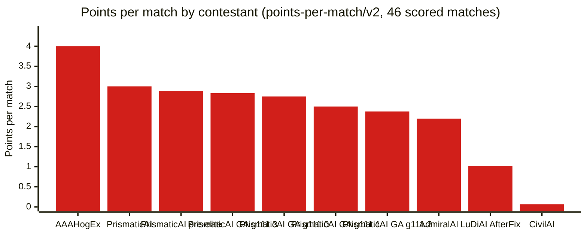
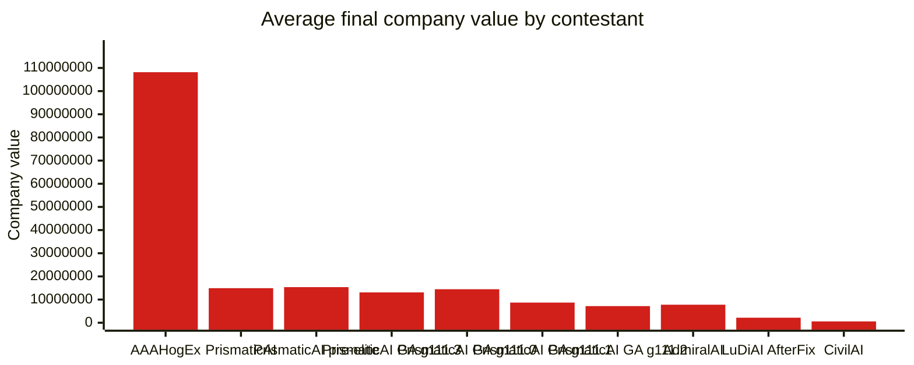
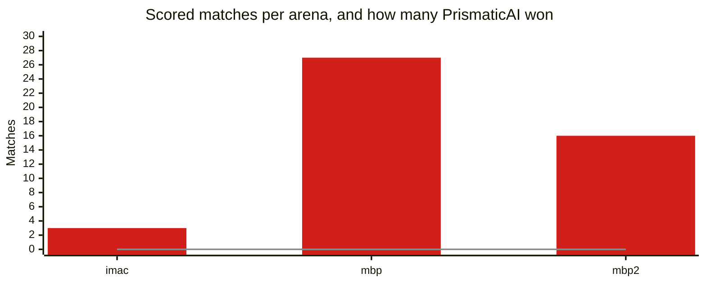

# battle-20261120T072124-6590a606

Derived from `battle-20261120T072124-6590a606.json` by `tools/research/ai-battle/battle.py report`; do not edit.

- Edition `6590a606976d3ed1`: PrismaticAI and referee at `2cab9e0314edf484880fedf08e9fc11d63d5357c`, base set `opengfx-8.0.tar`
- 20-year free-for-all from 1960, map 256x256 temperate, breakdowns 1
- 46 scored match(es) on `imac` (20261119-master-gdf1e05e7d8), `mbp` (20261120-master-m17653b726e), `mbp2` (20261119-master-gdf1e05e7d8)
- Replays: 0 of 0 identical to their original on another arena

| # | Contestant | Played | Wins | Points | Points/match | Avg rank | Avg final value | Squirrel errors | Matches with anomalies |
|---|---|---|---|---|---|---|---|---|---|
| 1 | AAAHogEx | 46 | 46 | 184 | 4.0 | 1.0 | 108.2 M | 0 | 0 |
| 2 | PrismaticAI | 7 | 0 | 21 | 3.0 | 2.0 | 14.9 M | 0 | 2 |
| 3 | PrismaticAI pre-elite | 9 | 0 | 26 | 2.889 | 2.11 | 15.4 M | 0 | 1 |
| 4 | PrismaticAI GA g111.3 | 6 | 0 | 17 | 2.833 | 2.17 | 13.1 M | 0 | 1 |
| 5 | PrismaticAI GA g111.0 | 8 | 0 | 22 | 2.75 | 2.25 | 14.5 M | 0 | 1 |
| 6 | PrismaticAI GA g111.1 | 8 | 0 | 20 | 2.5 | 2.5 | 8.7 M | 0 | 1 |
| 7 | PrismaticAI GA g111.2 | 8 | 0 | 19 | 2.375 | 2.62 | 7.2 M | 0 | 1 |
| 8 | AdmiralAI | 46 | 0 | 101 | 2.196 | 2.8 | 7.8 M | 72 | 6 |
| 9 | LuDiAI AfterFix | 46 | 0 | 47 | 1.022 | 3.98 | 2.2 M | 0 | 1 |
| 10 | CivilAI | 46 | 0 | 3 | 0.065 | 4.93 | 548.9 k | 33 | 9 |

```mermaid
---
config:
  xyChart:
    width: 900
    height: 360
  themeVariables:
    xyChart:
      plotColorPalette: "#d11f1a, #8a8a8a, #0b0b0b, #ece4d6"
---
xychart-beta
    title "Final company value per scored match: winner vs best PrismaticAI"
    x-axis ["m-0001", "m-0002", "m-0003", "m-0004", "m-0005", "m-0006", "m-0007", "m-0008", "m-0009", "m-0010", "m-0011", "m-0012", "m-0013", "m-0014", "m-0015", "m-0016", "m-0017", "m-0018", "m-0019", "m-0020", "m-0021", "m-0022", "m-0023", "m-0024", "m-0025", "m-0026", "m-0027", "m-0028", "m-0036", "m-0037", "m-0038", "m-0039", "m-0040", "m-0041", "m-0042", "m-0043", "m-0044", "m-0045", "m-0046", "m-0049", "m-0050", "m-0051", "m-0052", "m-0053", "m-0054", "m-0055"]
    %% series: Winner | Best PrismaticAI
    %% links: battle-20261120T072124-6590a606.md?col=Match&filter=m-0001 | battle-20261120T072124-6590a606.md?col=Match&filter=m-0002 | battle-20261120T072124-6590a606.md?col=Match&filter=m-0003 | battle-20261120T072124-6590a606.md?col=Match&filter=m-0004 | battle-20261120T072124-6590a606.md?col=Match&filter=m-0005 | battle-20261120T072124-6590a606.md?col=Match&filter=m-0006 | battle-20261120T072124-6590a606.md?col=Match&filter=m-0007 | battle-20261120T072124-6590a606.md?col=Match&filter=m-0008 | battle-20261120T072124-6590a606.md?col=Match&filter=m-0009 | battle-20261120T072124-6590a606.md?col=Match&filter=m-0010 | battle-20261120T072124-6590a606.md?col=Match&filter=m-0011 | battle-20261120T072124-6590a606.md?col=Match&filter=m-0012 | battle-20261120T072124-6590a606.md?col=Match&filter=m-0013 | battle-20261120T072124-6590a606.md?col=Match&filter=m-0014 | battle-20261120T072124-6590a606.md?col=Match&filter=m-0015 | battle-20261120T072124-6590a606.md?col=Match&filter=m-0016 | battle-20261120T072124-6590a606.md?col=Match&filter=m-0017 | battle-20261120T072124-6590a606.md?col=Match&filter=m-0018 | battle-20261120T072124-6590a606.md?col=Match&filter=m-0019 | battle-20261120T072124-6590a606.md?col=Match&filter=m-0020 | battle-20261120T072124-6590a606.md?col=Match&filter=m-0021 | battle-20261120T072124-6590a606.md?col=Match&filter=m-0022 | battle-20261120T072124-6590a606.md?col=Match&filter=m-0023 | battle-20261120T072124-6590a606.md?col=Match&filter=m-0024 | battle-20261120T072124-6590a606.md?col=Match&filter=m-0025 | battle-20261120T072124-6590a606.md?col=Match&filter=m-0026 | battle-20261120T072124-6590a606.md?col=Match&filter=m-0027 | battle-20261120T072124-6590a606.md?col=Match&filter=m-0028 | battle-20261120T072124-6590a606.md?col=Match&filter=m-0036 | battle-20261120T072124-6590a606.md?col=Match&filter=m-0037 | battle-20261120T072124-6590a606.md?col=Match&filter=m-0038 | battle-20261120T072124-6590a606.md?col=Match&filter=m-0039 | battle-20261120T072124-6590a606.md?col=Match&filter=m-0040 | battle-20261120T072124-6590a606.md?col=Match&filter=m-0041 | battle-20261120T072124-6590a606.md?col=Match&filter=m-0042 | battle-20261120T072124-6590a606.md?col=Match&filter=m-0043 | battle-20261120T072124-6590a606.md?col=Match&filter=m-0044 | battle-20261120T072124-6590a606.md?col=Match&filter=m-0045 | battle-20261120T072124-6590a606.md?col=Match&filter=m-0046 | battle-20261120T072124-6590a606.md?col=Match&filter=m-0049 | battle-20261120T072124-6590a606.md?col=Match&filter=m-0050 | battle-20261120T072124-6590a606.md?col=Match&filter=m-0051 | battle-20261120T072124-6590a606.md?col=Match&filter=m-0052 | battle-20261120T072124-6590a606.md?col=Match&filter=m-0053 | battle-20261120T072124-6590a606.md?col=Match&filter=m-0054 | battle-20261120T072124-6590a606.md?col=Match&filter=m-0055
    y-axis "Company value" 0 --> 171000000
    bar [95747101, 105150945, 86918345, 102309694, 94718488, 99442296, 133747400, 114777288, 128474642, 111179641, 107185468, 122556360, 139724584, 122814747, 84318720, 91222613, 110367685, 111544857, 113627563, 134394524, 120465870, 120323889, 97089710, 106629498, 103281290, 96020520, 107724677, 90994727, 97108279, 109993402, 74596502, 101121968, 106521879, 104042552, 100876312, 128272186, 108029739, 120896477, 132334922, 135138385, 155647763, 105771761, 87583586, 103396117, 66271066, 85450674]
    line [19011209, 15672727, 4721855, 5604977, 15306868, 15063733, 20158882, 17831905, 12071534, 4691423, 17569928, 7617628, 7507111, 8983227, 6232207, 7809971, 10474358, 18228108, 10631559, 18039250, 7424380, 5161371, 11834729, 14649080, 13443809, 13982813, 8357565, 4692794, 9929951, 13401995, 7728925, 10749395, 7623467, 9549789, 21502976, 17852460, 18713267, 7925461, 12472120, 16163993, 14712044, 12058194, 9294032, 13780148, 17400020, 20109165]
```

<!-- battle-charts:begin -->
<!-- derived from battle-20261120T072124-6590a606.json by `battle.py render`; `battle.py check` fails when it is stale -->

<!-- battle-charts:end -->

| Match | Arena | Seed | Winner | Value | Last | Anomalies |
|---|---|---|---|---|---|---|
| m-0001 | mbp | 1356449461 | AAAHogEx | 95.7 M | CivilAI | - |
| m-0002 | mbp | 1356449461 | AAAHogEx | 105.2 M | CivilAI | - |
| m-0003 | mbp | 1356449461 | AAAHogEx | 86.9 M | CivilAI | - |
| m-0004 | mbp | 1356449461 | AAAHogEx | 102.3 M | CivilAI | - |
| m-0005 | mbp | 1356449461 | AAAHogEx | 94.7 M | CivilAI | AdmiralAI: squirrel_errors:72 |
| m-0006 | mbp | 1005331537 | AAAHogEx | 99.4 M | CivilAI | - |
| m-0007 | mbp | 1005331537 | AAAHogEx | 133.7 M | CivilAI | - |
| m-0008 | mbp | 1005331537 | AAAHogEx | 114.8 M | CivilAI | - |
| m-0009 | mbp | 1005331537 | AAAHogEx | 128.5 M | CivilAI | - |
| m-0010 | imac | 1005331537 | AAAHogEx | 111.2 M | CivilAI | - |
| m-0011 | imac | 1005331537 | AAAHogEx | 107.2 M | CivilAI | CivilAI: fleet_drop:22->15 |
| m-0012 | imac | 1797219643 | AAAHogEx | 122.6 M | LuDiAI AfterFix | - |
| m-0013 | mbp2 | 1797219643 | AAAHogEx | 139.7 M | AdmiralAI | PrismaticAI pre-elite: fleet_drop:60->34; CivilAI: squirrel_errors:33, fleet_drop:74->25 |
| m-0014 | mbp2 | 1797219643 | AAAHogEx | 122.8 M | CivilAI | CivilAI: fleet_drop:37->18 |
| m-0015 | mbp2 | 1797219643 | AAAHogEx | 84.3 M | CivilAI | CivilAI: fleet_drop:67->42 |
| m-0016 | mbp2 | 1797219643 | AAAHogEx | 91.2 M | CivilAI | PrismaticAI GA g111.2: fleet_drop:51->34 |
| m-0017 | mbp2 | 1797219643 | AAAHogEx | 110.4 M | CivilAI | LuDiAI AfterFix: fleet_drop:121->72; CivilAI: fleet_drop:47->14 |
| m-0018 | mbp2 | 1004784300 | AAAHogEx | 111.5 M | CivilAI | - |
| m-0019 | mbp2 | 1004784300 | AAAHogEx | 113.6 M | CivilAI | - |
| m-0020 | mbp2 | 1004784300 | AAAHogEx | 134.4 M | CivilAI | - |
| m-0021 | mbp2 | 1004784300 | AAAHogEx | 120.5 M | CivilAI | - |
| m-0022 | mbp2 | 1004784300 | AAAHogEx | 120.3 M | CivilAI | AdmiralAI: fleet_drop:221->146 |
| m-0023 | mbp2 | 1004784300 | AAAHogEx | 97.1 M | CivilAI | - |
| m-0024 | mbp2 | 1098517872 | AAAHogEx | 106.6 M | CivilAI | PrismaticAI: fleet_drop:106->71 |
| m-0025 | mbp2 | 1098517872 | AAAHogEx | 103.3 M | CivilAI | - |
| m-0026 | mbp2 | 1098517872 | AAAHogEx | 96.0 M | CivilAI | PrismaticAI GA g111.0: fleet_drop:78->48 |
| m-0027 | mbp2 | 1098517872 | AAAHogEx | 107.7 M | CivilAI | - |
| m-0028 | mbp2 | 1098517872 | AAAHogEx | 91.0 M | CivilAI | - |
| m-0036 | mbp | 1045656372 | AAAHogEx | 97.1 M | CivilAI | PrismaticAI: fleet_drop:104->37; AdmiralAI: fleet_drop:383->266 |
| m-0037 | mbp | 1045656372 | AAAHogEx | 110.0 M | CivilAI | - |
| m-0038 | mbp | 1045656372 | AAAHogEx | 74.6 M | CivilAI | AdmiralAI: fleet_drop:406->239 |
| m-0039 | mbp | 1045656372 | AAAHogEx | 101.1 M | CivilAI | - |
| m-0040 | mbp | 1045656372 | AAAHogEx | 106.5 M | CivilAI | CivilAI: fleet_drop:56->29 |
| m-0041 | mbp | 1045656372 | AAAHogEx | 104.0 M | LuDiAI AfterFix | - |
| m-0042 | mbp | 1335961386 | AAAHogEx | 100.9 M | CivilAI | - |
| m-0043 | mbp | 1335961386 | AAAHogEx | 128.3 M | CivilAI | - |
| m-0044 | mbp | 1335961386 | AAAHogEx | 108.0 M | CivilAI | - |
| m-0045 | mbp | 1335961386 | AAAHogEx | 120.9 M | CivilAI | PrismaticAI GA g111.1: fleet_drop:126->88; CivilAI: fleet_drop:12->8 |
| m-0046 | mbp | 1335961386 | AAAHogEx | 132.3 M | CivilAI | CivilAI: fleet_drop:35->20 |
| m-0049 | mbp | 1102843975 | AAAHogEx | 135.1 M | CivilAI | - |
| m-0050 | mbp | 1102843975 | AAAHogEx | 155.6 M | CivilAI | - |
| m-0051 | mbp | 1102843975 | AAAHogEx | 105.8 M | CivilAI | - |
| m-0052 | mbp | 1102843975 | AAAHogEx | 87.6 M | CivilAI | AdmiralAI: fleet_drop:321->183 |
| m-0053 | mbp | 1102843975 | AAAHogEx | 103.4 M | CivilAI | PrismaticAI GA g111.3: fleet_drop:94->64; CivilAI: fleet_drop:138->74 |
| m-0054 | mbp | 858583697 | AAAHogEx | 66.3 M | CivilAI | - |
| m-0055 | mbp | 858583697 | AAAHogEx | 85.5 M | CivilAI | AdmiralAI: fleet_drop:411->279 |
