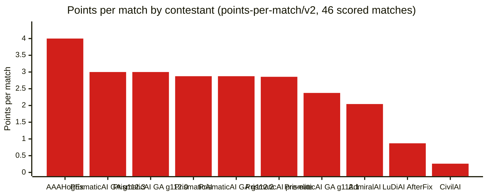
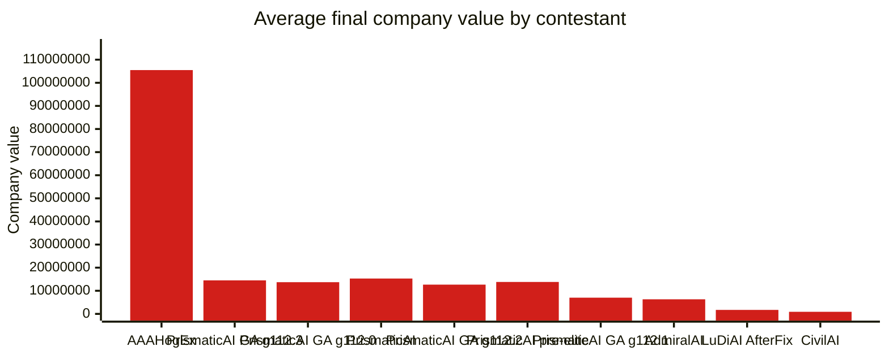
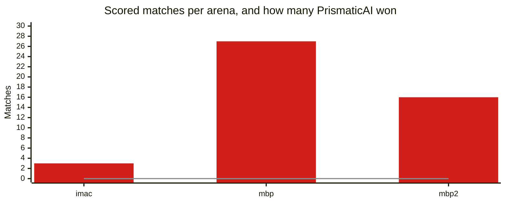

# battle-20261120T073115-8339a757

Derived from `battle-20261120T073115-8339a757.json` by `tools/research/ai-battle/battle.py report`; do not edit.

- Edition `8339a757fb3274bd`: PrismaticAI and referee at `2cab9e0314edf484880fedf08e9fc11d63d5357c`, base set `opengfx-8.0.tar`
- 20-year free-for-all from 1960, map 256x256 temperate, breakdowns 1
- 46 scored match(es) on `imac` (20261119-master-gdf1e05e7d8), `mbp` (20261120-master-m17653b726e), `mbp2` (20261119-master-gdf1e05e7d8)
- Replays: 0 of 0 identical to their original on another arena

| # | Contestant | Played | Wins | Points | Points/match | Avg rank | Avg final value | Squirrel errors | Matches with anomalies |
|---|---|---|---|---|---|---|---|---|---|
| 1 | AAAHogEx | 46 | 46 | 184 | 4.0 | 1.0 | 105.5 M | 0 | 0 |
| 2 | PrismaticAI GA g112.3 | 7 | 0 | 21 | 3.0 | 2.0 | 14.5 M | 0 | 0 |
| 3 | PrismaticAI GA g112.0 | 8 | 0 | 24 | 3.0 | 2.0 | 13.7 M | 0 | 3 |
| 4 | PrismaticAI | 8 | 0 | 23 | 2.875 | 2.12 | 15.3 M | 0 | 4 |
| 5 | PrismaticAI GA g112.2 | 8 | 0 | 23 | 2.875 | 2.12 | 12.7 M | 0 | 2 |
| 6 | PrismaticAI pre-elite | 7 | 0 | 20 | 2.857 | 2.14 | 13.8 M | 0 | 0 |
| 7 | PrismaticAI GA g112.1 | 8 | 0 | 19 | 2.375 | 2.62 | 7.0 M | 0 | 0 |
| 8 | AdmiralAI | 46 | 0 | 94 | 2.043 | 2.96 | 6.3 M | 0 | 1 |
| 9 | LuDiAI AfterFix | 46 | 0 | 40 | 0.87 | 4.13 | 1.7 M | 0 | 3 |
| 10 | CivilAI | 46 | 0 | 12 | 0.261 | 4.74 | 896.8 k | 0 | 9 |

```mermaid
---
config:
  xyChart:
    width: 900
    height: 360
  themeVariables:
    xyChart:
      plotColorPalette: "#d11f1a, #8a8a8a, #0b0b0b, #ece4d6"
---
xychart-beta
    title "Final company value per scored match: winner vs best PrismaticAI"
    x-axis ["m-0001", "m-0002", "m-0003", "m-0004", "m-0005", "m-0006", "m-0007", "m-0008", "m-0009", "m-0010", "m-0011", "m-0012", "m-0013", "m-0014", "m-0015", "m-0016", "m-0017", "m-0018", "m-0019", "m-0020", "m-0021", "m-0022", "m-0023", "m-0024", "m-0025", "m-0026", "m-0027", "m-0028", "m-0036", "m-0037", "m-0038", "m-0039", "m-0040", "m-0041", "m-0042", "m-0043", "m-0044", "m-0045", "m-0046", "m-0050", "m-0051", "m-0052", "m-0053", "m-0054", "m-0065", "m-0066"]
    %% series: Winner | Best PrismaticAI
    %% links: battle-20261120T073115-8339a757.md?col=Match&filter=m-0001 | battle-20261120T073115-8339a757.md?col=Match&filter=m-0002 | battle-20261120T073115-8339a757.md?col=Match&filter=m-0003 | battle-20261120T073115-8339a757.md?col=Match&filter=m-0004 | battle-20261120T073115-8339a757.md?col=Match&filter=m-0005 | battle-20261120T073115-8339a757.md?col=Match&filter=m-0006 | battle-20261120T073115-8339a757.md?col=Match&filter=m-0007 | battle-20261120T073115-8339a757.md?col=Match&filter=m-0008 | battle-20261120T073115-8339a757.md?col=Match&filter=m-0009 | battle-20261120T073115-8339a757.md?col=Match&filter=m-0010 | battle-20261120T073115-8339a757.md?col=Match&filter=m-0011 | battle-20261120T073115-8339a757.md?col=Match&filter=m-0012 | battle-20261120T073115-8339a757.md?col=Match&filter=m-0013 | battle-20261120T073115-8339a757.md?col=Match&filter=m-0014 | battle-20261120T073115-8339a757.md?col=Match&filter=m-0015 | battle-20261120T073115-8339a757.md?col=Match&filter=m-0016 | battle-20261120T073115-8339a757.md?col=Match&filter=m-0017 | battle-20261120T073115-8339a757.md?col=Match&filter=m-0018 | battle-20261120T073115-8339a757.md?col=Match&filter=m-0019 | battle-20261120T073115-8339a757.md?col=Match&filter=m-0020 | battle-20261120T073115-8339a757.md?col=Match&filter=m-0021 | battle-20261120T073115-8339a757.md?col=Match&filter=m-0022 | battle-20261120T073115-8339a757.md?col=Match&filter=m-0023 | battle-20261120T073115-8339a757.md?col=Match&filter=m-0024 | battle-20261120T073115-8339a757.md?col=Match&filter=m-0025 | battle-20261120T073115-8339a757.md?col=Match&filter=m-0026 | battle-20261120T073115-8339a757.md?col=Match&filter=m-0027 | battle-20261120T073115-8339a757.md?col=Match&filter=m-0028 | battle-20261120T073115-8339a757.md?col=Match&filter=m-0036 | battle-20261120T073115-8339a757.md?col=Match&filter=m-0037 | battle-20261120T073115-8339a757.md?col=Match&filter=m-0038 | battle-20261120T073115-8339a757.md?col=Match&filter=m-0039 | battle-20261120T073115-8339a757.md?col=Match&filter=m-0040 | battle-20261120T073115-8339a757.md?col=Match&filter=m-0041 | battle-20261120T073115-8339a757.md?col=Match&filter=m-0042 | battle-20261120T073115-8339a757.md?col=Match&filter=m-0043 | battle-20261120T073115-8339a757.md?col=Match&filter=m-0044 | battle-20261120T073115-8339a757.md?col=Match&filter=m-0045 | battle-20261120T073115-8339a757.md?col=Match&filter=m-0046 | battle-20261120T073115-8339a757.md?col=Match&filter=m-0050 | battle-20261120T073115-8339a757.md?col=Match&filter=m-0051 | battle-20261120T073115-8339a757.md?col=Match&filter=m-0052 | battle-20261120T073115-8339a757.md?col=Match&filter=m-0053 | battle-20261120T073115-8339a757.md?col=Match&filter=m-0054 | battle-20261120T073115-8339a757.md?col=Match&filter=m-0065 | battle-20261120T073115-8339a757.md?col=Match&filter=m-0066
    y-axis "Company value" 0 --> 170000000
    bar [65247124, 65763126, 72371639, 59276300, 70608212, 114858621, 82959877, 93413605, 94256419, 98676755, 97329285, 143339683, 123597168, 135056464, 112512796, 126309602, 127229444, 118777360, 105040305, 103020076, 91427214, 101177251, 124247328, 83934142, 121313543, 113105101, 89239701, 94434798, 131925023, 102946686, 113433722, 115713182, 110750416, 128286001, 78241961, 110125990, 92268145, 89342599, 88467871, 154618752, 137604491, 115587528, 154956457, 92155076, 122657462, 85358682]
    line [15014083, 8413719, 8141563, 11458076, 8906997, 8030581, 13716078, 9942045, 4589500, 3116135, 9675090, 16603526, 9655347, 15876651, 8147652, 11562423, 10100000, 23899075, 17697029, 20959827, 8370857, 22640264, 21046949, 17374687, 7611859, 10750276, 5199928, 10941973, 18750133, 21953409, 22098820, 9649865, 20866935, 16091700, 11193139, 11039891, 9084710, 3151954, 9306965, 12597439, 8832683, 11346893, 15992142, 14716085, 19644644, 11799832]
```

<!-- battle-charts:begin -->
<!-- derived from battle-20261120T073115-8339a757.json by `battle.py render`; `battle.py check` fails when it is stale -->

<!-- battle-charts:end -->

| Match | Arena | Seed | Winner | Value | Last | Anomalies |
|---|---|---|---|---|---|---|
| m-0001 | mbp | 920542217 | AAAHogEx | 65.2 M | AdmiralAI | - |
| m-0002 | mbp | 920542217 | AAAHogEx | 65.8 M | CivilAI | CivilAI: fleet_drop:113->53 |
| m-0003 | mbp | 920542217 | AAAHogEx | 72.4 M | CivilAI | CivilAI: no_vehicles |
| m-0004 | mbp | 920542217 | AAAHogEx | 59.3 M | LuDiAI AfterFix | - |
| m-0005 | mbp | 920542217 | AAAHogEx | 70.6 M | AdmiralAI | - |
| m-0006 | mbp | 1750429498 | AAAHogEx | 114.9 M | CivilAI | PrismaticAI: fleet_drop:115->57 |
| m-0007 | mbp | 1750429498 | AAAHogEx | 83.0 M | CivilAI | - |
| m-0008 | mbp | 1750429498 | AAAHogEx | 93.4 M | CivilAI | PrismaticAI GA g112.0: fleet_drop:85->53 |
| m-0009 | mbp | 1750429498 | AAAHogEx | 94.3 M | CivilAI | - |
| m-0010 | imac | 1750429498 | AAAHogEx | 98.7 M | CivilAI | PrismaticAI GA g112.2: fleet_drop:68->34 |
| m-0011 | imac | 1750429498 | AAAHogEx | 97.3 M | CivilAI | CivilAI: fleet_drop:54->27 |
| m-0012 | imac | 769790861 | AAAHogEx | 143.3 M | AdmiralAI | - |
| m-0013 | mbp2 | 769790861 | AAAHogEx | 123.6 M | CivilAI | - |
| m-0014 | mbp2 | 769790861 | AAAHogEx | 135.1 M | LuDiAI AfterFix | CivilAI: fleet_drop:14->8; LuDiAI AfterFix: fleet_drop:35->21 |
| m-0015 | mbp2 | 769790861 | AAAHogEx | 112.5 M | CivilAI | - |
| m-0016 | mbp2 | 769790861 | AAAHogEx | 126.3 M | LuDiAI AfterFix | - |
| m-0017 | mbp2 | 769790861 | AAAHogEx | 127.2 M | CivilAI | LuDiAI AfterFix: fleet_drop:69->48; CivilAI: fleet_drop:73->33 |
| m-0018 | mbp2 | 558089024 | AAAHogEx | 118.8 M | CivilAI | PrismaticAI: fleet_drop:94->56; CivilAI: fleet_drop:18->6 |
| m-0019 | mbp2 | 558089024 | AAAHogEx | 105.0 M | CivilAI | - |
| m-0020 | mbp2 | 558089024 | AAAHogEx | 103.0 M | LuDiAI AfterFix | PrismaticAI GA g112.0: fleet_drop:78->53 |
| m-0021 | mbp2 | 558089024 | AAAHogEx | 91.4 M | CivilAI | CivilAI: fleet_drop:20->5 |
| m-0022 | mbp2 | 558089024 | AAAHogEx | 101.2 M | CivilAI | PrismaticAI GA g112.2: fleet_drop:72->49; CivilAI: fleet_drop:37->10 |
| m-0023 | mbp2 | 558089024 | AAAHogEx | 124.2 M | CivilAI | - |
| m-0024 | mbp2 | 1580729276 | AAAHogEx | 83.9 M | LuDiAI AfterFix | LuDiAI AfterFix: fleet_drop:27->14 |
| m-0025 | mbp2 | 1580729276 | AAAHogEx | 121.3 M | CivilAI | CivilAI: fleet_drop:22->13 |
| m-0026 | mbp2 | 1580729276 | AAAHogEx | 113.1 M | LuDiAI AfterFix | - |
| m-0027 | mbp2 | 1580729276 | AAAHogEx | 89.2 M | CivilAI | - |
| m-0028 | mbp2 | 1580729276 | AAAHogEx | 94.4 M | CivilAI | - |
| m-0036 | mbp | 1079288731 | AAAHogEx | 131.9 M | LuDiAI AfterFix | - |
| m-0037 | mbp | 1079288731 | AAAHogEx | 102.9 M | CivilAI | - |
| m-0038 | mbp | 1079288731 | AAAHogEx | 113.4 M | CivilAI | - |
| m-0039 | mbp | 1079288731 | AAAHogEx | 115.7 M | CivilAI | - |
| m-0040 | mbp | 1079288731 | AAAHogEx | 110.8 M | CivilAI | - |
| m-0041 | mbp | 1079288731 | AAAHogEx | 128.3 M | CivilAI | AdmiralAI: fleet_drop:306->213 |
| m-0042 | mbp | 1256409240 | AAAHogEx | 78.2 M | CivilAI | - |
| m-0043 | mbp | 1256409240 | AAAHogEx | 110.1 M | LuDiAI AfterFix | - |
| m-0044 | mbp | 1256409240 | AAAHogEx | 92.3 M | CivilAI | - |
| m-0045 | mbp | 1256409240 | AAAHogEx | 89.3 M | CivilAI | - |
| m-0046 | mbp | 1256409240 | AAAHogEx | 88.5 M | CivilAI | - |
| m-0050 | mbp | 945952745 | AAAHogEx | 154.6 M | CivilAI | PrismaticAI GA g112.0: fleet_drop:92->63 |
| m-0051 | mbp | 945952745 | AAAHogEx | 137.6 M | CivilAI | - |
| m-0052 | mbp | 945952745 | AAAHogEx | 115.6 M | CivilAI | - |
| m-0053 | mbp | 945952745 | AAAHogEx | 155.0 M | CivilAI | - |
| m-0054 | mbp | 1401672961 | AAAHogEx | 92.2 M | CivilAI | PrismaticAI: fleet_drop:52->34 |
| m-0065 | mbp | 768945790 | AAAHogEx | 122.7 M | LuDiAI AfterFix | - |
| m-0066 | mbp | 440157259 | AAAHogEx | 85.4 M | CivilAI | PrismaticAI: fleet_drop:75->36 |
