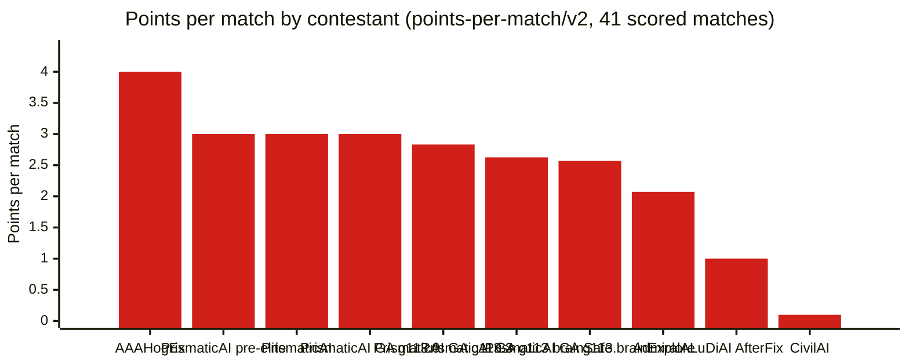
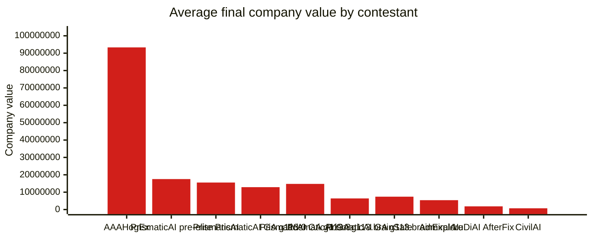
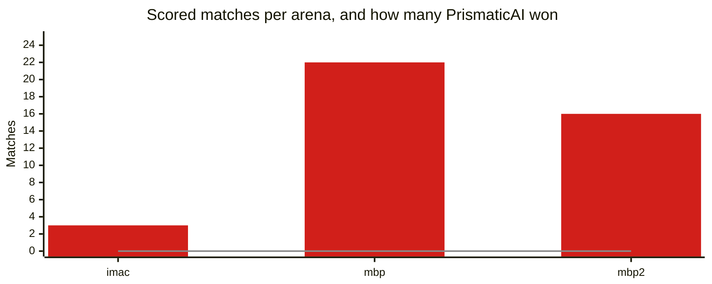

# battle-20261120T074038-a2646c19

Derived from `battle-20261120T074038-a2646c19.json` by `tools/research/ai-battle/battle.py report`; do not edit.

- Edition `a2646c1971d589fc`: PrismaticAI and referee at `2cab9e0314edf484880fedf08e9fc11d63d5357c`, base set `opengfx-8.0.tar`
- 20-year free-for-all from 1960, map 256x256 temperate, breakdowns 1
- 41 scored match(es) on `imac` (20261119-master-gdf1e05e7d8), `mbp` (20261120-master-m17653b726e), `mbp2` (20261119-master-gdf1e05e7d8)
- Replays: 1 of 1 identical to their original on another arena

| # | Contestant | Played | Wins | Points | Points/match | Avg rank | Avg final value | Squirrel errors | Matches with anomalies |
|---|---|---|---|---|---|---|---|---|---|
| 1 | AAAHogEx | 41 | 41 | 164 | 4.0 | 1.0 | 93.3 M | 0 | 0 |
| 2 | PrismaticAI pre-elite | 7 | 0 | 21 | 3.0 | 2.0 | 17.5 M | 0 | 0 |
| 3 | PrismaticAI | 6 | 0 | 18 | 3.0 | 2.0 | 15.5 M | 0 | 1 |
| 4 | PrismaticAI GA g113.0 | 7 | 0 | 21 | 3.0 | 2.0 | 12.9 M | 0 | 2 |
| 5 | PrismaticAI GA g113.3 | 6 | 0 | 17 | 2.833 | 2.17 | 14.8 M | 0 | 1 |
| 6 | PrismaticAI GA g113.brainSafe | 8 | 0 | 21 | 2.625 | 2.38 | 6.4 M | 0 | 1 |
| 7 | PrismaticAI GA g113.brainExplore | 7 | 0 | 18 | 2.571 | 2.43 | 7.4 M | 0 | 0 |
| 8 | AdmiralAI | 41 | 0 | 85 | 2.073 | 2.93 | 5.4 M | 0 | 3 |
| 9 | LuDiAI AfterFix | 41 | 0 | 41 | 1.0 | 4.0 | 1.8 M | 0 | 0 |
| 10 | CivilAI | 41 | 0 | 4 | 0.098 | 4.9 | 718.0 k | 0 | 10 |

```mermaid
---
config:
  xyChart:
    width: 900
    height: 360
  themeVariables:
    xyChart:
      plotColorPalette: "#d11f1a, #8a8a8a, #0b0b0b, #ece4d6"
---
xychart-beta
    title "Final company value per scored match: winner vs best PrismaticAI"
    x-axis ["m-0001", "m-0002", "m-0003", "m-0004", "m-0005", "m-0006", "m-0007", "m-0008", "m-0009", "m-0010", "m-0011", "m-0012", "m-0013", "m-0014", "m-0015", "m-0016", "m-0017", "m-0018", "m-0019", "m-0020", "m-0021", "m-0022", "m-0023", "m-0024", "m-0025", "m-0026", "m-0027", "m-0028", "m-0036", "m-0037", "m-0038", "m-0039", "m-0040", "m-0041", "m-0042", "m-0043", "m-0044", "m-0045", "m-0046", "m-0047", "m-0051"]
    %% series: Winner | Best PrismaticAI
    %% links: battle-20261120T074038-a2646c19.md?col=Match&filter=m-0001 | battle-20261120T074038-a2646c19.md?col=Match&filter=m-0002 | battle-20261120T074038-a2646c19.md?col=Match&filter=m-0003 | battle-20261120T074038-a2646c19.md?col=Match&filter=m-0004 | battle-20261120T074038-a2646c19.md?col=Match&filter=m-0005 | battle-20261120T074038-a2646c19.md?col=Match&filter=m-0006 | battle-20261120T074038-a2646c19.md?col=Match&filter=m-0007 | battle-20261120T074038-a2646c19.md?col=Match&filter=m-0008 | battle-20261120T074038-a2646c19.md?col=Match&filter=m-0009 | battle-20261120T074038-a2646c19.md?col=Match&filter=m-0010 | battle-20261120T074038-a2646c19.md?col=Match&filter=m-0011 | battle-20261120T074038-a2646c19.md?col=Match&filter=m-0012 | battle-20261120T074038-a2646c19.md?col=Match&filter=m-0013 | battle-20261120T074038-a2646c19.md?col=Match&filter=m-0014 | battle-20261120T074038-a2646c19.md?col=Match&filter=m-0015 | battle-20261120T074038-a2646c19.md?col=Match&filter=m-0016 | battle-20261120T074038-a2646c19.md?col=Match&filter=m-0017 | battle-20261120T074038-a2646c19.md?col=Match&filter=m-0018 | battle-20261120T074038-a2646c19.md?col=Match&filter=m-0019 | battle-20261120T074038-a2646c19.md?col=Match&filter=m-0020 | battle-20261120T074038-a2646c19.md?col=Match&filter=m-0021 | battle-20261120T074038-a2646c19.md?col=Match&filter=m-0022 | battle-20261120T074038-a2646c19.md?col=Match&filter=m-0023 | battle-20261120T074038-a2646c19.md?col=Match&filter=m-0024 | battle-20261120T074038-a2646c19.md?col=Match&filter=m-0025 | battle-20261120T074038-a2646c19.md?col=Match&filter=m-0026 | battle-20261120T074038-a2646c19.md?col=Match&filter=m-0027 | battle-20261120T074038-a2646c19.md?col=Match&filter=m-0028 | battle-20261120T074038-a2646c19.md?col=Match&filter=m-0036 | battle-20261120T074038-a2646c19.md?col=Match&filter=m-0037 | battle-20261120T074038-a2646c19.md?col=Match&filter=m-0038 | battle-20261120T074038-a2646c19.md?col=Match&filter=m-0039 | battle-20261120T074038-a2646c19.md?col=Match&filter=m-0040 | battle-20261120T074038-a2646c19.md?col=Match&filter=m-0041 | battle-20261120T074038-a2646c19.md?col=Match&filter=m-0042 | battle-20261120T074038-a2646c19.md?col=Match&filter=m-0043 | battle-20261120T074038-a2646c19.md?col=Match&filter=m-0044 | battle-20261120T074038-a2646c19.md?col=Match&filter=m-0045 | battle-20261120T074038-a2646c19.md?col=Match&filter=m-0046 | battle-20261120T074038-a2646c19.md?col=Match&filter=m-0047 | battle-20261120T074038-a2646c19.md?col=Match&filter=m-0051
    y-axis "Company value" 0 --> 156000000
    bar [90437945, 81644880, 78917960, 80066770, 82865570, 71787893, 81566256, 81243633, 86806545, 70544969, 93936096, 100251283, 108231134, 121717555, 112552544, 125533038, 91562873, 133957869, 101495105, 76631871, 96332419, 94284255, 105807434, 103514384, 111312338, 142241240, 101847554, 100520369, 76383195, 85497047, 94392527, 100466036, 108692073, 82780942, 87933428, 70888325, 90658890, 69479746, 82825383, 71195766, 77653884]
    line [18259351, 16220771, 3879172, 9371979, 18771349, 13165268, 16656688, 11769649, 8756991, 5253927, 17827987, 21370491, 15257383, 15580436, 5779605, 13604935, 10201414, 5993132, 11615846, 7426099, 8501444, 6152124, 15957118, 21937264, 24282063, 19950476, 8009106, 10081010, 16611547, 17976686, 9426414, 3338154, 1316648, 16384171, 14199334, 18722252, 9792865, 8547980, 6060256, 9423152, 4409694]
```

<!-- battle-charts:begin -->
<!-- derived from battle-20261120T074038-a2646c19.json by `battle.py render`; `battle.py check` fails when it is stale -->

<!-- battle-charts:end -->

| Seed | Original | Replay | Arenas | Identical |
|---|---|---|---|---|
| 831817174 | m-0020 | m-0048 | mbp2 / mbp | yes |

| Match | Arena | Seed | Winner | Value | Last | Anomalies |
|---|---|---|---|---|---|---|
| m-0001 | mbp | 713058917 | AAAHogEx | 90.4 M | CivilAI | AdmiralAI: fleet_drop:373->256 |
| m-0002 | mbp | 713058917 | AAAHogEx | 81.6 M | CivilAI | PrismaticAI GA g113.0: fleet_drop:146->102; CivilAI: fleet_drop:66->24 |
| m-0003 | mbp | 713058917 | AAAHogEx | 78.9 M | CivilAI | - |
| m-0004 | mbp | 713058917 | AAAHogEx | 80.1 M | CivilAI | - |
| m-0005 | mbp | 713058917 | AAAHogEx | 82.9 M | CivilAI | - |
| m-0006 | mbp | 1997456330 | AAAHogEx | 71.8 M | CivilAI | PrismaticAI: fleet_drop:91->63 |
| m-0007 | mbp | 1997456330 | AAAHogEx | 81.6 M | CivilAI | - |
| m-0008 | mbp | 1997456330 | AAAHogEx | 81.2 M | CivilAI | PrismaticAI GA g113.0: fleet_drop:98->66; CivilAI: no_vehicles |
| m-0009 | mbp | 1997456330 | AAAHogEx | 86.8 M | CivilAI | - |
| m-0010 | imac | 1997456330 | AAAHogEx | 70.5 M | CivilAI | CivilAI: fleet_drop:69->42 |
| m-0011 | imac | 1997456330 | AAAHogEx | 93.9 M | CivilAI | PrismaticAI GA g113.3: fleet_drop:138->90 |
| m-0012 | imac | 1686766537 | AAAHogEx | 100.3 M | CivilAI | - |
| m-0013 | mbp2 | 1686766537 | AAAHogEx | 108.2 M | CivilAI | - |
| m-0014 | mbp2 | 1686766537 | AAAHogEx | 121.7 M | CivilAI | - |
| m-0015 | mbp2 | 1686766537 | AAAHogEx | 112.6 M | LuDiAI AfterFix | - |
| m-0016 | mbp2 | 1686766537 | AAAHogEx | 125.5 M | CivilAI | - |
| m-0017 | mbp2 | 1686766537 | AAAHogEx | 91.6 M | CivilAI | - |
| m-0018 | mbp2 | 831817174 | AAAHogEx | 134.0 M | CivilAI | - |
| m-0019 | mbp2 | 831817174 | AAAHogEx | 101.5 M | LuDiAI AfterFix | - |
| m-0020 | mbp2 | 831817174 | AAAHogEx | 76.6 M | LuDiAI AfterFix | - |
| m-0021 | mbp2 | 831817174 | AAAHogEx | 96.3 M | CivilAI | PrismaticAI GA g113.brainSafe: fleet_drop:75->49; CivilAI: fleet_drop:21->14 |
| m-0022 | mbp2 | 831817174 | AAAHogEx | 94.3 M | CivilAI | - |
| m-0023 | mbp2 | 831817174 | AAAHogEx | 105.8 M | CivilAI | - |
| m-0024 | mbp2 | 661771968 | AAAHogEx | 103.5 M | CivilAI | CivilAI: fleet_drop:52->35 |
| m-0025 | mbp2 | 661771968 | AAAHogEx | 111.3 M | CivilAI | - |
| m-0026 | mbp2 | 661771968 | AAAHogEx | 142.2 M | CivilAI | AdmiralAI: fleet_drop:181->124; CivilAI: fleet_drop:33->19 |
| m-0027 | mbp2 | 661771968 | AAAHogEx | 101.8 M | CivilAI | CivilAI: fleet_drop:75->51 |
| m-0028 | mbp2 | 661771968 | AAAHogEx | 100.5 M | CivilAI | - |
| m-0036 | mbp | 702000616 | AAAHogEx | 76.4 M | CivilAI | - |
| m-0037 | mbp | 702000616 | AAAHogEx | 85.5 M | CivilAI | - |
| m-0038 | mbp | 702000616 | AAAHogEx | 94.4 M | CivilAI | - |
| m-0039 | mbp | 702000616 | AAAHogEx | 100.5 M | CivilAI | AdmiralAI: fleet_drop:275->159 |
| m-0040 | mbp | 702000616 | AAAHogEx | 108.7 M | CivilAI | - |
| m-0041 | mbp | 702000616 | AAAHogEx | 82.8 M | CivilAI | - |
| m-0042 | mbp | 1034077467 | AAAHogEx | 87.9 M | CivilAI | - |
| m-0043 | mbp | 1034077467 | AAAHogEx | 70.9 M | CivilAI | - |
| m-0044 | mbp | 1034077467 | AAAHogEx | 90.7 M | CivilAI | CivilAI: fleet_drop:75->42 |
| m-0045 | mbp | 1034077467 | AAAHogEx | 69.5 M | CivilAI | - |
| m-0046 | mbp | 1034077467 | AAAHogEx | 82.8 M | CivilAI | CivilAI: fleet_drop:24->13 |
| m-0047 | mbp | 1034077467 | AAAHogEx | 71.2 M | LuDiAI AfterFix | - |
| m-0048 (replay) | mbp | 831817174 | AAAHogEx | 76.6 M | LuDiAI AfterFix | - |
| m-0051 | mbp | 1932988696 | AAAHogEx | 77.7 M | CivilAI | CivilAI: fleet_drop:31->16 |
