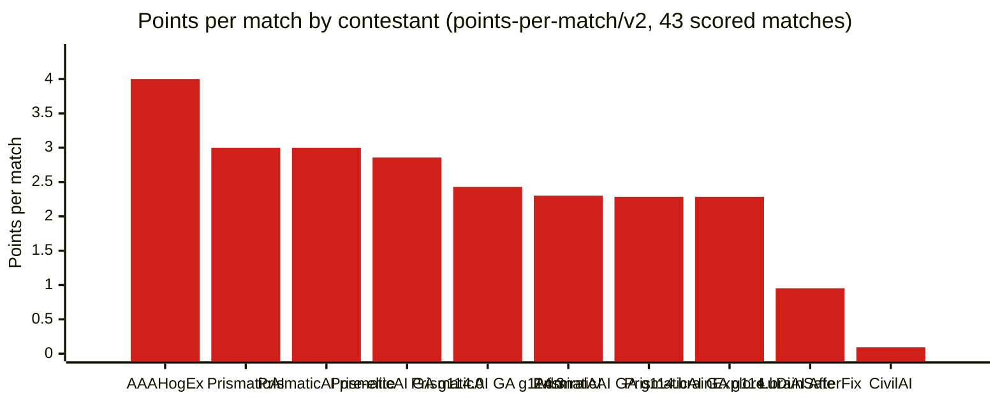
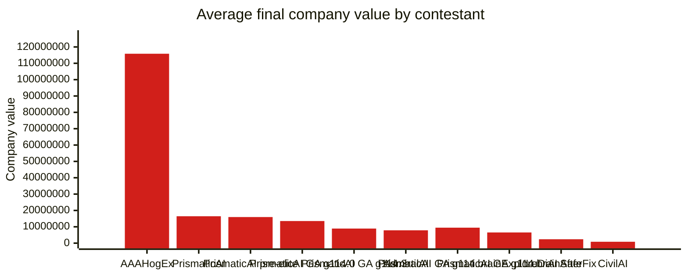
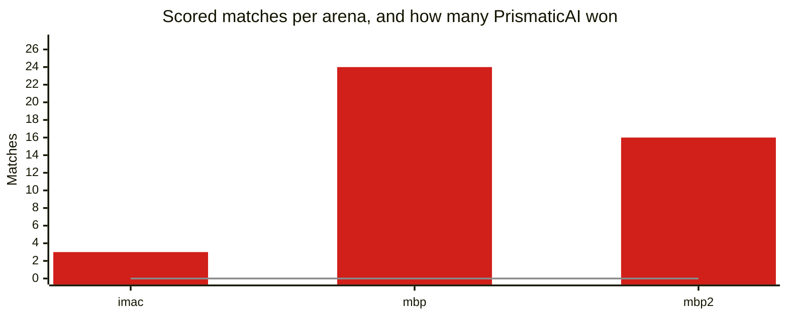

# battle-20261120T075136-36d6f968

Derived from `battle-20261120T075136-36d6f968.json` by `tools/research/ai-battle/battle.py report`; do not edit.

- Edition `36d6f968a8209c6c`: PrismaticAI and referee at `2cab9e0314edf484880fedf08e9fc11d63d5357c`, base set `opengfx-8.0.tar`
- 20-year free-for-all from 1960, map 256x256 temperate, breakdowns 1
- 43 scored match(es) on `imac` (20261119-master-gdf1e05e7d8), `mbp` (20261120-master-m17653b726e), `mbp2` (20261119-master-gdf1e05e7d8)
- Replays: 1 of 1 identical to their original on another arena

| # | Contestant | Played | Wins | Points | Points/match | Avg rank | Avg final value | Squirrel errors | Matches with anomalies |
|---|---|---|---|---|---|---|---|---|---|
| 1 | AAAHogEx | 43 | 43 | 172 | 4.0 | 1.0 | 115.8 M | 0 | 0 |
| 2 | PrismaticAI | 7 | 0 | 21 | 3.0 | 2.0 | 16.5 M | 0 | 4 |
| 3 | PrismaticAI pre-elite | 8 | 0 | 24 | 3.0 | 2.0 | 16.0 M | 0 | 0 |
| 4 | PrismaticAI GA g114.0 | 7 | 0 | 20 | 2.857 | 2.14 | 13.5 M | 0 | 1 |
| 5 | PrismaticAI GA g114.3 | 7 | 0 | 17 | 2.429 | 2.57 | 8.9 M | 0 | 0 |
| 6 | AdmiralAI | 43 | 0 | 99 | 2.302 | 2.7 | 7.8 M | 0 | 6 |
| 7 | PrismaticAI GA g114.brainExplore | 7 | 0 | 16 | 2.286 | 2.71 | 9.5 M | 0 | 0 |
| 8 | PrismaticAI GA g114.brainSafe | 7 | 0 | 16 | 2.286 | 2.71 | 6.5 M | 0 | 0 |
| 9 | LuDiAI AfterFix | 43 | 0 | 41 | 0.953 | 4.05 | 2.4 M | 0 | 1 |
| 10 | CivilAI | 43 | 0 | 4 | 0.093 | 4.91 | 848.0 k | 0 | 8 |

```mermaid
---
config:
  xyChart:
    width: 900
    height: 360
  themeVariables:
    xyChart:
      plotColorPalette: "#d11f1a, #8a8a8a, #0b0b0b, #ece4d6"
---
xychart-beta
    title "Final company value per scored match: winner vs best PrismaticAI"
    x-axis ["m-0001", "m-0002", "m-0003", "m-0004", "m-0005", "m-0006", "m-0007", "m-0008", "m-0009", "m-0010", "m-0011", "m-0012", "m-0013", "m-0014", "m-0015", "m-0016", "m-0017", "m-0018", "m-0019", "m-0020", "m-0021", "m-0022", "m-0023", "m-0024", "m-0025", "m-0026", "m-0027", "m-0028", "m-0036", "m-0037", "m-0038", "m-0039", "m-0040", "m-0041", "m-0042", "m-0043", "m-0044", "m-0045", "m-0046", "m-0047", "m-0049", "m-0053", "m-0054"]
    %% series: Winner | Best PrismaticAI
    %% links: battle-20261120T075136-36d6f968.md?col=Match&filter=m-0001 | battle-20261120T075136-36d6f968.md?col=Match&filter=m-0002 | battle-20261120T075136-36d6f968.md?col=Match&filter=m-0003 | battle-20261120T075136-36d6f968.md?col=Match&filter=m-0004 | battle-20261120T075136-36d6f968.md?col=Match&filter=m-0005 | battle-20261120T075136-36d6f968.md?col=Match&filter=m-0006 | battle-20261120T075136-36d6f968.md?col=Match&filter=m-0007 | battle-20261120T075136-36d6f968.md?col=Match&filter=m-0008 | battle-20261120T075136-36d6f968.md?col=Match&filter=m-0009 | battle-20261120T075136-36d6f968.md?col=Match&filter=m-0010 | battle-20261120T075136-36d6f968.md?col=Match&filter=m-0011 | battle-20261120T075136-36d6f968.md?col=Match&filter=m-0012 | battle-20261120T075136-36d6f968.md?col=Match&filter=m-0013 | battle-20261120T075136-36d6f968.md?col=Match&filter=m-0014 | battle-20261120T075136-36d6f968.md?col=Match&filter=m-0015 | battle-20261120T075136-36d6f968.md?col=Match&filter=m-0016 | battle-20261120T075136-36d6f968.md?col=Match&filter=m-0017 | battle-20261120T075136-36d6f968.md?col=Match&filter=m-0018 | battle-20261120T075136-36d6f968.md?col=Match&filter=m-0019 | battle-20261120T075136-36d6f968.md?col=Match&filter=m-0020 | battle-20261120T075136-36d6f968.md?col=Match&filter=m-0021 | battle-20261120T075136-36d6f968.md?col=Match&filter=m-0022 | battle-20261120T075136-36d6f968.md?col=Match&filter=m-0023 | battle-20261120T075136-36d6f968.md?col=Match&filter=m-0024 | battle-20261120T075136-36d6f968.md?col=Match&filter=m-0025 | battle-20261120T075136-36d6f968.md?col=Match&filter=m-0026 | battle-20261120T075136-36d6f968.md?col=Match&filter=m-0027 | battle-20261120T075136-36d6f968.md?col=Match&filter=m-0028 | battle-20261120T075136-36d6f968.md?col=Match&filter=m-0036 | battle-20261120T075136-36d6f968.md?col=Match&filter=m-0037 | battle-20261120T075136-36d6f968.md?col=Match&filter=m-0038 | battle-20261120T075136-36d6f968.md?col=Match&filter=m-0039 | battle-20261120T075136-36d6f968.md?col=Match&filter=m-0040 | battle-20261120T075136-36d6f968.md?col=Match&filter=m-0041 | battle-20261120T075136-36d6f968.md?col=Match&filter=m-0042 | battle-20261120T075136-36d6f968.md?col=Match&filter=m-0043 | battle-20261120T075136-36d6f968.md?col=Match&filter=m-0044 | battle-20261120T075136-36d6f968.md?col=Match&filter=m-0045 | battle-20261120T075136-36d6f968.md?col=Match&filter=m-0046 | battle-20261120T075136-36d6f968.md?col=Match&filter=m-0047 | battle-20261120T075136-36d6f968.md?col=Match&filter=m-0049 | battle-20261120T075136-36d6f968.md?col=Match&filter=m-0053 | battle-20261120T075136-36d6f968.md?col=Match&filter=m-0054
    y-axis "Company value" 0 --> 193000000
    bar [104938010, 80049396, 96650701, 103597276, 111155735, 84494267, 116254876, 107351438, 93878036, 103183664, 111085870, 93472169, 77094141, 110646633, 90469431, 74007176, 92986098, 100131697, 125270735, 112434214, 122172880, 124730651, 112591627, 115067921, 102814433, 108147826, 120794624, 118069550, 135749018, 166316155, 153259453, 155377157, 175107702, 143960681, 117801303, 142191380, 120788831, 140567198, 134443442, 151024638, 111467165, 113985703, 105475800]
    line [8972963, 6271638, 4681809, 1844820, 2715291, 20709376, 14869075, 20449605, 4888682, 23308668, 14627392, 14225840, 10028574, 10455614, 3469442, 8232857, 5633115, 19516587, 14252943, 14378080, 11285586, 5785199, 8511416, 9237422, 10276365, 7095356, 2892848, 794287, 17144288, 22934389, 17563493, 13886526, 12513427, 8284704, 21028326, 27282481, 18453065, 4642711, 13772147, 16947844, 19076548, 5723495, 13331673]
```

<!-- battle-charts:begin -->
<!-- derived from battle-20261120T075136-36d6f968.json by `battle.py render`; `battle.py check` fails when it is stale -->

<!-- battle-charts:end -->

| Seed | Original | Replay | Arenas | Identical |
|---|---|---|---|---|
| 885856118 | m-0015 | m-0048 | mbp2 / mbp | yes |

| Match | Arena | Seed | Winner | Value | Last | Anomalies |
|---|---|---|---|---|---|---|
| m-0001 | mbp | 343096422 | AAAHogEx | 104.9 M | CivilAI | CivilAI: fleet_drop:61->33 |
| m-0002 | mbp | 343096422 | AAAHogEx | 80.0 M | CivilAI | - |
| m-0003 | mbp | 343096422 | AAAHogEx | 96.7 M | CivilAI | - |
| m-0004 | mbp | 343096422 | AAAHogEx | 103.6 M | CivilAI | CivilAI: fleet_drop:160->109 |
| m-0005 | mbp | 343096422 | AAAHogEx | 111.2 M | LuDiAI AfterFix | - |
| m-0006 | mbp | 1117129377 | AAAHogEx | 84.5 M | CivilAI | PrismaticAI: fleet_drop:119->41 |
| m-0007 | mbp | 1117129377 | AAAHogEx | 116.3 M | CivilAI | AdmiralAI: fleet_drop:348->236 |
| m-0008 | mbp | 1117129377 | AAAHogEx | 107.4 M | CivilAI | - |
| m-0009 | mbp | 1117129377 | AAAHogEx | 93.9 M | CivilAI | - |
| m-0010 | imac | 1117129377 | AAAHogEx | 103.2 M | CivilAI | - |
| m-0011 | imac | 1117129377 | AAAHogEx | 111.1 M | CivilAI | - |
| m-0012 | imac | 885856118 | AAAHogEx | 93.5 M | CivilAI | - |
| m-0013 | mbp2 | 885856118 | AAAHogEx | 77.1 M | CivilAI | - |
| m-0014 | mbp2 | 885856118 | AAAHogEx | 110.6 M | CivilAI | - |
| m-0015 | mbp2 | 885856118 | AAAHogEx | 90.5 M | CivilAI | - |
| m-0016 | mbp2 | 885856118 | AAAHogEx | 74.0 M | CivilAI | - |
| m-0017 | mbp2 | 885856118 | AAAHogEx | 93.0 M | CivilAI | - |
| m-0018 | mbp2 | 146176729 | AAAHogEx | 100.1 M | CivilAI | AdmiralAI: fleet_drop:220->123; CivilAI: fleet_drop:22->11 |
| m-0019 | mbp2 | 146176729 | AAAHogEx | 125.3 M | CivilAI | - |
| m-0020 | mbp2 | 146176729 | AAAHogEx | 112.4 M | CivilAI | - |
| m-0021 | mbp2 | 146176729 | AAAHogEx | 122.2 M | CivilAI | - |
| m-0022 | mbp2 | 146176729 | AAAHogEx | 124.7 M | CivilAI | - |
| m-0023 | mbp2 | 146176729 | AAAHogEx | 112.6 M | CivilAI | AdmiralAI: fleet_drop:259->139 |
| m-0024 | mbp2 | 1413208285 | AAAHogEx | 115.1 M | CivilAI | PrismaticAI: fleet_drop:77->36 |
| m-0025 | mbp2 | 1413208285 | AAAHogEx | 102.8 M | CivilAI | CivilAI: fleet_drop:55->26 |
| m-0026 | mbp2 | 1413208285 | AAAHogEx | 108.1 M | CivilAI | PrismaticAI GA g114.0: fleet_drop:110->57; CivilAI: fleet_drop:34->20 |
| m-0027 | mbp2 | 1413208285 | AAAHogEx | 120.8 M | CivilAI | AdmiralAI: fleet_drop:233->146; CivilAI: fleet_drop:43->29 |
| m-0028 | mbp2 | 1413208285 | AAAHogEx | 118.1 M | PrismaticAI GA g114.brainExplore | - |
| m-0036 | mbp | 993597621 | AAAHogEx | 135.7 M | CivilAI | PrismaticAI: fleet_drop:133->58 |
| m-0037 | mbp | 993597621 | AAAHogEx | 166.3 M | CivilAI | - |
| m-0038 | mbp | 993597621 | AAAHogEx | 153.3 M | CivilAI | - |
| m-0039 | mbp | 993597621 | AAAHogEx | 155.4 M | CivilAI | CivilAI: fleet_drop:49->20 |
| m-0040 | mbp | 993597621 | AAAHogEx | 175.1 M | CivilAI | - |
| m-0041 | mbp | 993597621 | AAAHogEx | 144.0 M | CivilAI | - |
| m-0042 | mbp | 77061587 | AAAHogEx | 117.8 M | CivilAI | PrismaticAI: fleet_drop:143->92 |
| m-0043 | mbp | 77061587 | AAAHogEx | 142.2 M | CivilAI | - |
| m-0044 | mbp | 77061587 | AAAHogEx | 120.8 M | LuDiAI AfterFix | AdmiralAI: fleet_drop:232->162 |
| m-0045 | mbp | 77061587 | AAAHogEx | 140.6 M | CivilAI | LuDiAI AfterFix: fleet_drop:197->113; CivilAI: fleet_drop:36->17 |
| m-0046 | mbp | 77061587 | AAAHogEx | 134.4 M | CivilAI | AdmiralAI: fleet_drop:215->139 |
| m-0047 | mbp | 77061587 | AAAHogEx | 151.0 M | CivilAI | - |
| m-0048 (replay) | mbp | 885856118 | AAAHogEx | 90.5 M | CivilAI | - |
| m-0049 | mbp | 873548322 | AAAHogEx | 111.5 M | CivilAI | - |
| m-0053 | mbp | 873548322 | AAAHogEx | 114.0 M | LuDiAI AfterFix | - |
| m-0054 | mbp | 4567576 | AAAHogEx | 105.5 M | CivilAI | - |
