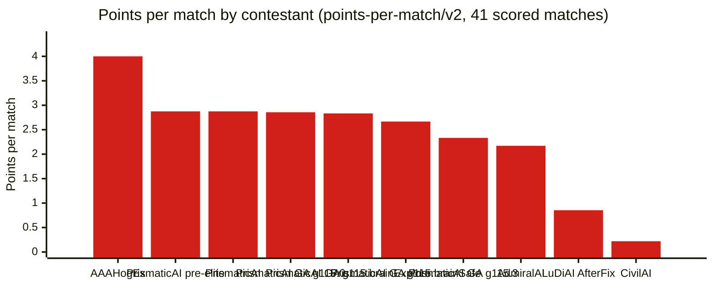
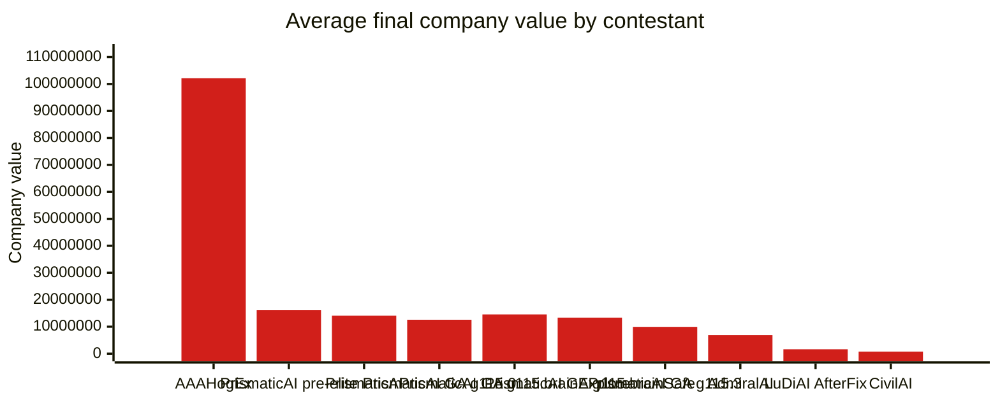
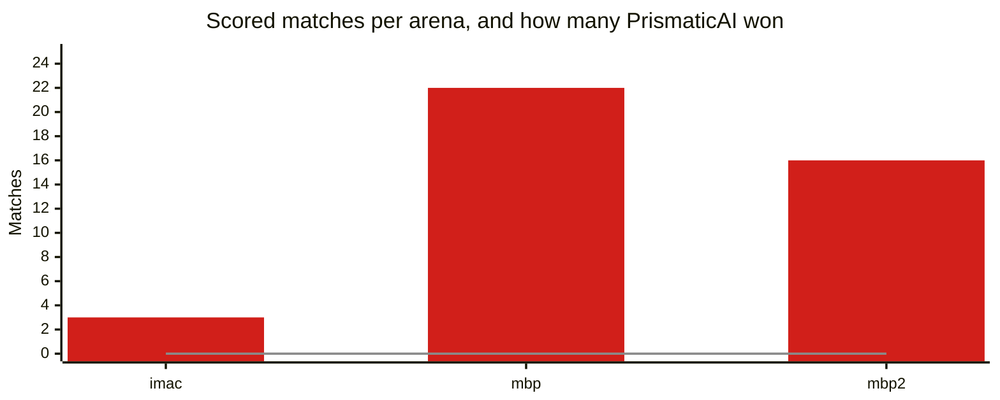

# battle-20261120T080115-bcc40b0a

Derived from `battle-20261120T080115-bcc40b0a.json` by `tools/research/ai-battle/battle.py report`; do not edit.

- Edition `bcc40b0ac5544615`: PrismaticAI and referee at `2cab9e0314edf484880fedf08e9fc11d63d5357c`, base set `opengfx-8.0.tar`
- 20-year free-for-all from 1960, map 256x256 temperate, breakdowns 1
- 41 scored match(es) on `imac` (20261119-master-gdf1e05e7d8), `mbp` (20261120-master-m17653b726e), `mbp2` (20261119-master-gdf1e05e7d8)
- Replays: 0 of 0 identical to their original on another arena

| # | Contestant | Played | Wins | Points | Points/match | Avg rank | Avg final value | Squirrel errors | Matches with anomalies |
|---|---|---|---|---|---|---|---|---|---|
| 1 | AAAHogEx | 41 | 41 | 164 | 4.0 | 1.0 | 102.1 M | 0 | 0 |
| 2 | PrismaticAI pre-elite | 8 | 0 | 23 | 2.875 | 2.12 | 16.1 M | 0 | 0 |
| 3 | PrismaticAI | 8 | 0 | 23 | 2.875 | 2.12 | 14.1 M | 0 | 3 |
| 4 | PrismaticAI GA g115.0 | 7 | 0 | 20 | 2.857 | 2.14 | 12.6 M | 0 | 1 |
| 5 | PrismaticAI GA g115.brainExplore | 6 | 0 | 17 | 2.833 | 2.17 | 14.6 M | 0 | 3 |
| 6 | PrismaticAI GA g115.brainSafe | 6 | 0 | 16 | 2.667 | 2.33 | 13.4 M | 0 | 3 |
| 7 | PrismaticAI GA g115.3 | 6 | 0 | 14 | 2.333 | 2.67 | 9.9 M | 0 | 1 |
| 8 | AdmiralAI | 41 | 0 | 89 | 2.171 | 2.83 | 6.9 M | 0 | 3 |
| 9 | LuDiAI AfterFix | 41 | 0 | 35 | 0.854 | 4.15 | 1.6 M | 0 | 0 |
| 10 | CivilAI | 41 | 0 | 9 | 0.22 | 4.78 | 759.9 k | 0 | 9 |

```mermaid
---
config:
  xyChart:
    width: 900
    height: 360
  themeVariables:
    xyChart:
      plotColorPalette: "#d11f1a, #8a8a8a, #0b0b0b, #ece4d6"
---
xychart-beta
    title "Final company value per scored match: winner vs best PrismaticAI"
    x-axis ["m-0001", "m-0002", "m-0003", "m-0004", "m-0005", "m-0006", "m-0007", "m-0008", "m-0009", "m-0010", "m-0011", "m-0012", "m-0013", "m-0014", "m-0015", "m-0016", "m-0017", "m-0018", "m-0019", "m-0020", "m-0021", "m-0022", "m-0023", "m-0024", "m-0025", "m-0026", "m-0027", "m-0028", "m-0036", "m-0037", "m-0038", "m-0039", "m-0040", "m-0041", "m-0042", "m-0043", "m-0044", "m-0047", "m-0060", "m-0061", "m-0066"]
    %% series: Winner | Best PrismaticAI
    %% links: battle-20261120T080115-bcc40b0a.md?col=Match&filter=m-0001 | battle-20261120T080115-bcc40b0a.md?col=Match&filter=m-0002 | battle-20261120T080115-bcc40b0a.md?col=Match&filter=m-0003 | battle-20261120T080115-bcc40b0a.md?col=Match&filter=m-0004 | battle-20261120T080115-bcc40b0a.md?col=Match&filter=m-0005 | battle-20261120T080115-bcc40b0a.md?col=Match&filter=m-0006 | battle-20261120T080115-bcc40b0a.md?col=Match&filter=m-0007 | battle-20261120T080115-bcc40b0a.md?col=Match&filter=m-0008 | battle-20261120T080115-bcc40b0a.md?col=Match&filter=m-0009 | battle-20261120T080115-bcc40b0a.md?col=Match&filter=m-0010 | battle-20261120T080115-bcc40b0a.md?col=Match&filter=m-0011 | battle-20261120T080115-bcc40b0a.md?col=Match&filter=m-0012 | battle-20261120T080115-bcc40b0a.md?col=Match&filter=m-0013 | battle-20261120T080115-bcc40b0a.md?col=Match&filter=m-0014 | battle-20261120T080115-bcc40b0a.md?col=Match&filter=m-0015 | battle-20261120T080115-bcc40b0a.md?col=Match&filter=m-0016 | battle-20261120T080115-bcc40b0a.md?col=Match&filter=m-0017 | battle-20261120T080115-bcc40b0a.md?col=Match&filter=m-0018 | battle-20261120T080115-bcc40b0a.md?col=Match&filter=m-0019 | battle-20261120T080115-bcc40b0a.md?col=Match&filter=m-0020 | battle-20261120T080115-bcc40b0a.md?col=Match&filter=m-0021 | battle-20261120T080115-bcc40b0a.md?col=Match&filter=m-0022 | battle-20261120T080115-bcc40b0a.md?col=Match&filter=m-0023 | battle-20261120T080115-bcc40b0a.md?col=Match&filter=m-0024 | battle-20261120T080115-bcc40b0a.md?col=Match&filter=m-0025 | battle-20261120T080115-bcc40b0a.md?col=Match&filter=m-0026 | battle-20261120T080115-bcc40b0a.md?col=Match&filter=m-0027 | battle-20261120T080115-bcc40b0a.md?col=Match&filter=m-0028 | battle-20261120T080115-bcc40b0a.md?col=Match&filter=m-0036 | battle-20261120T080115-bcc40b0a.md?col=Match&filter=m-0037 | battle-20261120T080115-bcc40b0a.md?col=Match&filter=m-0038 | battle-20261120T080115-bcc40b0a.md?col=Match&filter=m-0039 | battle-20261120T080115-bcc40b0a.md?col=Match&filter=m-0040 | battle-20261120T080115-bcc40b0a.md?col=Match&filter=m-0041 | battle-20261120T080115-bcc40b0a.md?col=Match&filter=m-0042 | battle-20261120T080115-bcc40b0a.md?col=Match&filter=m-0043 | battle-20261120T080115-bcc40b0a.md?col=Match&filter=m-0044 | battle-20261120T080115-bcc40b0a.md?col=Match&filter=m-0047 | battle-20261120T080115-bcc40b0a.md?col=Match&filter=m-0060 | battle-20261120T080115-bcc40b0a.md?col=Match&filter=m-0061 | battle-20261120T080115-bcc40b0a.md?col=Match&filter=m-0066
    y-axis "Company value" 0 --> 150000000
    bar [123697903, 115167884, 90941299, 95976994, 102708109, 136080037, 81247643, 99330090, 111047191, 108897280, 101035843, 72755853, 87436443, 61763657, 77731933, 82412564, 85935390, 135192635, 120575522, 111231639, 105797416, 132648043, 128962863, 102887966, 118624951, 115341163, 119139709, 112094770, 118721303, 91601376, 115893131, 99980652, 118885414, 125550840, 83621115, 76770800, 91841803, 89726187, 52315946, 56256820, 128942224]
    line [16650131, 12522039, 11611648, 15720447, 11180672, 14379956, 22189255, 16209907, 7154385, 17467280, 12400982, 7572528, 15301987, 10266436, 10833715, 4734368, 7719486, 19726096, 18629800, 19570249, 15694575, 21919470, 24149712, 16467431, 12086061, 13370657, 13766691, 16764090, 21422883, 20083770, 7838177, 21065596, 10735376, 554928, 7679623, 11184234, 8249436, 3629773, 15442857, 12746435, 10014083]
```

<!-- battle-charts:begin -->
<!-- derived from battle-20261120T080115-bcc40b0a.json by `battle.py render`; `battle.py check` fails when it is stale -->

<!-- battle-charts:end -->

| Match | Arena | Seed | Winner | Value | Last | Anomalies |
|---|---|---|---|---|---|---|
| m-0001 | mbp | 907386711 | AAAHogEx | 123.7 M | CivilAI | - |
| m-0002 | mbp | 907386711 | AAAHogEx | 115.2 M | CivilAI | AdmiralAI: fleet_drop:277->123 |
| m-0003 | mbp | 907386711 | AAAHogEx | 90.9 M | CivilAI | PrismaticAI GA g115.brainSafe: fleet_drop:79->51; CivilAI: fleet_drop:134->89 |
| m-0004 | mbp | 907386711 | AAAHogEx | 96.0 M | CivilAI | - |
| m-0005 | mbp | 907386711 | AAAHogEx | 102.7 M | CivilAI | - |
| m-0006 | mbp | 413368357 | AAAHogEx | 136.1 M | CivilAI | PrismaticAI: fleet_drop:106->45 |
| m-0007 | mbp | 413368357 | AAAHogEx | 81.2 M | LuDiAI AfterFix | - |
| m-0008 | mbp | 413368357 | AAAHogEx | 99.3 M | CivilAI | - |
| m-0009 | mbp | 413368357 | AAAHogEx | 111.0 M | CivilAI | PrismaticAI GA g115.brainSafe: fleet_drop:54->20 |
| m-0010 | imac | 413368357 | AAAHogEx | 108.9 M | CivilAI | - |
| m-0011 | imac | 413368357 | AAAHogEx | 101.0 M | LuDiAI AfterFix | - |
| m-0012 | imac | 1044015465 | AAAHogEx | 72.8 M | CivilAI | CivilAI: fleet_drop:44->26 |
| m-0013 | mbp2 | 1044015465 | AAAHogEx | 87.4 M | CivilAI | - |
| m-0014 | mbp2 | 1044015465 | AAAHogEx | 61.8 M | CivilAI | PrismaticAI GA g115.0: fleet_drop:97->59 |
| m-0015 | mbp2 | 1044015465 | AAAHogEx | 77.7 M | LuDiAI AfterFix | - |
| m-0016 | mbp2 | 1044015465 | AAAHogEx | 82.4 M | CivilAI | PrismaticAI GA g115.brainExplore: fleet_drop:73->46; CivilAI: fleet_drop:29->13 |
| m-0017 | mbp2 | 1044015465 | AAAHogEx | 85.9 M | CivilAI | CivilAI: fleet_drop:90->49 |
| m-0018 | mbp2 | 1386471571 | AAAHogEx | 135.2 M | CivilAI | - |
| m-0019 | mbp2 | 1386471571 | AAAHogEx | 120.6 M | LuDiAI AfterFix | - |
| m-0020 | mbp2 | 1386471571 | AAAHogEx | 111.2 M | CivilAI | CivilAI: fleet_drop:91->60 |
| m-0021 | mbp2 | 1386471571 | AAAHogEx | 105.8 M | CivilAI | CivilAI: fleet_drop:70->34 |
| m-0022 | mbp2 | 1386471571 | AAAHogEx | 132.6 M | CivilAI | - |
| m-0023 | mbp2 | 1386471571 | AAAHogEx | 129.0 M | LuDiAI AfterFix | - |
| m-0024 | mbp2 | 856274468 | AAAHogEx | 102.9 M | CivilAI | PrismaticAI: fleet_drop:86->52 |
| m-0025 | mbp2 | 856274468 | AAAHogEx | 118.6 M | LuDiAI AfterFix | - |
| m-0026 | mbp2 | 856274468 | AAAHogEx | 115.3 M | CivilAI | AdmiralAI: fleet_drop:168->114 |
| m-0027 | mbp2 | 856274468 | AAAHogEx | 119.1 M | CivilAI | - |
| m-0028 | mbp2 | 856274468 | AAAHogEx | 112.1 M | LuDiAI AfterFix | PrismaticAI GA g115.brainExplore: fleet_drop:81->56; CivilAI: fleet_drop:47->24 |
| m-0036 | mbp | 1188670659 | AAAHogEx | 118.7 M | CivilAI | PrismaticAI: fleet_drop:98->49 |
| m-0037 | mbp | 1188670659 | AAAHogEx | 91.6 M | CivilAI | AdmiralAI: fleet_drop:370->170 |
| m-0038 | mbp | 1188670659 | AAAHogEx | 115.9 M | CivilAI | - |
| m-0039 | mbp | 1188670659 | AAAHogEx | 100.0 M | CivilAI | PrismaticAI GA g115.brainSafe: fleet_drop:140->66 |
| m-0040 | mbp | 1188670659 | AAAHogEx | 118.9 M | CivilAI | PrismaticAI GA g115.brainExplore: fleet_drop:65->44 |
| m-0041 | mbp | 1188670659 | AAAHogEx | 125.6 M | PrismaticAI GA g115.3 | - |
| m-0042 | mbp | 33247056 | AAAHogEx | 83.6 M | CivilAI | - |
| m-0043 | mbp | 33247056 | AAAHogEx | 76.8 M | CivilAI | - |
| m-0044 | mbp | 33247056 | AAAHogEx | 91.8 M | CivilAI | - |
| m-0047 | mbp | 33247056 | AAAHogEx | 89.7 M | CivilAI | PrismaticAI GA g115.3: fleet_drop:70->37 |
| m-0060 | mbp | 575507869 | AAAHogEx | 52.3 M | LuDiAI AfterFix | CivilAI: fleet_drop:79->51 |
| m-0061 | mbp | 575507869 | AAAHogEx | 56.3 M | CivilAI | CivilAI: no_vehicles |
| m-0066 | mbp | 1579168020 | AAAHogEx | 128.9 M | CivilAI | - |
