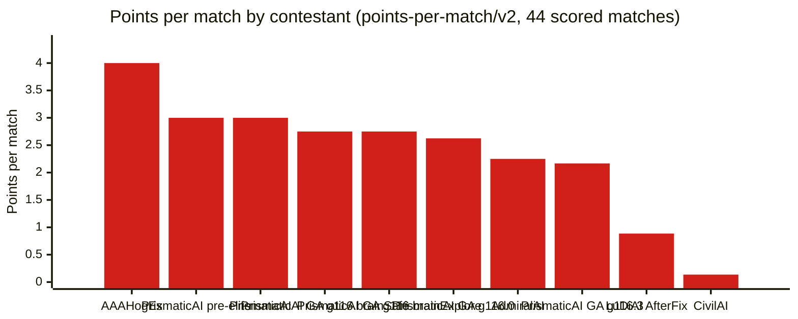
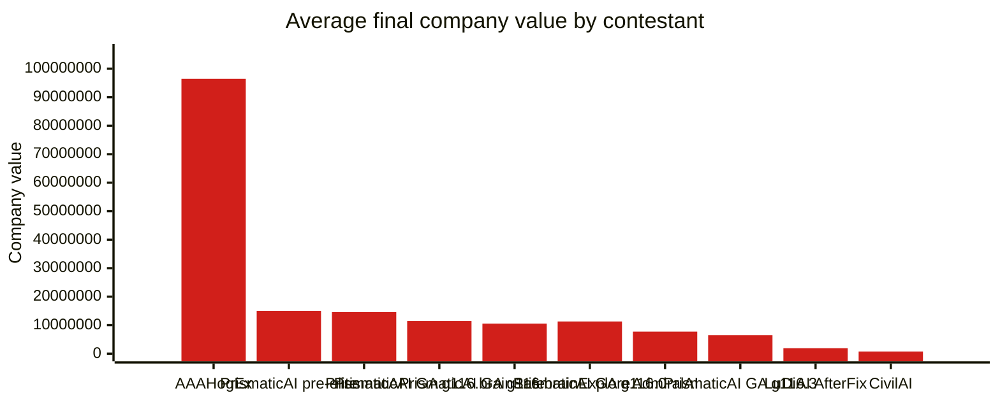
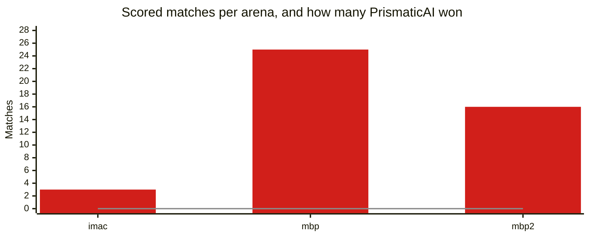

# battle-20261120T081125-146803f7

Derived from `battle-20261120T081125-146803f7.json` by `tools/research/ai-battle/battle.py report`; do not edit.

- Edition `146803f7b5f56de2`: PrismaticAI and referee at `2cab9e0314edf484880fedf08e9fc11d63d5357c`, base set `opengfx-8.0.tar`
- 20-year free-for-all from 1960, map 256x256 temperate, breakdowns 1
- 44 scored match(es) on `imac` (20261119-master-gdf1e05e7d8), `mbp` (20261120-master-m17653b726e), `mbp2` (20261119-master-gdf1e05e7d8)
- Replays: 1 of 1 identical to their original on another arena

| # | Contestant | Played | Wins | Points | Points/match | Avg rank | Avg final value | Squirrel errors | Matches with anomalies |
|---|---|---|---|---|---|---|---|---|---|
| 1 | AAAHogEx | 44 | 44 | 176 | 4.0 | 1.0 | 96.5 M | 0 | 0 |
| 2 | PrismaticAI pre-elite | 8 | 0 | 24 | 3.0 | 2.0 | 15.0 M | 0 | 0 |
| 3 | PrismaticAI | 6 | 0 | 18 | 3.0 | 2.0 | 14.6 M | 0 | 3 |
| 4 | PrismaticAI GA g116.brainSafe | 8 | 0 | 22 | 2.75 | 2.25 | 11.4 M | 0 | 2 |
| 5 | PrismaticAI GA g116.brainExplore | 8 | 0 | 22 | 2.75 | 2.25 | 10.6 M | 0 | 1 |
| 6 | PrismaticAI GA g116.0 | 8 | 0 | 21 | 2.625 | 2.38 | 11.3 M | 0 | 1 |
| 7 | AdmiralAI | 44 | 0 | 99 | 2.25 | 2.75 | 7.7 M | 0 | 1 |
| 8 | PrismaticAI GA g116.3 | 6 | 0 | 13 | 2.167 | 2.83 | 6.5 M | 0 | 2 |
| 9 | LuDiAI AfterFix | 44 | 0 | 39 | 0.886 | 4.11 | 1.9 M | 0 | 0 |
| 10 | CivilAI | 44 | 0 | 6 | 0.136 | 4.86 | 762.1 k | 3625 | 3 |

```mermaid
---
config:
  xyChart:
    width: 900
    height: 360
  themeVariables:
    xyChart:
      plotColorPalette: "#d11f1a, #8a8a8a, #0b0b0b, #ece4d6"
---
xychart-beta
    title "Final company value per scored match: winner vs best PrismaticAI"
    x-axis ["m-0001", "m-0002", "m-0003", "m-0004", "m-0005", "m-0006", "m-0007", "m-0008", "m-0009", "m-0010", "m-0011", "m-0012", "m-0013", "m-0014", "m-0015", "m-0016", "m-0017", "m-0018", "m-0019", "m-0020", "m-0021", "m-0022", "m-0023", "m-0024", "m-0025", "m-0026", "m-0027", "m-0028", "m-0036", "m-0037", "m-0038", "m-0039", "m-0040", "m-0041", "m-0042", "m-0043", "m-0044", "m-0045", "m-0046", "m-0047", "m-0049", "m-0050", "m-0051", "m-0058"]
    %% series: Winner | Best PrismaticAI
    %% links: battle-20261120T081125-146803f7.md?col=Match&filter=m-0001 | battle-20261120T081125-146803f7.md?col=Match&filter=m-0002 | battle-20261120T081125-146803f7.md?col=Match&filter=m-0003 | battle-20261120T081125-146803f7.md?col=Match&filter=m-0004 | battle-20261120T081125-146803f7.md?col=Match&filter=m-0005 | battle-20261120T081125-146803f7.md?col=Match&filter=m-0006 | battle-20261120T081125-146803f7.md?col=Match&filter=m-0007 | battle-20261120T081125-146803f7.md?col=Match&filter=m-0008 | battle-20261120T081125-146803f7.md?col=Match&filter=m-0009 | battle-20261120T081125-146803f7.md?col=Match&filter=m-0010 | battle-20261120T081125-146803f7.md?col=Match&filter=m-0011 | battle-20261120T081125-146803f7.md?col=Match&filter=m-0012 | battle-20261120T081125-146803f7.md?col=Match&filter=m-0013 | battle-20261120T081125-146803f7.md?col=Match&filter=m-0014 | battle-20261120T081125-146803f7.md?col=Match&filter=m-0015 | battle-20261120T081125-146803f7.md?col=Match&filter=m-0016 | battle-20261120T081125-146803f7.md?col=Match&filter=m-0017 | battle-20261120T081125-146803f7.md?col=Match&filter=m-0018 | battle-20261120T081125-146803f7.md?col=Match&filter=m-0019 | battle-20261120T081125-146803f7.md?col=Match&filter=m-0020 | battle-20261120T081125-146803f7.md?col=Match&filter=m-0021 | battle-20261120T081125-146803f7.md?col=Match&filter=m-0022 | battle-20261120T081125-146803f7.md?col=Match&filter=m-0023 | battle-20261120T081125-146803f7.md?col=Match&filter=m-0024 | battle-20261120T081125-146803f7.md?col=Match&filter=m-0025 | battle-20261120T081125-146803f7.md?col=Match&filter=m-0026 | battle-20261120T081125-146803f7.md?col=Match&filter=m-0027 | battle-20261120T081125-146803f7.md?col=Match&filter=m-0028 | battle-20261120T081125-146803f7.md?col=Match&filter=m-0036 | battle-20261120T081125-146803f7.md?col=Match&filter=m-0037 | battle-20261120T081125-146803f7.md?col=Match&filter=m-0038 | battle-20261120T081125-146803f7.md?col=Match&filter=m-0039 | battle-20261120T081125-146803f7.md?col=Match&filter=m-0040 | battle-20261120T081125-146803f7.md?col=Match&filter=m-0041 | battle-20261120T081125-146803f7.md?col=Match&filter=m-0042 | battle-20261120T081125-146803f7.md?col=Match&filter=m-0043 | battle-20261120T081125-146803f7.md?col=Match&filter=m-0044 | battle-20261120T081125-146803f7.md?col=Match&filter=m-0045 | battle-20261120T081125-146803f7.md?col=Match&filter=m-0046 | battle-20261120T081125-146803f7.md?col=Match&filter=m-0047 | battle-20261120T081125-146803f7.md?col=Match&filter=m-0049 | battle-20261120T081125-146803f7.md?col=Match&filter=m-0050 | battle-20261120T081125-146803f7.md?col=Match&filter=m-0051 | battle-20261120T081125-146803f7.md?col=Match&filter=m-0058
    y-axis "Company value" 0 --> 183000000
    bar [103006032, 81011642, 125423012, 117957292, 78840129, 101426525, 83009904, 105457421, 96930840, 94336518, 91056799, 54847373, 89705715, 104405216, 105439607, 71188443, 66068194, 49502203, 69818456, 57712234, 56079717, 47425881, 47076040, 122079893, 125990214, 134496559, 124610539, 136457095, 110298081, 97608846, 117181454, 108519845, 112230531, 95067216, 66107739, 81670710, 85173852, 88183704, 80755521, 89257454, 166787790, 163871657, 156632710, 83241532]
    line [9400527, 12016248, 9885569, 5255564, 1806585, 14101441, 19960495, 18257920, 15327426, 17932131, 11283125, 14564596, 14343674, 3126631, 5233525, 3891262, 10980194, 14839041, 12184361, 9551602, 9967383, 16632058, 4020100, 9112771, 21532758, 16167280, 13350825, 8200087, 15373722, 14699397, 7381424, 11225752, 5333645, 3098313, 19604209, 13632995, 16435947, 17031613, 16359198, 7748097, 14541399, 7463563, 9549750, 10802329]
```

<!-- battle-charts:begin -->
<!-- derived from battle-20261120T081125-146803f7.json by `battle.py render`; `battle.py check` fails when it is stale -->

<!-- battle-charts:end -->

| Seed | Original | Replay | Arenas | Identical |
|---|---|---|---|---|
| 1973445780 | m-0018 | m-0048 | mbp2 / mbp | yes |

| Match | Arena | Seed | Winner | Value | Last | Anomalies |
|---|---|---|---|---|---|---|
| m-0001 | mbp | 1529252518 | AAAHogEx | 103.0 M | CivilAI | - |
| m-0002 | mbp | 1529252518 | AAAHogEx | 81.0 M | CivilAI | - |
| m-0003 | mbp | 1529252518 | AAAHogEx | 125.4 M | CivilAI | - |
| m-0004 | mbp | 1529252518 | AAAHogEx | 118.0 M | LuDiAI AfterFix | - |
| m-0005 | mbp | 1529252518 | AAAHogEx | 78.8 M | CivilAI | PrismaticAI GA g116.3: fleet_drop:97->58 |
| m-0006 | mbp | 1651759076 | AAAHogEx | 101.4 M | CivilAI | PrismaticAI: fleet_drop:123->49 |
| m-0007 | mbp | 1651759076 | AAAHogEx | 83.0 M | CivilAI | - |
| m-0008 | mbp | 1651759076 | AAAHogEx | 105.5 M | CivilAI | - |
| m-0009 | mbp | 1651759076 | AAAHogEx | 96.9 M | CivilAI | - |
| m-0010 | imac | 1651759076 | AAAHogEx | 94.3 M | CivilAI | - |
| m-0011 | imac | 1651759076 | AAAHogEx | 91.1 M | CivilAI | PrismaticAI GA g116.3: fleet_drop:168->54 |
| m-0012 | imac | 1943016331 | AAAHogEx | 54.8 M | CivilAI | PrismaticAI: fleet_drop:92->58 |
| m-0013 | mbp2 | 1943016331 | AAAHogEx | 89.7 M | LuDiAI AfterFix | - |
| m-0014 | mbp2 | 1943016331 | AAAHogEx | 104.4 M | CivilAI | - |
| m-0015 | mbp2 | 1943016331 | AAAHogEx | 105.4 M | CivilAI | - |
| m-0016 | mbp2 | 1943016331 | AAAHogEx | 71.2 M | CivilAI | - |
| m-0017 | mbp2 | 1943016331 | AAAHogEx | 66.1 M | CivilAI | - |
| m-0018 | mbp2 | 1973445780 | AAAHogEx | 49.5 M | CivilAI | PrismaticAI: fleet_drop:54->37 |
| m-0019 | mbp2 | 1973445780 | AAAHogEx | 69.8 M | CivilAI | - |
| m-0020 | mbp2 | 1973445780 | AAAHogEx | 57.7 M | CivilAI | - |
| m-0021 | mbp2 | 1973445780 | AAAHogEx | 56.1 M | CivilAI | PrismaticAI GA g116.brainSafe: fleet_drop:55->30 |
| m-0022 | mbp2 | 1973445780 | AAAHogEx | 47.4 M | CivilAI | PrismaticAI GA g116.brainExplore: fleet_drop:92->60 |
| m-0023 | mbp2 | 1973445780 | AAAHogEx | 47.1 M | CivilAI | - |
| m-0024 | mbp2 | 1484624419 | AAAHogEx | 122.1 M | LuDiAI AfterFix | - |
| m-0025 | mbp2 | 1484624419 | AAAHogEx | 126.0 M | CivilAI | CivilAI: squirrel_errors:3625 |
| m-0026 | mbp2 | 1484624419 | AAAHogEx | 134.5 M | CivilAI | - |
| m-0027 | mbp2 | 1484624419 | AAAHogEx | 124.6 M | CivilAI | - |
| m-0028 | mbp2 | 1484624419 | AAAHogEx | 136.5 M | CivilAI | - |
| m-0036 | mbp | 1434451854 | AAAHogEx | 110.3 M | LuDiAI AfterFix | - |
| m-0037 | mbp | 1434451854 | AAAHogEx | 97.6 M | CivilAI | - |
| m-0038 | mbp | 1434451854 | AAAHogEx | 117.2 M | CivilAI | - |
| m-0039 | mbp | 1434451854 | AAAHogEx | 108.5 M | CivilAI | PrismaticAI GA g116.brainSafe: fleet_drop:88->58 |
| m-0040 | mbp | 1434451854 | AAAHogEx | 112.2 M | LuDiAI AfterFix | - |
| m-0041 | mbp | 1434451854 | AAAHogEx | 95.1 M | CivilAI | - |
| m-0042 | mbp | 1711571576 | AAAHogEx | 66.1 M | LuDiAI AfterFix | - |
| m-0043 | mbp | 1711571576 | AAAHogEx | 81.7 M | CivilAI | - |
| m-0044 | mbp | 1711571576 | AAAHogEx | 85.2 M | CivilAI | CivilAI: fleet_drop:25->14 |
| m-0045 | mbp | 1711571576 | AAAHogEx | 88.2 M | CivilAI | CivilAI: fleet_drop:15->7 |
| m-0046 | mbp | 1711571576 | AAAHogEx | 80.8 M | CivilAI | - |
| m-0047 | mbp | 1711571576 | AAAHogEx | 89.3 M | CivilAI | - |
| m-0048 (replay) | mbp | 1973445780 | AAAHogEx | 49.5 M | CivilAI | PrismaticAI: fleet_drop:54->37 |
| m-0049 | mbp | 1308287437 | AAAHogEx | 166.8 M | CivilAI | AdmiralAI: fleet_drop:327->199 |
| m-0050 | mbp | 1308287437 | AAAHogEx | 163.9 M | CivilAI | PrismaticAI GA g116.0: fleet_drop:94->57 |
| m-0051 | mbp | 1308287437 | AAAHogEx | 156.6 M | CivilAI | - |
| m-0058 | mbp | 330686477 | AAAHogEx | 83.2 M | CivilAI | - |
