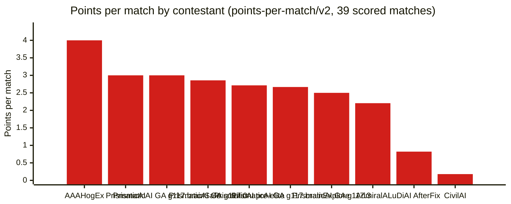
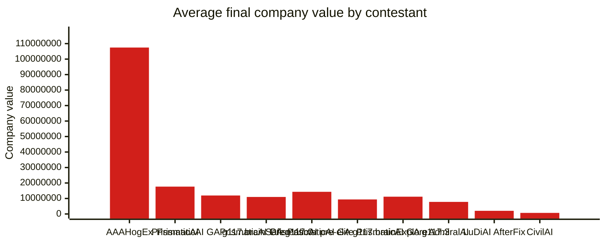
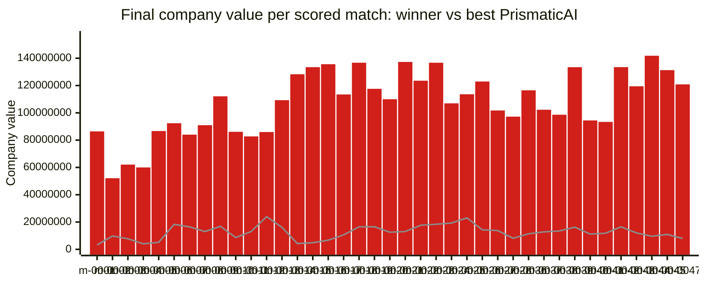
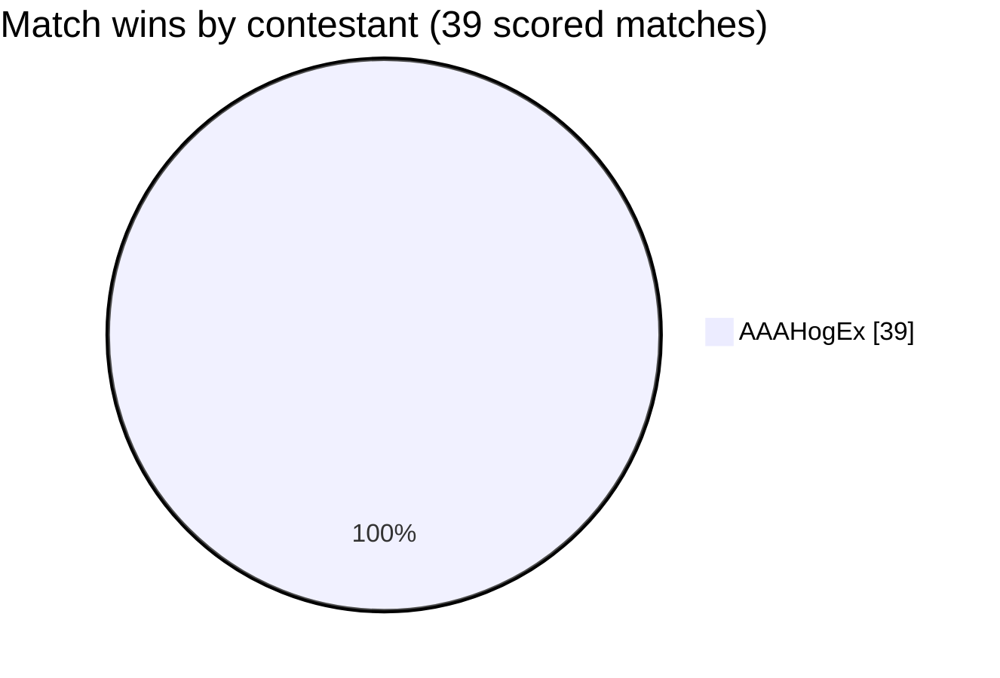
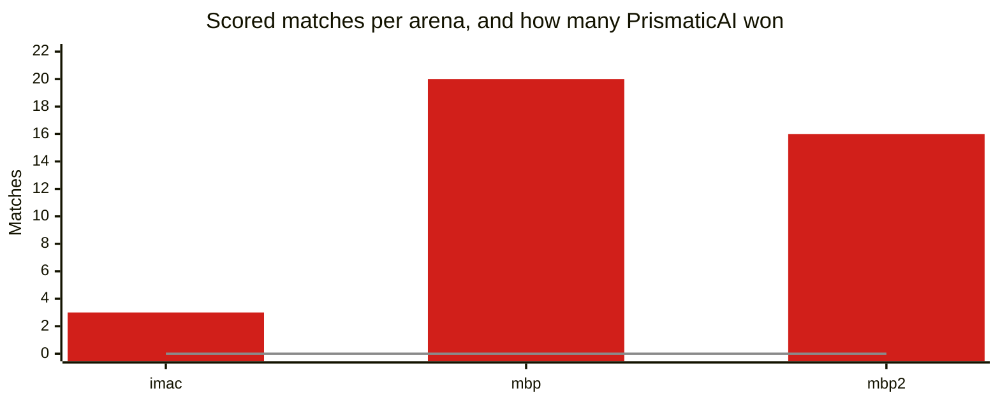

# battle-20261120T082041-61d84928

Derived from `battle-20261120T082041-61d84928.json` by `tools/research/ai-battle/battle.py report`; do not edit.

- Edition `61d8492876050716`: PrismaticAI and referee at `2cab9e0314edf484880fedf08e9fc11d63d5357c`, base set `opengfx-8.0.tar`
- 20-year free-for-all from 1960, map 256x256 temperate, breakdowns 1
- 39 scored match(es) on `imac` (20261119-master-gdf1e05e7d8), `mbp` (20261120-master-m17653b726e), `mbp2` (20261119-master-gdf1e05e7d8)
- Replays: 0 of 1 identical to their original on another arena

| # | Contestant | Played | Wins | Points | Points/match | Avg rank | Avg final value | Squirrel errors | Matches with anomalies |
|---|---|---|---|---|---|---|---|---|---|
| 1 | AAAHogEx | 39 | 39 | 156 | 4.0 | 1.0 | 107.5 M | 0 | 0 |
| 2 | PrismaticAI | 6 | 0 | 18 | 3.0 | 2.0 | 17.7 M | 0 | 1 |
| 3 | PrismaticAI GA g117.brainSafe | 7 | 0 | 21 | 3.0 | 2.0 | 11.9 M | 0 | 1 |
| 4 | PrismaticAI GA g117.0 | 7 | 0 | 20 | 2.857 | 2.14 | 11.0 M | 0 | 2 |
| 5 | PrismaticAI pre-elite | 7 | 0 | 19 | 2.714 | 2.29 | 14.3 M | 0 | 1 |
| 6 | PrismaticAI GA g117.brainExplore | 6 | 0 | 16 | 2.667 | 2.33 | 9.4 M | 0 | 0 |
| 7 | PrismaticAI GA g117.3 | 6 | 0 | 15 | 2.5 | 2.5 | 11.2 M | 0 | 1 |
| 8 | AdmiralAI | 39 | 0 | 86 | 2.205 | 2.79 | 7.8 M | 104 | 2 |
| 9 | LuDiAI AfterFix | 39 | 0 | 32 | 0.821 | 4.18 | 2.0 M | 0 | 1 |
| 10 | CivilAI | 39 | 0 | 7 | 0.179 | 4.82 | 690.6 k | 7445 | 4 |

<!-- battle-charts:begin -->
<!-- derived from battle-20261120T082041-61d84928.json by `battle.py render`; `battle.py check` fails when it is stale -->

<!-- battle-charts:end -->

| Seed | Original | Replay | Arenas | Identical |
|---|---|---|---|---|
| 1728420829 | m-0011 | m-0048 | imac / mbp | NO |

| Match | Arena | Seed | Winner | Value | Last | Anomalies |
|---|---|---|---|---|---|---|
| m-0001 | mbp | 840687424 | AAAHogEx | 86.4 M | LuDiAI AfterFix | PrismaticAI pre-elite: fleet_drop:43->26 |
| m-0002 | mbp | 840687424 | AAAHogEx | 52.1 M | CivilAI | - |
| m-0003 | mbp | 840687424 | AAAHogEx | 62.1 M | CivilAI | - |
| m-0004 | mbp | 840687424 | AAAHogEx | 60.0 M | CivilAI | CivilAI: squirrel_errors:3695 |
| m-0005 | mbp | 840687424 | AAAHogEx | 86.7 M | CivilAI | AdmiralAI: squirrel_errors:59 |
| m-0006 | mbp | 1728420829 | AAAHogEx | 92.4 M | CivilAI | PrismaticAI: fleet_drop:87->59 |
| m-0007 | mbp | 1728420829 | AAAHogEx | 84.0 M | CivilAI | - |
| m-0008 | mbp | 1728420829 | AAAHogEx | 91.0 M | CivilAI | PrismaticAI GA g117.0: fleet_drop:77->53 |
| m-0009 | mbp | 1728420829 | AAAHogEx | 112.1 M | CivilAI | - |
| m-0010 | imac | 1728420829 | AAAHogEx | 86.1 M | CivilAI | CivilAI: fleet_drop:14->8 |
| m-0011 | imac | 1728420829 | AAAHogEx | 82.7 M | CivilAI | - |
| m-0012 | imac | 831159470 | AAAHogEx | 85.9 M | CivilAI | - |
| m-0013 | mbp2 | 831159470 | AAAHogEx | 109.3 M | LuDiAI AfterFix | - |
| m-0014 | mbp2 | 831159470 | AAAHogEx | 128.3 M | CivilAI | PrismaticAI GA g117.0: fleet_drop:51->27; CivilAI: squirrel_errors:3750 |
| m-0015 | mbp2 | 831159470 | AAAHogEx | 133.5 M | LuDiAI AfterFix | PrismaticAI GA g117.brainSafe: fleet_drop:85->57 |
| m-0016 | mbp2 | 831159470 | AAAHogEx | 135.6 M | CivilAI | - |
| m-0017 | mbp2 | 831159470 | AAAHogEx | 113.5 M | LuDiAI AfterFix | LuDiAI AfterFix: fleet_drop:49->14 |
| m-0018 | mbp2 | 133154444 | AAAHogEx | 136.7 M | CivilAI | CivilAI: fleet_drop:28->10 |
| m-0019 | mbp2 | 133154444 | AAAHogEx | 117.6 M | CivilAI | - |
| m-0020 | mbp2 | 133154444 | AAAHogEx | 110.0 M | CivilAI | AdmiralAI: squirrel_errors:45 |
| m-0021 | mbp2 | 133154444 | AAAHogEx | 137.3 M | CivilAI | - |
| m-0022 | mbp2 | 133154444 | AAAHogEx | 123.5 M | CivilAI | - |
| m-0023 | mbp2 | 133154444 | AAAHogEx | 136.7 M | CivilAI | - |
| m-0024 | mbp2 | 305283400 | AAAHogEx | 106.9 M | CivilAI | - |
| m-0025 | mbp2 | 305283400 | AAAHogEx | 113.6 M | CivilAI | - |
| m-0026 | mbp2 | 305283400 | AAAHogEx | 122.9 M | CivilAI | - |
| m-0027 | mbp2 | 305283400 | AAAHogEx | 101.7 M | CivilAI | - |
| m-0028 | mbp2 | 305283400 | AAAHogEx | 97.2 M | CivilAI | - |
| m-0036 | mbp | 1108677110 | AAAHogEx | 116.5 M | CivilAI | - |
| m-0037 | mbp | 1108677110 | AAAHogEx | 102.3 M | CivilAI | - |
| m-0038 | mbp | 1108677110 | AAAHogEx | 98.6 M | CivilAI | - |
| m-0039 | mbp | 1108677110 | AAAHogEx | 133.5 M | CivilAI | - |
| m-0040 | mbp | 1108677110 | AAAHogEx | 94.4 M | CivilAI | - |
| m-0041 | mbp | 1108677110 | AAAHogEx | 93.3 M | CivilAI | - |
| m-0042 | mbp | 1962116930 | AAAHogEx | 133.5 M | LuDiAI AfterFix | - |
| m-0043 | mbp | 1962116930 | AAAHogEx | 119.4 M | LuDiAI AfterFix | - |
| m-0044 | mbp | 1962116930 | AAAHogEx | 141.8 M | CivilAI | - |
| m-0045 | mbp | 1962116930 | AAAHogEx | 131.3 M | CivilAI | - |
| m-0047 | mbp | 1962116930 | AAAHogEx | 120.8 M | LuDiAI AfterFix | PrismaticAI GA g117.3: fleet_drop:81->54 |
| m-0048 (replay) | mbp | 1728420829 | AAAHogEx | 102.3 M | CivilAI | - |
