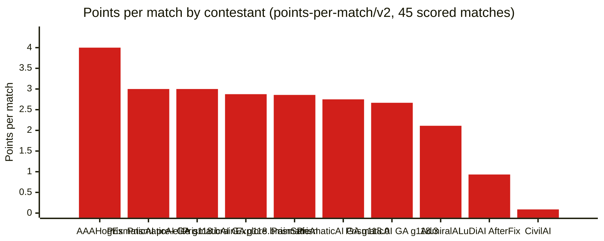
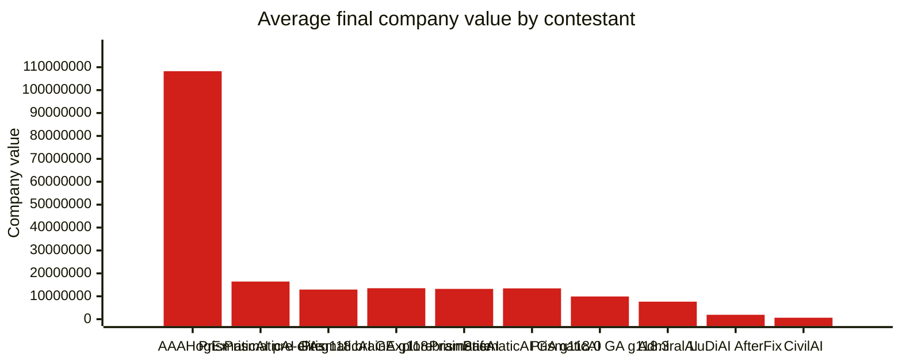
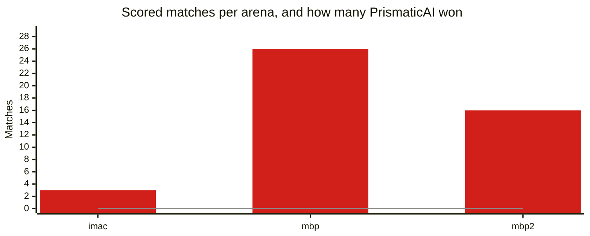

# battle-20261120T083039-b3423d22

Derived from `battle-20261120T083039-b3423d22.json` by `tools/research/ai-battle/battle.py report`; do not edit.

- Edition `b3423d227a2e7332`: PrismaticAI and referee at `2cab9e0314edf484880fedf08e9fc11d63d5357c`, base set `opengfx-8.0.tar`
- 20-year free-for-all from 1960, map 256x256 temperate, breakdowns 1
- 45 scored match(es) on `imac` (20261119-master-gdf1e05e7d8), `mbp` (20261120-master-m17653b726e), `mbp2` (20261119-master-gdf1e05e7d8)
- Replays: 1 of 1 identical to their original on another arena

| # | Contestant | Played | Wins | Points | Points/match | Avg rank | Avg final value | Squirrel errors | Matches with anomalies |
|---|---|---|---|---|---|---|---|---|---|
| 1 | AAAHogEx | 45 | 45 | 180 | 4.0 | 1.0 | 108.3 M | 0 | 0 |
| 2 | PrismaticAI pre-elite | 8 | 0 | 24 | 3.0 | 2.0 | 16.4 M | 0 | 1 |
| 3 | PrismaticAI GA g118.brainExplore | 8 | 0 | 24 | 3.0 | 2.0 | 12.9 M | 0 | 5 |
| 4 | PrismaticAI GA g118.brainSafe | 8 | 0 | 23 | 2.875 | 2.12 | 13.5 M | 0 | 1 |
| 5 | PrismaticAI | 7 | 0 | 20 | 2.857 | 2.14 | 13.2 M | 0 | 6 |
| 6 | PrismaticAI GA g118.0 | 8 | 0 | 22 | 2.75 | 2.25 | 13.4 M | 0 | 2 |
| 7 | PrismaticAI GA g118.3 | 6 | 0 | 16 | 2.667 | 2.33 | 9.9 M | 0 | 1 |
| 8 | AdmiralAI | 45 | 0 | 95 | 2.111 | 2.89 | 7.6 M | 47 | 2 |
| 9 | LuDiAI AfterFix | 45 | 0 | 42 | 0.933 | 4.07 | 1.9 M | 0 | 0 |
| 10 | CivilAI | 45 | 0 | 4 | 0.089 | 4.91 | 637.7 k | 0 | 7 |

```mermaid
---
config:
  xyChart:
    width: 900
    height: 360
  themeVariables:
    xyChart:
      plotColorPalette: "#d11f1a, #8a8a8a, #0b0b0b, #ece4d6"
---
xychart-beta
    title "Final company value per scored match: winner vs best PrismaticAI"
    x-axis ["m-0001", "m-0002", "m-0003", "m-0004", "m-0005", "m-0006", "m-0007", "m-0008", "m-0009", "m-0010", "m-0011", "m-0012", "m-0013", "m-0014", "m-0015", "m-0016", "m-0017", "m-0018", "m-0019", "m-0020", "m-0021", "m-0022", "m-0023", "m-0024", "m-0025", "m-0026", "m-0027", "m-0028", "m-0036", "m-0037", "m-0038", "m-0039", "m-0040", "m-0041", "m-0042", "m-0043", "m-0044", "m-0050", "m-0051", "m-0052", "m-0053", "m-0054", "m-0055", "m-0057", "m-0058"]
    %% series: Winner | Best PrismaticAI
    %% links: battle-20261120T083039-b3423d22.md?col=Match&filter=m-0001 | battle-20261120T083039-b3423d22.md?col=Match&filter=m-0002 | battle-20261120T083039-b3423d22.md?col=Match&filter=m-0003 | battle-20261120T083039-b3423d22.md?col=Match&filter=m-0004 | battle-20261120T083039-b3423d22.md?col=Match&filter=m-0005 | battle-20261120T083039-b3423d22.md?col=Match&filter=m-0006 | battle-20261120T083039-b3423d22.md?col=Match&filter=m-0007 | battle-20261120T083039-b3423d22.md?col=Match&filter=m-0008 | battle-20261120T083039-b3423d22.md?col=Match&filter=m-0009 | battle-20261120T083039-b3423d22.md?col=Match&filter=m-0010 | battle-20261120T083039-b3423d22.md?col=Match&filter=m-0011 | battle-20261120T083039-b3423d22.md?col=Match&filter=m-0012 | battle-20261120T083039-b3423d22.md?col=Match&filter=m-0013 | battle-20261120T083039-b3423d22.md?col=Match&filter=m-0014 | battle-20261120T083039-b3423d22.md?col=Match&filter=m-0015 | battle-20261120T083039-b3423d22.md?col=Match&filter=m-0016 | battle-20261120T083039-b3423d22.md?col=Match&filter=m-0017 | battle-20261120T083039-b3423d22.md?col=Match&filter=m-0018 | battle-20261120T083039-b3423d22.md?col=Match&filter=m-0019 | battle-20261120T083039-b3423d22.md?col=Match&filter=m-0020 | battle-20261120T083039-b3423d22.md?col=Match&filter=m-0021 | battle-20261120T083039-b3423d22.md?col=Match&filter=m-0022 | battle-20261120T083039-b3423d22.md?col=Match&filter=m-0023 | battle-20261120T083039-b3423d22.md?col=Match&filter=m-0024 | battle-20261120T083039-b3423d22.md?col=Match&filter=m-0025 | battle-20261120T083039-b3423d22.md?col=Match&filter=m-0026 | battle-20261120T083039-b3423d22.md?col=Match&filter=m-0027 | battle-20261120T083039-b3423d22.md?col=Match&filter=m-0028 | battle-20261120T083039-b3423d22.md?col=Match&filter=m-0036 | battle-20261120T083039-b3423d22.md?col=Match&filter=m-0037 | battle-20261120T083039-b3423d22.md?col=Match&filter=m-0038 | battle-20261120T083039-b3423d22.md?col=Match&filter=m-0039 | battle-20261120T083039-b3423d22.md?col=Match&filter=m-0040 | battle-20261120T083039-b3423d22.md?col=Match&filter=m-0041 | battle-20261120T083039-b3423d22.md?col=Match&filter=m-0042 | battle-20261120T083039-b3423d22.md?col=Match&filter=m-0043 | battle-20261120T083039-b3423d22.md?col=Match&filter=m-0044 | battle-20261120T083039-b3423d22.md?col=Match&filter=m-0050 | battle-20261120T083039-b3423d22.md?col=Match&filter=m-0051 | battle-20261120T083039-b3423d22.md?col=Match&filter=m-0052 | battle-20261120T083039-b3423d22.md?col=Match&filter=m-0053 | battle-20261120T083039-b3423d22.md?col=Match&filter=m-0054 | battle-20261120T083039-b3423d22.md?col=Match&filter=m-0055 | battle-20261120T083039-b3423d22.md?col=Match&filter=m-0057 | battle-20261120T083039-b3423d22.md?col=Match&filter=m-0058
    y-axis "Company value" 0 --> 164000000
    bar [107595425, 115048697, 142958310, 146357426, 115452263, 145273221, 114528107, 129274053, 115688568, 94227357, 108349355, 109028741, 71357560, 82506711, 105750511, 99225776, 96121825, 106597446, 94335636, 118900609, 113473087, 124590405, 91054711, 132764278, 108701441, 138595351, 120395841, 117697534, 110995751, 91051102, 79816776, 98006372, 82868235, 97876005, 69631922, 85033648, 76164668, 149494602, 137967270, 145374664, 134030991, 98117689, 91091192, 73804661, 84676725]
    line [20338720, 15795755, 20104506, 12918525, 18009423, 16932122, 12747661, 20748215, 13465079, 17771150, 7896815, 10158177, 9146005, 9792252, 5299767, 11053002, 4028967, 14522386, 17970080, 10305046, 10944645, 11025735, 10854182, 16382236, 21692840, 15263691, 18697008, 15117398, 5496425, 12301817, 11131698, 7832403, 6749231, 2424573, 13257871, 22654255, 9488623, 15074118, 17431325, 15293529, 16241601, 15836745, 14620477, 14356625, 13521601]
```

<!-- battle-charts:begin -->
<!-- derived from battle-20261120T083039-b3423d22.json by `battle.py render`; `battle.py check` fails when it is stale -->

<!-- battle-charts:end -->

| Seed | Original | Replay | Arenas | Identical |
|---|---|---|---|---|
| 1089261125 | m-0013 | m-0056 | mbp2 / mbp | yes |

| Match | Arena | Seed | Winner | Value | Last | Anomalies |
|---|---|---|---|---|---|---|
| m-0001 | mbp | 1645095529 | AAAHogEx | 107.6 M | CivilAI | PrismaticAI pre-elite: fleet_drop:111->74 |
| m-0002 | mbp | 1645095529 | AAAHogEx | 115.0 M | CivilAI | - |
| m-0003 | mbp | 1645095529 | AAAHogEx | 143.0 M | CivilAI | AdmiralAI: squirrel_errors:47 |
| m-0004 | mbp | 1645095529 | AAAHogEx | 146.4 M | CivilAI | PrismaticAI GA g118.brainExplore: fleet_drop:112->48 |
| m-0005 | mbp | 1645095529 | AAAHogEx | 115.5 M | CivilAI | - |
| m-0006 | mbp | 1461347703 | AAAHogEx | 145.3 M | CivilAI | PrismaticAI: fleet_drop:76->52 |
| m-0007 | mbp | 1461347703 | AAAHogEx | 114.5 M | CivilAI | - |
| m-0008 | mbp | 1461347703 | AAAHogEx | 129.3 M | CivilAI | PrismaticAI GA g118.0: fleet_drop:103->69 |
| m-0009 | mbp | 1461347703 | AAAHogEx | 115.7 M | CivilAI | CivilAI: fleet_drop:42->27 |
| m-0010 | imac | 1461347703 | AAAHogEx | 94.2 M | CivilAI | CivilAI: fleet_drop:40->16 |
| m-0011 | imac | 1461347703 | AAAHogEx | 108.3 M | CivilAI | - |
| m-0012 | imac | 1089261125 | AAAHogEx | 109.0 M | CivilAI | PrismaticAI: fleet_drop:70->34; CivilAI: fleet_drop:49->20 |
| m-0013 | mbp2 | 1089261125 | AAAHogEx | 71.4 M | CivilAI | - |
| m-0014 | mbp2 | 1089261125 | AAAHogEx | 82.5 M | CivilAI | - |
| m-0015 | mbp2 | 1089261125 | AAAHogEx | 105.8 M | LuDiAI AfterFix | - |
| m-0016 | mbp2 | 1089261125 | AAAHogEx | 99.2 M | CivilAI | PrismaticAI GA g118.brainExplore: fleet_drop:112->28 |
| m-0017 | mbp2 | 1089261125 | AAAHogEx | 96.1 M | CivilAI | CivilAI: fleet_drop:47->17 |
| m-0018 | mbp2 | 1710411092 | AAAHogEx | 106.6 M | CivilAI | PrismaticAI: fleet_drop:93->59 |
| m-0019 | mbp2 | 1710411092 | AAAHogEx | 94.3 M | CivilAI | - |
| m-0020 | mbp2 | 1710411092 | AAAHogEx | 118.9 M | CivilAI | - |
| m-0021 | mbp2 | 1710411092 | AAAHogEx | 113.5 M | CivilAI | - |
| m-0022 | mbp2 | 1710411092 | AAAHogEx | 124.6 M | CivilAI | - |
| m-0023 | mbp2 | 1710411092 | AAAHogEx | 91.1 M | CivilAI | - |
| m-0024 | mbp2 | 1844950675 | AAAHogEx | 132.8 M | CivilAI | PrismaticAI: fleet_drop:91->62 |
| m-0025 | mbp2 | 1844950675 | AAAHogEx | 108.7 M | CivilAI | - |
| m-0026 | mbp2 | 1844950675 | AAAHogEx | 138.6 M | CivilAI | - |
| m-0027 | mbp2 | 1844950675 | AAAHogEx | 120.4 M | CivilAI | PrismaticAI GA g118.brainSafe: fleet_drop:62->41; AdmiralAI: fleet_drop:211->146 |
| m-0028 | mbp2 | 1844950675 | AAAHogEx | 117.7 M | CivilAI | PrismaticAI GA g118.brainExplore: fleet_drop:72->47 |
| m-0036 | mbp | 851394136 | AAAHogEx | 111.0 M | LuDiAI AfterFix | PrismaticAI: fleet_drop:99->67; CivilAI: fleet_drop:90->40 |
| m-0037 | mbp | 851394136 | AAAHogEx | 91.1 M | CivilAI | - |
| m-0038 | mbp | 851394136 | AAAHogEx | 79.8 M | CivilAI | PrismaticAI GA g118.0: fleet_drop:107->69 |
| m-0039 | mbp | 851394136 | AAAHogEx | 98.0 M | CivilAI | - |
| m-0040 | mbp | 851394136 | AAAHogEx | 82.9 M | LuDiAI AfterFix | CivilAI: fleet_drop:49->34 |
| m-0041 | mbp | 851394136 | AAAHogEx | 97.9 M | CivilAI | - |
| m-0042 | mbp | 952956724 | AAAHogEx | 69.6 M | CivilAI | - |
| m-0043 | mbp | 952956724 | AAAHogEx | 85.0 M | CivilAI | CivilAI: fleet_drop:53->36 |
| m-0044 | mbp | 952956724 | AAAHogEx | 76.2 M | CivilAI | - |
| m-0050 | mbp | 372596482 | AAAHogEx | 149.5 M | CivilAI | - |
| m-0051 | mbp | 372596482 | AAAHogEx | 138.0 M | CivilAI | - |
| m-0052 | mbp | 372596482 | AAAHogEx | 145.4 M | LuDiAI AfterFix | PrismaticAI GA g118.brainExplore: fleet_drop:105->45 |
| m-0053 | mbp | 372596482 | AAAHogEx | 134.0 M | CivilAI | PrismaticAI GA g118.3: fleet_drop:108->74 |
| m-0054 | mbp | 1540981509 | AAAHogEx | 98.1 M | CivilAI | PrismaticAI: fleet_drop:77->50 |
| m-0055 | mbp | 1540981509 | AAAHogEx | 91.1 M | CivilAI | - |
| m-0056 (replay) | mbp | 1089261125 | AAAHogEx | 71.4 M | CivilAI | - |
| m-0057 | mbp | 1540981509 | AAAHogEx | 73.8 M | CivilAI | - |
| m-0058 | mbp | 1540981509 | AAAHogEx | 84.7 M | CivilAI | PrismaticAI GA g118.brainExplore: fleet_drop:65->37 |
