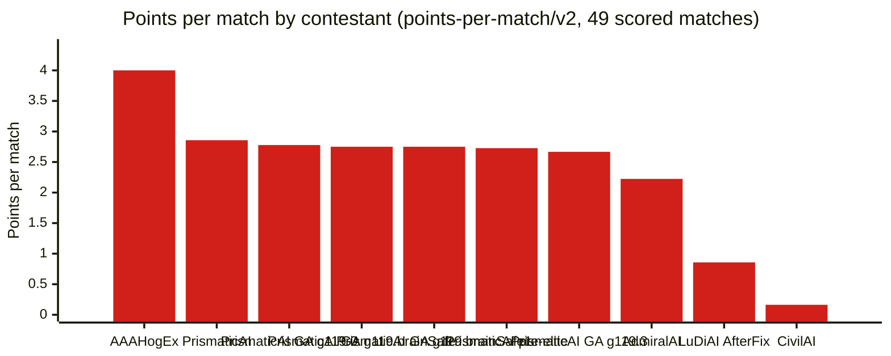
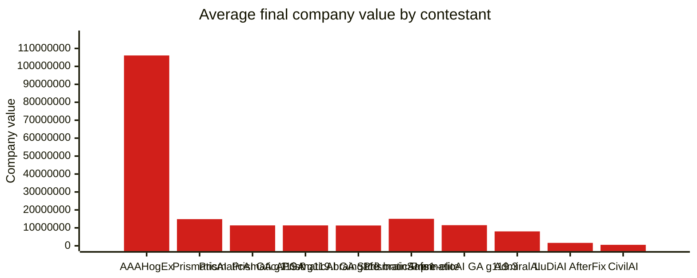
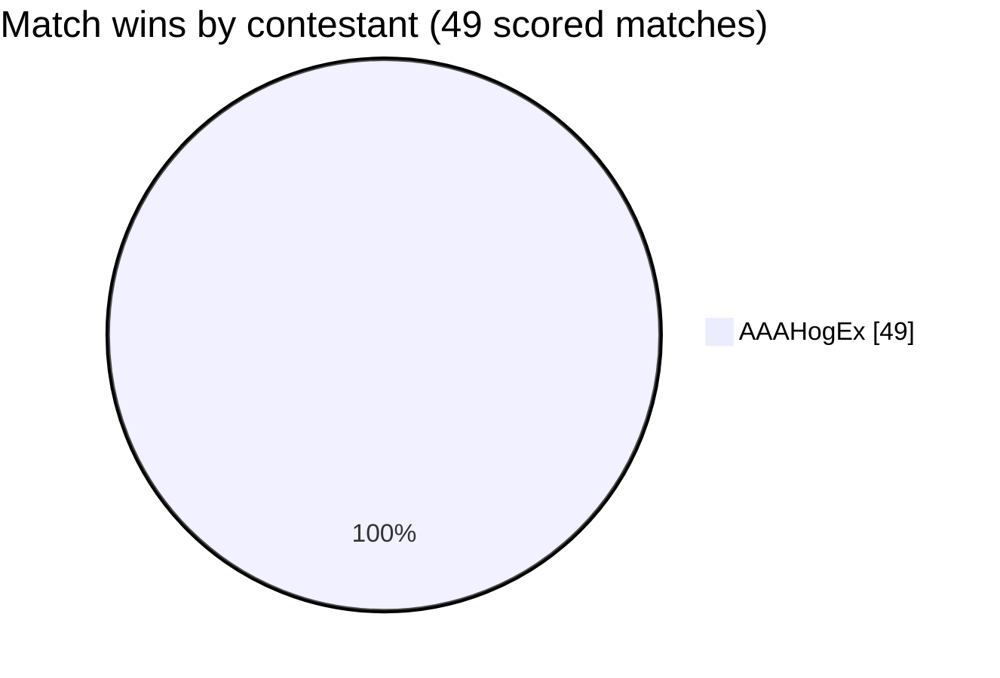
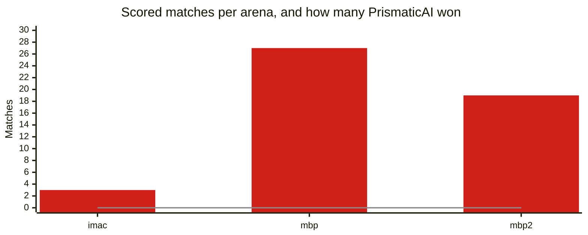

# battle-20261120T084248-a7a1bc52

Derived from `battle-20261120T084248-a7a1bc52.json` by `tools/research/ai-battle/battle.py report`; do not edit.

- Edition `a7a1bc527a04ec96`: PrismaticAI and referee at `2cab9e0314edf484880fedf08e9fc11d63d5357c`, base set `opengfx-8.0.tar`
- 20-year free-for-all from 1960, map 256x256 temperate, breakdowns 1
- 49 scored match(es) on `imac` (20261119-master-gdf1e05e7d8), `mbp` (20261120-master-m17653b726e), `mbp2` (20261119-master-gdf1e05e7d8)
- Replays: 2 of 3 identical to their original on another arena

| # | Contestant | Played | Wins | Points | Points/match | Avg rank | Avg final value | Squirrel errors | Matches with anomalies |
|---|---|---|---|---|---|---|---|---|---|
| 1 | AAAHogEx | 49 | 49 | 196 | 4.0 | 1.0 | 106.1 M | 0 | 0 |
| 2 | PrismaticAI | 7 | 0 | 20 | 2.857 | 2.14 | 14.8 M | 0 | 2 |
| 3 | PrismaticAI GA g119.0 | 9 | 0 | 25 | 2.778 | 2.22 | 11.4 M | 0 | 2 |
| 4 | PrismaticAI GA g119.brainSafe | 8 | 0 | 22 | 2.75 | 2.25 | 11.4 M | 0 | 4 |
| 5 | PrismaticAI GA g119.brainSafe1 | 8 | 0 | 22 | 2.75 | 2.25 | 11.3 M | 0 | 2 |
| 6 | PrismaticAI pre-elite | 11 | 0 | 30 | 2.727 | 2.27 | 15.0 M | 0 | 1 |
| 7 | PrismaticAI GA g119.3 | 6 | 0 | 16 | 2.667 | 2.33 | 11.5 M | 0 | 3 |
| 8 | AdmiralAI | 49 | 0 | 109 | 2.224 | 2.78 | 8.0 M | 44 | 1 |
| 9 | LuDiAI AfterFix | 49 | 0 | 42 | 0.857 | 4.14 | 1.6 M | 0 | 1 |
| 10 | CivilAI | 49 | 0 | 8 | 0.163 | 4.84 | 547.5 k | 0 | 9 |

```mermaid
---
config:
  xyChart:
    width: 900
    height: 360
  themeVariables:
    xyChart:
      plotColorPalette: "#d11f1a, #8a8a8a, #0b0b0b, #ece4d6"
---
xychart-beta
    title "Final company value per scored match: winner vs best PrismaticAI"
    x-axis ["m-0001", "m-0002", "m-0003", "m-0004", "m-0005", "m-0006", "m-0007", "m-0008", "m-0009", "m-0010", "m-0011", "m-0012", "m-0013", "m-0014", "m-0015", "m-0016", "m-0017", "m-0018", "m-0019", "m-0020", "m-0021", "m-0022", "m-0023", "m-0024", "m-0025", "m-0026", "m-0027", "m-0028", "m-0036", "m-0037", "m-0038", "m-0039", "m-0040", "m-0041", "m-0042", "m-0043", "m-0044", "m-0045", "m-0046", "m-0049", "m-0050", "m-0051", "m-0052", "m-0053", "m-0054", "m-0055", "m-0067", "m-0073", "m-0074"]
    %% series: Winner | Best PrismaticAI
    %% links: battle-20261120T084248-a7a1bc52.md?col=Match&filter=m-0001 | battle-20261120T084248-a7a1bc52.md?col=Match&filter=m-0002 | battle-20261120T084248-a7a1bc52.md?col=Match&filter=m-0003 | battle-20261120T084248-a7a1bc52.md?col=Match&filter=m-0004 | battle-20261120T084248-a7a1bc52.md?col=Match&filter=m-0005 | battle-20261120T084248-a7a1bc52.md?col=Match&filter=m-0006 | battle-20261120T084248-a7a1bc52.md?col=Match&filter=m-0007 | battle-20261120T084248-a7a1bc52.md?col=Match&filter=m-0008 | battle-20261120T084248-a7a1bc52.md?col=Match&filter=m-0009 | battle-20261120T084248-a7a1bc52.md?col=Match&filter=m-0010 | battle-20261120T084248-a7a1bc52.md?col=Match&filter=m-0011 | battle-20261120T084248-a7a1bc52.md?col=Match&filter=m-0012 | battle-20261120T084248-a7a1bc52.md?col=Match&filter=m-0013 | battle-20261120T084248-a7a1bc52.md?col=Match&filter=m-0014 | battle-20261120T084248-a7a1bc52.md?col=Match&filter=m-0015 | battle-20261120T084248-a7a1bc52.md?col=Match&filter=m-0016 | battle-20261120T084248-a7a1bc52.md?col=Match&filter=m-0017 | battle-20261120T084248-a7a1bc52.md?col=Match&filter=m-0018 | battle-20261120T084248-a7a1bc52.md?col=Match&filter=m-0019 | battle-20261120T084248-a7a1bc52.md?col=Match&filter=m-0020 | battle-20261120T084248-a7a1bc52.md?col=Match&filter=m-0021 | battle-20261120T084248-a7a1bc52.md?col=Match&filter=m-0022 | battle-20261120T084248-a7a1bc52.md?col=Match&filter=m-0023 | battle-20261120T084248-a7a1bc52.md?col=Match&filter=m-0024 | battle-20261120T084248-a7a1bc52.md?col=Match&filter=m-0025 | battle-20261120T084248-a7a1bc52.md?col=Match&filter=m-0026 | battle-20261120T084248-a7a1bc52.md?col=Match&filter=m-0027 | battle-20261120T084248-a7a1bc52.md?col=Match&filter=m-0028 | battle-20261120T084248-a7a1bc52.md?col=Match&filter=m-0036 | battle-20261120T084248-a7a1bc52.md?col=Match&filter=m-0037 | battle-20261120T084248-a7a1bc52.md?col=Match&filter=m-0038 | battle-20261120T084248-a7a1bc52.md?col=Match&filter=m-0039 | battle-20261120T084248-a7a1bc52.md?col=Match&filter=m-0040 | battle-20261120T084248-a7a1bc52.md?col=Match&filter=m-0041 | battle-20261120T084248-a7a1bc52.md?col=Match&filter=m-0042 | battle-20261120T084248-a7a1bc52.md?col=Match&filter=m-0043 | battle-20261120T084248-a7a1bc52.md?col=Match&filter=m-0044 | battle-20261120T084248-a7a1bc52.md?col=Match&filter=m-0045 | battle-20261120T084248-a7a1bc52.md?col=Match&filter=m-0046 | battle-20261120T084248-a7a1bc52.md?col=Match&filter=m-0049 | battle-20261120T084248-a7a1bc52.md?col=Match&filter=m-0050 | battle-20261120T084248-a7a1bc52.md?col=Match&filter=m-0051 | battle-20261120T084248-a7a1bc52.md?col=Match&filter=m-0052 | battle-20261120T084248-a7a1bc52.md?col=Match&filter=m-0053 | battle-20261120T084248-a7a1bc52.md?col=Match&filter=m-0054 | battle-20261120T084248-a7a1bc52.md?col=Match&filter=m-0055 | battle-20261120T084248-a7a1bc52.md?col=Match&filter=m-0067 | battle-20261120T084248-a7a1bc52.md?col=Match&filter=m-0073 | battle-20261120T084248-a7a1bc52.md?col=Match&filter=m-0074
    y-axis "Company value" 0 --> 162000000
    bar [84849330, 108793292, 93620671, 121173663, 89654950, 97750134, 94847958, 120644371, 92659408, 114632009, 118248836, 123339800, 88261121, 118852610, 133438145, 127435981, 75070717, 121763319, 137016422, 115335065, 138083001, 142534727, 102126089, 107984476, 93054197, 96002936, 101727248, 102017253, 121971258, 127362036, 107580953, 126985525, 128350484, 127094441, 90390482, 70085043, 76660552, 82922172, 65454316, 99598894, 99916415, 147233544, 116626574, 93142721, 102669015, 68858669, 108733119, 82014453, 93643179]
    line [12367584, 9702437, 5455701, 9783616, 10030200, 13867682, 12981210, 17339970, 12660187, 14769257, 12378672, 17351662, 13268927, 15241977, 11801432, 14059924, 12840960, 14674412, 14761329, 14167183, 13329577, 9175467, 10407013, 18111544, 15200826, 4365068, 17912887, 10559479, 7290662, 9404474, 7955764, 8573626, 6146870, 7681469, 14810106, 14212384, 10199150, 9552271, 11510803, 16679100, 11851036, 11670142, 14577329, 15667051, 17838965, 11912436, 25372067, 19186797, 11568812]
```

<!-- battle-charts:begin -->
<!-- derived from battle-20261120T084248-a7a1bc52.json by `battle.py render`; `battle.py check` fails when it is stale -->

<!-- battle-charts:end -->

| Seed | Original | Replay | Arenas | Identical |
|---|---|---|---|---|
| 367072039 | m-0013 | m-0048 | mbp2 / mbp | yes |
| 367072039 | m-0014 | m-0056 | mbp2 / mbp | yes |
| 1313431548 | m-0010 | m-0072 | imac / mbp | NO |

| Match | Arena | Seed | Winner | Value | Last | Anomalies |
|---|---|---|---|---|---|---|
| m-0001 | mbp | 1471717003 | AAAHogEx | 84.8 M | CivilAI | - |
| m-0002 | mbp | 1471717003 | AAAHogEx | 108.8 M | CivilAI | - |
| m-0003 | mbp | 1471717003 | AAAHogEx | 93.6 M | CivilAI | PrismaticAI GA g119.brainSafe: fleet_drop:75->47 |
| m-0004 | mbp | 1471717003 | AAAHogEx | 121.2 M | CivilAI | - |
| m-0005 | mbp | 1471717003 | AAAHogEx | 89.7 M | LuDiAI AfterFix | PrismaticAI GA g119.3: fleet_drop:89->49 |
| m-0006 | mbp | 1313431548 | AAAHogEx | 97.8 M | CivilAI | - |
| m-0007 | mbp | 1313431548 | AAAHogEx | 94.8 M | CivilAI | - |
| m-0008 | mbp | 1313431548 | AAAHogEx | 120.6 M | CivilAI | CivilAI: fleet_drop:71->47 |
| m-0009 | mbp | 1313431548 | AAAHogEx | 92.7 M | CivilAI | - |
| m-0010 | imac | 1313431548 | AAAHogEx | 114.6 M | CivilAI | CivilAI: fleet_drop:10->3 |
| m-0011 | imac | 1313431548 | AAAHogEx | 118.2 M | CivilAI | - |
| m-0012 | imac | 367072039 | AAAHogEx | 123.3 M | CivilAI | CivilAI: fleet_drop:18->7 |
| m-0013 | mbp2 | 367072039 | AAAHogEx | 88.3 M | CivilAI | - |
| m-0014 | mbp2 | 367072039 | AAAHogEx | 118.9 M | CivilAI | PrismaticAI GA g119.0: fleet_drop:110->58 |
| m-0015 | mbp2 | 367072039 | AAAHogEx | 133.4 M | CivilAI | - |
| m-0016 | mbp2 | 367072039 | AAAHogEx | 127.4 M | CivilAI | CivilAI: fleet_drop:15->9 |
| m-0017 | mbp2 | 367072039 | AAAHogEx | 75.1 M | CivilAI | PrismaticAI GA g119.3: fleet_drop:88->51 |
| m-0018 | mbp2 | 482708063 | AAAHogEx | 121.8 M | CivilAI | - |
| m-0019 | mbp2 | 482708063 | AAAHogEx | 137.0 M | CivilAI | - |
| m-0020 | mbp2 | 482708063 | AAAHogEx | 115.3 M | CivilAI | CivilAI: fleet_drop:84->44 |
| m-0021 | mbp2 | 482708063 | AAAHogEx | 138.1 M | CivilAI | - |
| m-0022 | mbp2 | 482708063 | AAAHogEx | 142.5 M | LuDiAI AfterFix | - |
| m-0023 | mbp2 | 482708063 | AAAHogEx | 102.1 M | CivilAI | PrismaticAI GA g119.3: fleet_drop:75->36 |
| m-0024 | mbp2 | 67359057 | AAAHogEx | 108.0 M | CivilAI | - |
| m-0025 | mbp2 | 67359057 | AAAHogEx | 93.1 M | CivilAI | CivilAI: fleet_drop:28->19 |
| m-0026 | mbp2 | 67359057 | AAAHogEx | 96.0 M | CivilAI | CivilAI: fleet_drop:33->19 |
| m-0027 | mbp2 | 67359057 | AAAHogEx | 101.7 M | CivilAI | - |
| m-0028 | mbp2 | 67359057 | AAAHogEx | 102.0 M | CivilAI | PrismaticAI GA g119.brainSafe1: fleet_drop:67->30 |
| m-0036 | mbp | 9413428 | AAAHogEx | 122.0 M | CivilAI | PrismaticAI: fleet_drop:73->51 |
| m-0037 | mbp | 9413428 | AAAHogEx | 127.4 M | CivilAI | - |
| m-0038 | mbp | 9413428 | AAAHogEx | 107.6 M | CivilAI | CivilAI: fleet_drop:24->16 |
| m-0039 | mbp | 9413428 | AAAHogEx | 127.0 M | CivilAI | PrismaticAI GA g119.brainSafe: fleet_drop:56->37 |
| m-0040 | mbp | 9413428 | AAAHogEx | 128.4 M | CivilAI | PrismaticAI GA g119.brainSafe1: fleet_drop:86->35 |
| m-0041 | mbp | 9413428 | AAAHogEx | 127.1 M | CivilAI | - |
| m-0042 | mbp | 126641168 | AAAHogEx | 90.4 M | LuDiAI AfterFix | PrismaticAI: fleet_drop:94->63 |
| m-0043 | mbp | 126641168 | AAAHogEx | 70.1 M | LuDiAI AfterFix | - |
| m-0044 | mbp | 126641168 | AAAHogEx | 76.7 M | LuDiAI AfterFix | PrismaticAI GA g119.0: fleet_drop:73->47 |
| m-0045 | mbp | 126641168 | AAAHogEx | 82.9 M | CivilAI | PrismaticAI GA g119.brainSafe: fleet_drop:58->28 |
| m-0046 | mbp | 126641168 | AAAHogEx | 65.5 M | LuDiAI AfterFix | - |
| m-0048 (replay) | mbp | 367072039 | AAAHogEx | 88.3 M | CivilAI | - |
| m-0049 | mbp | 738161775 | AAAHogEx | 99.6 M | CivilAI | - |
| m-0050 | mbp | 738161775 | AAAHogEx | 99.9 M | CivilAI | - |
| m-0051 | mbp2 | 738161775 | AAAHogEx | 147.2 M | CivilAI | PrismaticAI GA g119.brainSafe: fleet_drop:76->52; CivilAI: fleet_drop:58->37 |
| m-0052 | mbp2 | 738161775 | AAAHogEx | 116.6 M | LuDiAI AfterFix | - |
| m-0053 | mbp2 | 738161775 | AAAHogEx | 93.1 M | CivilAI | - |
| m-0054 | mbp | 187653273 | AAAHogEx | 102.7 M | CivilAI | AdmiralAI: squirrel_errors:44 |
| m-0055 | mbp | 187653273 | AAAHogEx | 68.9 M | LuDiAI AfterFix | PrismaticAI pre-elite: fleet_drop:69->47; LuDiAI AfterFix: fleet_drop:14->4 |
| m-0056 (replay) | mbp | 367072039 | AAAHogEx | 118.9 M | CivilAI | PrismaticAI GA g119.0: fleet_drop:110->58 |
| m-0067 | mbp | 1377539225 | AAAHogEx | 108.7 M | CivilAI | - |
| m-0072 (replay) | mbp | 1313431548 | AAAHogEx | 119.1 M | CivilAI | - |
| m-0073 | mbp | 576985329 | AAAHogEx | 82.0 M | CivilAI | - |
| m-0074 | mbp | 576985329 | AAAHogEx | 93.6 M | CivilAI | - |
