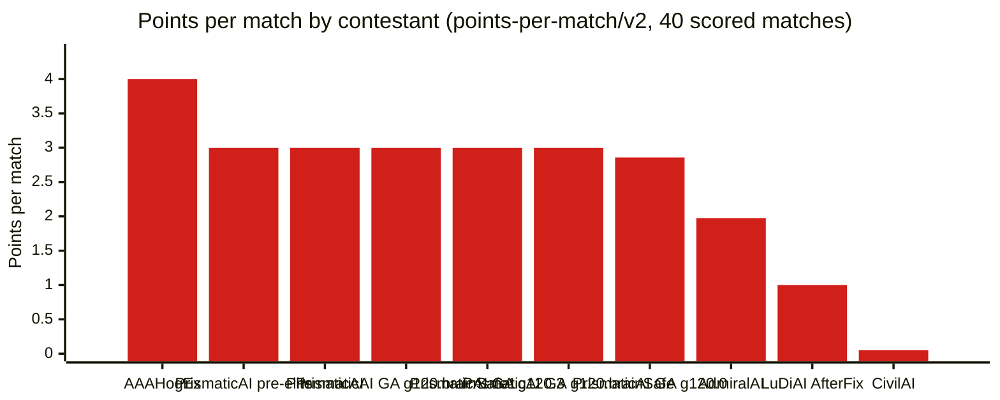
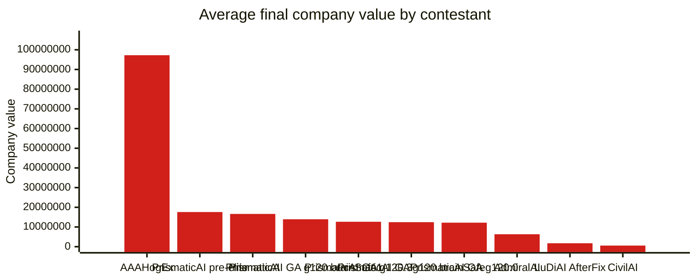
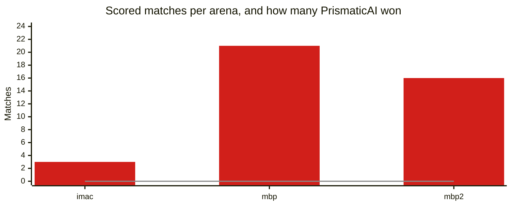

# battle-20261120T085203-ef6353aa

Derived from `battle-20261120T085203-ef6353aa.json` by `tools/research/ai-battle/battle.py report`; do not edit.

- Edition `ef6353aa7c22becd`: PrismaticAI and referee at `2cab9e0314edf484880fedf08e9fc11d63d5357c`, base set `opengfx-8.0.tar`
- 20-year free-for-all from 1960, map 256x256 temperate, breakdowns 1
- 40 scored match(es) on `imac` (20261119-master-gdf1e05e7d8), `mbp` (20261120-master-m17653b726e), `mbp2` (20261119-master-gdf1e05e7d8)
- Replays: 0 of 0 identical to their original on another arena

| # | Contestant | Played | Wins | Points | Points/match | Avg rank | Avg final value | Squirrel errors | Matches with anomalies |
|---|---|---|---|---|---|---|---|---|---|
| 1 | AAAHogEx | 40 | 40 | 160 | 4.0 | 1.0 | 97.2 M | 0 | 0 |
| 2 | PrismaticAI pre-elite | 7 | 0 | 21 | 3.0 | 2.0 | 17.6 M | 0 | 0 |
| 3 | PrismaticAI | 6 | 0 | 18 | 3.0 | 2.0 | 16.6 M | 0 | 2 |
| 4 | PrismaticAI GA g120.brainSafe1 | 7 | 0 | 21 | 3.0 | 2.0 | 13.9 M | 0 | 3 |
| 5 | PrismaticAI GA g120.3 | 6 | 0 | 18 | 3.0 | 2.0 | 12.7 M | 0 | 2 |
| 6 | PrismaticAI GA g120.brainSafe | 7 | 0 | 21 | 3.0 | 2.0 | 12.4 M | 0 | 1 |
| 7 | PrismaticAI GA g120.0 | 7 | 0 | 20 | 2.857 | 2.14 | 12.2 M | 0 | 3 |
| 8 | AdmiralAI | 40 | 0 | 79 | 1.975 | 3.02 | 6.3 M | 0 | 4 |
| 9 | LuDiAI AfterFix | 40 | 0 | 40 | 1.0 | 4.0 | 1.7 M | 0 | 0 |
| 10 | CivilAI | 40 | 0 | 2 | 0.05 | 4.95 | 560.1 k | 32 | 13 |

```mermaid
---
config:
  xyChart:
    width: 900
    height: 360
  themeVariables:
    xyChart:
      plotColorPalette: "#d11f1a, #8a8a8a, #0b0b0b, #ece4d6"
---
xychart-beta
    title "Final company value per scored match: winner vs best PrismaticAI"
    x-axis ["m-0001", "m-0002", "m-0003", "m-0004", "m-0005", "m-0006", "m-0007", "m-0008", "m-0009", "m-0010", "m-0011", "m-0012", "m-0013", "m-0014", "m-0015", "m-0016", "m-0017", "m-0018", "m-0019", "m-0020", "m-0021", "m-0022", "m-0023", "m-0024", "m-0025", "m-0026", "m-0027", "m-0028", "m-0036", "m-0037", "m-0038", "m-0039", "m-0040", "m-0041", "m-0042", "m-0043", "m-0044", "m-0045", "m-0046", "m-0047"]
    %% series: Winner | Best PrismaticAI
    %% links: battle-20261120T085203-ef6353aa.md?col=Match&filter=m-0001 | battle-20261120T085203-ef6353aa.md?col=Match&filter=m-0002 | battle-20261120T085203-ef6353aa.md?col=Match&filter=m-0003 | battle-20261120T085203-ef6353aa.md?col=Match&filter=m-0004 | battle-20261120T085203-ef6353aa.md?col=Match&filter=m-0005 | battle-20261120T085203-ef6353aa.md?col=Match&filter=m-0006 | battle-20261120T085203-ef6353aa.md?col=Match&filter=m-0007 | battle-20261120T085203-ef6353aa.md?col=Match&filter=m-0008 | battle-20261120T085203-ef6353aa.md?col=Match&filter=m-0009 | battle-20261120T085203-ef6353aa.md?col=Match&filter=m-0010 | battle-20261120T085203-ef6353aa.md?col=Match&filter=m-0011 | battle-20261120T085203-ef6353aa.md?col=Match&filter=m-0012 | battle-20261120T085203-ef6353aa.md?col=Match&filter=m-0013 | battle-20261120T085203-ef6353aa.md?col=Match&filter=m-0014 | battle-20261120T085203-ef6353aa.md?col=Match&filter=m-0015 | battle-20261120T085203-ef6353aa.md?col=Match&filter=m-0016 | battle-20261120T085203-ef6353aa.md?col=Match&filter=m-0017 | battle-20261120T085203-ef6353aa.md?col=Match&filter=m-0018 | battle-20261120T085203-ef6353aa.md?col=Match&filter=m-0019 | battle-20261120T085203-ef6353aa.md?col=Match&filter=m-0020 | battle-20261120T085203-ef6353aa.md?col=Match&filter=m-0021 | battle-20261120T085203-ef6353aa.md?col=Match&filter=m-0022 | battle-20261120T085203-ef6353aa.md?col=Match&filter=m-0023 | battle-20261120T085203-ef6353aa.md?col=Match&filter=m-0024 | battle-20261120T085203-ef6353aa.md?col=Match&filter=m-0025 | battle-20261120T085203-ef6353aa.md?col=Match&filter=m-0026 | battle-20261120T085203-ef6353aa.md?col=Match&filter=m-0027 | battle-20261120T085203-ef6353aa.md?col=Match&filter=m-0028 | battle-20261120T085203-ef6353aa.md?col=Match&filter=m-0036 | battle-20261120T085203-ef6353aa.md?col=Match&filter=m-0037 | battle-20261120T085203-ef6353aa.md?col=Match&filter=m-0038 | battle-20261120T085203-ef6353aa.md?col=Match&filter=m-0039 | battle-20261120T085203-ef6353aa.md?col=Match&filter=m-0040 | battle-20261120T085203-ef6353aa.md?col=Match&filter=m-0041 | battle-20261120T085203-ef6353aa.md?col=Match&filter=m-0042 | battle-20261120T085203-ef6353aa.md?col=Match&filter=m-0043 | battle-20261120T085203-ef6353aa.md?col=Match&filter=m-0044 | battle-20261120T085203-ef6353aa.md?col=Match&filter=m-0045 | battle-20261120T085203-ef6353aa.md?col=Match&filter=m-0046 | battle-20261120T085203-ef6353aa.md?col=Match&filter=m-0047
    y-axis "Company value" 0 --> 171000000
    bar [116169177, 139155475, 139343544, 130779450, 119963916, 65974080, 93557827, 96045934, 98867103, 82867075, 89965123, 73259173, 84065830, 75902663, 69735040, 82458100, 84985429, 73520138, 97032680, 93021436, 84858541, 87730676, 75622425, 86303071, 80862691, 85018442, 96635639, 97308108, 76988433, 76627141, 113100444, 107024528, 88764936, 90777210, 102983756, 126283363, 155885999, 102338689, 120360124, 127823126]
    line [21050339, 19435259, 11141640, 21986434, 16587823, 16689237, 16601575, 16050276, 11988403, 10950437, 8198006, 10370455, 13545456, 10722633, 8984351, 9801355, 8633605, 18376741, 18669163, 12476570, 20776208, 16913045, 21507291, 13737863, 26066320, 15834585, 10669977, 13310017, 19592898, 11983801, 9632205, 11911621, 15984652, 13801368, 21058382, 15220493, 1190122, 11633948, 8571842, 7188758]
```

<!-- battle-charts:begin -->
<!-- derived from battle-20261120T085203-ef6353aa.json by `battle.py render`; `battle.py check` fails when it is stale -->

<!-- battle-charts:end -->

| Match | Arena | Seed | Winner | Value | Last | Anomalies |
|---|---|---|---|---|---|---|
| m-0001 | mbp | 169258738 | AAAHogEx | 116.2 M | CivilAI | CivilAI: fleet_drop:26->9 |
| m-0002 | mbp | 169258738 | AAAHogEx | 139.2 M | CivilAI | PrismaticAI GA g120.0: fleet_drop:147->95 |
| m-0003 | mbp | 169258738 | AAAHogEx | 139.3 M | CivilAI | - |
| m-0004 | mbp | 169258738 | AAAHogEx | 130.8 M | CivilAI | PrismaticAI GA g120.brainSafe1: fleet_drop:83->46; CivilAI: fleet_drop:46->27 |
| m-0005 | mbp | 169258738 | AAAHogEx | 120.0 M | CivilAI | PrismaticAI GA g120.3: fleet_drop:142->59 |
| m-0006 | mbp | 1761421471 | AAAHogEx | 66.0 M | CivilAI | - |
| m-0007 | mbp | 1761421471 | AAAHogEx | 93.6 M | CivilAI | CivilAI: fleet_drop:50->28 |
| m-0008 | mbp | 1761421471 | AAAHogEx | 96.0 M | CivilAI | - |
| m-0009 | mbp | 1761421471 | AAAHogEx | 98.9 M | CivilAI | CivilAI: squirrel_errors:32 |
| m-0010 | imac | 1761421471 | AAAHogEx | 82.9 M | CivilAI | CivilAI: fleet_drop:30->20 |
| m-0011 | imac | 1761421471 | AAAHogEx | 90.0 M | CivilAI | - |
| m-0012 | imac | 1704704197 | AAAHogEx | 73.3 M | CivilAI | - |
| m-0013 | mbp2 | 1704704197 | AAAHogEx | 84.1 M | CivilAI | - |
| m-0014 | mbp2 | 1704704197 | AAAHogEx | 75.9 M | CivilAI | - |
| m-0015 | mbp2 | 1704704197 | AAAHogEx | 69.7 M | CivilAI | CivilAI: no_vehicles |
| m-0016 | mbp2 | 1704704197 | AAAHogEx | 82.5 M | CivilAI | PrismaticAI GA g120.brainSafe1: fleet_drop:77->43 |
| m-0017 | mbp2 | 1704704197 | AAAHogEx | 85.0 M | CivilAI | - |
| m-0018 | mbp2 | 982936930 | AAAHogEx | 73.5 M | CivilAI | PrismaticAI: fleet_drop:105->71; CivilAI: fleet_drop:54->28 |
| m-0019 | mbp2 | 982936930 | AAAHogEx | 97.0 M | CivilAI | - |
| m-0020 | mbp2 | 982936930 | AAAHogEx | 93.0 M | CivilAI | PrismaticAI GA g120.0: fleet_drop:115->65 |
| m-0021 | mbp2 | 982936930 | AAAHogEx | 84.9 M | CivilAI | - |
| m-0022 | mbp2 | 982936930 | AAAHogEx | 87.7 M | CivilAI | - |
| m-0023 | mbp2 | 982936930 | AAAHogEx | 75.6 M | CivilAI | - |
| m-0024 | mbp2 | 351953238 | AAAHogEx | 86.3 M | CivilAI | PrismaticAI: fleet_drop:99->63; CivilAI: fleet_drop:46->24 |
| m-0025 | mbp2 | 351953238 | AAAHogEx | 80.9 M | LuDiAI AfterFix | - |
| m-0026 | mbp2 | 351953238 | AAAHogEx | 85.0 M | LuDiAI AfterFix | PrismaticAI GA g120.0: fleet_drop:129->87 |
| m-0027 | mbp2 | 351953238 | AAAHogEx | 96.6 M | CivilAI | CivilAI: fleet_drop:39->21 |
| m-0028 | mbp2 | 351953238 | AAAHogEx | 97.3 M | CivilAI | CivilAI: fleet_drop:40->21 |
| m-0036 | mbp | 1201899165 | AAAHogEx | 77.0 M | CivilAI | AdmiralAI: fleet_drop:402->263 |
| m-0037 | mbp | 1201899165 | AAAHogEx | 76.6 M | CivilAI | - |
| m-0038 | mbp | 1201899165 | AAAHogEx | 113.1 M | CivilAI | - |
| m-0039 | mbp | 1201899165 | AAAHogEx | 107.0 M | CivilAI | AdmiralAI: fleet_drop:223->142 |
| m-0040 | mbp | 1201899165 | AAAHogEx | 88.8 M | CivilAI | AdmiralAI: fleet_drop:237->141; CivilAI: fleet_drop:155->48 |
| m-0041 | mbp | 1201899165 | AAAHogEx | 90.8 M | CivilAI | - |
| m-0042 | mbp | 1428177777 | AAAHogEx | 103.0 M | CivilAI | - |
| m-0043 | mbp | 1428177777 | AAAHogEx | 126.3 M | CivilAI | AdmiralAI: fleet_drop:125->69 |
| m-0044 | mbp | 1428177777 | AAAHogEx | 155.9 M | CivilAI | CivilAI: fleet_drop:19->13 |
| m-0045 | mbp | 1428177777 | AAAHogEx | 102.3 M | CivilAI | PrismaticAI GA g120.brainSafe: fleet_drop:62->39; CivilAI: fleet_drop:91->62 |
| m-0046 | mbp | 1428177777 | AAAHogEx | 120.4 M | CivilAI | PrismaticAI GA g120.brainSafe1: fleet_drop:64->42 |
| m-0047 | mbp | 1428177777 | AAAHogEx | 127.8 M | CivilAI | PrismaticAI GA g120.3: fleet_drop:67->44 |
