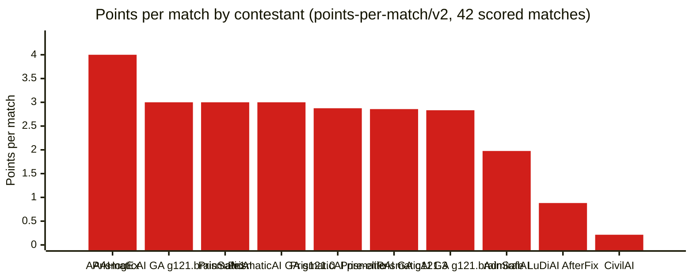
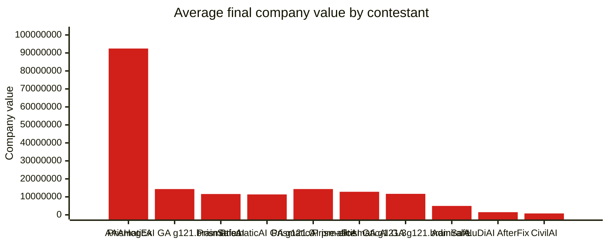
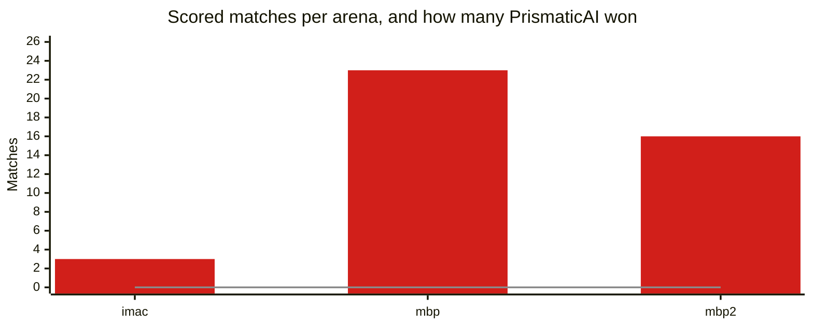

# battle-20261120T090127-3b430f60

Derived from `battle-20261120T090127-3b430f60.json` by `tools/research/ai-battle/battle.py report`; do not edit.

- Edition `3b430f60ba34c18d`: PrismaticAI and referee at `2cab9e0314edf484880fedf08e9fc11d63d5357c`, base set `opengfx-8.0.tar`
- 20-year free-for-all from 1960, map 256x256 temperate, breakdowns 1
- 42 scored match(es) on `imac` (20261119-master-gdf1e05e7d8), `mbp` (20261120-master-m17653b726e), `mbp2` (20261119-master-gdf1e05e7d8)
- Replays: 0 of 0 identical to their original on another arena

| # | Contestant | Played | Wins | Points | Points/match | Avg rank | Avg final value | Squirrel errors | Matches with anomalies |
|---|---|---|---|---|---|---|---|---|---|
| 1 | AAAHogEx | 42 | 42 | 168 | 4.0 | 1.0 | 92.5 M | 0 | 0 |
| 2 | PrismaticAI GA g121.brainSafe1 | 7 | 0 | 21 | 3.0 | 2.0 | 14.3 M | 0 | 2 |
| 3 | PrismaticAI | 7 | 0 | 21 | 3.0 | 2.0 | 11.6 M | 0 | 2 |
| 4 | PrismaticAI GA g121.0 | 7 | 0 | 21 | 3.0 | 2.0 | 11.4 M | 0 | 0 |
| 5 | PrismaticAI pre-elite | 8 | 0 | 23 | 2.875 | 2.12 | 14.3 M | 0 | 1 |
| 6 | PrismaticAI GA g121.3 | 7 | 0 | 20 | 2.857 | 2.14 | 12.8 M | 0 | 1 |
| 7 | PrismaticAI GA g121.brainSafe | 6 | 0 | 17 | 2.833 | 2.17 | 11.7 M | 0 | 3 |
| 8 | AdmiralAI | 42 | 0 | 83 | 1.976 | 3.02 | 5.0 M | 0 | 1 |
| 9 | LuDiAI AfterFix | 42 | 0 | 37 | 0.881 | 4.12 | 1.5 M | 0 | 1 |
| 10 | CivilAI | 42 | 0 | 9 | 0.214 | 4.79 | 780.4 k | 0 | 3 |

```mermaid
---
config:
  xyChart:
    width: 900
    height: 360
  themeVariables:
    xyChart:
      plotColorPalette: "#d11f1a, #8a8a8a, #0b0b0b, #ece4d6"
---
xychart-beta
    title "Final company value per scored match: winner vs best PrismaticAI"
    x-axis ["m-0001", "m-0002", "m-0003", "m-0004", "m-0005", "m-0006", "m-0007", "m-0008", "m-0009", "m-0010", "m-0011", "m-0012", "m-0013", "m-0014", "m-0015", "m-0016", "m-0017", "m-0018", "m-0019", "m-0020", "m-0021", "m-0022", "m-0023", "m-0024", "m-0025", "m-0026", "m-0027", "m-0028", "m-0036", "m-0037", "m-0038", "m-0039", "m-0040", "m-0041", "m-0042", "m-0043", "m-0044", "m-0052", "m-0053", "m-0059", "m-0060", "m-0061"]
    %% series: Winner | Best PrismaticAI
    %% links: battle-20261120T090127-3b430f60.md?col=Match&filter=m-0001 | battle-20261120T090127-3b430f60.md?col=Match&filter=m-0002 | battle-20261120T090127-3b430f60.md?col=Match&filter=m-0003 | battle-20261120T090127-3b430f60.md?col=Match&filter=m-0004 | battle-20261120T090127-3b430f60.md?col=Match&filter=m-0005 | battle-20261120T090127-3b430f60.md?col=Match&filter=m-0006 | battle-20261120T090127-3b430f60.md?col=Match&filter=m-0007 | battle-20261120T090127-3b430f60.md?col=Match&filter=m-0008 | battle-20261120T090127-3b430f60.md?col=Match&filter=m-0009 | battle-20261120T090127-3b430f60.md?col=Match&filter=m-0010 | battle-20261120T090127-3b430f60.md?col=Match&filter=m-0011 | battle-20261120T090127-3b430f60.md?col=Match&filter=m-0012 | battle-20261120T090127-3b430f60.md?col=Match&filter=m-0013 | battle-20261120T090127-3b430f60.md?col=Match&filter=m-0014 | battle-20261120T090127-3b430f60.md?col=Match&filter=m-0015 | battle-20261120T090127-3b430f60.md?col=Match&filter=m-0016 | battle-20261120T090127-3b430f60.md?col=Match&filter=m-0017 | battle-20261120T090127-3b430f60.md?col=Match&filter=m-0018 | battle-20261120T090127-3b430f60.md?col=Match&filter=m-0019 | battle-20261120T090127-3b430f60.md?col=Match&filter=m-0020 | battle-20261120T090127-3b430f60.md?col=Match&filter=m-0021 | battle-20261120T090127-3b430f60.md?col=Match&filter=m-0022 | battle-20261120T090127-3b430f60.md?col=Match&filter=m-0023 | battle-20261120T090127-3b430f60.md?col=Match&filter=m-0024 | battle-20261120T090127-3b430f60.md?col=Match&filter=m-0025 | battle-20261120T090127-3b430f60.md?col=Match&filter=m-0026 | battle-20261120T090127-3b430f60.md?col=Match&filter=m-0027 | battle-20261120T090127-3b430f60.md?col=Match&filter=m-0028 | battle-20261120T090127-3b430f60.md?col=Match&filter=m-0036 | battle-20261120T090127-3b430f60.md?col=Match&filter=m-0037 | battle-20261120T090127-3b430f60.md?col=Match&filter=m-0038 | battle-20261120T090127-3b430f60.md?col=Match&filter=m-0039 | battle-20261120T090127-3b430f60.md?col=Match&filter=m-0040 | battle-20261120T090127-3b430f60.md?col=Match&filter=m-0041 | battle-20261120T090127-3b430f60.md?col=Match&filter=m-0042 | battle-20261120T090127-3b430f60.md?col=Match&filter=m-0043 | battle-20261120T090127-3b430f60.md?col=Match&filter=m-0044 | battle-20261120T090127-3b430f60.md?col=Match&filter=m-0052 | battle-20261120T090127-3b430f60.md?col=Match&filter=m-0053 | battle-20261120T090127-3b430f60.md?col=Match&filter=m-0059 | battle-20261120T090127-3b430f60.md?col=Match&filter=m-0060 | battle-20261120T090127-3b430f60.md?col=Match&filter=m-0061
    y-axis "Company value" 0 --> 171000000
    bar [113873479, 106499746, 108283935, 122070881, 133440135, 101985762, 97835639, 98895508, 77309455, 71254458, 93119790, 94929681, 119066754, 90246707, 94952628, 98387888, 96743454, 73140006, 71234141, 59330969, 79915168, 71726131, 83365480, 64226920, 69196027, 42438258, 78756567, 78354834, 77550844, 76110557, 70229118, 79266064, 110993832, 104247015, 109645998, 94680471, 111149196, 155037245, 142060698, 100974066, 71234143, 89225989]
    line [21081819, 14015782, 13080695, 13593180, 16291889, 2624242, 3668175, 3422725, 4960470, 14563680, 5114553, 14649336, 16436338, 17368544, 14259677, 11826994, 15190366, 12048474, 16533250, 12458446, 10701794, 12499094, 11918175, 11532536, 11163158, 11919522, 10181350, 13430047, 17437678, 17668366, 10199137, 16890567, 14668478, 11828279, 11769062, 16692755, 10090818, 19737364, 19871169, 9573490, 11035878, 11475248]
```

<!-- battle-charts:begin -->
<!-- derived from battle-20261120T090127-3b430f60.json by `battle.py render`; `battle.py check` fails when it is stale -->

<!-- battle-charts:end -->

| Match | Arena | Seed | Winner | Value | Last | Anomalies |
|---|---|---|---|---|---|---|
| m-0001 | mbp | 1521100565 | AAAHogEx | 113.9 M | LuDiAI AfterFix | - |
| m-0002 | mbp | 1521100565 | AAAHogEx | 106.5 M | CivilAI | - |
| m-0003 | mbp | 1521100565 | AAAHogEx | 108.3 M | CivilAI | PrismaticAI GA g121.brainSafe: fleet_drop:185->67 |
| m-0004 | mbp | 1521100565 | AAAHogEx | 122.1 M | CivilAI | AdmiralAI: fleet_drop:430->283 |
| m-0005 | mbp | 1521100565 | AAAHogEx | 133.4 M | CivilAI | - |
| m-0006 | mbp | 1025285638 | AAAHogEx | 102.0 M | CivilAI | PrismaticAI: fleet_drop:52->32 |
| m-0007 | mbp | 1025285638 | AAAHogEx | 97.8 M | CivilAI | PrismaticAI pre-elite: fleet_drop:47->23 |
| m-0008 | mbp | 1025285638 | AAAHogEx | 98.9 M | CivilAI | - |
| m-0009 | mbp | 1025285638 | AAAHogEx | 77.3 M | CivilAI | PrismaticAI GA g121.brainSafe: fleet_drop:38->23 |
| m-0010 | imac | 1025285638 | AAAHogEx | 71.3 M | LuDiAI AfterFix | CivilAI: fleet_drop:13->9 |
| m-0011 | imac | 1025285638 | AAAHogEx | 93.1 M | CivilAI | PrismaticAI GA g121.3: fleet_drop:35->16 |
| m-0012 | imac | 665213927 | AAAHogEx | 94.9 M | LuDiAI AfterFix | - |
| m-0013 | mbp2 | 665213927 | AAAHogEx | 119.1 M | CivilAI | - |
| m-0014 | mbp2 | 665213927 | AAAHogEx | 90.2 M | CivilAI | - |
| m-0015 | mbp2 | 665213927 | AAAHogEx | 95.0 M | LuDiAI AfterFix | PrismaticAI GA g121.brainSafe: fleet_drop:101->64; CivilAI: fleet_drop:20->13; LuDiAI AfterFix: fleet_drop:57->29 |
| m-0016 | mbp2 | 665213927 | AAAHogEx | 98.4 M | LuDiAI AfterFix | PrismaticAI GA g121.brainSafe1: fleet_drop:72->44 |
| m-0017 | mbp2 | 665213927 | AAAHogEx | 96.7 M | CivilAI | - |
| m-0018 | mbp2 | 1470164604 | AAAHogEx | 73.1 M | CivilAI | PrismaticAI: fleet_drop:91->57 |
| m-0019 | mbp2 | 1470164604 | AAAHogEx | 71.2 M | CivilAI | - |
| m-0020 | mbp2 | 1470164604 | AAAHogEx | 59.3 M | CivilAI | - |
| m-0021 | mbp2 | 1470164604 | AAAHogEx | 79.9 M | CivilAI | - |
| m-0022 | mbp2 | 1470164604 | AAAHogEx | 71.7 M | CivilAI | - |
| m-0023 | mbp2 | 1470164604 | AAAHogEx | 83.4 M | AdmiralAI | - |
| m-0024 | mbp2 | 26811426 | AAAHogEx | 64.2 M | CivilAI | - |
| m-0025 | mbp2 | 26811426 | AAAHogEx | 69.2 M | CivilAI | - |
| m-0026 | mbp2 | 26811426 | AAAHogEx | 42.4 M | CivilAI | - |
| m-0027 | mbp2 | 26811426 | AAAHogEx | 78.8 M | CivilAI | CivilAI: fleet_drop:35->21 |
| m-0028 | mbp2 | 26811426 | AAAHogEx | 78.4 M | LuDiAI AfterFix | - |
| m-0036 | mbp | 562855746 | AAAHogEx | 77.6 M | CivilAI | - |
| m-0037 | mbp | 562855746 | AAAHogEx | 76.1 M | CivilAI | - |
| m-0038 | mbp | 562855746 | AAAHogEx | 70.2 M | CivilAI | - |
| m-0039 | mbp | 562855746 | AAAHogEx | 79.3 M | CivilAI | - |
| m-0040 | mbp | 562855746 | AAAHogEx | 111.0 M | LuDiAI AfterFix | - |
| m-0041 | mbp | 562855746 | AAAHogEx | 104.2 M | CivilAI | - |
| m-0042 | mbp | 1470190073 | AAAHogEx | 109.6 M | CivilAI | - |
| m-0043 | mbp | 1470190073 | AAAHogEx | 94.7 M | CivilAI | - |
| m-0044 | mbp | 1470190073 | AAAHogEx | 111.1 M | CivilAI | - |
| m-0052 | mbp | 983235 | AAAHogEx | 155.0 M | CivilAI | PrismaticAI GA g121.brainSafe1: fleet_drop:107->51 |
| m-0053 | mbp | 983235 | AAAHogEx | 142.1 M | CivilAI | - |
| m-0059 | mbp | 2245414 | AAAHogEx | 101.0 M | CivilAI | - |
| m-0060 | mbp | 821709730 | AAAHogEx | 71.2 M | CivilAI | - |
| m-0061 | mbp | 821709730 | AAAHogEx | 89.2 M | LuDiAI AfterFix | - |
