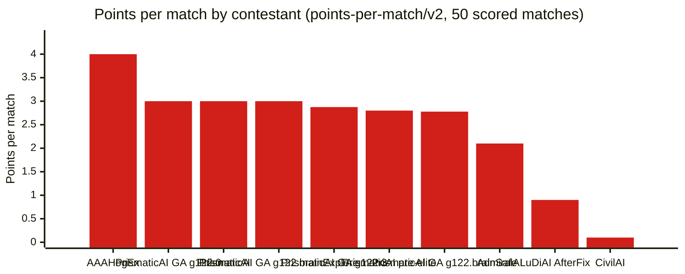
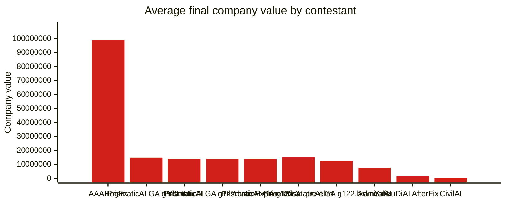
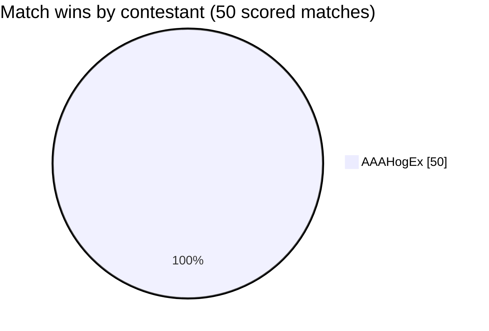
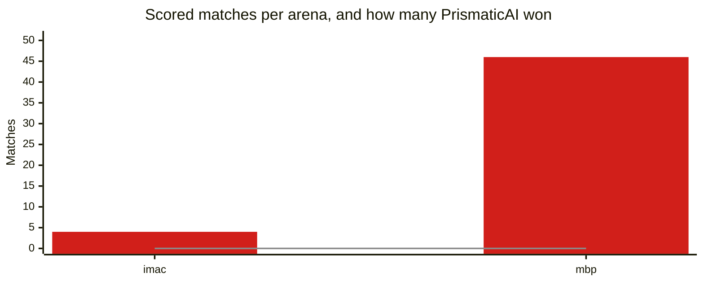

# battle-20261120T092020-0cfd506f

Derived from `battle-20261120T092020-0cfd506f.json` by `tools/research/ai-battle/battle.py report`; do not edit.

- Edition `0cfd506f4003d0b1`: PrismaticAI and referee at `2cab9e0314edf484880fedf08e9fc11d63d5357c`, base set `opengfx-8.0.tar`
- 20-year free-for-all from 1960, map 256x256 temperate, breakdowns 1
- 50 scored match(es) on `imac` (20261119-master-gdf1e05e7d8), `mbp` (20261120-master-m17653b726e), `mbp2` (20261119-master-gdf1e05e7d8)
- Replays: 0 of 2 identical to their original on another arena

| # | Contestant | Played | Wins | Points | Points/match | Avg rank | Avg final value | Squirrel errors | Matches with anomalies |
|---|---|---|---|---|---|---|---|---|---|
| 1 | AAAHogEx | 50 | 50 | 200 | 4.0 | 1.0 | 99.0 M | 0 | 0 |
| 2 | PrismaticAI GA g122.0 | 9 | 0 | 27 | 3.0 | 2.0 | 15.0 M | 0 | 2 |
| 3 | PrismaticAI | 8 | 0 | 24 | 3.0 | 2.0 | 14.3 M | 0 | 3 |
| 4 | PrismaticAI GA g122.brainExplore | 6 | 0 | 18 | 3.0 | 2.0 | 14.3 M | 0 | 3 |
| 5 | PrismaticAI GA g122.3 | 8 | 0 | 23 | 2.875 | 2.12 | 13.9 M | 0 | 3 |
| 6 | PrismaticAI pre-elite | 10 | 0 | 28 | 2.8 | 2.2 | 15.3 M | 0 | 0 |
| 7 | PrismaticAI GA g122.brainSafe | 9 | 0 | 25 | 2.778 | 2.22 | 12.5 M | 0 | 3 |
| 8 | AdmiralAI | 50 | 0 | 105 | 2.1 | 2.9 | 7.8 M | 44 | 2 |
| 9 | LuDiAI AfterFix | 50 | 0 | 45 | 0.9 | 4.1 | 1.7 M | 0 | 2 |
| 10 | CivilAI | 50 | 0 | 5 | 0.1 | 4.9 | 574.7 k | 0 | 7 |

```mermaid
---
config:
  xyChart:
    width: 900
    height: 360
  themeVariables:
    xyChart:
      plotColorPalette: "#d11f1a, #8a8a8a, #0b0b0b, #ece4d6"
---
xychart-beta
    title "Final company value per scored match: winner vs best PrismaticAI"
    x-axis ["m-0001", "m-0002", "m-0003", "m-0004", "m-0005", "m-0006", "m-0007", "m-0008", "m-0009", "m-0010", "m-0011", "m-0012", "m-0036", "m-0037", "m-0038", "m-0039", "m-0040", "m-0041", "m-0042", "m-0043", "m-0044", "m-0045", "m-0046", "m-0047", "m-0048", "m-0049", "m-0050", "m-0051", "m-0052", "m-0053", "m-0054", "m-0055", "m-0057", "m-0058", "m-0059", "m-0060", "m-0061", "m-0062", "m-0063", "m-0065", "m-0066", "m-0067", "m-0068", "m-0069", "m-0071", "m-0073", "m-0074", "m-0091", "m-0092", "m-0093"]
    %% series: Winner | Best PrismaticAI
    %% links: battle-20261120T092020-0cfd506f.md?col=Match&filter=m-0001 | battle-20261120T092020-0cfd506f.md?col=Match&filter=m-0002 | battle-20261120T092020-0cfd506f.md?col=Match&filter=m-0003 | battle-20261120T092020-0cfd506f.md?col=Match&filter=m-0004 | battle-20261120T092020-0cfd506f.md?col=Match&filter=m-0005 | battle-20261120T092020-0cfd506f.md?col=Match&filter=m-0006 | battle-20261120T092020-0cfd506f.md?col=Match&filter=m-0007 | battle-20261120T092020-0cfd506f.md?col=Match&filter=m-0008 | battle-20261120T092020-0cfd506f.md?col=Match&filter=m-0009 | battle-20261120T092020-0cfd506f.md?col=Match&filter=m-0010 | battle-20261120T092020-0cfd506f.md?col=Match&filter=m-0011 | battle-20261120T092020-0cfd506f.md?col=Match&filter=m-0012 | battle-20261120T092020-0cfd506f.md?col=Match&filter=m-0036 | battle-20261120T092020-0cfd506f.md?col=Match&filter=m-0037 | battle-20261120T092020-0cfd506f.md?col=Match&filter=m-0038 | battle-20261120T092020-0cfd506f.md?col=Match&filter=m-0039 | battle-20261120T092020-0cfd506f.md?col=Match&filter=m-0040 | battle-20261120T092020-0cfd506f.md?col=Match&filter=m-0041 | battle-20261120T092020-0cfd506f.md?col=Match&filter=m-0042 | battle-20261120T092020-0cfd506f.md?col=Match&filter=m-0043 | battle-20261120T092020-0cfd506f.md?col=Match&filter=m-0044 | battle-20261120T092020-0cfd506f.md?col=Match&filter=m-0045 | battle-20261120T092020-0cfd506f.md?col=Match&filter=m-0046 | battle-20261120T092020-0cfd506f.md?col=Match&filter=m-0047 | battle-20261120T092020-0cfd506f.md?col=Match&filter=m-0048 | battle-20261120T092020-0cfd506f.md?col=Match&filter=m-0049 | battle-20261120T092020-0cfd506f.md?col=Match&filter=m-0050 | battle-20261120T092020-0cfd506f.md?col=Match&filter=m-0051 | battle-20261120T092020-0cfd506f.md?col=Match&filter=m-0052 | battle-20261120T092020-0cfd506f.md?col=Match&filter=m-0053 | battle-20261120T092020-0cfd506f.md?col=Match&filter=m-0054 | battle-20261120T092020-0cfd506f.md?col=Match&filter=m-0055 | battle-20261120T092020-0cfd506f.md?col=Match&filter=m-0057 | battle-20261120T092020-0cfd506f.md?col=Match&filter=m-0058 | battle-20261120T092020-0cfd506f.md?col=Match&filter=m-0059 | battle-20261120T092020-0cfd506f.md?col=Match&filter=m-0060 | battle-20261120T092020-0cfd506f.md?col=Match&filter=m-0061 | battle-20261120T092020-0cfd506f.md?col=Match&filter=m-0062 | battle-20261120T092020-0cfd506f.md?col=Match&filter=m-0063 | battle-20261120T092020-0cfd506f.md?col=Match&filter=m-0065 | battle-20261120T092020-0cfd506f.md?col=Match&filter=m-0066 | battle-20261120T092020-0cfd506f.md?col=Match&filter=m-0067 | battle-20261120T092020-0cfd506f.md?col=Match&filter=m-0068 | battle-20261120T092020-0cfd506f.md?col=Match&filter=m-0069 | battle-20261120T092020-0cfd506f.md?col=Match&filter=m-0071 | battle-20261120T092020-0cfd506f.md?col=Match&filter=m-0073 | battle-20261120T092020-0cfd506f.md?col=Match&filter=m-0074 | battle-20261120T092020-0cfd506f.md?col=Match&filter=m-0091 | battle-20261120T092020-0cfd506f.md?col=Match&filter=m-0092 | battle-20261120T092020-0cfd506f.md?col=Match&filter=m-0093
    y-axis "Company value" 0 --> 160000000
    bar [99559309, 108064662, 94651083, 138057704, 92286946, 102586673, 108385701, 121221542, 107673414, 117703800, 101856888, 100495522, 133398172, 142670220, 130995950, 145233400, 102735108, 127887492, 99228305, 90837185, 86110813, 84790070, 80391373, 70771901, 96168518, 76494139, 80919870, 108851399, 95684154, 112104064, 89717253, 81282549, 90581795, 68397827, 98709525, 105400252, 80545698, 78659903, 77590771, 101176648, 91225541, 100839846, 81546336, 97958918, 96535709, 101951402, 129916670, 79282706, 74964895, 64005681]
    line [21980765, 13840093, 12311943, 17715048, 14647685, 10473409, 6077823, 11894929, 7684339, 9827294, 16395428, 17265666, 17904784, 19220954, 21830409, 8269690, 17059371, 19528898, 20327344, 20248692, 20471654, 20377340, 15745551, 17289300, 10043880, 8789222, 13810779, 7894230, 10370562, 4388736, 16611328, 18118568, 15898745, 14799756, 14640326, 7809803, 5111070, 7444071, 10420504, 4320649, 13761260, 16564426, 19452695, 17532614, 19699525, 24575274, 15787103, 12038711, 10836278, 11907608]
```

<!-- battle-charts:begin -->
<!-- derived from battle-20261120T092020-0cfd506f.json by `battle.py render`; `battle.py check` fails when it is stale -->

<!-- battle-charts:end -->

| Seed | Original | Replay | Arenas | Identical |
|---|---|---|---|---|
| 1607850074 | m-0012 | m-0056 | imac / mbp | NO |
| 968570719 | m-0010 | m-0072 | imac / mbp | NO |

| Match | Arena | Seed | Winner | Value | Last | Anomalies |
|---|---|---|---|---|---|---|
| m-0001 | mbp | 1443406730 | AAAHogEx | 99.6 M | LuDiAI AfterFix | - |
| m-0002 | mbp | 1443406730 | AAAHogEx | 108.1 M | CivilAI | PrismaticAI GA g122.0: fleet_drop:140->88 |
| m-0003 | mbp | 1443406730 | AAAHogEx | 94.7 M | CivilAI | - |
| m-0004 | mbp | 1443406730 | AAAHogEx | 138.1 M | CivilAI | - |
| m-0005 | mbp | 1443406730 | AAAHogEx | 92.3 M | CivilAI | - |
| m-0006 | mbp | 968570719 | AAAHogEx | 102.6 M | CivilAI | PrismaticAI: fleet_drop:121->66 |
| m-0007 | mbp | 968570719 | AAAHogEx | 108.4 M | CivilAI | - |
| m-0008 | mbp | 968570719 | AAAHogEx | 121.2 M | CivilAI | - |
| m-0009 | mbp | 968570719 | AAAHogEx | 107.7 M | CivilAI | AdmiralAI: squirrel_errors:44 |
| m-0010 | imac | 968570719 | AAAHogEx | 117.7 M | CivilAI | - |
| m-0011 | imac | 968570719 | AAAHogEx | 101.9 M | CivilAI | - |
| m-0012 | imac | 1607850074 | AAAHogEx | 100.5 M | CivilAI | PrismaticAI: fleet_drop:91->62 |
| m-0013 | mbp2 | 1607850074 | AAAHogEx | 59.0 M | CivilAI | - |
| m-0014 | mbp2 | 1607850074 | AAAHogEx | 65.8 M | CivilAI | PrismaticAI GA g122.0: fleet_drop:70->38 |
| m-0015 | mbp2 | 1607850074 | AAAHogEx | 70.2 M | CivilAI | PrismaticAI GA g122.brainSafe: fleet_drop:123->57 |
| m-0016 | mbp2 | 1607850074 | AAAHogEx | 57.9 M | CivilAI | PrismaticAI GA g122.brainExplore: fleet_drop:66->33 |
| m-0017 | mbp2 | 1607850074 | AAAHogEx | 58.1 M | CivilAI | PrismaticAI GA g122.3: fleet_drop:122->43 |
| m-0018 | mbp2 | 23636869 | AAAHogEx | 71.8 M | CivilAI | PrismaticAI: fleet_drop:106->54 |
| m-0019 | mbp2 | 23636869 | AAAHogEx | 49.6 M | CivilAI | - |
| m-0020 | mbp2 | 23636869 | AAAHogEx | 40.6 M | CivilAI | - |
| m-0021 | mbp2 | 23636869 | AAAHogEx | 67.0 M | CivilAI | - |
| m-0022 | mbp2 | 23636869 | AAAHogEx | 60.6 M | CivilAI | PrismaticAI GA g122.brainExplore: fleet_drop:99->53 |
| m-0023 | mbp2 | 23636869 | AAAHogEx | 60.7 M | CivilAI | - |
| m-0024 | mbp2 | 1907415551 | AAAHogEx | 65.6 M | LuDiAI AfterFix | PrismaticAI: fleet_drop:122->79 |
| m-0025 | mbp2 | 1907415551 | AAAHogEx | 71.1 M | CivilAI | - |
| m-0026 | mbp2 | 1907415551 | AAAHogEx | 83.9 M | CivilAI | - |
| m-0027 | mbp2 | 1907415551 | AAAHogEx | 61.3 M | LuDiAI AfterFix | CivilAI: squirrel_errors:3775 |
| m-0028 | mbp2 | 1907415551 | AAAHogEx | 60.0 M | LuDiAI AfterFix | LuDiAI AfterFix: fleet_drop:70->24 |
| m-0036 | mbp | 430708745 | AAAHogEx | 133.4 M | CivilAI | - |
| m-0037 | mbp | 430708745 | AAAHogEx | 142.7 M | CivilAI | - |
| m-0038 | mbp | 430708745 | AAAHogEx | 131.0 M | CivilAI | - |
| m-0039 | mbp | 430708745 | AAAHogEx | 145.2 M | CivilAI | - |
| m-0040 | mbp | 430708745 | AAAHogEx | 102.7 M | CivilAI | PrismaticAI GA g122.brainExplore: fleet_drop:89->58 |
| m-0041 | mbp | 430708745 | AAAHogEx | 127.9 M | CivilAI | - |
| m-0042 | mbp | 147769351 | AAAHogEx | 99.2 M | CivilAI | AdmiralAI: fleet_drop:347->211; CivilAI: fleet_drop:53->33 |
| m-0043 | mbp | 147769351 | AAAHogEx | 90.8 M | CivilAI | - |
| m-0044 | mbp | 147769351 | AAAHogEx | 86.1 M | CivilAI | - |
| m-0045 | mbp | 147769351 | AAAHogEx | 84.8 M | CivilAI | PrismaticAI GA g122.brainSafe: fleet_drop:91->43; CivilAI: fleet_drop:57->38 |
| m-0046 | mbp | 147769351 | AAAHogEx | 80.4 M | CivilAI | CivilAI: fleet_drop:64->29 |
| m-0047 | mbp | 147769351 | AAAHogEx | 70.8 M | CivilAI | CivilAI: fleet_drop:47->30 |
| m-0048 | mbp | 505482570 | AAAHogEx | 96.2 M | CivilAI | LuDiAI AfterFix: fleet_drop:93->65 |
| m-0049 | mbp | 505482570 | AAAHogEx | 76.5 M | CivilAI | - |
| m-0050 | mbp | 505482570 | AAAHogEx | 80.9 M | CivilAI | PrismaticAI GA g122.0: fleet_drop:84->34 |
| m-0051 | mbp | 505482570 | AAAHogEx | 108.9 M | CivilAI | PrismaticAI GA g122.brainSafe: fleet_drop:65->39 |
| m-0052 | mbp | 505482570 | AAAHogEx | 95.7 M | CivilAI | PrismaticAI GA g122.brainExplore: fleet_drop:146->60 |
| m-0053 | mbp | 505482570 | AAAHogEx | 112.1 M | LuDiAI AfterFix | - |
| m-0054 | mbp | 1533184249 | AAAHogEx | 89.7 M | CivilAI | - |
| m-0055 | mbp | 1533184249 | AAAHogEx | 81.3 M | CivilAI | - |
| m-0056 (replay) | mbp | 1607850074 | AAAHogEx | 100.7 M | CivilAI | PrismaticAI: fleet_drop:92->60 |
| m-0057 | mbp | 1533184249 | AAAHogEx | 90.6 M | CivilAI | PrismaticAI GA g122.brainSafe: fleet_drop:124->77 |
| m-0058 | imac | 1533184249 | AAAHogEx | 68.4 M | CivilAI | PrismaticAI GA g122.brainExplore: fleet_drop:65->37 |
| m-0059 | mbp | 1533184249 | AAAHogEx | 98.7 M | CivilAI | PrismaticAI GA g122.3: fleet_drop:154->100 |
| m-0060 | mbp | 1635288238 | AAAHogEx | 105.4 M | CivilAI | - |
| m-0061 | mbp | 1635288238 | AAAHogEx | 80.5 M | CivilAI | - |
| m-0062 | mbp | 1635288238 | AAAHogEx | 78.7 M | CivilAI | CivilAI: fleet_drop:38->6 |
| m-0063 | mbp | 1635288238 | AAAHogEx | 77.6 M | CivilAI | - |
| m-0065 | mbp | 1635288238 | AAAHogEx | 101.2 M | CivilAI | PrismaticAI GA g122.3: fleet_drop:71->41 |
| m-0066 | mbp | 946143555 | AAAHogEx | 91.2 M | CivilAI | PrismaticAI: fleet_drop:86->58; LuDiAI AfterFix: fleet_drop:70->45; CivilAI: fleet_drop:43->30 |
| m-0067 | mbp | 946143555 | AAAHogEx | 100.8 M | CivilAI | - |
| m-0068 | mbp | 946143555 | AAAHogEx | 81.5 M | CivilAI | - |
| m-0069 | mbp | 946143555 | AAAHogEx | 98.0 M | CivilAI | - |
| m-0071 | mbp | 946143555 | AAAHogEx | 96.5 M | CivilAI | PrismaticAI GA g122.3: fleet_drop:89->55; CivilAI: fleet_drop:30->12 |
| m-0072 (replay) | mbp | 968570719 | AAAHogEx | 110.9 M | CivilAI | LuDiAI AfterFix: fleet_drop:68->42 |
| m-0073 | mbp | 855982016 | AAAHogEx | 102.0 M | LuDiAI AfterFix | - |
| m-0074 | mbp | 855982016 | AAAHogEx | 129.9 M | CivilAI | - |
| m-0091 | mbp | 591922191 | AAAHogEx | 79.3 M | LuDiAI AfterFix | - |
| m-0092 | mbp | 591922191 | AAAHogEx | 75.0 M | LuDiAI AfterFix | - |
| m-0093 | mbp | 591922191 | AAAHogEx | 64.0 M | CivilAI | - |
