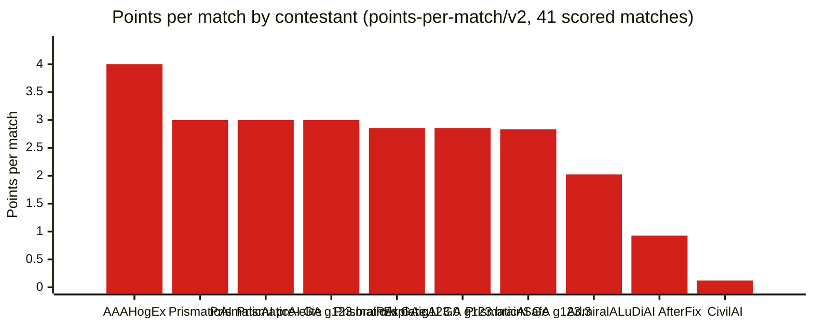
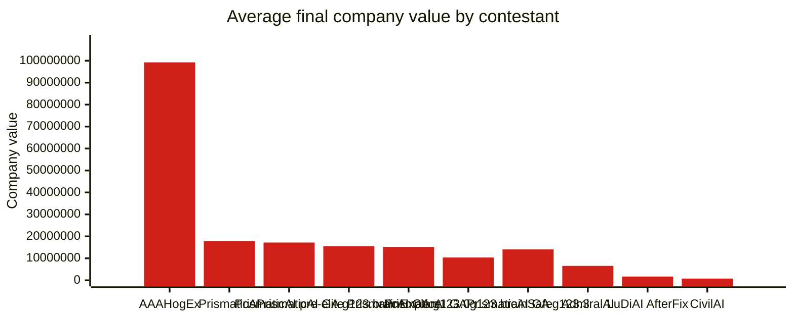
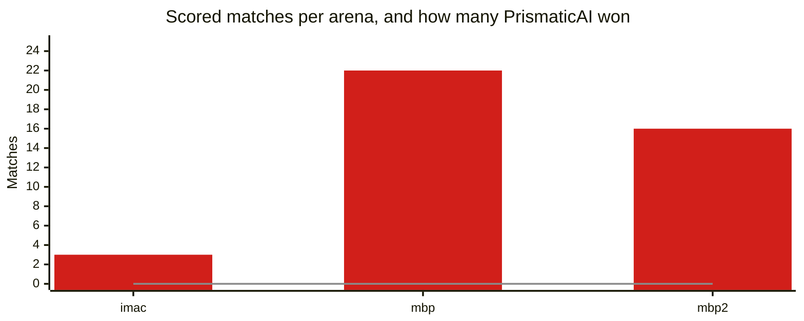

# battle-20261120T092928-8a5a3a41

Derived from `battle-20261120T092928-8a5a3a41.json` by `tools/research/ai-battle/battle.py report`; do not edit.

- Edition `8a5a3a4146591594`: PrismaticAI and referee at `2cab9e0314edf484880fedf08e9fc11d63d5357c`, base set `opengfx-8.0.tar`
- 20-year free-for-all from 1960, map 256x256 temperate, breakdowns 1
- 41 scored match(es) on `imac` (20261119-master-gdf1e05e7d8), `mbp` (20261120-master-m17653b726e), `mbp2` (20261119-master-gdf1e05e7d8)
- Replays: 0 of 0 identical to their original on another arena

| # | Contestant | Played | Wins | Points | Points/match | Avg rank | Avg final value | Squirrel errors | Matches with anomalies |
|---|---|---|---|---|---|---|---|---|---|
| 1 | AAAHogEx | 41 | 41 | 164 | 4.0 | 1.0 | 99.2 M | 0 | 0 |
| 2 | PrismaticAI | 6 | 0 | 18 | 3.0 | 2.0 | 17.9 M | 0 | 4 |
| 3 | PrismaticAI pre-elite | 8 | 0 | 24 | 3.0 | 2.0 | 17.2 M | 0 | 0 |
| 4 | PrismaticAI GA g123.brainExplore | 7 | 0 | 21 | 3.0 | 2.0 | 15.5 M | 0 | 1 |
| 5 | PrismaticAI GA g123.0 | 7 | 0 | 20 | 2.857 | 2.14 | 15.2 M | 0 | 2 |
| 6 | PrismaticAI GA g123.brainSafe | 7 | 0 | 20 | 2.857 | 2.14 | 10.4 M | 0 | 5 |
| 7 | PrismaticAI GA g123.3 | 6 | 0 | 17 | 2.833 | 2.17 | 14.1 M | 0 | 0 |
| 8 | AdmiralAI | 41 | 0 | 83 | 2.024 | 2.98 | 6.6 M | 0 | 4 |
| 9 | LuDiAI AfterFix | 41 | 0 | 38 | 0.927 | 4.07 | 1.7 M | 0 | 1 |
| 10 | CivilAI | 41 | 0 | 5 | 0.122 | 4.88 | 780.0 k | 0 | 5 |

```mermaid
---
config:
  xyChart:
    width: 900
    height: 360
  themeVariables:
    xyChart:
      plotColorPalette: "#d11f1a, #8a8a8a, #0b0b0b, #ece4d6"
---
xychart-beta
    title "Final company value per scored match: winner vs best PrismaticAI"
    x-axis ["m-0001", "m-0002", "m-0003", "m-0004", "m-0005", "m-0006", "m-0007", "m-0008", "m-0009", "m-0010", "m-0011", "m-0012", "m-0013", "m-0014", "m-0015", "m-0016", "m-0017", "m-0018", "m-0019", "m-0020", "m-0021", "m-0022", "m-0023", "m-0024", "m-0025", "m-0026", "m-0027", "m-0028", "m-0036", "m-0037", "m-0038", "m-0039", "m-0040", "m-0041", "m-0042", "m-0043", "m-0044", "m-0045", "m-0046", "m-0047", "m-0049"]
    %% series: Winner | Best PrismaticAI
    %% links: battle-20261120T092928-8a5a3a41.md?col=Match&filter=m-0001 | battle-20261120T092928-8a5a3a41.md?col=Match&filter=m-0002 | battle-20261120T092928-8a5a3a41.md?col=Match&filter=m-0003 | battle-20261120T092928-8a5a3a41.md?col=Match&filter=m-0004 | battle-20261120T092928-8a5a3a41.md?col=Match&filter=m-0005 | battle-20261120T092928-8a5a3a41.md?col=Match&filter=m-0006 | battle-20261120T092928-8a5a3a41.md?col=Match&filter=m-0007 | battle-20261120T092928-8a5a3a41.md?col=Match&filter=m-0008 | battle-20261120T092928-8a5a3a41.md?col=Match&filter=m-0009 | battle-20261120T092928-8a5a3a41.md?col=Match&filter=m-0010 | battle-20261120T092928-8a5a3a41.md?col=Match&filter=m-0011 | battle-20261120T092928-8a5a3a41.md?col=Match&filter=m-0012 | battle-20261120T092928-8a5a3a41.md?col=Match&filter=m-0013 | battle-20261120T092928-8a5a3a41.md?col=Match&filter=m-0014 | battle-20261120T092928-8a5a3a41.md?col=Match&filter=m-0015 | battle-20261120T092928-8a5a3a41.md?col=Match&filter=m-0016 | battle-20261120T092928-8a5a3a41.md?col=Match&filter=m-0017 | battle-20261120T092928-8a5a3a41.md?col=Match&filter=m-0018 | battle-20261120T092928-8a5a3a41.md?col=Match&filter=m-0019 | battle-20261120T092928-8a5a3a41.md?col=Match&filter=m-0020 | battle-20261120T092928-8a5a3a41.md?col=Match&filter=m-0021 | battle-20261120T092928-8a5a3a41.md?col=Match&filter=m-0022 | battle-20261120T092928-8a5a3a41.md?col=Match&filter=m-0023 | battle-20261120T092928-8a5a3a41.md?col=Match&filter=m-0024 | battle-20261120T092928-8a5a3a41.md?col=Match&filter=m-0025 | battle-20261120T092928-8a5a3a41.md?col=Match&filter=m-0026 | battle-20261120T092928-8a5a3a41.md?col=Match&filter=m-0027 | battle-20261120T092928-8a5a3a41.md?col=Match&filter=m-0028 | battle-20261120T092928-8a5a3a41.md?col=Match&filter=m-0036 | battle-20261120T092928-8a5a3a41.md?col=Match&filter=m-0037 | battle-20261120T092928-8a5a3a41.md?col=Match&filter=m-0038 | battle-20261120T092928-8a5a3a41.md?col=Match&filter=m-0039 | battle-20261120T092928-8a5a3a41.md?col=Match&filter=m-0040 | battle-20261120T092928-8a5a3a41.md?col=Match&filter=m-0041 | battle-20261120T092928-8a5a3a41.md?col=Match&filter=m-0042 | battle-20261120T092928-8a5a3a41.md?col=Match&filter=m-0043 | battle-20261120T092928-8a5a3a41.md?col=Match&filter=m-0044 | battle-20261120T092928-8a5a3a41.md?col=Match&filter=m-0045 | battle-20261120T092928-8a5a3a41.md?col=Match&filter=m-0046 | battle-20261120T092928-8a5a3a41.md?col=Match&filter=m-0047 | battle-20261120T092928-8a5a3a41.md?col=Match&filter=m-0049
    y-axis "Company value" 0 --> 167000000
    bar [70291928, 74971801, 62098037, 70054687, 65883015, 105264093, 131243436, 98011850, 99762903, 113798373, 108026132, 88581193, 91520844, 93297872, 106065007, 82923542, 90116915, 130684502, 101410574, 118316800, 109949084, 101156493, 113458395, 91582252, 100351540, 104871967, 85120288, 79575524, 47718071, 65882258, 92350063, 78692338, 88076403, 101725517, 144492889, 138642677, 116023682, 129519089, 152202430, 126544955, 98176848]
    line [11242573, 17742197, 8922693, 7286833, 11359087, 16204342, 19204062, 14862924, 13676386, 13360979, 18725505, 15793807, 19739709, 11025858, 3245088, 13604089, 11281953, 27704224, 24736226, 20576410, 14529535, 22604492, 20667288, 9897823, 8718746, 8709632, 5927325, 12940106, 18802511, 19803465, 19512962, 7317390, 16694170, 8392292, 18756734, 19888629, 13830213, 18968653, 22211357, 13918704, 14156032]
```

<!-- battle-charts:begin -->
<!-- derived from battle-20261120T092928-8a5a3a41.json by `battle.py render`; `battle.py check` fails when it is stale -->

<!-- battle-charts:end -->

| Match | Arena | Seed | Winner | Value | Last | Anomalies |
|---|---|---|---|---|---|---|
| m-0001 | mbp | 1447022759 | AAAHogEx | 70.3 M | CivilAI | - |
| m-0002 | mbp | 1447022759 | AAAHogEx | 75.0 M | CivilAI | - |
| m-0003 | mbp | 1447022759 | AAAHogEx | 62.1 M | CivilAI | - |
| m-0004 | mbp | 1447022759 | AAAHogEx | 70.1 M | CivilAI | CivilAI: fleet_drop:62->12 |
| m-0005 | mbp | 1447022759 | AAAHogEx | 65.9 M | CivilAI | - |
| m-0006 | mbp | 186983178 | AAAHogEx | 105.3 M | CivilAI | PrismaticAI: fleet_drop:59->37; AdmiralAI: fleet_drop:147->73 |
| m-0007 | mbp | 186983178 | AAAHogEx | 131.2 M | CivilAI | - |
| m-0008 | mbp | 186983178 | AAAHogEx | 98.0 M | CivilAI | - |
| m-0009 | mbp | 186983178 | AAAHogEx | 99.8 M | LuDiAI AfterFix | PrismaticAI GA g123.brainSafe: fleet_drop:84->58 |
| m-0010 | imac | 186983178 | AAAHogEx | 113.8 M | CivilAI | CivilAI: fleet_drop:13->9 |
| m-0011 | imac | 186983178 | AAAHogEx | 108.0 M | CivilAI | - |
| m-0012 | imac | 23715143 | AAAHogEx | 88.6 M | CivilAI | PrismaticAI: fleet_drop:99->65 |
| m-0013 | mbp2 | 23715143 | AAAHogEx | 91.5 M | CivilAI | AdmiralAI: fleet_drop:183->118 |
| m-0014 | mbp2 | 23715143 | AAAHogEx | 93.3 M | CivilAI | - |
| m-0015 | mbp2 | 23715143 | AAAHogEx | 106.1 M | CivilAI | PrismaticAI GA g123.brainSafe: fleet_drop:113->66 |
| m-0016 | mbp2 | 23715143 | AAAHogEx | 82.9 M | CivilAI | - |
| m-0017 | mbp2 | 23715143 | AAAHogEx | 90.1 M | CivilAI | AdmiralAI: fleet_drop:101->56; CivilAI: fleet_drop:52->32 |
| m-0018 | mbp2 | 1911869941 | AAAHogEx | 130.7 M | CivilAI | - |
| m-0019 | mbp2 | 1911869941 | AAAHogEx | 101.4 M | CivilAI | AdmiralAI: fleet_drop:419->229 |
| m-0020 | mbp2 | 1911869941 | AAAHogEx | 118.3 M | CivilAI | - |
| m-0021 | mbp2 | 1911869941 | AAAHogEx | 109.9 M | CivilAI | PrismaticAI GA g123.brainSafe: fleet_drop:121->58 |
| m-0022 | mbp2 | 1911869941 | AAAHogEx | 101.2 M | CivilAI | - |
| m-0023 | mbp2 | 1911869941 | AAAHogEx | 113.5 M | CivilAI | - |
| m-0024 | mbp2 | 617860072 | AAAHogEx | 91.6 M | CivilAI | PrismaticAI: fleet_drop:71->44 |
| m-0025 | mbp2 | 617860072 | AAAHogEx | 100.4 M | CivilAI | - |
| m-0026 | mbp2 | 617860072 | AAAHogEx | 104.9 M | CivilAI | PrismaticAI GA g123.0: fleet_drop:46->21 |
| m-0027 | mbp2 | 617860072 | AAAHogEx | 85.1 M | CivilAI | PrismaticAI GA g123.brainSafe: fleet_drop:57->31 |
| m-0028 | mbp2 | 617860072 | AAAHogEx | 79.6 M | CivilAI | - |
| m-0036 | mbp | 879084192 | AAAHogEx | 47.7 M | LuDiAI AfterFix | - |
| m-0037 | mbp | 879084192 | AAAHogEx | 65.9 M | LuDiAI AfterFix | - |
| m-0038 | mbp | 879084192 | AAAHogEx | 92.4 M | CivilAI | - |
| m-0039 | mbp | 879084192 | AAAHogEx | 78.7 M | CivilAI | - |
| m-0040 | mbp | 879084192 | AAAHogEx | 88.1 M | CivilAI | CivilAI: fleet_drop:52->22 |
| m-0041 | mbp | 879084192 | AAAHogEx | 101.7 M | LuDiAI AfterFix | - |
| m-0042 | mbp | 791092167 | AAAHogEx | 144.5 M | CivilAI | PrismaticAI: fleet_drop:72->41 |
| m-0043 | mbp | 791092167 | AAAHogEx | 138.6 M | CivilAI | - |
| m-0044 | mbp | 791092167 | AAAHogEx | 116.0 M | LuDiAI AfterFix | PrismaticAI GA g123.0: fleet_drop:96->64 |
| m-0045 | mbp | 791092167 | AAAHogEx | 129.5 M | CivilAI | PrismaticAI GA g123.brainSafe: fleet_drop:134->89 |
| m-0046 | mbp | 791092167 | AAAHogEx | 152.2 M | CivilAI | PrismaticAI GA g123.brainExplore: fleet_drop:103->69; LuDiAI AfterFix: fleet_drop:49->33; CivilAI: fleet_drop:44->20 |
| m-0047 | mbp | 791092167 | AAAHogEx | 126.5 M | CivilAI | - |
| m-0049 | mbp | 1801475950 | AAAHogEx | 98.2 M | CivilAI | - |
