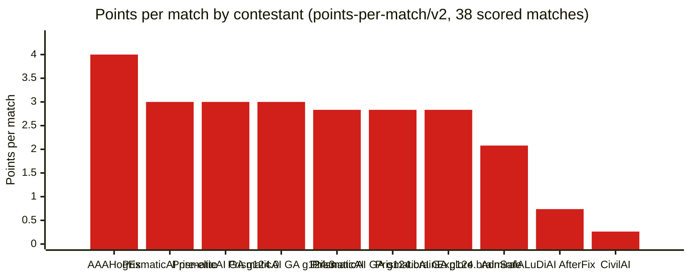
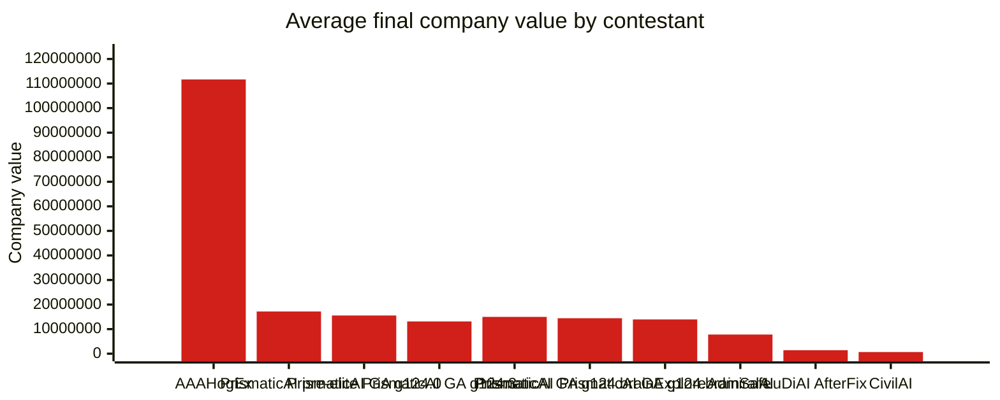
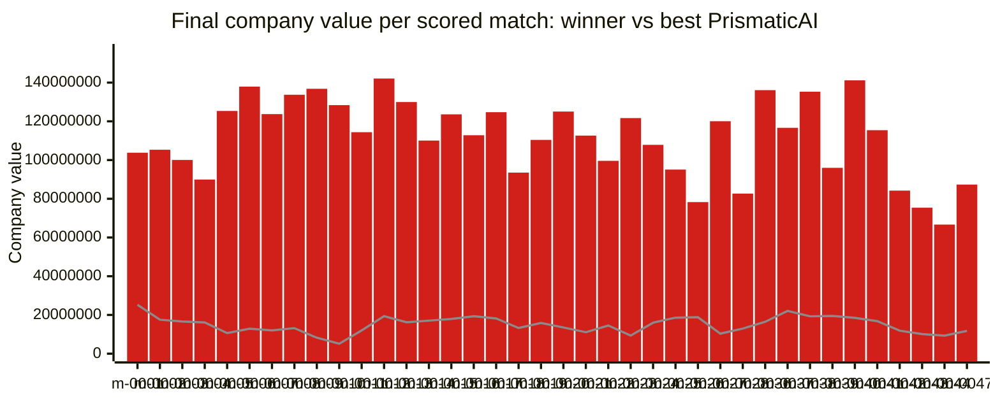
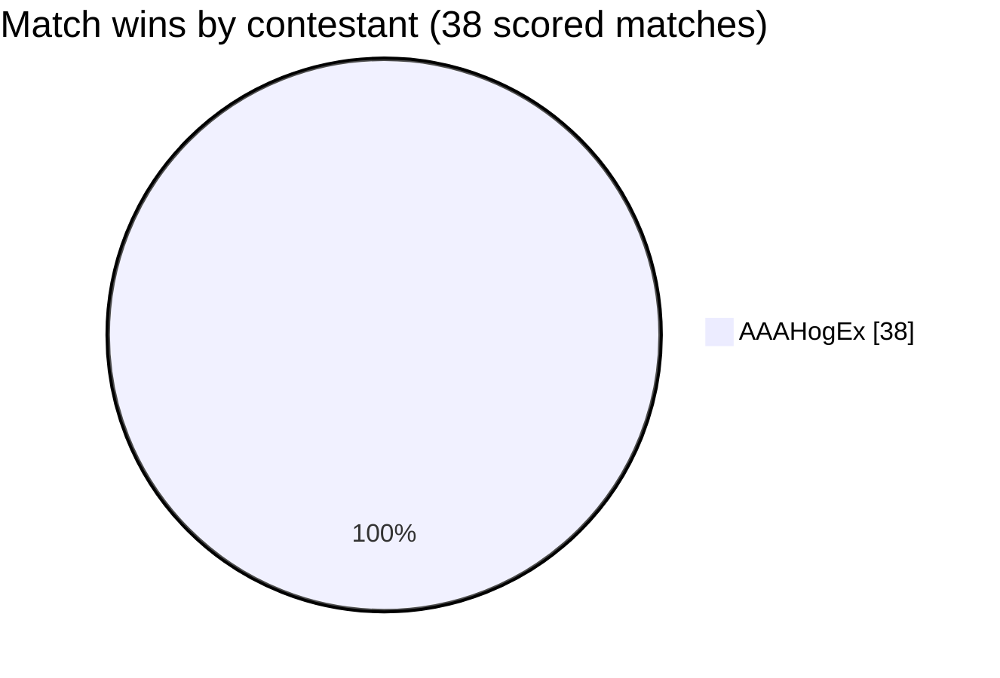
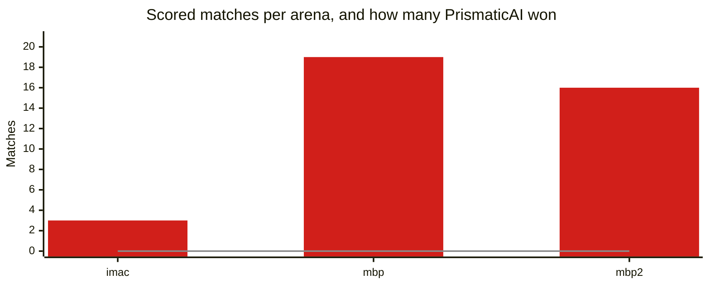

# battle-20261120T093811-1bc66b1c

Derived from `battle-20261120T093811-1bc66b1c.json` by `tools/research/ai-battle/battle.py report`; do not edit.

- Edition `1bc66b1c0aad6dc1`: PrismaticAI and referee at `2cab9e0314edf484880fedf08e9fc11d63d5357c`, base set `opengfx-8.0.tar`
- 20-year free-for-all from 1960, map 256x256 temperate, breakdowns 1
- 38 scored match(es) on `imac` (20261119-master-gdf1e05e7d8), `mbp` (20261120-master-m17653b726e), `mbp2` (20261119-master-gdf1e05e7d8)
- Replays: 0 of 0 identical to their original on another arena

| # | Contestant | Played | Wins | Points | Points/match | Avg rank | Avg final value | Squirrel errors | Matches with anomalies |
|---|---|---|---|---|---|---|---|---|---|
| 1 | AAAHogEx | 38 | 38 | 152 | 4.0 | 1.0 | 111.7 M | 0 | 0 |
| 2 | PrismaticAI pre-elite | 7 | 0 | 21 | 3.0 | 2.0 | 17.2 M | 0 | 0 |
| 3 | PrismaticAI GA g124.0 | 7 | 0 | 21 | 3.0 | 2.0 | 15.5 M | 0 | 0 |
| 4 | PrismaticAI GA g124.3 | 6 | 0 | 18 | 3.0 | 2.0 | 13.1 M | 0 | 0 |
| 5 | PrismaticAI | 6 | 0 | 17 | 2.833 | 2.17 | 15.0 M | 0 | 1 |
| 6 | PrismaticAI GA g124.brainExplore | 6 | 0 | 17 | 2.833 | 2.17 | 14.4 M | 0 | 3 |
| 7 | PrismaticAI GA g124.brainSafe | 6 | 0 | 17 | 2.833 | 2.17 | 13.9 M | 0 | 4 |
| 8 | AdmiralAI | 38 | 0 | 79 | 2.079 | 2.92 | 7.8 M | 0 | 1 |
| 9 | LuDiAI AfterFix | 38 | 0 | 28 | 0.737 | 4.26 | 1.4 M | 0 | 2 |
| 10 | CivilAI | 38 | 0 | 10 | 0.263 | 4.74 | 665.1 k | 0 | 7 |

<!-- battle-charts:begin -->
<!-- derived from battle-20261120T093811-1bc66b1c.json by `battle.py render`; `battle.py check` fails when it is stale -->

<!-- battle-charts:end -->

| Match | Arena | Seed | Winner | Value | Last | Anomalies |
|---|---|---|---|---|---|---|
| m-0001 | mbp | 694185765 | AAAHogEx | 103.8 M | CivilAI | - |
| m-0002 | mbp | 694185765 | AAAHogEx | 105.3 M | CivilAI | - |
| m-0003 | mbp | 694185765 | AAAHogEx | 100.0 M | CivilAI | PrismaticAI GA g124.brainSafe: fleet_drop:122->72 |
| m-0004 | mbp | 694185765 | AAAHogEx | 89.9 M | CivilAI | PrismaticAI GA g124.brainExplore: fleet_drop:121->78; CivilAI: fleet_drop:18->12 |
| m-0005 | mbp | 694185765 | AAAHogEx | 125.3 M | CivilAI | - |
| m-0006 | mbp | 20598852 | AAAHogEx | 137.9 M | CivilAI | - |
| m-0007 | mbp | 20598852 | AAAHogEx | 123.7 M | CivilAI | - |
| m-0008 | mbp | 20598852 | AAAHogEx | 133.7 M | CivilAI | - |
| m-0009 | mbp | 20598852 | AAAHogEx | 136.8 M | CivilAI | PrismaticAI GA g124.brainSafe: fleet_drop:101->55; CivilAI: fleet_drop:41->25 |
| m-0010 | imac | 20598852 | AAAHogEx | 128.4 M | CivilAI | PrismaticAI GA g124.brainExplore: fleet_drop:108->49 |
| m-0011 | imac | 20598852 | AAAHogEx | 114.4 M | CivilAI | CivilAI: fleet_drop:26->10 |
| m-0012 | imac | 1359539986 | AAAHogEx | 142.1 M | CivilAI | PrismaticAI: fleet_drop:95->56; CivilAI: fleet_drop:14->9 |
| m-0013 | mbp2 | 1359539986 | AAAHogEx | 130.0 M | CivilAI | - |
| m-0014 | mbp2 | 1359539986 | AAAHogEx | 110.1 M | CivilAI | - |
| m-0015 | mbp2 | 1359539986 | AAAHogEx | 123.6 M | LuDiAI AfterFix | - |
| m-0016 | mbp2 | 1359539986 | AAAHogEx | 112.8 M | LuDiAI AfterFix | PrismaticAI GA g124.brainExplore: fleet_drop:99->49 |
| m-0017 | mbp2 | 1359539986 | AAAHogEx | 124.7 M | CivilAI | - |
| m-0018 | mbp2 | 31482051 | AAAHogEx | 93.5 M | LuDiAI AfterFix | LuDiAI AfterFix: fleet_drop:41->28 |
| m-0019 | mbp2 | 31482051 | AAAHogEx | 110.4 M | CivilAI | - |
| m-0020 | mbp2 | 31482051 | AAAHogEx | 125.0 M | LuDiAI AfterFix | LuDiAI AfterFix: fleet_drop:26->17 |
| m-0021 | mbp2 | 31482051 | AAAHogEx | 112.6 M | LuDiAI AfterFix | PrismaticAI GA g124.brainSafe: fleet_drop:182->103 |
| m-0022 | mbp2 | 31482051 | AAAHogEx | 99.6 M | CivilAI | - |
| m-0023 | mbp2 | 31482051 | AAAHogEx | 121.7 M | CivilAI | - |
| m-0024 | mbp2 | 1207619036 | AAAHogEx | 107.9 M | LuDiAI AfterFix | CivilAI: fleet_drop:10->5 |
| m-0025 | mbp2 | 1207619036 | AAAHogEx | 95.1 M | LuDiAI AfterFix | - |
| m-0026 | mbp2 | 1207619036 | AAAHogEx | 78.3 M | LuDiAI AfterFix | - |
| m-0027 | mbp2 | 1207619036 | AAAHogEx | 120.1 M | LuDiAI AfterFix | PrismaticAI GA g124.brainSafe: fleet_drop:98->58 |
| m-0028 | mbp2 | 1207619036 | AAAHogEx | 82.7 M | CivilAI | - |
| m-0036 | mbp | 1429289917 | AAAHogEx | 136.1 M | LuDiAI AfterFix | - |
| m-0037 | mbp | 1429289917 | AAAHogEx | 116.6 M | CivilAI | AdmiralAI: fleet_drop:282->177 |
| m-0038 | mbp | 1429289917 | AAAHogEx | 135.3 M | CivilAI | - |
| m-0039 | mbp | 1429289917 | AAAHogEx | 96.0 M | CivilAI | - |
| m-0040 | mbp | 1429289917 | AAAHogEx | 141.2 M | CivilAI | - |
| m-0041 | mbp | 1429289917 | AAAHogEx | 115.4 M | CivilAI | - |
| m-0042 | mbp | 1337000976 | AAAHogEx | 84.2 M | CivilAI | CivilAI: fleet_drop:53->36 |
| m-0043 | mbp | 1337000976 | AAAHogEx | 75.4 M | CivilAI | - |
| m-0044 | mbp | 1337000976 | AAAHogEx | 66.7 M | CivilAI | - |
| m-0047 | mbp | 1337000976 | AAAHogEx | 87.3 M | CivilAI | CivilAI: fleet_drop:41->21 |
