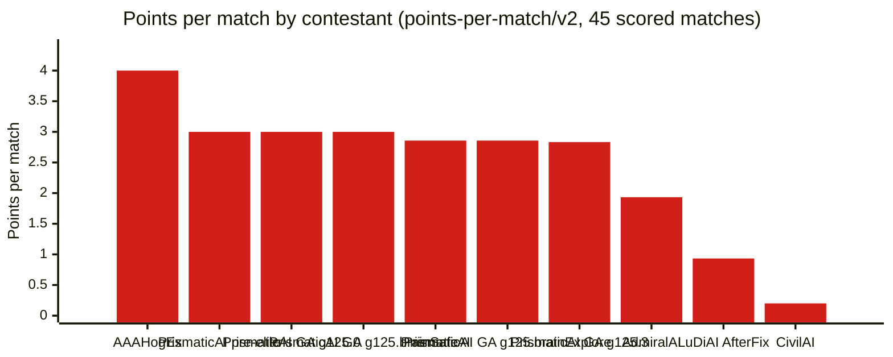
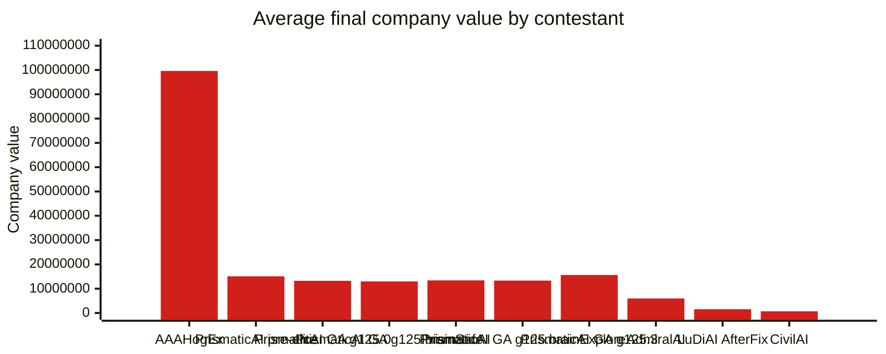
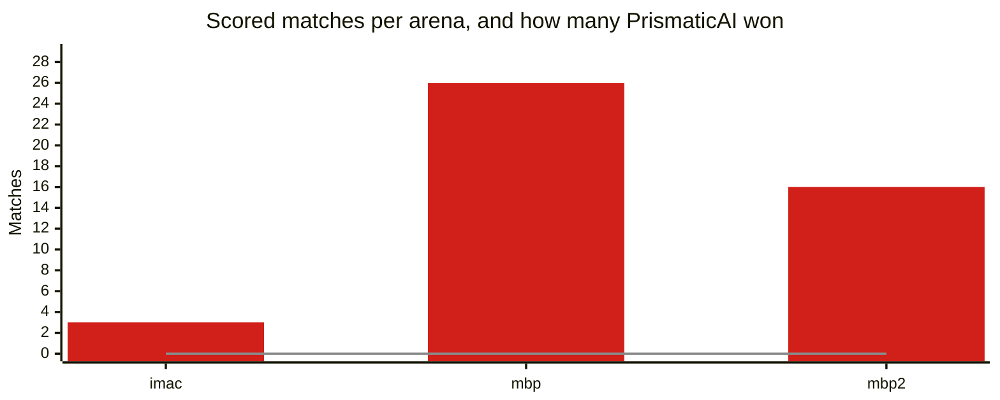

# battle-20261120T094806-f34b4117

Derived from `battle-20261120T094806-f34b4117.json` by `tools/research/ai-battle/battle.py report`; do not edit.

- Edition `f34b4117a1df4f7c`: PrismaticAI and referee at `2cab9e0314edf484880fedf08e9fc11d63d5357c`, base set `opengfx-8.0.tar`
- 20-year free-for-all from 1960, map 256x256 temperate, breakdowns 1
- 45 scored match(es) on `imac` (20261119-master-gdf1e05e7d8), `mbp` (20261120-master-m17653b726e), `mbp2` (20261119-master-gdf1e05e7d8)
- Replays: 0 of 1 identical to their original on another arena

| # | Contestant | Played | Wins | Points | Points/match | Avg rank | Avg final value | Squirrel errors | Matches with anomalies |
|---|---|---|---|---|---|---|---|---|---|
| 1 | AAAHogEx | 45 | 45 | 180 | 4.0 | 1.0 | 99.6 M | 0 | 0 |
| 2 | PrismaticAI pre-elite | 9 | 0 | 27 | 3.0 | 2.0 | 15.1 M | 0 | 0 |
| 3 | PrismaticAI GA g125.0 | 8 | 0 | 24 | 3.0 | 2.0 | 13.3 M | 0 | 2 |
| 4 | PrismaticAI GA g125.brainSafe | 8 | 0 | 24 | 3.0 | 2.0 | 13.0 M | 0 | 6 |
| 5 | PrismaticAI | 7 | 0 | 20 | 2.857 | 2.14 | 13.4 M | 0 | 1 |
| 6 | PrismaticAI GA g125.brainExplore | 7 | 0 | 20 | 2.857 | 2.14 | 13.3 M | 0 | 3 |
| 7 | PrismaticAI GA g125.3 | 6 | 0 | 17 | 2.833 | 2.17 | 15.6 M | 0 | 1 |
| 8 | AdmiralAI | 45 | 0 | 87 | 1.933 | 3.07 | 6.0 M | 70 | 3 |
| 9 | LuDiAI AfterFix | 45 | 0 | 42 | 0.933 | 4.07 | 1.6 M | 0 | 1 |
| 10 | CivilAI | 45 | 0 | 9 | 0.2 | 4.8 | 694.6 k | 0 | 15 |

```mermaid
---
config:
  xyChart:
    width: 900
    height: 360
  themeVariables:
    xyChart:
      plotColorPalette: "#d11f1a, #8a8a8a, #0b0b0b, #ece4d6"
---
xychart-beta
    title "Final company value per scored match: winner vs best PrismaticAI"
    x-axis ["m-0001", "m-0002", "m-0003", "m-0004", "m-0005", "m-0006", "m-0007", "m-0008", "m-0009", "m-0010", "m-0011", "m-0012", "m-0013", "m-0014", "m-0015", "m-0016", "m-0017", "m-0018", "m-0019", "m-0020", "m-0021", "m-0022", "m-0023", "m-0024", "m-0025", "m-0026", "m-0027", "m-0028", "m-0036", "m-0037", "m-0038", "m-0039", "m-0040", "m-0041", "m-0042", "m-0043", "m-0044", "m-0049", "m-0050", "m-0051", "m-0054", "m-0055", "m-0057", "m-0058", "m-0065"]
    %% series: Winner | Best PrismaticAI
    %% links: battle-20261120T094806-f34b4117.md?col=Match&filter=m-0001 | battle-20261120T094806-f34b4117.md?col=Match&filter=m-0002 | battle-20261120T094806-f34b4117.md?col=Match&filter=m-0003 | battle-20261120T094806-f34b4117.md?col=Match&filter=m-0004 | battle-20261120T094806-f34b4117.md?col=Match&filter=m-0005 | battle-20261120T094806-f34b4117.md?col=Match&filter=m-0006 | battle-20261120T094806-f34b4117.md?col=Match&filter=m-0007 | battle-20261120T094806-f34b4117.md?col=Match&filter=m-0008 | battle-20261120T094806-f34b4117.md?col=Match&filter=m-0009 | battle-20261120T094806-f34b4117.md?col=Match&filter=m-0010 | battle-20261120T094806-f34b4117.md?col=Match&filter=m-0011 | battle-20261120T094806-f34b4117.md?col=Match&filter=m-0012 | battle-20261120T094806-f34b4117.md?col=Match&filter=m-0013 | battle-20261120T094806-f34b4117.md?col=Match&filter=m-0014 | battle-20261120T094806-f34b4117.md?col=Match&filter=m-0015 | battle-20261120T094806-f34b4117.md?col=Match&filter=m-0016 | battle-20261120T094806-f34b4117.md?col=Match&filter=m-0017 | battle-20261120T094806-f34b4117.md?col=Match&filter=m-0018 | battle-20261120T094806-f34b4117.md?col=Match&filter=m-0019 | battle-20261120T094806-f34b4117.md?col=Match&filter=m-0020 | battle-20261120T094806-f34b4117.md?col=Match&filter=m-0021 | battle-20261120T094806-f34b4117.md?col=Match&filter=m-0022 | battle-20261120T094806-f34b4117.md?col=Match&filter=m-0023 | battle-20261120T094806-f34b4117.md?col=Match&filter=m-0024 | battle-20261120T094806-f34b4117.md?col=Match&filter=m-0025 | battle-20261120T094806-f34b4117.md?col=Match&filter=m-0026 | battle-20261120T094806-f34b4117.md?col=Match&filter=m-0027 | battle-20261120T094806-f34b4117.md?col=Match&filter=m-0028 | battle-20261120T094806-f34b4117.md?col=Match&filter=m-0036 | battle-20261120T094806-f34b4117.md?col=Match&filter=m-0037 | battle-20261120T094806-f34b4117.md?col=Match&filter=m-0038 | battle-20261120T094806-f34b4117.md?col=Match&filter=m-0039 | battle-20261120T094806-f34b4117.md?col=Match&filter=m-0040 | battle-20261120T094806-f34b4117.md?col=Match&filter=m-0041 | battle-20261120T094806-f34b4117.md?col=Match&filter=m-0042 | battle-20261120T094806-f34b4117.md?col=Match&filter=m-0043 | battle-20261120T094806-f34b4117.md?col=Match&filter=m-0044 | battle-20261120T094806-f34b4117.md?col=Match&filter=m-0049 | battle-20261120T094806-f34b4117.md?col=Match&filter=m-0050 | battle-20261120T094806-f34b4117.md?col=Match&filter=m-0051 | battle-20261120T094806-f34b4117.md?col=Match&filter=m-0054 | battle-20261120T094806-f34b4117.md?col=Match&filter=m-0055 | battle-20261120T094806-f34b4117.md?col=Match&filter=m-0057 | battle-20261120T094806-f34b4117.md?col=Match&filter=m-0058 | battle-20261120T094806-f34b4117.md?col=Match&filter=m-0065
    y-axis "Company value" 0 --> 168000000
    bar [111995597, 106474153, 113399870, 136060206, 121392973, 83457677, 105959270, 92664764, 87037248, 76090533, 84029420, 100644398, 127162189, 102465597, 110268798, 153006136, 108905121, 112822433, 111105005, 109840792, 114429219, 104082675, 102025798, 85438979, 93545744, 101966632, 102200205, 78613105, 104162834, 79721030, 77545746, 91524359, 128528417, 70457113, 83745190, 87692653, 81410193, 91676984, 98659612, 93899789, 104195049, 89036135, 91201747, 92527942, 79528919]
    line [12415248, 12969252, 14153694, 14020200, 20546997, 11958457, 13554660, 9118007, 8954230, 13878053, 11439796, 19296553, 23663307, 11633523, 16922980, 22540445, 8777760, 13151926, 19683502, 17535103, 22729018, 13220784, 23639797, 11874338, 10059767, 8023940, 6144942, 8454223, 12015157, 14875010, 16136872, 16424643, 13799185, 11664464, 12965796, 11301996, 12249045, 19513955, 18358540, 13872334, 12712193, 10658926, 4730612, 7444655, 17794525]
```

<!-- battle-charts:begin -->
<!-- derived from battle-20261120T094806-f34b4117.json by `battle.py render`; `battle.py check` fails when it is stale -->

<!-- battle-charts:end -->

| Seed | Original | Replay | Arenas | Identical |
|---|---|---|---|---|
| 643840962 | m-0010 | m-0056 | imac / mbp | NO |

| Match | Arena | Seed | Winner | Value | Last | Anomalies |
|---|---|---|---|---|---|---|
| m-0001 | mbp | 789892709 | AAAHogEx | 112.0 M | CivilAI | CivilAI: fleet_drop:50->14 |
| m-0002 | mbp | 789892709 | AAAHogEx | 106.5 M | CivilAI | - |
| m-0003 | mbp | 789892709 | AAAHogEx | 113.4 M | LuDiAI AfterFix | CivilAI: fleet_drop:58->26 |
| m-0004 | mbp | 789892709 | AAAHogEx | 136.1 M | CivilAI | - |
| m-0005 | mbp | 789892709 | AAAHogEx | 121.4 M | CivilAI | AdmiralAI: fleet_drop:218->122 |
| m-0006 | mbp | 643840962 | AAAHogEx | 83.5 M | CivilAI | - |
| m-0007 | mbp | 643840962 | AAAHogEx | 106.0 M | CivilAI | - |
| m-0008 | mbp | 643840962 | AAAHogEx | 92.7 M | AdmiralAI | AdmiralAI: fleet_drop:103->66 |
| m-0009 | mbp | 643840962 | AAAHogEx | 87.0 M | CivilAI | LuDiAI AfterFix: fleet_drop:88->59 |
| m-0010 | imac | 643840962 | AAAHogEx | 76.1 M | CivilAI | - |
| m-0011 | imac | 643840962 | AAAHogEx | 84.0 M | CivilAI | - |
| m-0012 | imac | 1835228523 | AAAHogEx | 100.6 M | CivilAI | PrismaticAI: fleet_drop:112->75 |
| m-0013 | mbp2 | 1835228523 | AAAHogEx | 127.2 M | CivilAI | CivilAI: fleet_drop:15->10 |
| m-0014 | mbp2 | 1835228523 | AAAHogEx | 102.5 M | CivilAI | PrismaticAI GA g125.0: fleet_drop:138->92; CivilAI: fleet_drop:29->17 |
| m-0015 | mbp2 | 1835228523 | AAAHogEx | 110.3 M | LuDiAI AfterFix | PrismaticAI GA g125.brainSafe: fleet_drop:182->92 |
| m-0016 | mbp2 | 1835228523 | AAAHogEx | 153.0 M | CivilAI | PrismaticAI GA g125.brainExplore: fleet_drop:140->45 |
| m-0017 | mbp2 | 1835228523 | AAAHogEx | 108.9 M | CivilAI | - |
| m-0018 | mbp2 | 1919805840 | AAAHogEx | 112.8 M | CivilAI | AdmiralAI: squirrel_errors:70 |
| m-0019 | mbp2 | 1919805840 | AAAHogEx | 111.1 M | LuDiAI AfterFix | - |
| m-0020 | mbp2 | 1919805840 | AAAHogEx | 109.8 M | LuDiAI AfterFix | - |
| m-0021 | mbp2 | 1919805840 | AAAHogEx | 114.4 M | CivilAI | PrismaticAI GA g125.brainSafe: fleet_drop:178->74 |
| m-0022 | mbp2 | 1919805840 | AAAHogEx | 104.1 M | CivilAI | - |
| m-0023 | mbp2 | 1919805840 | AAAHogEx | 102.0 M | CivilAI | CivilAI: fleet_drop:78->46 |
| m-0024 | mbp2 | 634171068 | AAAHogEx | 85.4 M | CivilAI | - |
| m-0025 | mbp2 | 634171068 | AAAHogEx | 93.5 M | CivilAI | CivilAI: no_vehicles |
| m-0026 | mbp2 | 634171068 | AAAHogEx | 102.0 M | LuDiAI AfterFix | PrismaticAI GA g125.0: fleet_drop:87->37 |
| m-0027 | mbp2 | 634171068 | AAAHogEx | 102.2 M | CivilAI | PrismaticAI GA g125.brainSafe: fleet_drop:70->42 |
| m-0028 | mbp2 | 634171068 | AAAHogEx | 78.6 M | CivilAI | - |
| m-0036 | mbp | 218090801 | AAAHogEx | 104.2 M | CivilAI | CivilAI: fleet_drop:18->9 |
| m-0037 | mbp | 218090801 | AAAHogEx | 79.7 M | CivilAI | - |
| m-0038 | mbp | 218090801 | AAAHogEx | 77.5 M | CivilAI | - |
| m-0039 | mbp | 218090801 | AAAHogEx | 91.5 M | CivilAI | PrismaticAI GA g125.brainSafe: fleet_drop:152->93 |
| m-0040 | mbp | 218090801 | AAAHogEx | 128.5 M | CivilAI | PrismaticAI GA g125.brainExplore: fleet_drop:120->67; CivilAI: fleet_drop:14->5 |
| m-0041 | mbp | 218090801 | AAAHogEx | 70.5 M | CivilAI | CivilAI: fleet_drop:80->40 |
| m-0042 | mbp | 1338254729 | AAAHogEx | 83.7 M | LuDiAI AfterFix | - |
| m-0043 | mbp | 1338254729 | AAAHogEx | 87.7 M | CivilAI | CivilAI: fleet_drop:62->37 |
| m-0044 | mbp | 1338254729 | AAAHogEx | 81.4 M | LuDiAI AfterFix | - |
| m-0049 | mbp | 1163490332 | AAAHogEx | 91.7 M | CivilAI | - |
| m-0050 | mbp | 1163490332 | AAAHogEx | 98.7 M | CivilAI | - |
| m-0051 | mbp | 1163490332 | AAAHogEx | 93.9 M | CivilAI | PrismaticAI GA g125.brainSafe: fleet_drop:68->42; CivilAI: fleet_drop:15->8 |
| m-0054 | mbp | 91879571 | AAAHogEx | 104.2 M | CivilAI | CivilAI: no_vehicles |
| m-0055 | mbp | 91879571 | AAAHogEx | 89.0 M | CivilAI | CivilAI: no_vehicles |
| m-0056 (replay) | mbp | 643840962 | AAAHogEx | 79.3 M | CivilAI | - |
| m-0057 | mbp | 91879571 | AAAHogEx | 91.2 M | CivilAI | PrismaticAI GA g125.brainSafe: fleet_drop:96->65; CivilAI: fleet_drop:56->28 |
| m-0058 | mbp | 91879571 | AAAHogEx | 92.5 M | LuDiAI AfterFix | PrismaticAI GA g125.brainExplore: fleet_drop:82->56 |
| m-0065 | mbp | 370457426 | AAAHogEx | 79.5 M | CivilAI | PrismaticAI GA g125.3: fleet_drop:103->69; CivilAI: fleet_drop:44->25 |
