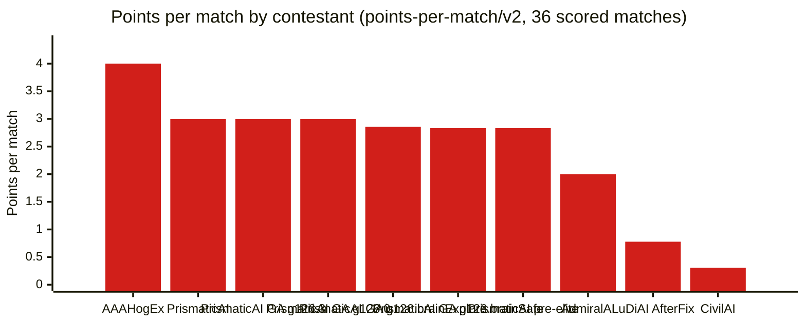
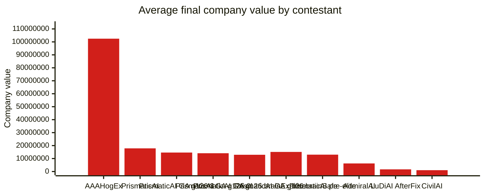
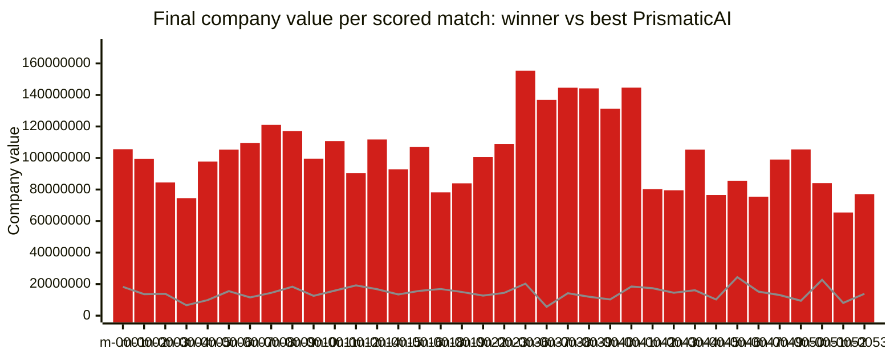
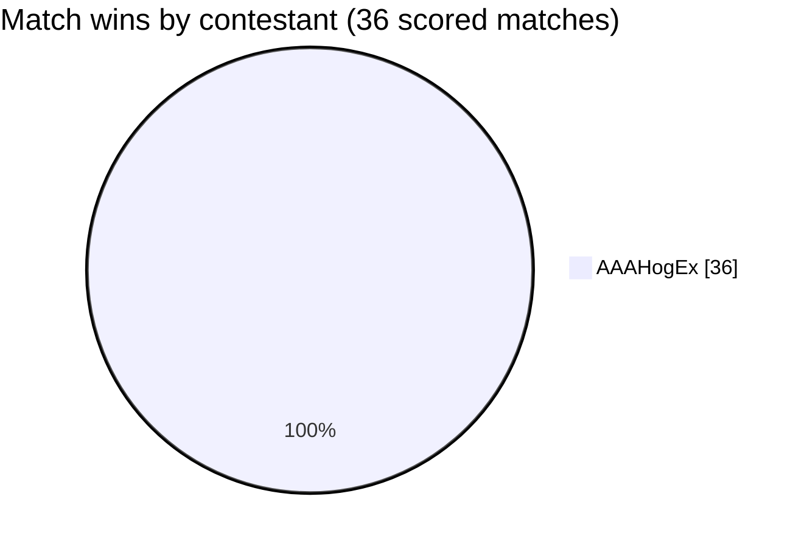
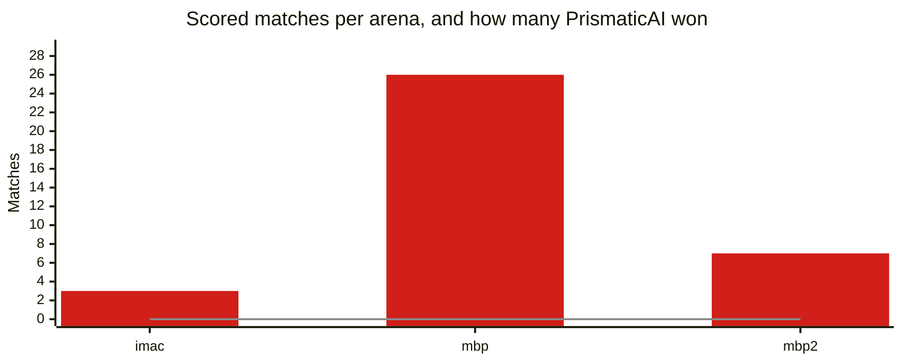

# battle-20261120T095850-710e4037

Derived from `battle-20261120T095850-710e4037.json` by `tools/research/ai-battle/battle.py report`; do not edit.

- Edition `710e4037d8f96917`: PrismaticAI and referee at `2cab9e0314edf484880fedf08e9fc11d63d5357c`, base set `opengfx-8.0.tar`
- 20-year free-for-all from 1960, map 256x256 temperate, breakdowns 1
- 36 scored match(es) on `imac` (20261119-master-gdf1e05e7d8), `mbp` (20261120-master-m17653b726e), `mbp2` (20261119-master-gdf1e05e7d8)
- Replays: 0 of 0 identical to their original on another arena

| # | Contestant | Played | Wins | Points | Points/match | Avg rank | Avg final value | Squirrel errors | Matches with anomalies |
|---|---|---|---|---|---|---|---|---|---|
| 1 | AAAHogEx | 36 | 36 | 144 | 4.0 | 1.0 | 102.5 M | 0 | 0 |
| 2 | PrismaticAI | 5 | 0 | 15 | 3.0 | 2.0 | 17.9 M | 0 | 1 |
| 3 | PrismaticAI GA g126.3 | 6 | 0 | 18 | 3.0 | 2.0 | 14.6 M | 0 | 4 |
| 4 | PrismaticAI GA g126.0 | 6 | 0 | 18 | 3.0 | 2.0 | 14.1 M | 0 | 1 |
| 5 | PrismaticAI GA g126.brainExplore | 7 | 0 | 20 | 2.857 | 2.14 | 12.9 M | 0 | 1 |
| 6 | PrismaticAI GA g126.brainSafe | 6 | 0 | 17 | 2.833 | 2.17 | 15.1 M | 0 | 1 |
| 7 | PrismaticAI pre-elite | 6 | 0 | 17 | 2.833 | 2.17 | 13.0 M | 0 | 0 |
| 8 | AdmiralAI | 36 | 0 | 72 | 2.0 | 3.0 | 6.2 M | 0 | 1 |
| 9 | LuDiAI AfterFix | 36 | 0 | 28 | 0.778 | 4.22 | 1.7 M | 0 | 1 |
| 10 | CivilAI | 36 | 0 | 11 | 0.306 | 4.69 | 1.0 M | 0 | 5 |

<!-- battle-charts:begin -->
<!-- derived from battle-20261120T095850-710e4037.json by `battle.py render`; `battle.py check` fails when it is stale -->

<!-- battle-charts:end -->

| Match | Arena | Seed | Winner | Value | Last | Anomalies |
|---|---|---|---|---|---|---|
| m-0001 | mbp | 1763405603 | AAAHogEx | 105.6 M | CivilAI | - |
| m-0002 | mbp | 1763405603 | AAAHogEx | 99.4 M | CivilAI | - |
| m-0003 | mbp | 1763405603 | AAAHogEx | 84.5 M | CivilAI | - |
| m-0004 | mbp | 1763405603 | AAAHogEx | 74.5 M | CivilAI | - |
| m-0005 | mbp | 1763405603 | AAAHogEx | 97.7 M | CivilAI | PrismaticAI GA g126.3: fleet_drop:147->97 |
| m-0006 | mbp | 1369786089 | AAAHogEx | 105.3 M | LuDiAI AfterFix | - |
| m-0007 | mbp | 1369786089 | AAAHogEx | 109.4 M | LuDiAI AfterFix | - |
| m-0008 | mbp | 1369786089 | AAAHogEx | 121.0 M | LuDiAI AfterFix | - |
| m-0009 | mbp | 1369786089 | AAAHogEx | 117.1 M | LuDiAI AfterFix | - |
| m-0010 | imac | 1369786089 | AAAHogEx | 99.5 M | LuDiAI AfterFix | - |
| m-0011 | imac | 1369786089 | AAAHogEx | 110.7 M | LuDiAI AfterFix | CivilAI: fleet_drop:105->66 |
| m-0012 | imac | 1437637633 | AAAHogEx | 90.5 M | LuDiAI AfterFix | CivilAI: fleet_drop:80->49 |
| m-0014 | mbp2 | 1437637633 | AAAHogEx | 111.7 M | CivilAI | - |
| m-0015 | mbp2 | 1437637633 | AAAHogEx | 92.8 M | CivilAI | PrismaticAI GA g126.brainSafe: fleet_drop:63->43 |
| m-0016 | mbp2 | 1437637633 | AAAHogEx | 107.0 M | LuDiAI AfterFix | - |
| m-0018 | mbp2 | 1221372654 | AAAHogEx | 78.2 M | CivilAI | LuDiAI AfterFix: fleet_drop:122->82 |
| m-0019 | mbp2 | 1221372654 | AAAHogEx | 83.9 M | CivilAI | AdmiralAI: fleet_drop:100->60 |
| m-0022 | mbp2 | 1221372654 | AAAHogEx | 100.7 M | CivilAI | - |
| m-0023 | mbp2 | 1221372654 | AAAHogEx | 109.0 M | CivilAI | - |
| m-0036 | mbp | 1398523000 | AAAHogEx | 155.3 M | CivilAI | - |
| m-0037 | mbp | 1398523000 | AAAHogEx | 136.8 M | CivilAI | CivilAI: fleet_drop:70->40 |
| m-0038 | mbp | 1398523000 | AAAHogEx | 144.6 M | CivilAI | PrismaticAI GA g126.0: fleet_drop:90->54 |
| m-0039 | mbp | 1398523000 | AAAHogEx | 144.2 M | CivilAI | - |
| m-0040 | mbp | 1398523000 | AAAHogEx | 131.2 M | CivilAI | - |
| m-0041 | mbp | 1398523000 | AAAHogEx | 144.7 M | CivilAI | PrismaticAI GA g126.3: fleet_drop:130->89; CivilAI: fleet_drop:60->36 |
| m-0042 | mbp | 1311067378 | AAAHogEx | 80.2 M | CivilAI | PrismaticAI: fleet_drop:72->39 |
| m-0043 | mbp | 1311067378 | AAAHogEx | 79.5 M | CivilAI | - |
| m-0044 | mbp | 1311067378 | AAAHogEx | 105.3 M | CivilAI | - |
| m-0045 | mbp | 1311067378 | AAAHogEx | 76.5 M | CivilAI | CivilAI: fleet_drop:11->4 |
| m-0046 | mbp | 1311067378 | AAAHogEx | 85.6 M | CivilAI | PrismaticAI GA g126.brainExplore: fleet_drop:104->66 |
| m-0047 | mbp | 1311067378 | AAAHogEx | 75.5 M | CivilAI | PrismaticAI GA g126.3: fleet_drop:117->80 |
| m-0049 | mbp | 1573577458 | AAAHogEx | 99.0 M | LuDiAI AfterFix | - |
| m-0050 | mbp | 1573577458 | AAAHogEx | 105.4 M | CivilAI | - |
| m-0051 | mbp | 1573577458 | AAAHogEx | 84.0 M | CivilAI | - |
| m-0052 | mbp | 1573577458 | AAAHogEx | 65.4 M | LuDiAI AfterFix | - |
| m-0053 | mbp | 1573577458 | AAAHogEx | 77.1 M | LuDiAI AfterFix | PrismaticAI GA g126.3: fleet_drop:142->76 |
