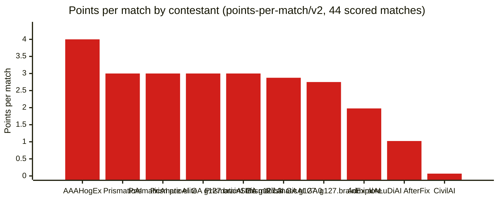
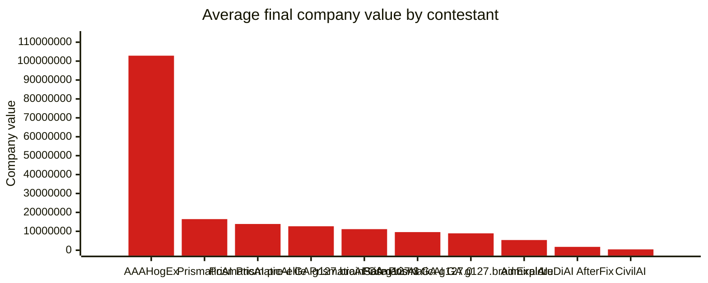
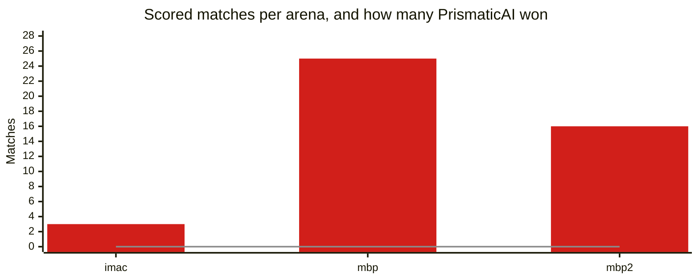

# battle-20261120T100812-76e99c1d

Derived from `battle-20261120T100812-76e99c1d.json` by `tools/research/ai-battle/battle.py report`; do not edit.

- Edition `76e99c1d4c57eefb`: PrismaticAI and referee at `2cab9e0314edf484880fedf08e9fc11d63d5357c`, base set `opengfx-8.0.tar`
- 20-year free-for-all from 1960, map 256x256 temperate, breakdowns 1
- 44 scored match(es) on `imac` (20261119-master-gdf1e05e7d8), `mbp` (20261120-master-m17653b726e), `mbp2` (20261119-master-gdf1e05e7d8)
- Replays: 0 of 1 identical to their original on another arena

| # | Contestant | Played | Wins | Points | Points/match | Avg rank | Avg final value | Squirrel errors | Matches with anomalies |
|---|---|---|---|---|---|---|---|---|---|
| 1 | AAAHogEx | 44 | 44 | 176 | 4.0 | 1.0 | 102.9 M | 0 | 0 |
| 2 | PrismaticAI | 6 | 0 | 18 | 3.0 | 2.0 | 16.4 M | 0 | 3 |
| 3 | PrismaticAI pre-elite | 8 | 0 | 24 | 3.0 | 2.0 | 13.9 M | 0 | 1 |
| 4 | PrismaticAI GA g127.brainSafe | 8 | 0 | 24 | 3.0 | 2.0 | 12.7 M | 0 | 0 |
| 5 | PrismaticAI GA g127.3 | 6 | 0 | 18 | 3.0 | 2.0 | 11.1 M | 0 | 2 |
| 6 | PrismaticAI GA g127.0 | 8 | 0 | 23 | 2.875 | 2.12 | 9.6 M | 0 | 3 |
| 7 | PrismaticAI GA g127.brainExplore | 8 | 0 | 22 | 2.75 | 2.25 | 8.9 M | 0 | 2 |
| 8 | AdmiralAI | 44 | 0 | 87 | 1.977 | 3.02 | 5.4 M | 121 | 3 |
| 9 | LuDiAI AfterFix | 44 | 0 | 45 | 1.023 | 3.98 | 1.8 M | 0 | 0 |
| 10 | CivilAI | 44 | 0 | 3 | 0.068 | 4.93 | 447.3 k | 3615 | 9 |

```mermaid
---
config:
  xyChart:
    width: 900
    height: 360
  themeVariables:
    xyChart:
      plotColorPalette: "#d11f1a, #8a8a8a, #0b0b0b, #ece4d6"
---
xychart-beta
    title "Final company value per scored match: winner vs best PrismaticAI"
    x-axis ["m-0001", "m-0002", "m-0003", "m-0004", "m-0005", "m-0006", "m-0007", "m-0008", "m-0009", "m-0010", "m-0011", "m-0012", "m-0013", "m-0014", "m-0015", "m-0016", "m-0017", "m-0018", "m-0019", "m-0020", "m-0021", "m-0022", "m-0023", "m-0024", "m-0025", "m-0026", "m-0027", "m-0028", "m-0036", "m-0037", "m-0038", "m-0039", "m-0040", "m-0041", "m-0042", "m-0043", "m-0044", "m-0045", "m-0046", "m-0047", "m-0049", "m-0050", "m-0051", "m-0052"]
    %% series: Winner | Best PrismaticAI
    %% links: battle-20261120T100812-76e99c1d.md?col=Match&filter=m-0001 | battle-20261120T100812-76e99c1d.md?col=Match&filter=m-0002 | battle-20261120T100812-76e99c1d.md?col=Match&filter=m-0003 | battle-20261120T100812-76e99c1d.md?col=Match&filter=m-0004 | battle-20261120T100812-76e99c1d.md?col=Match&filter=m-0005 | battle-20261120T100812-76e99c1d.md?col=Match&filter=m-0006 | battle-20261120T100812-76e99c1d.md?col=Match&filter=m-0007 | battle-20261120T100812-76e99c1d.md?col=Match&filter=m-0008 | battle-20261120T100812-76e99c1d.md?col=Match&filter=m-0009 | battle-20261120T100812-76e99c1d.md?col=Match&filter=m-0010 | battle-20261120T100812-76e99c1d.md?col=Match&filter=m-0011 | battle-20261120T100812-76e99c1d.md?col=Match&filter=m-0012 | battle-20261120T100812-76e99c1d.md?col=Match&filter=m-0013 | battle-20261120T100812-76e99c1d.md?col=Match&filter=m-0014 | battle-20261120T100812-76e99c1d.md?col=Match&filter=m-0015 | battle-20261120T100812-76e99c1d.md?col=Match&filter=m-0016 | battle-20261120T100812-76e99c1d.md?col=Match&filter=m-0017 | battle-20261120T100812-76e99c1d.md?col=Match&filter=m-0018 | battle-20261120T100812-76e99c1d.md?col=Match&filter=m-0019 | battle-20261120T100812-76e99c1d.md?col=Match&filter=m-0020 | battle-20261120T100812-76e99c1d.md?col=Match&filter=m-0021 | battle-20261120T100812-76e99c1d.md?col=Match&filter=m-0022 | battle-20261120T100812-76e99c1d.md?col=Match&filter=m-0023 | battle-20261120T100812-76e99c1d.md?col=Match&filter=m-0024 | battle-20261120T100812-76e99c1d.md?col=Match&filter=m-0025 | battle-20261120T100812-76e99c1d.md?col=Match&filter=m-0026 | battle-20261120T100812-76e99c1d.md?col=Match&filter=m-0027 | battle-20261120T100812-76e99c1d.md?col=Match&filter=m-0028 | battle-20261120T100812-76e99c1d.md?col=Match&filter=m-0036 | battle-20261120T100812-76e99c1d.md?col=Match&filter=m-0037 | battle-20261120T100812-76e99c1d.md?col=Match&filter=m-0038 | battle-20261120T100812-76e99c1d.md?col=Match&filter=m-0039 | battle-20261120T100812-76e99c1d.md?col=Match&filter=m-0040 | battle-20261120T100812-76e99c1d.md?col=Match&filter=m-0041 | battle-20261120T100812-76e99c1d.md?col=Match&filter=m-0042 | battle-20261120T100812-76e99c1d.md?col=Match&filter=m-0043 | battle-20261120T100812-76e99c1d.md?col=Match&filter=m-0044 | battle-20261120T100812-76e99c1d.md?col=Match&filter=m-0045 | battle-20261120T100812-76e99c1d.md?col=Match&filter=m-0046 | battle-20261120T100812-76e99c1d.md?col=Match&filter=m-0047 | battle-20261120T100812-76e99c1d.md?col=Match&filter=m-0049 | battle-20261120T100812-76e99c1d.md?col=Match&filter=m-0050 | battle-20261120T100812-76e99c1d.md?col=Match&filter=m-0051 | battle-20261120T100812-76e99c1d.md?col=Match&filter=m-0052
    y-axis "Company value" 0 --> 183000000
    bar [83360647, 110165563, 86030121, 90506947, 107342608, 72771000, 88055003, 89944610, 95866162, 93312832, 107117195, 134486629, 138093375, 125923311, 111147446, 138695912, 107160146, 95995381, 103152420, 91885960, 105223555, 95783148, 87693691, 96845595, 78366388, 94386247, 80213568, 93703232, 137014189, 137900571, 166098709, 134952537, 115402268, 133238571, 90732908, 101826791, 96311251, 70512538, 89657704, 91202673, 84511803, 109717397, 76732097, 87304906]
    line [6648730, 6658418, 6200434, 3018469, 3632007, 20201984, 18790581, 12112594, 11673239, 13811967, 10679125, 7650240, 13446535, 11114488, 11931121, 10300214, 11938835, 15970435, 10910212, 6053071, 15087451, 8224059, 11849375, 16380335, 13673551, 7425367, 8812599, 1722171, 25709420, 16890169, 16878074, 21085062, 10305071, 19352185, 12761255, 12630396, 7374822, 12975915, 13186892, 9413150, 17984470, 9036505, 13522974, 10848070]
```

<!-- battle-charts:begin -->
<!-- derived from battle-20261120T100812-76e99c1d.json by `battle.py render`; `battle.py check` fails when it is stale -->

<!-- battle-charts:end -->

| Seed | Original | Replay | Arenas | Identical |
|---|---|---|---|---|
| 1108449321 | m-0011 | m-0048 | imac / mbp | NO |

| Match | Arena | Seed | Winner | Value | Last | Anomalies |
|---|---|---|---|---|---|---|
| m-0001 | mbp | 1828283652 | AAAHogEx | 83.4 M | CivilAI | PrismaticAI pre-elite: fleet_drop:66->44 |
| m-0002 | mbp | 1828283652 | AAAHogEx | 110.2 M | CivilAI | - |
| m-0003 | mbp | 1828283652 | AAAHogEx | 86.0 M | CivilAI | - |
| m-0004 | mbp | 1828283652 | AAAHogEx | 90.5 M | CivilAI | CivilAI: fleet_drop:15->6 |
| m-0005 | mbp | 1828283652 | AAAHogEx | 107.3 M | CivilAI | - |
| m-0006 | mbp | 1108449321 | AAAHogEx | 72.8 M | CivilAI | CivilAI: fleet_drop:35->23 |
| m-0007 | mbp | 1108449321 | AAAHogEx | 88.1 M | CivilAI | CivilAI: fleet_drop:10->5 |
| m-0008 | mbp | 1108449321 | AAAHogEx | 89.9 M | CivilAI | - |
| m-0009 | mbp | 1108449321 | AAAHogEx | 95.9 M | CivilAI | - |
| m-0010 | imac | 1108449321 | AAAHogEx | 93.3 M | CivilAI | PrismaticAI GA g127.brainExplore: fleet_drop:107->51 |
| m-0011 | imac | 1108449321 | AAAHogEx | 107.1 M | CivilAI | - |
| m-0012 | imac | 1454352382 | AAAHogEx | 134.5 M | CivilAI | PrismaticAI: fleet_drop:81->47 |
| m-0013 | mbp2 | 1454352382 | AAAHogEx | 138.1 M | CivilAI | CivilAI: fleet_drop:51->29 |
| m-0014 | mbp2 | 1454352382 | AAAHogEx | 125.9 M | CivilAI | CivilAI: squirrel_errors:3615 |
| m-0015 | mbp2 | 1454352382 | AAAHogEx | 111.1 M | CivilAI | - |
| m-0016 | mbp2 | 1454352382 | AAAHogEx | 138.7 M | CivilAI | - |
| m-0017 | mbp2 | 1454352382 | AAAHogEx | 107.2 M | LuDiAI AfterFix | AdmiralAI: squirrel_errors:59 |
| m-0018 | mbp2 | 1384833579 | AAAHogEx | 96.0 M | CivilAI | - |
| m-0019 | mbp2 | 1384833579 | AAAHogEx | 103.2 M | CivilAI | AdmiralAI: squirrel_errors:62; CivilAI: fleet_drop:25->16 |
| m-0020 | mbp2 | 1384833579 | AAAHogEx | 91.9 M | CivilAI | - |
| m-0021 | mbp2 | 1384833579 | AAAHogEx | 105.2 M | CivilAI | - |
| m-0022 | mbp2 | 1384833579 | AAAHogEx | 95.8 M | CivilAI | - |
| m-0023 | mbp2 | 1384833579 | AAAHogEx | 87.7 M | CivilAI | - |
| m-0024 | mbp2 | 161778586 | AAAHogEx | 96.8 M | CivilAI | PrismaticAI: fleet_drop:69->39 |
| m-0025 | mbp2 | 161778586 | AAAHogEx | 78.4 M | CivilAI | - |
| m-0026 | mbp2 | 161778586 | AAAHogEx | 94.4 M | CivilAI | PrismaticAI GA g127.0: fleet_drop:113->37 |
| m-0027 | mbp2 | 161778586 | AAAHogEx | 80.2 M | LuDiAI AfterFix | CivilAI: fleet_drop:119->79 |
| m-0028 | mbp2 | 161778586 | AAAHogEx | 93.7 M | CivilAI | PrismaticAI GA g127.brainExplore: fleet_drop:55->29 |
| m-0036 | mbp | 589716052 | AAAHogEx | 137.0 M | CivilAI | PrismaticAI: fleet_drop:116->74 |
| m-0037 | mbp | 589716052 | AAAHogEx | 137.9 M | CivilAI | AdmiralAI: fleet_drop:248->159 |
| m-0038 | mbp | 589716052 | AAAHogEx | 166.1 M | CivilAI | PrismaticAI GA g127.0: fleet_drop:199->88 |
| m-0039 | mbp | 589716052 | AAAHogEx | 135.0 M | CivilAI | - |
| m-0040 | mbp | 589716052 | AAAHogEx | 115.4 M | CivilAI | - |
| m-0041 | mbp | 589716052 | AAAHogEx | 133.2 M | CivilAI | PrismaticAI GA g127.3: fleet_drop:173->84; CivilAI: fleet_drop:27->18 |
| m-0042 | mbp | 1613154313 | AAAHogEx | 90.7 M | CivilAI | - |
| m-0043 | mbp | 1613154313 | AAAHogEx | 101.8 M | CivilAI | - |
| m-0044 | mbp | 1613154313 | AAAHogEx | 96.3 M | LuDiAI AfterFix | PrismaticAI GA g127.0: fleet_drop:99->53 |
| m-0045 | mbp | 1613154313 | AAAHogEx | 70.5 M | CivilAI | - |
| m-0046 | mbp | 1613154313 | AAAHogEx | 89.7 M | CivilAI | - |
| m-0047 | mbp | 1613154313 | AAAHogEx | 91.2 M | CivilAI | PrismaticAI GA g127.3: fleet_drop:116->65 |
| m-0048 (replay) | mbp | 1108449321 | AAAHogEx | 102.1 M | CivilAI | - |
| m-0049 | mbp | 1556647184 | AAAHogEx | 84.5 M | CivilAI | - |
| m-0050 | mbp | 1556647184 | AAAHogEx | 109.7 M | CivilAI | - |
| m-0051 | mbp | 1556647184 | AAAHogEx | 76.7 M | CivilAI | CivilAI: fleet_drop:53->36 |
| m-0052 | mbp | 1556647184 | AAAHogEx | 87.3 M | CivilAI | - |
