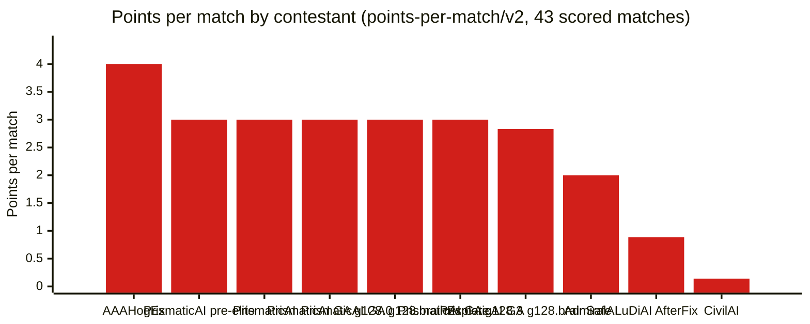
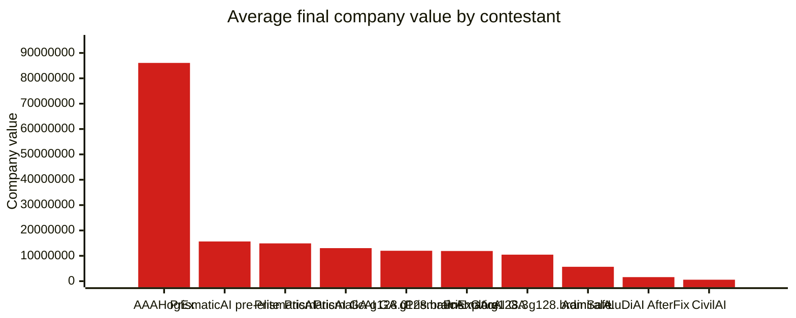
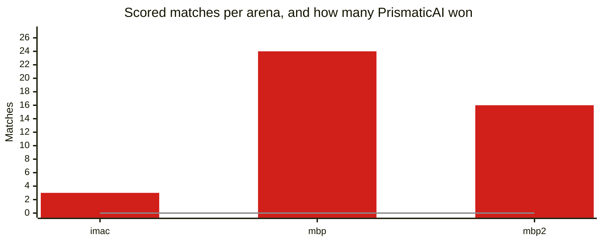

# battle-20261120T101722-352d7c24

Derived from `battle-20261120T101722-352d7c24.json` by `tools/research/ai-battle/battle.py report`; do not edit.

- Edition `352d7c246502c12e`: PrismaticAI and referee at `2cab9e0314edf484880fedf08e9fc11d63d5357c`, base set `opengfx-8.0.tar`
- 20-year free-for-all from 1960, map 256x256 temperate, breakdowns 1
- 43 scored match(es) on `imac` (20261119-master-gdf1e05e7d8), `mbp` (20261120-master-m17653b726e), `mbp2` (20261119-master-gdf1e05e7d8)
- Replays: 0 of 1 identical to their original on another arena

| # | Contestant | Played | Wins | Points | Points/match | Avg rank | Avg final value | Squirrel errors | Matches with anomalies |
|---|---|---|---|---|---|---|---|---|---|
| 1 | AAAHogEx | 43 | 43 | 172 | 4.0 | 1.0 | 86.1 M | 0 | 0 |
| 2 | PrismaticAI pre-elite | 8 | 0 | 24 | 3.0 | 2.0 | 15.7 M | 0 | 0 |
| 3 | PrismaticAI | 6 | 0 | 18 | 3.0 | 2.0 | 14.9 M | 0 | 2 |
| 4 | PrismaticAI GA g128.0 | 8 | 0 | 24 | 3.0 | 2.0 | 13.0 M | 0 | 0 |
| 5 | PrismaticAI GA g128.brainExplore | 8 | 0 | 24 | 3.0 | 2.0 | 12.0 M | 0 | 2 |
| 6 | PrismaticAI GA g128.3 | 7 | 0 | 21 | 3.0 | 2.0 | 11.9 M | 0 | 0 |
| 7 | PrismaticAI GA g128.brainSafe | 6 | 0 | 17 | 2.833 | 2.17 | 10.5 M | 0 | 1 |
| 8 | AdmiralAI | 43 | 0 | 86 | 2.0 | 3.0 | 5.7 M | 0 | 0 |
| 9 | LuDiAI AfterFix | 43 | 0 | 38 | 0.884 | 4.12 | 1.6 M | 0 | 1 |
| 10 | CivilAI | 43 | 0 | 6 | 0.14 | 4.86 | 573.4 k | 3685 | 10 |

```mermaid
---
config:
  xyChart:
    width: 900
    height: 360
  themeVariables:
    xyChart:
      plotColorPalette: "#d11f1a, #8a8a8a, #0b0b0b, #ece4d6"
---
xychart-beta
    title "Final company value per scored match: winner vs best PrismaticAI"
    x-axis ["m-0001", "m-0002", "m-0003", "m-0004", "m-0005", "m-0006", "m-0007", "m-0008", "m-0009", "m-0010", "m-0011", "m-0012", "m-0013", "m-0014", "m-0015", "m-0016", "m-0017", "m-0018", "m-0019", "m-0020", "m-0021", "m-0022", "m-0023", "m-0024", "m-0025", "m-0026", "m-0027", "m-0028", "m-0036", "m-0037", "m-0038", "m-0039", "m-0040", "m-0041", "m-0042", "m-0043", "m-0044", "m-0046", "m-0047", "m-0049", "m-0050", "m-0052", "m-0053"]
    %% series: Winner | Best PrismaticAI
    %% links: battle-20261120T101722-352d7c24.md?col=Match&filter=m-0001 | battle-20261120T101722-352d7c24.md?col=Match&filter=m-0002 | battle-20261120T101722-352d7c24.md?col=Match&filter=m-0003 | battle-20261120T101722-352d7c24.md?col=Match&filter=m-0004 | battle-20261120T101722-352d7c24.md?col=Match&filter=m-0005 | battle-20261120T101722-352d7c24.md?col=Match&filter=m-0006 | battle-20261120T101722-352d7c24.md?col=Match&filter=m-0007 | battle-20261120T101722-352d7c24.md?col=Match&filter=m-0008 | battle-20261120T101722-352d7c24.md?col=Match&filter=m-0009 | battle-20261120T101722-352d7c24.md?col=Match&filter=m-0010 | battle-20261120T101722-352d7c24.md?col=Match&filter=m-0011 | battle-20261120T101722-352d7c24.md?col=Match&filter=m-0012 | battle-20261120T101722-352d7c24.md?col=Match&filter=m-0013 | battle-20261120T101722-352d7c24.md?col=Match&filter=m-0014 | battle-20261120T101722-352d7c24.md?col=Match&filter=m-0015 | battle-20261120T101722-352d7c24.md?col=Match&filter=m-0016 | battle-20261120T101722-352d7c24.md?col=Match&filter=m-0017 | battle-20261120T101722-352d7c24.md?col=Match&filter=m-0018 | battle-20261120T101722-352d7c24.md?col=Match&filter=m-0019 | battle-20261120T101722-352d7c24.md?col=Match&filter=m-0020 | battle-20261120T101722-352d7c24.md?col=Match&filter=m-0021 | battle-20261120T101722-352d7c24.md?col=Match&filter=m-0022 | battle-20261120T101722-352d7c24.md?col=Match&filter=m-0023 | battle-20261120T101722-352d7c24.md?col=Match&filter=m-0024 | battle-20261120T101722-352d7c24.md?col=Match&filter=m-0025 | battle-20261120T101722-352d7c24.md?col=Match&filter=m-0026 | battle-20261120T101722-352d7c24.md?col=Match&filter=m-0027 | battle-20261120T101722-352d7c24.md?col=Match&filter=m-0028 | battle-20261120T101722-352d7c24.md?col=Match&filter=m-0036 | battle-20261120T101722-352d7c24.md?col=Match&filter=m-0037 | battle-20261120T101722-352d7c24.md?col=Match&filter=m-0038 | battle-20261120T101722-352d7c24.md?col=Match&filter=m-0039 | battle-20261120T101722-352d7c24.md?col=Match&filter=m-0040 | battle-20261120T101722-352d7c24.md?col=Match&filter=m-0041 | battle-20261120T101722-352d7c24.md?col=Match&filter=m-0042 | battle-20261120T101722-352d7c24.md?col=Match&filter=m-0043 | battle-20261120T101722-352d7c24.md?col=Match&filter=m-0044 | battle-20261120T101722-352d7c24.md?col=Match&filter=m-0046 | battle-20261120T101722-352d7c24.md?col=Match&filter=m-0047 | battle-20261120T101722-352d7c24.md?col=Match&filter=m-0049 | battle-20261120T101722-352d7c24.md?col=Match&filter=m-0050 | battle-20261120T101722-352d7c24.md?col=Match&filter=m-0052 | battle-20261120T101722-352d7c24.md?col=Match&filter=m-0053
    y-axis "Company value" 0 --> 137000000
    bar [60041010, 66834861, 72777943, 71929723, 75121080, 106750234, 73070987, 73495991, 98651553, 85356356, 102968380, 39570245, 48637397, 58154735, 54545061, 59051039, 71532546, 90453756, 102991582, 94770694, 87623536, 99389141, 98995398, 124563143, 116796176, 107249318, 124473793, 98590791, 74108292, 111518899, 87815841, 87480977, 79623722, 99088760, 85074713, 84957178, 92621494, 78966393, 81380211, 102705294, 78410572, 90042164, 102818242]
    line [19241737, 9789991, 10037273, 9474561, 8298958, 13863866, 16961917, 13333619, 10278490, 10651992, 14719202, 12660745, 16195394, 14327117, 10303161, 10042152, 11875614, 17852357, 18126156, 14216947, 16375202, 14145771, 16027161, 14782863, 18916925, 11600441, 3231036, 17957324, 14506947, 13763315, 12041015, 12502345, 14060263, 10642719, 15729936, 12103095, 15581351, 11603166, 13224397, 9946349, 13331792, 8002902, 8479897]
```

<!-- battle-charts:begin -->
<!-- derived from battle-20261120T101722-352d7c24.json by `battle.py render`; `battle.py check` fails when it is stale -->

<!-- battle-charts:end -->

| Seed | Original | Replay | Arenas | Identical |
|---|---|---|---|---|
| 1164894846 | m-0012 | m-0048 | imac / mbp | NO |

| Match | Arena | Seed | Winner | Value | Last | Anomalies |
|---|---|---|---|---|---|---|
| m-0001 | mbp | 1027535156 | AAAHogEx | 60.0 M | CivilAI | CivilAI: fleet_drop:42->29 |
| m-0002 | mbp | 1027535156 | AAAHogEx | 66.8 M | CivilAI | - |
| m-0003 | mbp | 1027535156 | AAAHogEx | 72.8 M | CivilAI | - |
| m-0004 | mbp | 1027535156 | AAAHogEx | 71.9 M | CivilAI | CivilAI: fleet_drop:12->8 |
| m-0005 | mbp | 1027535156 | AAAHogEx | 75.1 M | CivilAI | - |
| m-0006 | mbp | 1092816203 | AAAHogEx | 106.8 M | LuDiAI AfterFix | PrismaticAI: fleet_drop:104->38 |
| m-0007 | mbp | 1092816203 | AAAHogEx | 73.1 M | CivilAI | - |
| m-0008 | mbp | 1092816203 | AAAHogEx | 73.5 M | CivilAI | - |
| m-0009 | mbp | 1092816203 | AAAHogEx | 98.7 M | LuDiAI AfterFix | PrismaticAI GA g128.brainSafe: fleet_drop:64->40 |
| m-0010 | imac | 1092816203 | AAAHogEx | 85.4 M | CivilAI | PrismaticAI GA g128.brainExplore: fleet_drop:82->48 |
| m-0011 | imac | 1092816203 | AAAHogEx | 103.0 M | CivilAI | - |
| m-0012 | imac | 1164894846 | AAAHogEx | 39.6 M | CivilAI | CivilAI: fleet_drop:13->8 |
| m-0013 | mbp2 | 1164894846 | AAAHogEx | 48.6 M | LuDiAI AfterFix | - |
| m-0014 | mbp2 | 1164894846 | AAAHogEx | 58.2 M | CivilAI | - |
| m-0015 | mbp2 | 1164894846 | AAAHogEx | 54.5 M | CivilAI | - |
| m-0016 | mbp2 | 1164894846 | AAAHogEx | 59.1 M | CivilAI | PrismaticAI GA g128.brainExplore: fleet_drop:51->26; CivilAI: fleet_drop:25->4 |
| m-0017 | mbp2 | 1164894846 | AAAHogEx | 71.5 M | CivilAI | CivilAI: fleet_drop:46->31 |
| m-0018 | mbp2 | 942760219 | AAAHogEx | 90.5 M | LuDiAI AfterFix | - |
| m-0019 | mbp2 | 942760219 | AAAHogEx | 103.0 M | CivilAI | - |
| m-0020 | mbp2 | 942760219 | AAAHogEx | 94.8 M | CivilAI | - |
| m-0021 | mbp2 | 942760219 | AAAHogEx | 87.6 M | CivilAI | - |
| m-0022 | mbp2 | 942760219 | AAAHogEx | 99.4 M | CivilAI | - |
| m-0023 | mbp2 | 942760219 | AAAHogEx | 99.0 M | CivilAI | - |
| m-0024 | mbp2 | 208497482 | AAAHogEx | 124.6 M | CivilAI | - |
| m-0025 | mbp2 | 208497482 | AAAHogEx | 116.8 M | CivilAI | - |
| m-0026 | mbp2 | 208497482 | AAAHogEx | 107.2 M | CivilAI | - |
| m-0027 | mbp2 | 208497482 | AAAHogEx | 124.5 M | CivilAI | - |
| m-0028 | mbp2 | 208497482 | AAAHogEx | 98.6 M | CivilAI | CivilAI: fleet_drop:35->23 |
| m-0036 | mbp | 290755454 | AAAHogEx | 74.1 M | CivilAI | CivilAI: fleet_drop:47->32 |
| m-0037 | mbp | 290755454 | AAAHogEx | 111.5 M | LuDiAI AfterFix | - |
| m-0038 | mbp | 290755454 | AAAHogEx | 87.8 M | CivilAI | - |
| m-0039 | mbp | 290755454 | AAAHogEx | 87.5 M | CivilAI | CivilAI: fleet_drop:28->9 |
| m-0040 | mbp | 290755454 | AAAHogEx | 79.6 M | CivilAI | - |
| m-0041 | mbp | 290755454 | AAAHogEx | 99.1 M | LuDiAI AfterFix | LuDiAI AfterFix: fleet_drop:28->11 |
| m-0042 | mbp | 709997600 | AAAHogEx | 85.1 M | CivilAI | PrismaticAI: fleet_drop:169->94 |
| m-0043 | mbp | 709997600 | AAAHogEx | 85.0 M | CivilAI | - |
| m-0044 | mbp | 709997600 | AAAHogEx | 92.6 M | CivilAI | CivilAI: squirrel_errors:3685 |
| m-0046 | mbp | 709997600 | AAAHogEx | 79.0 M | CivilAI | - |
| m-0047 | mbp | 709997600 | AAAHogEx | 81.4 M | CivilAI | - |
| m-0048 (replay) | mbp | 1164894846 | AAAHogEx | 40.7 M | CivilAI | LuDiAI AfterFix: fleet_drop:84->57; CivilAI: fleet_drop:13->8 |
| m-0049 | mbp | 592266060 | AAAHogEx | 102.7 M | CivilAI | - |
| m-0050 | mbp | 592266060 | AAAHogEx | 78.4 M | CivilAI | - |
| m-0052 | mbp | 592266060 | AAAHogEx | 90.0 M | CivilAI | CivilAI: no_vehicles |
| m-0053 | mbp | 592266060 | AAAHogEx | 102.8 M | CivilAI | - |
