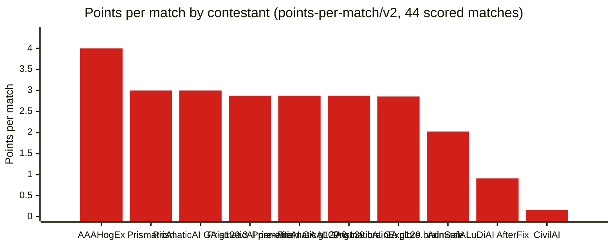
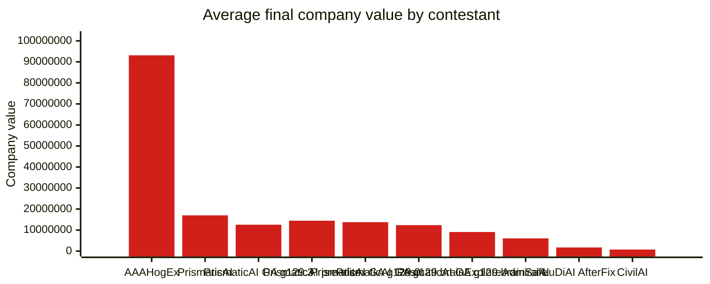
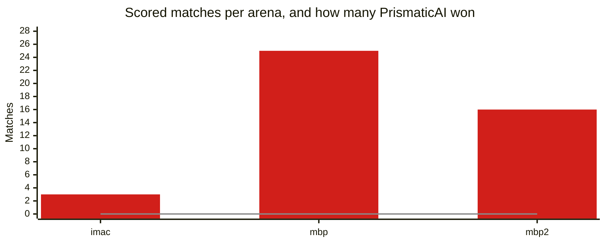

# battle-20261120T102626-2881f59c

Derived from `battle-20261120T102626-2881f59c.json` by `tools/research/ai-battle/battle.py report`; do not edit.

- Edition `2881f59cf5549445`: PrismaticAI and referee at `2cab9e0314edf484880fedf08e9fc11d63d5357c`, base set `opengfx-8.0.tar`
- 20-year free-for-all from 1960, map 256x256 temperate, breakdowns 1
- 44 scored match(es) on `imac` (20261119-master-gdf1e05e7d8), `mbp` (20261120-master-m17653b726e), `mbp2` (20261119-master-gdf1e05e7d8)
- Replays: 0 of 0 identical to their original on another arena

| # | Contestant | Played | Wins | Points | Points/match | Avg rank | Avg final value | Squirrel errors | Matches with anomalies |
|---|---|---|---|---|---|---|---|---|---|
| 1 | AAAHogEx | 44 | 44 | 176 | 4.0 | 1.0 | 93.1 M | 68 | 1 |
| 2 | PrismaticAI | 7 | 0 | 21 | 3.0 | 2.0 | 17.0 M | 0 | 0 |
| 3 | PrismaticAI GA g129.3 | 6 | 0 | 18 | 3.0 | 2.0 | 12.6 M | 0 | 1 |
| 4 | PrismaticAI pre-elite | 8 | 0 | 23 | 2.875 | 2.12 | 14.5 M | 0 | 0 |
| 5 | PrismaticAI GA g129.0 | 8 | 0 | 23 | 2.875 | 2.12 | 13.8 M | 0 | 0 |
| 6 | PrismaticAI GA g129.brainExplore | 8 | 0 | 23 | 2.875 | 2.12 | 12.4 M | 0 | 2 |
| 7 | PrismaticAI GA g129.brainSafe | 7 | 0 | 20 | 2.857 | 2.14 | 9.1 M | 0 | 3 |
| 8 | AdmiralAI | 44 | 0 | 89 | 2.023 | 2.98 | 6.1 M | 0 | 5 |
| 9 | LuDiAI AfterFix | 44 | 0 | 40 | 0.909 | 4.09 | 1.7 M | 0 | 1 |
| 10 | CivilAI | 44 | 0 | 7 | 0.159 | 4.84 | 743.3 k | 0 | 7 |

```mermaid
---
config:
  xyChart:
    width: 900
    height: 360
  themeVariables:
    xyChart:
      plotColorPalette: "#d11f1a, #8a8a8a, #0b0b0b, #ece4d6"
---
xychart-beta
    title "Final company value per scored match: winner vs best PrismaticAI"
    x-axis ["m-0001", "m-0002", "m-0003", "m-0004", "m-0005", "m-0006", "m-0007", "m-0008", "m-0009", "m-0010", "m-0011", "m-0012", "m-0013", "m-0014", "m-0015", "m-0016", "m-0017", "m-0018", "m-0019", "m-0020", "m-0021", "m-0022", "m-0023", "m-0024", "m-0025", "m-0026", "m-0027", "m-0028", "m-0036", "m-0037", "m-0038", "m-0039", "m-0040", "m-0041", "m-0042", "m-0043", "m-0044", "m-0045", "m-0046", "m-0047", "m-0048", "m-0049", "m-0050", "m-0052"]
    %% series: Winner | Best PrismaticAI
    %% links: battle-20261120T102626-2881f59c.md?col=Match&filter=m-0001 | battle-20261120T102626-2881f59c.md?col=Match&filter=m-0002 | battle-20261120T102626-2881f59c.md?col=Match&filter=m-0003 | battle-20261120T102626-2881f59c.md?col=Match&filter=m-0004 | battle-20261120T102626-2881f59c.md?col=Match&filter=m-0005 | battle-20261120T102626-2881f59c.md?col=Match&filter=m-0006 | battle-20261120T102626-2881f59c.md?col=Match&filter=m-0007 | battle-20261120T102626-2881f59c.md?col=Match&filter=m-0008 | battle-20261120T102626-2881f59c.md?col=Match&filter=m-0009 | battle-20261120T102626-2881f59c.md?col=Match&filter=m-0010 | battle-20261120T102626-2881f59c.md?col=Match&filter=m-0011 | battle-20261120T102626-2881f59c.md?col=Match&filter=m-0012 | battle-20261120T102626-2881f59c.md?col=Match&filter=m-0013 | battle-20261120T102626-2881f59c.md?col=Match&filter=m-0014 | battle-20261120T102626-2881f59c.md?col=Match&filter=m-0015 | battle-20261120T102626-2881f59c.md?col=Match&filter=m-0016 | battle-20261120T102626-2881f59c.md?col=Match&filter=m-0017 | battle-20261120T102626-2881f59c.md?col=Match&filter=m-0018 | battle-20261120T102626-2881f59c.md?col=Match&filter=m-0019 | battle-20261120T102626-2881f59c.md?col=Match&filter=m-0020 | battle-20261120T102626-2881f59c.md?col=Match&filter=m-0021 | battle-20261120T102626-2881f59c.md?col=Match&filter=m-0022 | battle-20261120T102626-2881f59c.md?col=Match&filter=m-0023 | battle-20261120T102626-2881f59c.md?col=Match&filter=m-0024 | battle-20261120T102626-2881f59c.md?col=Match&filter=m-0025 | battle-20261120T102626-2881f59c.md?col=Match&filter=m-0026 | battle-20261120T102626-2881f59c.md?col=Match&filter=m-0027 | battle-20261120T102626-2881f59c.md?col=Match&filter=m-0028 | battle-20261120T102626-2881f59c.md?col=Match&filter=m-0036 | battle-20261120T102626-2881f59c.md?col=Match&filter=m-0037 | battle-20261120T102626-2881f59c.md?col=Match&filter=m-0038 | battle-20261120T102626-2881f59c.md?col=Match&filter=m-0039 | battle-20261120T102626-2881f59c.md?col=Match&filter=m-0040 | battle-20261120T102626-2881f59c.md?col=Match&filter=m-0041 | battle-20261120T102626-2881f59c.md?col=Match&filter=m-0042 | battle-20261120T102626-2881f59c.md?col=Match&filter=m-0043 | battle-20261120T102626-2881f59c.md?col=Match&filter=m-0044 | battle-20261120T102626-2881f59c.md?col=Match&filter=m-0045 | battle-20261120T102626-2881f59c.md?col=Match&filter=m-0046 | battle-20261120T102626-2881f59c.md?col=Match&filter=m-0047 | battle-20261120T102626-2881f59c.md?col=Match&filter=m-0048 | battle-20261120T102626-2881f59c.md?col=Match&filter=m-0049 | battle-20261120T102626-2881f59c.md?col=Match&filter=m-0050 | battle-20261120T102626-2881f59c.md?col=Match&filter=m-0052
    y-axis "Company value" 0 --> 154000000
    bar [89248143, 93650819, 119850149, 95246600, 94959911, 91600043, 127871760, 96104440, 100847409, 91968026, 96981125, 78196848, 85116412, 74234567, 92437797, 99200214, 102927305, 93842989, 120629558, 134197564, 133334896, 114181645, 139900402, 80345646, 78012478, 92845075, 70925439, 89929481, 116858750, 101566753, 117409489, 90377895, 119634683, 125680135, 84040993, 76193821, 64859577, 76756677, 51597224, 77333992, 55468856, 59834104, 49483150, 51598267]
    line [14120739, 14646625, 4415523, 14613085, 12558903, 18272324, 19268536, 14910646, 7422349, 12260785, 12665520, 14164683, 10627724, 12355884, 8437249, 8415292, 10909919, 27183523, 23169905, 22773627, 13056850, 15793429, 14295159, 16404874, 9099910, 11043130, 8208251, 12435290, 22831201, 13080133, 15619861, 14220423, 10846964, 15843855, 11558985, 18148664, 7650133, 7849408, 13843557, 9063129, 8587262, 8179280, 11105167, 10602641]
```

<!-- battle-charts:begin -->
<!-- derived from battle-20261120T102626-2881f59c.json by `battle.py render`; `battle.py check` fails when it is stale -->

<!-- battle-charts:end -->

| Match | Arena | Seed | Winner | Value | Last | Anomalies |
|---|---|---|---|---|---|---|
| m-0001 | mbp | 1929123914 | AAAHogEx | 89.2 M | LuDiAI AfterFix | - |
| m-0002 | mbp | 1929123914 | AAAHogEx | 93.7 M | LuDiAI AfterFix | - |
| m-0003 | mbp | 1929123914 | AAAHogEx | 119.9 M | CivilAI | PrismaticAI GA g129.brainSafe: fleet_drop:65->37; CivilAI: fleet_drop:51->10 |
| m-0004 | mbp | 1929123914 | AAAHogEx | 95.2 M | CivilAI | PrismaticAI GA g129.brainExplore: fleet_drop:90->50 |
| m-0005 | mbp | 1929123914 | AAAHogEx | 95.0 M | CivilAI | - |
| m-0006 | mbp | 458705710 | AAAHogEx | 91.6 M | CivilAI | - |
| m-0007 | mbp | 458705710 | AAAHogEx | 127.9 M | CivilAI | - |
| m-0008 | mbp | 458705710 | AAAHogEx | 96.1 M | CivilAI | - |
| m-0009 | mbp | 458705710 | AAAHogEx | 100.8 M | CivilAI | CivilAI: fleet_drop:46->28 |
| m-0010 | imac | 458705710 | AAAHogEx | 92.0 M | CivilAI | AdmiralAI: fleet_drop:406->232 |
| m-0011 | imac | 458705710 | AAAHogEx | 97.0 M | CivilAI | - |
| m-0012 | imac | 1230027703 | AAAHogEx | 78.2 M | CivilAI | - |
| m-0013 | mbp2 | 1230027703 | AAAHogEx | 85.1 M | CivilAI | - |
| m-0014 | mbp2 | 1230027703 | AAAHogEx | 74.2 M | CivilAI | CivilAI: fleet_drop:101->63 |
| m-0015 | mbp2 | 1230027703 | AAAHogEx | 92.4 M | CivilAI | PrismaticAI GA g129.brainSafe: fleet_drop:96->38 |
| m-0016 | mbp2 | 1230027703 | AAAHogEx | 99.2 M | CivilAI | PrismaticAI GA g129.brainExplore: fleet_drop:91->56 |
| m-0017 | mbp2 | 1230027703 | AAAHogEx | 102.9 M | LuDiAI AfterFix | PrismaticAI GA g129.3: fleet_drop:56->39 |
| m-0018 | mbp2 | 1552138171 | AAAHogEx | 93.8 M | CivilAI | - |
| m-0019 | mbp2 | 1552138171 | AAAHogEx | 120.6 M | CivilAI | - |
| m-0020 | mbp2 | 1552138171 | AAAHogEx | 134.2 M | CivilAI | - |
| m-0021 | mbp2 | 1552138171 | AAAHogEx | 133.3 M | CivilAI | PrismaticAI GA g129.brainSafe: fleet_drop:115->64 |
| m-0022 | mbp2 | 1552138171 | AAAHogEx | 114.2 M | CivilAI | - |
| m-0023 | mbp2 | 1552138171 | AAAHogEx | 139.9 M | CivilAI | - |
| m-0024 | mbp2 | 837712592 | AAAHogEx | 80.3 M | CivilAI | - |
| m-0025 | mbp2 | 837712592 | AAAHogEx | 78.0 M | CivilAI | - |
| m-0026 | mbp2 | 837712592 | AAAHogEx | 92.8 M | CivilAI | CivilAI: fleet_drop:37->4 |
| m-0027 | mbp2 | 837712592 | AAAHogEx | 70.9 M | CivilAI | - |
| m-0028 | mbp2 | 837712592 | AAAHogEx | 89.9 M | CivilAI | - |
| m-0036 | mbp | 944176661 | AAAHogEx | 116.9 M | CivilAI | - |
| m-0037 | mbp | 944176661 | AAAHogEx | 101.6 M | CivilAI | - |
| m-0038 | mbp | 944176661 | AAAHogEx | 117.4 M | CivilAI | AdmiralAI: fleet_drop:261->169; CivilAI: fleet_drop:50->27 |
| m-0039 | mbp | 944176661 | AAAHogEx | 90.4 M | CivilAI | - |
| m-0040 | mbp | 944176661 | AAAHogEx | 119.6 M | CivilAI | AdmiralAI: fleet_drop:151->97; CivilAI: fleet_drop:38->21 |
| m-0041 | mbp | 944176661 | AAAHogEx | 125.7 M | CivilAI | AdmiralAI: fleet_drop:225->155 |
| m-0042 | mbp | 1102970202 | AAAHogEx | 84.0 M | CivilAI | - |
| m-0043 | mbp | 1102970202 | AAAHogEx | 76.2 M | LuDiAI AfterFix | - |
| m-0044 | mbp | 1102970202 | AAAHogEx | 64.9 M | LuDiAI AfterFix | - |
| m-0045 | mbp | 1102970202 | AAAHogEx | 76.8 M | LuDiAI AfterFix | - |
| m-0046 | mbp | 1102970202 | AAAHogEx | 51.6 M | LuDiAI AfterFix | - |
| m-0047 | mbp | 1102970202 | AAAHogEx | 77.3 M | CivilAI | - |
| m-0048 | mbp | 1980527307 | AAAHogEx | 55.5 M | CivilAI | AAAHogEx: squirrel_errors:68; LuDiAI AfterFix: fleet_drop:65->34 |
| m-0049 | mbp | 1980527307 | AAAHogEx | 59.8 M | CivilAI | AdmiralAI: fleet_drop:246->157 |
| m-0050 | mbp | 1980527307 | AAAHogEx | 49.5 M | CivilAI | - |
| m-0052 | mbp | 1980527307 | AAAHogEx | 51.6 M | CivilAI | CivilAI: no_vehicles |
