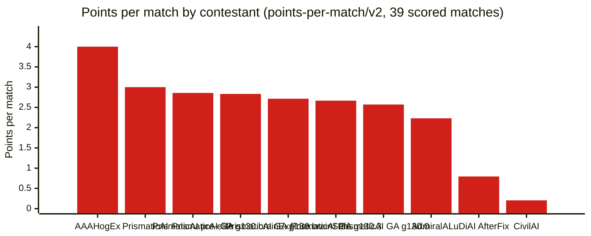
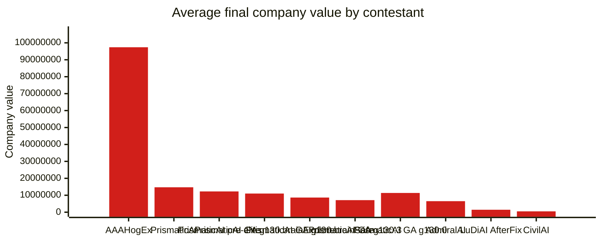
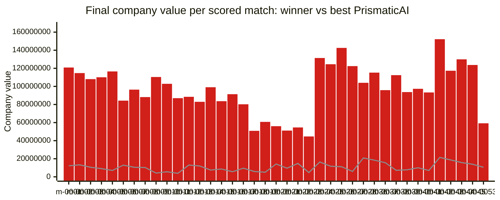
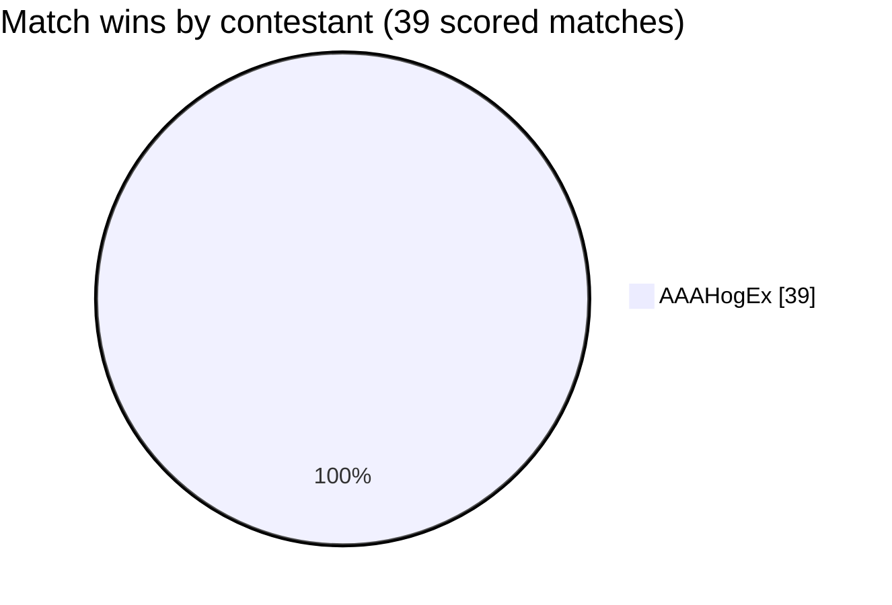
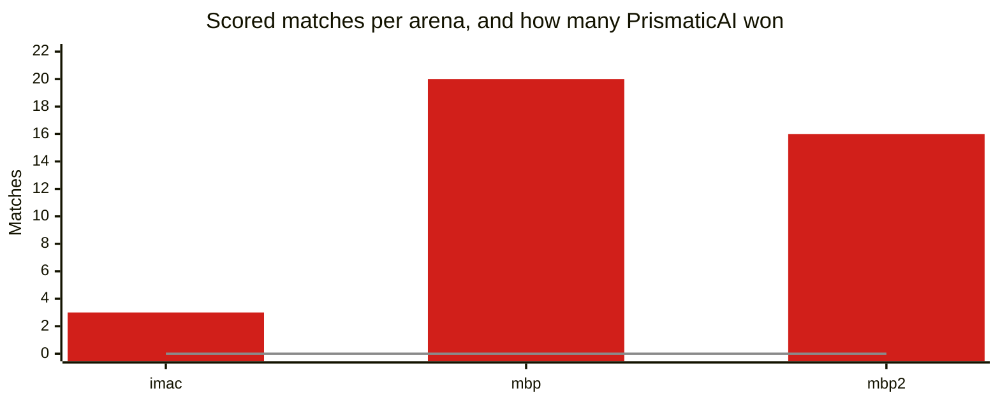

# battle-20261120T103519-87d860b6

Derived from `battle-20261120T103519-87d860b6.json` by `tools/research/ai-battle/battle.py report`; do not edit.

- Edition `87d860b6e385afac`: PrismaticAI and referee at `2cab9e0314edf484880fedf08e9fc11d63d5357c`, base set `opengfx-8.0.tar`
- 20-year free-for-all from 1960, map 256x256 temperate, breakdowns 1
- 39 scored match(es) on `imac` (20261119-master-gdf1e05e7d8), `mbp` (20261120-master-m17653b726e), `mbp2` (20261119-master-gdf1e05e7d8)
- Replays: 1 of 1 identical to their original on another arena

| # | Contestant | Played | Wins | Points | Points/match | Avg rank | Avg final value | Squirrel errors | Matches with anomalies |
|---|---|---|---|---|---|---|---|---|---|
| 1 | AAAHogEx | 39 | 39 | 156 | 4.0 | 1.0 | 97.4 M | 0 | 0 |
| 2 | PrismaticAI | 6 | 0 | 18 | 3.0 | 2.0 | 14.7 M | 0 | 3 |
| 3 | PrismaticAI pre-elite | 7 | 0 | 20 | 2.857 | 2.14 | 12.3 M | 0 | 0 |
| 4 | PrismaticAI GA g130.brainExplore | 6 | 0 | 17 | 2.833 | 2.17 | 11.0 M | 0 | 2 |
| 5 | PrismaticAI GA g130.brainSafe | 7 | 0 | 19 | 2.714 | 2.29 | 8.7 M | 0 | 2 |
| 6 | PrismaticAI GA g130.3 | 6 | 0 | 16 | 2.667 | 2.33 | 7.1 M | 0 | 0 |
| 7 | PrismaticAI GA g130.0 | 7 | 0 | 18 | 2.571 | 2.43 | 11.4 M | 0 | 1 |
| 8 | AdmiralAI | 39 | 0 | 87 | 2.231 | 2.77 | 6.5 M | 0 | 1 |
| 9 | LuDiAI AfterFix | 39 | 0 | 31 | 0.795 | 4.21 | 1.4 M | 0 | 1 |
| 10 | CivilAI | 39 | 0 | 8 | 0.205 | 4.79 | 495.9 k | 3675 | 4 |

<!-- battle-charts:begin -->
<!-- derived from battle-20261120T103519-87d860b6.json by `battle.py render`; `battle.py check` fails when it is stale -->

<!-- battle-charts:end -->

| Seed | Original | Replay | Arenas | Identical |
|---|---|---|---|---|
| 928879960 | m-0018 | m-0056 | mbp2 / mbp | yes |

| Match | Arena | Seed | Winner | Value | Last | Anomalies |
|---|---|---|---|---|---|---|
| m-0001 | mbp | 1181750707 | AAAHogEx | 120.9 M | CivilAI | - |
| m-0002 | mbp | 1181750707 | AAAHogEx | 114.7 M | CivilAI | PrismaticAI GA g130.0: fleet_drop:118->68 |
| m-0003 | mbp | 1181750707 | AAAHogEx | 108.1 M | CivilAI | PrismaticAI GA g130.brainSafe: fleet_drop:143->72 |
| m-0004 | mbp | 1181750707 | AAAHogEx | 110.1 M | CivilAI | - |
| m-0005 | mbp | 1181750707 | AAAHogEx | 116.5 M | CivilAI | - |
| m-0006 | mbp | 904851669 | AAAHogEx | 84.3 M | CivilAI | PrismaticAI: fleet_drop:87->58 |
| m-0007 | mbp | 904851669 | AAAHogEx | 96.4 M | CivilAI | - |
| m-0008 | mbp | 904851669 | AAAHogEx | 88.2 M | CivilAI | CivilAI: squirrel_errors:3675 |
| m-0009 | mbp | 904851669 | AAAHogEx | 110.4 M | CivilAI | - |
| m-0010 | imac | 904851669 | AAAHogEx | 102.9 M | CivilAI | - |
| m-0011 | imac | 904851669 | AAAHogEx | 87.0 M | CivilAI | - |
| m-0012 | imac | 254514776 | AAAHogEx | 88.5 M | CivilAI | - |
| m-0013 | mbp2 | 254514776 | AAAHogEx | 83.0 M | CivilAI | - |
| m-0014 | mbp2 | 254514776 | AAAHogEx | 99.1 M | CivilAI | - |
| m-0015 | mbp2 | 254514776 | AAAHogEx | 83.7 M | CivilAI | PrismaticAI GA g130.brainSafe: fleet_drop:60->36 |
| m-0016 | mbp2 | 254514776 | AAAHogEx | 91.4 M | CivilAI | PrismaticAI GA g130.brainExplore: fleet_drop:69->28 |
| m-0017 | mbp2 | 254514776 | AAAHogEx | 80.2 M | LuDiAI AfterFix | - |
| m-0018 | mbp2 | 928879960 | AAAHogEx | 50.9 M | CivilAI | - |
| m-0019 | mbp2 | 928879960 | AAAHogEx | 60.8 M | LuDiAI AfterFix | - |
| m-0020 | mbp2 | 928879960 | AAAHogEx | 56.0 M | LuDiAI AfterFix | - |
| m-0021 | mbp2 | 928879960 | AAAHogEx | 51.1 M | LuDiAI AfterFix | - |
| m-0022 | mbp2 | 928879960 | AAAHogEx | 54.6 M | LuDiAI AfterFix | - |
| m-0023 | mbp2 | 928879960 | AAAHogEx | 44.7 M | LuDiAI AfterFix | CivilAI: fleet_drop:29->20 |
| m-0024 | mbp2 | 1491333760 | AAAHogEx | 131.4 M | CivilAI | CivilAI: fleet_drop:51->32 |
| m-0025 | mbp2 | 1491333760 | AAAHogEx | 124.5 M | CivilAI | - |
| m-0026 | mbp2 | 1491333760 | AAAHogEx | 142.6 M | CivilAI | - |
| m-0027 | mbp2 | 1491333760 | AAAHogEx | 122.4 M | CivilAI | - |
| m-0028 | mbp2 | 1491333760 | AAAHogEx | 104.0 M | CivilAI | - |
| m-0036 | mbp | 586449716 | AAAHogEx | 115.2 M | CivilAI | PrismaticAI: fleet_drop:122->85 |
| m-0037 | mbp | 586449716 | AAAHogEx | 95.9 M | LuDiAI AfterFix | CivilAI: fleet_drop:81->51 |
| m-0038 | mbp | 586449716 | AAAHogEx | 112.4 M | CivilAI | - |
| m-0039 | mbp | 586449716 | AAAHogEx | 93.7 M | CivilAI | - |
| m-0040 | mbp | 586449716 | AAAHogEx | 97.3 M | CivilAI | PrismaticAI GA g130.brainExplore: fleet_drop:83->58; LuDiAI AfterFix: fleet_drop:65->17 |
| m-0041 | mbp | 586449716 | AAAHogEx | 93.3 M | CivilAI | - |
| m-0042 | mbp | 51861008 | AAAHogEx | 152.2 M | CivilAI | PrismaticAI: fleet_drop:125->75 |
| m-0043 | mbp | 51861008 | AAAHogEx | 117.3 M | CivilAI | - |
| m-0044 | mbp | 51861008 | AAAHogEx | 129.9 M | CivilAI | AdmiralAI: fleet_drop:85->49 |
| m-0045 | mbp | 51861008 | AAAHogEx | 123.7 M | CivilAI | - |
| m-0053 | mbp | 942788029 | AAAHogEx | 59.2 M | LuDiAI AfterFix | - |
| m-0056 (replay) | mbp | 928879960 | AAAHogEx | 50.9 M | CivilAI | - |
