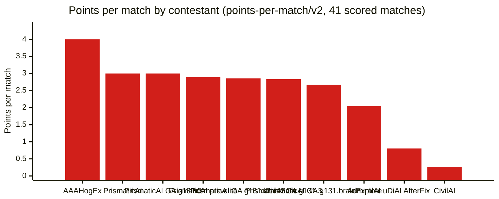
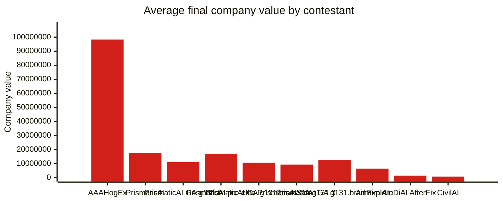
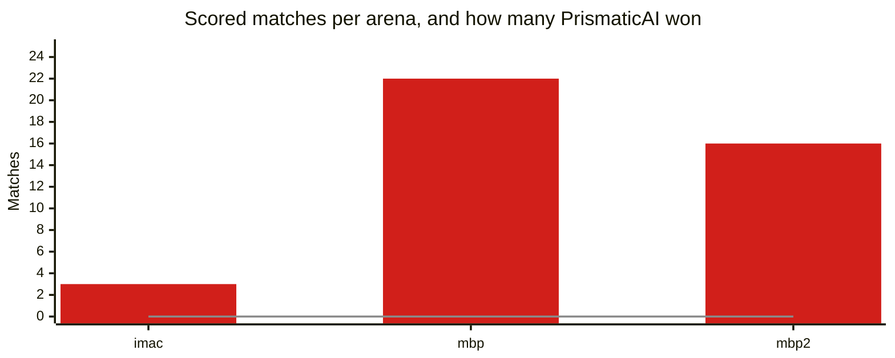

# battle-20261120T104459-f2791c67

Derived from `battle-20261120T104459-f2791c67.json` by `tools/research/ai-battle/battle.py report`; do not edit.

- Edition `f2791c6705feef0c`: PrismaticAI and referee at `2cab9e0314edf484880fedf08e9fc11d63d5357c`, base set `opengfx-8.0.tar`
- 20-year free-for-all from 1960, map 256x256 temperate, breakdowns 1
- 41 scored match(es) on `imac` (20261119-master-gdf1e05e7d8), `mbp` (20261120-master-m17653b726e), `mbp2` (20261119-master-gdf1e05e7d8)
- Replays: 1 of 2 identical to their original on another arena

| # | Contestant | Played | Wins | Points | Points/match | Avg rank | Avg final value | Squirrel errors | Matches with anomalies |
|---|---|---|---|---|---|---|---|---|---|
| 1 | AAAHogEx | 41 | 41 | 164 | 4.0 | 1.0 | 98.3 M | 0 | 0 |
| 2 | PrismaticAI | 6 | 0 | 18 | 3.0 | 2.0 | 17.6 M | 0 | 3 |
| 3 | PrismaticAI GA g131.0 | 7 | 0 | 21 | 3.0 | 2.0 | 11.0 M | 0 | 2 |
| 4 | PrismaticAI pre-elite | 9 | 0 | 26 | 2.889 | 2.11 | 17.0 M | 0 | 0 |
| 5 | PrismaticAI GA g131.brainSafe | 7 | 0 | 20 | 2.857 | 2.14 | 10.7 M | 0 | 2 |
| 6 | PrismaticAI GA g131.3 | 6 | 0 | 17 | 2.833 | 2.17 | 9.3 M | 0 | 2 |
| 7 | PrismaticAI GA g131.brainExplore | 6 | 0 | 16 | 2.667 | 2.33 | 12.5 M | 0 | 1 |
| 8 | AdmiralAI | 41 | 0 | 84 | 2.049 | 2.95 | 6.5 M | 0 | 2 |
| 9 | LuDiAI AfterFix | 41 | 0 | 33 | 0.805 | 4.2 | 1.5 M | 0 | 1 |
| 10 | CivilAI | 41 | 0 | 11 | 0.268 | 4.73 | 810.0 k | 0 | 5 |

```mermaid
---
config:
  xyChart:
    width: 900
    height: 360
  themeVariables:
    xyChart:
      plotColorPalette: "#d11f1a, #8a8a8a, #0b0b0b, #ece4d6"
---
xychart-beta
    title "Final company value per scored match: winner vs best PrismaticAI"
    x-axis ["m-0001", "m-0002", "m-0003", "m-0004", "m-0005", "m-0006", "m-0007", "m-0008", "m-0009", "m-0010", "m-0011", "m-0012", "m-0013", "m-0014", "m-0015", "m-0016", "m-0017", "m-0018", "m-0019", "m-0020", "m-0021", "m-0022", "m-0023", "m-0024", "m-0025", "m-0026", "m-0027", "m-0028", "m-0036", "m-0037", "m-0038", "m-0039", "m-0040", "m-0041", "m-0042", "m-0043", "m-0044", "m-0045", "m-0047", "m-0049", "m-0055"]
    %% series: Winner | Best PrismaticAI
    %% links: battle-20261120T104459-f2791c67.md?col=Match&filter=m-0001 | battle-20261120T104459-f2791c67.md?col=Match&filter=m-0002 | battle-20261120T104459-f2791c67.md?col=Match&filter=m-0003 | battle-20261120T104459-f2791c67.md?col=Match&filter=m-0004 | battle-20261120T104459-f2791c67.md?col=Match&filter=m-0005 | battle-20261120T104459-f2791c67.md?col=Match&filter=m-0006 | battle-20261120T104459-f2791c67.md?col=Match&filter=m-0007 | battle-20261120T104459-f2791c67.md?col=Match&filter=m-0008 | battle-20261120T104459-f2791c67.md?col=Match&filter=m-0009 | battle-20261120T104459-f2791c67.md?col=Match&filter=m-0010 | battle-20261120T104459-f2791c67.md?col=Match&filter=m-0011 | battle-20261120T104459-f2791c67.md?col=Match&filter=m-0012 | battle-20261120T104459-f2791c67.md?col=Match&filter=m-0013 | battle-20261120T104459-f2791c67.md?col=Match&filter=m-0014 | battle-20261120T104459-f2791c67.md?col=Match&filter=m-0015 | battle-20261120T104459-f2791c67.md?col=Match&filter=m-0016 | battle-20261120T104459-f2791c67.md?col=Match&filter=m-0017 | battle-20261120T104459-f2791c67.md?col=Match&filter=m-0018 | battle-20261120T104459-f2791c67.md?col=Match&filter=m-0019 | battle-20261120T104459-f2791c67.md?col=Match&filter=m-0020 | battle-20261120T104459-f2791c67.md?col=Match&filter=m-0021 | battle-20261120T104459-f2791c67.md?col=Match&filter=m-0022 | battle-20261120T104459-f2791c67.md?col=Match&filter=m-0023 | battle-20261120T104459-f2791c67.md?col=Match&filter=m-0024 | battle-20261120T104459-f2791c67.md?col=Match&filter=m-0025 | battle-20261120T104459-f2791c67.md?col=Match&filter=m-0026 | battle-20261120T104459-f2791c67.md?col=Match&filter=m-0027 | battle-20261120T104459-f2791c67.md?col=Match&filter=m-0028 | battle-20261120T104459-f2791c67.md?col=Match&filter=m-0036 | battle-20261120T104459-f2791c67.md?col=Match&filter=m-0037 | battle-20261120T104459-f2791c67.md?col=Match&filter=m-0038 | battle-20261120T104459-f2791c67.md?col=Match&filter=m-0039 | battle-20261120T104459-f2791c67.md?col=Match&filter=m-0040 | battle-20261120T104459-f2791c67.md?col=Match&filter=m-0041 | battle-20261120T104459-f2791c67.md?col=Match&filter=m-0042 | battle-20261120T104459-f2791c67.md?col=Match&filter=m-0043 | battle-20261120T104459-f2791c67.md?col=Match&filter=m-0044 | battle-20261120T104459-f2791c67.md?col=Match&filter=m-0045 | battle-20261120T104459-f2791c67.md?col=Match&filter=m-0047 | battle-20261120T104459-f2791c67.md?col=Match&filter=m-0049 | battle-20261120T104459-f2791c67.md?col=Match&filter=m-0055
    y-axis "Company value" 0 --> 159000000
    bar [87698632, 117520224, 114010130, 144582131, 131354575, 80292686, 90033130, 107083054, 78639487, 80830755, 91319068, 74348532, 98274259, 105769215, 100179997, 90545396, 95709657, 85916749, 80110043, 70948915, 68491514, 66691199, 79887065, 119443562, 137279371, 99473459, 116159483, 142001057, 106574694, 111091240, 142503147, 96607681, 95828045, 105240649, 50277740, 85964773, 73522193, 102546898, 92730279, 130069191, 83554923]
    line [17649800, 8281074, 13355140, 13282725, 8847472, 13716047, 15401459, 8867635, 8100092, 6709603, 6146903, 20425699, 15642513, 7937121, 13820294, 18832430, 8592280, 13189018, 14065057, 13226767, 11233569, 9308170, 7094382, 17411359, 21918234, 10118972, 10359678, 10072428, 21925852, 18118711, 12023309, 13293402, 16845808, 13705581, 19105229, 17632533, 16542569, 4755533, 11554471, 25087676, 7443372]
```

<!-- battle-charts:begin -->
<!-- derived from battle-20261120T104459-f2791c67.json by `battle.py render`; `battle.py check` fails when it is stale -->

<!-- battle-charts:end -->

| Seed | Original | Replay | Arenas | Identical |
|---|---|---|---|---|
| 1666189545 | m-0015 | m-0048 | mbp2 / mbp | yes |
| 1999149904 | m-0010 | m-0056 | imac / mbp | NO |

| Match | Arena | Seed | Winner | Value | Last | Anomalies |
|---|---|---|---|---|---|---|
| m-0001 | mbp | 1514125018 | AAAHogEx | 87.7 M | LuDiAI AfterFix | - |
| m-0002 | mbp | 1514125018 | AAAHogEx | 117.5 M | LuDiAI AfterFix | - |
| m-0003 | mbp | 1514125018 | AAAHogEx | 114.0 M | CivilAI | - |
| m-0004 | mbp | 1514125018 | AAAHogEx | 144.6 M | CivilAI | - |
| m-0005 | mbp | 1514125018 | AAAHogEx | 131.4 M | CivilAI | PrismaticAI GA g131.3: fleet_drop:56->36 |
| m-0006 | mbp | 1999149904 | AAAHogEx | 80.3 M | CivilAI | PrismaticAI: fleet_drop:79->47 |
| m-0007 | mbp | 1999149904 | AAAHogEx | 90.0 M | CivilAI | LuDiAI AfterFix: fleet_drop:45->31 |
| m-0008 | mbp | 1999149904 | AAAHogEx | 107.1 M | CivilAI | PrismaticAI GA g131.0: fleet_drop:70->46; CivilAI: fleet_drop:34->20 |
| m-0009 | mbp | 1999149904 | AAAHogEx | 78.6 M | CivilAI | - |
| m-0010 | imac | 1999149904 | AAAHogEx | 80.8 M | CivilAI | - |
| m-0011 | imac | 1999149904 | AAAHogEx | 91.3 M | CivilAI | PrismaticAI GA g131.3: fleet_drop:53->33; CivilAI: fleet_drop:77->47 |
| m-0012 | imac | 1666189545 | AAAHogEx | 74.3 M | CivilAI | - |
| m-0013 | mbp2 | 1666189545 | AAAHogEx | 98.3 M | CivilAI | - |
| m-0014 | mbp2 | 1666189545 | AAAHogEx | 105.8 M | CivilAI | PrismaticAI GA g131.0: fleet_drop:57->34 |
| m-0015 | mbp2 | 1666189545 | AAAHogEx | 100.2 M | LuDiAI AfterFix | - |
| m-0016 | mbp2 | 1666189545 | AAAHogEx | 90.5 M | CivilAI | PrismaticAI GA g131.brainExplore: fleet_drop:101->62 |
| m-0017 | mbp2 | 1666189545 | AAAHogEx | 95.7 M | CivilAI | - |
| m-0018 | mbp2 | 69843427 | AAAHogEx | 85.9 M | LuDiAI AfterFix | CivilAI: fleet_drop:42->9 |
| m-0019 | mbp2 | 69843427 | AAAHogEx | 80.1 M | CivilAI | - |
| m-0020 | mbp2 | 69843427 | AAAHogEx | 70.9 M | CivilAI | - |
| m-0021 | mbp2 | 69843427 | AAAHogEx | 68.5 M | CivilAI | PrismaticAI GA g131.brainSafe: fleet_drop:78->51 |
| m-0022 | mbp2 | 69843427 | AAAHogEx | 66.7 M | CivilAI | CivilAI: fleet_drop:20->5 |
| m-0023 | mbp2 | 69843427 | AAAHogEx | 79.9 M | LuDiAI AfterFix | - |
| m-0024 | mbp2 | 817861998 | AAAHogEx | 119.4 M | LuDiAI AfterFix | PrismaticAI: fleet_drop:83->50 |
| m-0025 | mbp2 | 817861998 | AAAHogEx | 137.3 M | CivilAI | - |
| m-0026 | mbp2 | 817861998 | AAAHogEx | 99.5 M | LuDiAI AfterFix | - |
| m-0027 | mbp2 | 817861998 | AAAHogEx | 116.2 M | CivilAI | - |
| m-0028 | mbp2 | 817861998 | AAAHogEx | 142.0 M | CivilAI | - |
| m-0036 | mbp | 1312879757 | AAAHogEx | 106.6 M | LuDiAI AfterFix | PrismaticAI: fleet_drop:105->69 |
| m-0037 | mbp | 1312879757 | AAAHogEx | 111.1 M | CivilAI | CivilAI: fleet_drop:86->30 |
| m-0038 | mbp | 1312879757 | AAAHogEx | 142.5 M | CivilAI | - |
| m-0039 | mbp | 1312879757 | AAAHogEx | 96.6 M | CivilAI | - |
| m-0040 | mbp | 1312879757 | AAAHogEx | 95.8 M | LuDiAI AfterFix | - |
| m-0041 | mbp | 1312879757 | AAAHogEx | 105.2 M | CivilAI | - |
| m-0042 | mbp | 570285692 | AAAHogEx | 50.3 M | LuDiAI AfterFix | - |
| m-0043 | mbp | 570285692 | AAAHogEx | 86.0 M | CivilAI | - |
| m-0044 | mbp | 570285692 | AAAHogEx | 73.5 M | CivilAI | - |
| m-0045 | mbp | 570285692 | AAAHogEx | 102.5 M | CivilAI | PrismaticAI GA g131.brainSafe: fleet_drop:78->50 |
| m-0047 | mbp | 570285692 | AAAHogEx | 92.7 M | CivilAI | AdmiralAI: fleet_drop:231->125 |
| m-0048 (replay) | mbp | 1666189545 | AAAHogEx | 100.2 M | LuDiAI AfterFix | - |
| m-0049 | mbp | 300098994 | AAAHogEx | 130.1 M | AdmiralAI | - |
| m-0055 | mbp | 1196444563 | AAAHogEx | 83.6 M | CivilAI | AdmiralAI: fleet_drop:120->83 |
| m-0056 (replay) | mbp | 1999149904 | AAAHogEx | 88.2 M | CivilAI | - |
