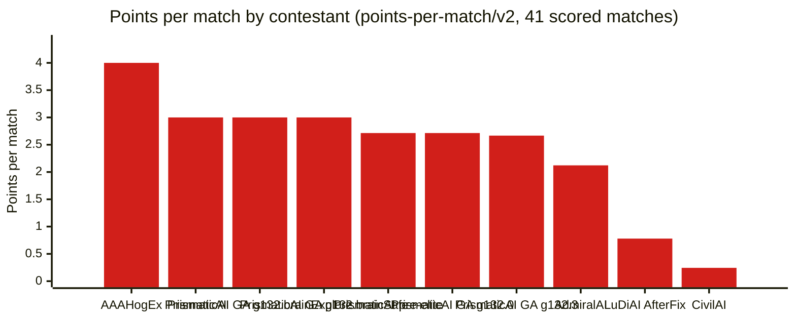
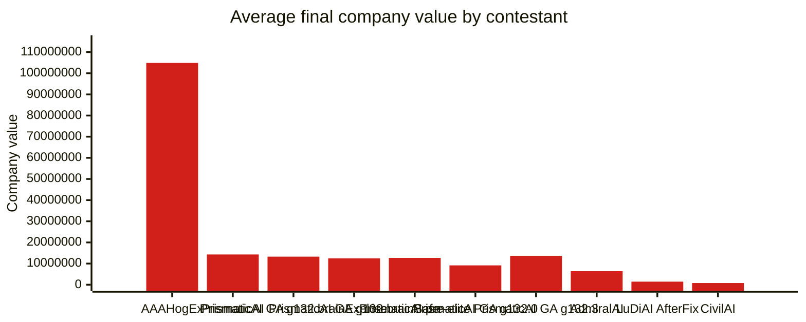
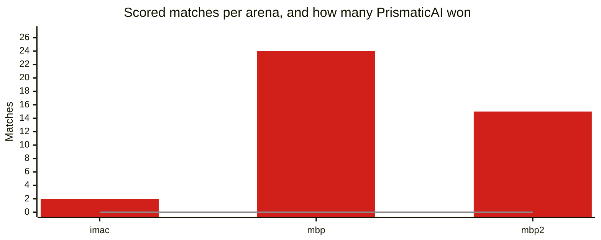

# battle-20261120T105416-0deeae1b

Derived from `battle-20261120T105416-0deeae1b.json` by `tools/research/ai-battle/battle.py report`; do not edit.

- Edition `0deeae1b4e0ae86f`: PrismaticAI and referee at `2cab9e0314edf484880fedf08e9fc11d63d5357c`, base set `opengfx-8.0.tar`
- 20-year free-for-all from 1960, map 256x256 temperate, breakdowns 1
- 41 scored match(es) on `imac` (20261119-master-gdf1e05e7d8), `mbp` (20261120-master-m17653b726e), `mbp2` (20261119-master-gdf1e05e7d8)
- Replays: 0 of 0 identical to their original on another arena

| # | Contestant | Played | Wins | Points | Points/match | Avg rank | Avg final value | Squirrel errors | Matches with anomalies |
|---|---|---|---|---|---|---|---|---|---|
| 1 | AAAHogEx | 41 | 41 | 164 | 4.0 | 1.0 | 104.9 M | 0 | 0 |
| 2 | PrismaticAI | 6 | 0 | 18 | 3.0 | 2.0 | 14.3 M | 0 | 1 |
| 3 | PrismaticAI GA g132.brainExplore | 7 | 0 | 21 | 3.0 | 2.0 | 13.3 M | 0 | 6 |
| 4 | PrismaticAI GA g132.brainSafe | 8 | 0 | 24 | 3.0 | 2.0 | 12.5 M | 0 | 3 |
| 5 | PrismaticAI pre-elite | 7 | 0 | 19 | 2.714 | 2.29 | 12.7 M | 0 | 1 |
| 6 | PrismaticAI GA g132.0 | 7 | 0 | 19 | 2.714 | 2.29 | 9.1 M | 0 | 3 |
| 7 | PrismaticAI GA g132.3 | 6 | 0 | 16 | 2.667 | 2.33 | 13.6 M | 0 | 1 |
| 8 | AdmiralAI | 41 | 0 | 87 | 2.122 | 2.88 | 6.4 M | 0 | 2 |
| 9 | LuDiAI AfterFix | 41 | 0 | 32 | 0.78 | 4.22 | 1.4 M | 0 | 1 |
| 10 | CivilAI | 41 | 0 | 10 | 0.244 | 4.76 | 780.3 k | 0 | 6 |

```mermaid
---
config:
  xyChart:
    width: 900
    height: 360
  themeVariables:
    xyChart:
      plotColorPalette: "#d11f1a, #8a8a8a, #0b0b0b, #ece4d6"
---
xychart-beta
    title "Final company value per scored match: winner vs best PrismaticAI"
    x-axis ["m-0001", "m-0002", "m-0003", "m-0004", "m-0005", "m-0006", "m-0007", "m-0008", "m-0009", "m-0010", "m-0011", "m-0013", "m-0014", "m-0015", "m-0016", "m-0017", "m-0018", "m-0019", "m-0020", "m-0021", "m-0023", "m-0024", "m-0025", "m-0026", "m-0027", "m-0028", "m-0036", "m-0037", "m-0038", "m-0039", "m-0040", "m-0041", "m-0042", "m-0043", "m-0044", "m-0045", "m-0046", "m-0047", "m-0048", "m-0051", "m-0052"]
    %% series: Winner | Best PrismaticAI
    %% links: battle-20261120T105416-0deeae1b.md?col=Match&filter=m-0001 | battle-20261120T105416-0deeae1b.md?col=Match&filter=m-0002 | battle-20261120T105416-0deeae1b.md?col=Match&filter=m-0003 | battle-20261120T105416-0deeae1b.md?col=Match&filter=m-0004 | battle-20261120T105416-0deeae1b.md?col=Match&filter=m-0005 | battle-20261120T105416-0deeae1b.md?col=Match&filter=m-0006 | battle-20261120T105416-0deeae1b.md?col=Match&filter=m-0007 | battle-20261120T105416-0deeae1b.md?col=Match&filter=m-0008 | battle-20261120T105416-0deeae1b.md?col=Match&filter=m-0009 | battle-20261120T105416-0deeae1b.md?col=Match&filter=m-0010 | battle-20261120T105416-0deeae1b.md?col=Match&filter=m-0011 | battle-20261120T105416-0deeae1b.md?col=Match&filter=m-0013 | battle-20261120T105416-0deeae1b.md?col=Match&filter=m-0014 | battle-20261120T105416-0deeae1b.md?col=Match&filter=m-0015 | battle-20261120T105416-0deeae1b.md?col=Match&filter=m-0016 | battle-20261120T105416-0deeae1b.md?col=Match&filter=m-0017 | battle-20261120T105416-0deeae1b.md?col=Match&filter=m-0018 | battle-20261120T105416-0deeae1b.md?col=Match&filter=m-0019 | battle-20261120T105416-0deeae1b.md?col=Match&filter=m-0020 | battle-20261120T105416-0deeae1b.md?col=Match&filter=m-0021 | battle-20261120T105416-0deeae1b.md?col=Match&filter=m-0023 | battle-20261120T105416-0deeae1b.md?col=Match&filter=m-0024 | battle-20261120T105416-0deeae1b.md?col=Match&filter=m-0025 | battle-20261120T105416-0deeae1b.md?col=Match&filter=m-0026 | battle-20261120T105416-0deeae1b.md?col=Match&filter=m-0027 | battle-20261120T105416-0deeae1b.md?col=Match&filter=m-0028 | battle-20261120T105416-0deeae1b.md?col=Match&filter=m-0036 | battle-20261120T105416-0deeae1b.md?col=Match&filter=m-0037 | battle-20261120T105416-0deeae1b.md?col=Match&filter=m-0038 | battle-20261120T105416-0deeae1b.md?col=Match&filter=m-0039 | battle-20261120T105416-0deeae1b.md?col=Match&filter=m-0040 | battle-20261120T105416-0deeae1b.md?col=Match&filter=m-0041 | battle-20261120T105416-0deeae1b.md?col=Match&filter=m-0042 | battle-20261120T105416-0deeae1b.md?col=Match&filter=m-0043 | battle-20261120T105416-0deeae1b.md?col=Match&filter=m-0044 | battle-20261120T105416-0deeae1b.md?col=Match&filter=m-0045 | battle-20261120T105416-0deeae1b.md?col=Match&filter=m-0046 | battle-20261120T105416-0deeae1b.md?col=Match&filter=m-0047 | battle-20261120T105416-0deeae1b.md?col=Match&filter=m-0048 | battle-20261120T105416-0deeae1b.md?col=Match&filter=m-0051 | battle-20261120T105416-0deeae1b.md?col=Match&filter=m-0052
    y-axis "Company value" 0 --> 165000000
    bar [115125124, 98768721, 103859021, 129184976, 94039481, 104650583, 99127202, 87914140, 115085530, 107126925, 97081142, 115296548, 131882266, 118434523, 111663342, 123387482, 98835445, 131984212, 130001178, 150162780, 127201269, 104535190, 98096063, 107139354, 98369790, 104167668, 122697553, 96372400, 97465230, 83379093, 102196782, 100895291, 82575078, 92011185, 90986651, 91441439, 80086057, 88023651, 102411055, 80171918, 86714351]
    line [20528005, 8772386, 10103508, 12077847, 20042862, 14052654, 9542621, 11754223, 12434745, 13218472, 11077366, 13917217, 4409949, 9411661, 9426524, 7745221, 15525346, 5421383, 12156248, 16041164, 13691973, 13255490, 9771571, 8473391, 7193044, 11835432, 9663941, 12404253, 6688771, 13913732, 11852645, 12359400, 16675401, 17130453, 11708207, 15211078, 15544533, 16889201, 16563521, 15453975, 18840341]
```

<!-- battle-charts:begin -->
<!-- derived from battle-20261120T105416-0deeae1b.json by `battle.py render`; `battle.py check` fails when it is stale -->

<!-- battle-charts:end -->

| Match | Arena | Seed | Winner | Value | Last | Anomalies |
|---|---|---|---|---|---|---|
| m-0001 | mbp | 1999073531 | AAAHogEx | 115.1 M | CivilAI | - |
| m-0002 | mbp | 1999073531 | AAAHogEx | 98.8 M | LuDiAI AfterFix | - |
| m-0003 | mbp | 1999073531 | AAAHogEx | 103.9 M | LuDiAI AfterFix | - |
| m-0004 | mbp | 1999073531 | AAAHogEx | 129.2 M | CivilAI | PrismaticAI GA g132.brainExplore: fleet_drop:76->39 |
| m-0005 | mbp | 1999073531 | AAAHogEx | 94.0 M | CivilAI | - |
| m-0006 | mbp | 858735020 | AAAHogEx | 104.7 M | CivilAI | - |
| m-0007 | mbp | 858735020 | AAAHogEx | 99.1 M | LuDiAI AfterFix | - |
| m-0008 | mbp | 858735020 | AAAHogEx | 87.9 M | CivilAI | - |
| m-0009 | mbp | 858735020 | AAAHogEx | 115.1 M | LuDiAI AfterFix | - |
| m-0010 | imac | 858735020 | AAAHogEx | 107.1 M | LuDiAI AfterFix | PrismaticAI GA g132.brainExplore: fleet_drop:69->47 |
| m-0011 | imac | 858735020 | AAAHogEx | 97.1 M | LuDiAI AfterFix | - |
| m-0013 | mbp2 | 1965090739 | AAAHogEx | 115.3 M | CivilAI | - |
| m-0014 | mbp2 | 1965090739 | AAAHogEx | 131.9 M | CivilAI | - |
| m-0015 | mbp2 | 1965090739 | AAAHogEx | 118.4 M | CivilAI | LuDiAI AfterFix: fleet_drop:32->18 |
| m-0016 | mbp2 | 1965090739 | AAAHogEx | 111.7 M | CivilAI | PrismaticAI GA g132.brainExplore: fleet_drop:113->54 |
| m-0017 | mbp2 | 1965090739 | AAAHogEx | 123.4 M | CivilAI | PrismaticAI GA g132.3: fleet_drop:54->36 |
| m-0018 | mbp2 | 1286166067 | AAAHogEx | 98.8 M | CivilAI | - |
| m-0019 | mbp2 | 1286166067 | AAAHogEx | 132.0 M | CivilAI | PrismaticAI pre-elite: fleet_drop:74->44; CivilAI: fleet_drop:57->30 |
| m-0020 | mbp2 | 1286166067 | AAAHogEx | 130.0 M | CivilAI | PrismaticAI GA g132.0: fleet_drop:90->50 |
| m-0021 | mbp2 | 1286166067 | AAAHogEx | 150.2 M | CivilAI | PrismaticAI GA g132.brainSafe: fleet_drop:129->81 |
| m-0023 | mbp2 | 1286166067 | AAAHogEx | 127.2 M | CivilAI | - |
| m-0024 | mbp2 | 1066310287 | AAAHogEx | 104.5 M | CivilAI | CivilAI: fleet_drop:74->37 |
| m-0025 | mbp2 | 1066310287 | AAAHogEx | 98.1 M | LuDiAI AfterFix | - |
| m-0026 | mbp2 | 1066310287 | AAAHogEx | 107.1 M | CivilAI | PrismaticAI GA g132.0: fleet_drop:61->37 |
| m-0027 | mbp2 | 1066310287 | AAAHogEx | 98.4 M | LuDiAI AfterFix | - |
| m-0028 | mbp2 | 1066310287 | AAAHogEx | 104.2 M | CivilAI | PrismaticAI GA g132.brainExplore: fleet_drop:153->98 |
| m-0036 | mbp | 1314466223 | AAAHogEx | 122.7 M | CivilAI | - |
| m-0037 | mbp | 1314466223 | AAAHogEx | 96.4 M | LuDiAI AfterFix | - |
| m-0038 | mbp | 1314466223 | AAAHogEx | 97.5 M | CivilAI | PrismaticAI GA g132.0: fleet_drop:46->22 |
| m-0039 | mbp | 1314466223 | AAAHogEx | 83.4 M | CivilAI | CivilAI: fleet_drop:27->7 |
| m-0040 | mbp | 1314466223 | AAAHogEx | 102.2 M | CivilAI | - |
| m-0041 | mbp | 1314466223 | AAAHogEx | 100.9 M | LuDiAI AfterFix | - |
| m-0042 | mbp | 821076870 | AAAHogEx | 82.6 M | CivilAI | PrismaticAI: fleet_drop:97->58 |
| m-0043 | mbp | 821076870 | AAAHogEx | 92.0 M | CivilAI | CivilAI: fleet_drop:45->13 |
| m-0044 | mbp | 821076870 | AAAHogEx | 91.0 M | CivilAI | CivilAI: fleet_drop:56->36 |
| m-0045 | mbp | 821076870 | AAAHogEx | 91.4 M | CivilAI | PrismaticAI GA g132.brainSafe: fleet_drop:110->55 |
| m-0046 | mbp | 821076870 | AAAHogEx | 80.1 M | CivilAI | PrismaticAI GA g132.brainExplore: fleet_drop:77->50; AdmiralAI: fleet_drop:207->114 |
| m-0047 | mbp | 821076870 | AAAHogEx | 88.0 M | CivilAI | AdmiralAI: fleet_drop:284->171; CivilAI: fleet_drop:88->55 |
| m-0048 | mbp | 1701846611 | AAAHogEx | 102.4 M | CivilAI | - |
| m-0051 | mbp | 1701846611 | AAAHogEx | 80.2 M | CivilAI | PrismaticAI GA g132.brainSafe: fleet_drop:78->48 |
| m-0052 | mbp | 1701846611 | AAAHogEx | 86.7 M | CivilAI | PrismaticAI GA g132.brainExplore: fleet_drop:121->75 |
