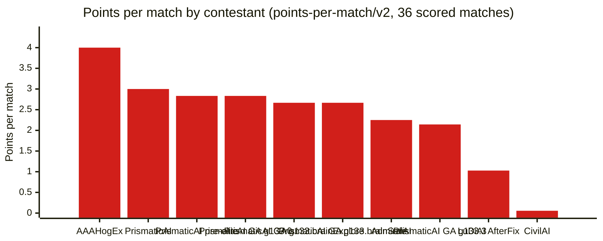
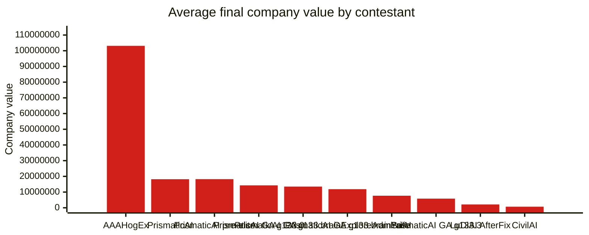
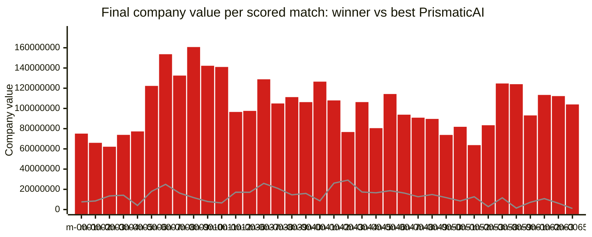
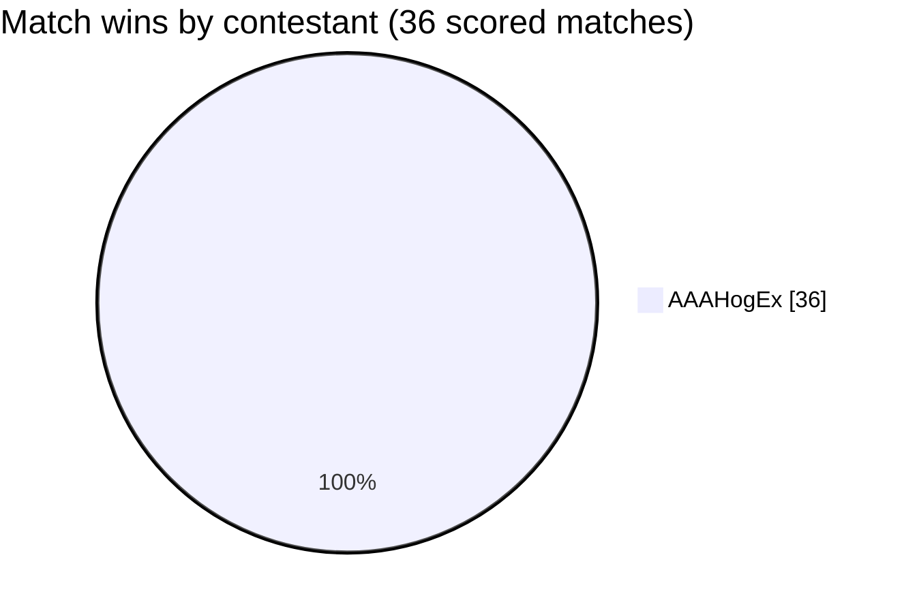
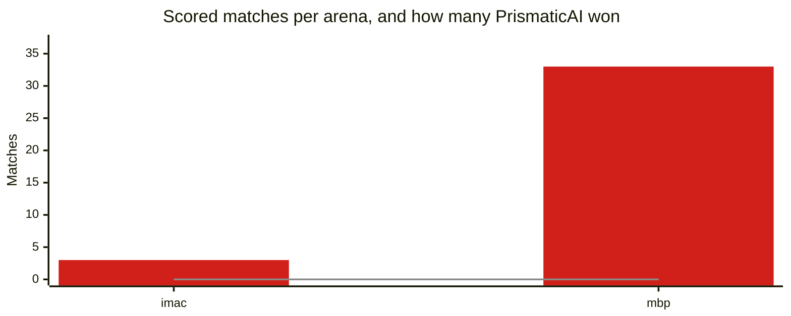

# battle-20261120T110759-9a645248

Derived from `battle-20261120T110759-9a645248.json` by `tools/research/ai-battle/battle.py report`; do not edit.

- Edition `9a64524842fd9d11`: PrismaticAI and referee at `2cab9e0314edf484880fedf08e9fc11d63d5357c`, base set `opengfx-8.0.tar`
- 20-year free-for-all from 1960, map 256x256 temperate, breakdowns 1
- 36 scored match(es) on `imac` (20261119-master-gdf1e05e7d8), `mbp` (20261120-master-m17653b726e)
- Replays: 1 of 1 identical to their original on another arena

| # | Contestant | Played | Wins | Points | Points/match | Avg rank | Avg final value | Squirrel errors | Matches with anomalies |
|---|---|---|---|---|---|---|---|---|---|
| 1 | AAAHogEx | 36 | 36 | 144 | 4.0 | 1.0 | 103.1 M | 0 | 0 |
| 2 | PrismaticAI | 5 | 0 | 15 | 3.0 | 2.0 | 18.2 M | 0 | 2 |
| 3 | PrismaticAI pre-elite | 6 | 0 | 17 | 2.833 | 2.17 | 18.2 M | 0 | 0 |
| 4 | PrismaticAI GA g133.0 | 6 | 0 | 17 | 2.833 | 2.17 | 14.3 M | 0 | 4 |
| 5 | PrismaticAI GA g133.brainExplore | 6 | 0 | 16 | 2.667 | 2.33 | 13.5 M | 0 | 4 |
| 6 | PrismaticAI GA g133.brainSafe | 6 | 0 | 16 | 2.667 | 2.33 | 11.9 M | 0 | 3 |
| 7 | AdmiralAI | 36 | 0 | 81 | 2.25 | 2.75 | 7.7 M | 72 | 3 |
| 8 | PrismaticAI GA g133.3 | 7 | 0 | 15 | 2.143 | 2.86 | 5.8 M | 0 | 5 |
| 9 | LuDiAI AfterFix | 36 | 0 | 37 | 1.028 | 3.97 | 2.1 M | 0 | 1 |
| 10 | CivilAI | 36 | 0 | 2 | 0.056 | 4.94 | 694.6 k | 0 | 3 |

<!-- battle-charts:begin -->
<!-- derived from battle-20261120T110759-9a645248.json by `battle.py render`; `battle.py check` fails when it is stale -->

<!-- battle-charts:end -->

| Seed | Original | Replay | Arenas | Identical |
|---|---|---|---|---|
| 409087884 | m-0010 | m-0056 | imac / mbp | yes |

| Match | Arena | Seed | Winner | Value | Last | Anomalies |
|---|---|---|---|---|---|---|
| m-0001 | mbp | 1368367127 | AAAHogEx | 75.1 M | CivilAI | AdmiralAI: fleet_drop:153->107 |
| m-0002 | mbp | 1368367127 | AAAHogEx | 66.0 M | CivilAI | - |
| m-0003 | mbp | 1368367127 | AAAHogEx | 62.1 M | CivilAI | AdmiralAI: fleet_drop:308->177 |
| m-0004 | mbp | 1368367127 | AAAHogEx | 73.9 M | CivilAI | - |
| m-0005 | mbp | 1368367127 | AAAHogEx | 77.3 M | CivilAI | PrismaticAI GA g133.3: fleet_drop:82->56 |
| m-0006 | mbp | 409087884 | AAAHogEx | 122.3 M | CivilAI | - |
| m-0007 | mbp | 409087884 | AAAHogEx | 153.6 M | CivilAI | - |
| m-0008 | mbp | 409087884 | AAAHogEx | 132.5 M | CivilAI | PrismaticAI GA g133.0: fleet_drop:186->51 |
| m-0009 | mbp | 409087884 | AAAHogEx | 160.7 M | CivilAI | PrismaticAI GA g133.brainSafe: fleet_drop:123->72 |
| m-0010 | imac | 409087884 | AAAHogEx | 142.2 M | CivilAI | PrismaticAI GA g133.brainExplore: fleet_drop:88->55 |
| m-0011 | imac | 409087884 | AAAHogEx | 141.0 M | CivilAI | PrismaticAI GA g133.3: fleet_drop:99->53 |
| m-0012 | imac | 1915356450 | AAAHogEx | 96.5 M | CivilAI | AdmiralAI: squirrel_errors:72 |
| m-0036 | mbp | 386254389 | AAAHogEx | 97.6 M | CivilAI | PrismaticAI: fleet_drop:94->47 |
| m-0037 | mbp | 386254389 | AAAHogEx | 128.8 M | CivilAI | - |
| m-0038 | mbp | 386254389 | AAAHogEx | 104.9 M | CivilAI | PrismaticAI GA g133.0: fleet_drop:95->64 |
| m-0039 | mbp | 386254389 | AAAHogEx | 111.2 M | CivilAI | - |
| m-0040 | mbp | 386254389 | AAAHogEx | 106.3 M | CivilAI | PrismaticAI GA g133.brainExplore: fleet_drop:119->54 |
| m-0041 | mbp | 386254389 | AAAHogEx | 126.5 M | CivilAI | - |
| m-0042 | mbp | 29458058 | AAAHogEx | 107.9 M | AdmiralAI | CivilAI: fleet_drop:33->20 |
| m-0043 | mbp | 29458058 | AAAHogEx | 76.7 M | CivilAI | - |
| m-0044 | mbp | 29458058 | AAAHogEx | 106.3 M | CivilAI | LuDiAI AfterFix: fleet_drop:75->44 |
| m-0045 | mbp | 29458058 | AAAHogEx | 80.5 M | CivilAI | - |
| m-0046 | mbp | 29458058 | AAAHogEx | 114.3 M | CivilAI | PrismaticAI GA g133.brainExplore: fleet_drop:121->62 |
| m-0047 | mbp | 29458058 | AAAHogEx | 93.8 M | CivilAI | - |
| m-0048 | mbp | 1223807049 | AAAHogEx | 90.9 M | CivilAI | PrismaticAI: fleet_drop:95->54 |
| m-0049 | mbp | 1223807049 | AAAHogEx | 89.6 M | CivilAI | CivilAI: fleet_drop:20->11 |
| m-0050 | mbp | 1223807049 | AAAHogEx | 73.8 M | CivilAI | PrismaticAI GA g133.0: fleet_drop:92->42 |
| m-0051 | mbp | 1223807049 | AAAHogEx | 81.8 M | CivilAI | PrismaticAI GA g133.brainSafe: fleet_drop:118->31; CivilAI: fleet_drop:23->15 |
| m-0052 | mbp | 1223807049 | AAAHogEx | 63.7 M | CivilAI | - |
| m-0053 | mbp | 1223807049 | AAAHogEx | 83.4 M | CivilAI | PrismaticAI GA g133.3: fleet_drop:99->49 |
| m-0056 (replay) | mbp | 409087884 | AAAHogEx | 142.2 M | CivilAI | PrismaticAI GA g133.brainExplore: fleet_drop:88->55 |
| m-0058 | mbp | 1904652327 | AAAHogEx | 124.7 M | CivilAI | PrismaticAI GA g133.brainExplore: fleet_drop:54->30 |
| m-0059 | mbp | 1904652327 | AAAHogEx | 124.0 M | CivilAI | PrismaticAI GA g133.3: fleet_drop:102->44 |
| m-0061 | mbp | 241748079 | AAAHogEx | 93.1 M | CivilAI | - |
| m-0062 | mbp | 241748079 | AAAHogEx | 113.4 M | CivilAI | PrismaticAI GA g133.0: fleet_drop:89->47 |
| m-0063 | mbp | 241748079 | AAAHogEx | 112.2 M | LuDiAI AfterFix | PrismaticAI GA g133.brainSafe: fleet_drop:62->32 |
| m-0065 | mbp | 241748079 | AAAHogEx | 104.0 M | CivilAI | PrismaticAI GA g133.3: fleet_drop:51->26 |
