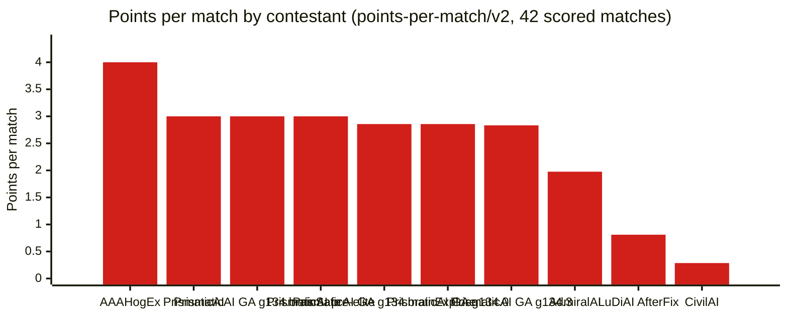
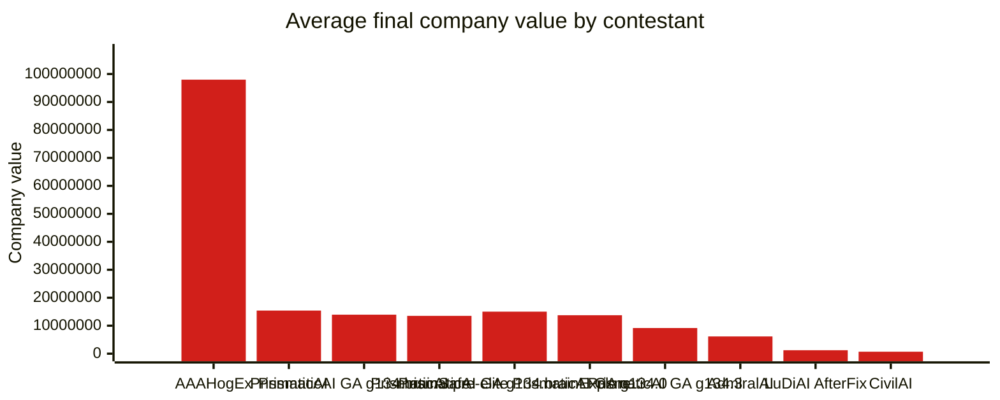
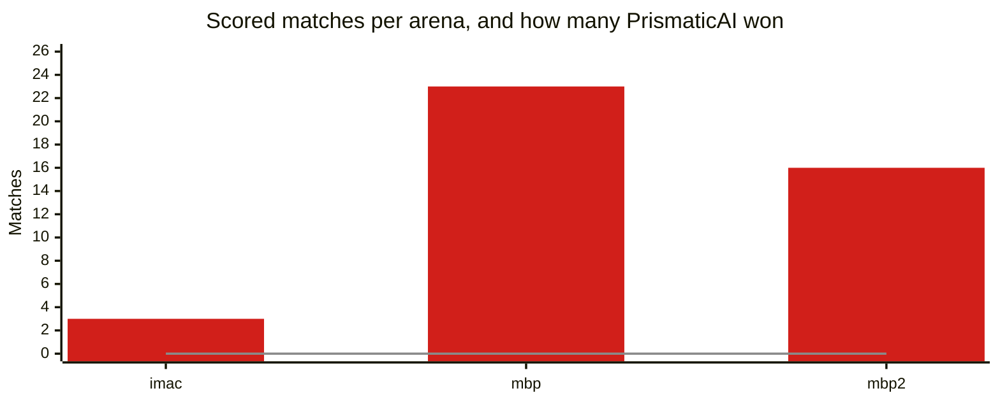

# battle-20261120T111700-86de6259

Derived from `battle-20261120T111700-86de6259.json` by `tools/research/ai-battle/battle.py report`; do not edit.

- Edition `86de6259e5a90556`: PrismaticAI and referee at `2cab9e0314edf484880fedf08e9fc11d63d5357c`, base set `opengfx-8.0.tar`
- 20-year free-for-all from 1960, map 256x256 temperate, breakdowns 1
- 42 scored match(es) on `imac` (20261119-master-gdf1e05e7d8), `mbp` (20261120-master-m17653b726e), `mbp2` (20261119-master-gdf1e05e7d8)
- Replays: 0 of 0 identical to their original on another arena

| # | Contestant | Played | Wins | Points | Points/match | Avg rank | Avg final value | Squirrel errors | Matches with anomalies |
|---|---|---|---|---|---|---|---|---|---|
| 1 | AAAHogEx | 42 | 42 | 168 | 4.0 | 1.0 | 98.0 M | 0 | 0 |
| 2 | PrismaticAI | 7 | 0 | 21 | 3.0 | 2.0 | 15.4 M | 0 | 1 |
| 3 | PrismaticAI GA g134.brainSafe | 7 | 0 | 21 | 3.0 | 2.0 | 13.9 M | 0 | 1 |
| 4 | PrismaticAI pre-elite | 8 | 0 | 24 | 3.0 | 2.0 | 13.5 M | 0 | 0 |
| 5 | PrismaticAI GA g134.brainExplore | 7 | 0 | 20 | 2.857 | 2.14 | 15.0 M | 0 | 4 |
| 6 | PrismaticAI GA g134.0 | 7 | 0 | 20 | 2.857 | 2.14 | 13.7 M | 0 | 2 |
| 7 | PrismaticAI GA g134.3 | 6 | 0 | 17 | 2.833 | 2.17 | 9.2 M | 0 | 5 |
| 8 | AdmiralAI | 42 | 0 | 83 | 1.976 | 3.02 | 6.2 M | 59 | 4 |
| 9 | LuDiAI AfterFix | 42 | 0 | 34 | 0.81 | 4.19 | 1.2 M | 0 | 3 |
| 10 | CivilAI | 42 | 0 | 12 | 0.286 | 4.71 | 703.8 k | 3965 | 6 |

```mermaid
---
config:
  xyChart:
    width: 900
    height: 360
  themeVariables:
    xyChart:
      plotColorPalette: "#d11f1a, #8a8a8a, #0b0b0b, #ece4d6"
---
xychart-beta
    title "Final company value per scored match: winner vs best PrismaticAI"
    x-axis ["m-0001", "m-0002", "m-0003", "m-0004", "m-0005", "m-0006", "m-0007", "m-0008", "m-0009", "m-0010", "m-0011", "m-0012", "m-0013", "m-0014", "m-0015", "m-0016", "m-0017", "m-0018", "m-0019", "m-0020", "m-0021", "m-0022", "m-0023", "m-0024", "m-0025", "m-0026", "m-0027", "m-0028", "m-0036", "m-0037", "m-0038", "m-0039", "m-0040", "m-0041", "m-0042", "m-0043", "m-0044", "m-0045", "m-0046", "m-0047", "m-0048", "m-0049"]
    %% series: Winner | Best PrismaticAI
    %% links: battle-20261120T111700-86de6259.md?col=Match&filter=m-0001 | battle-20261120T111700-86de6259.md?col=Match&filter=m-0002 | battle-20261120T111700-86de6259.md?col=Match&filter=m-0003 | battle-20261120T111700-86de6259.md?col=Match&filter=m-0004 | battle-20261120T111700-86de6259.md?col=Match&filter=m-0005 | battle-20261120T111700-86de6259.md?col=Match&filter=m-0006 | battle-20261120T111700-86de6259.md?col=Match&filter=m-0007 | battle-20261120T111700-86de6259.md?col=Match&filter=m-0008 | battle-20261120T111700-86de6259.md?col=Match&filter=m-0009 | battle-20261120T111700-86de6259.md?col=Match&filter=m-0010 | battle-20261120T111700-86de6259.md?col=Match&filter=m-0011 | battle-20261120T111700-86de6259.md?col=Match&filter=m-0012 | battle-20261120T111700-86de6259.md?col=Match&filter=m-0013 | battle-20261120T111700-86de6259.md?col=Match&filter=m-0014 | battle-20261120T111700-86de6259.md?col=Match&filter=m-0015 | battle-20261120T111700-86de6259.md?col=Match&filter=m-0016 | battle-20261120T111700-86de6259.md?col=Match&filter=m-0017 | battle-20261120T111700-86de6259.md?col=Match&filter=m-0018 | battle-20261120T111700-86de6259.md?col=Match&filter=m-0019 | battle-20261120T111700-86de6259.md?col=Match&filter=m-0020 | battle-20261120T111700-86de6259.md?col=Match&filter=m-0021 | battle-20261120T111700-86de6259.md?col=Match&filter=m-0022 | battle-20261120T111700-86de6259.md?col=Match&filter=m-0023 | battle-20261120T111700-86de6259.md?col=Match&filter=m-0024 | battle-20261120T111700-86de6259.md?col=Match&filter=m-0025 | battle-20261120T111700-86de6259.md?col=Match&filter=m-0026 | battle-20261120T111700-86de6259.md?col=Match&filter=m-0027 | battle-20261120T111700-86de6259.md?col=Match&filter=m-0028 | battle-20261120T111700-86de6259.md?col=Match&filter=m-0036 | battle-20261120T111700-86de6259.md?col=Match&filter=m-0037 | battle-20261120T111700-86de6259.md?col=Match&filter=m-0038 | battle-20261120T111700-86de6259.md?col=Match&filter=m-0039 | battle-20261120T111700-86de6259.md?col=Match&filter=m-0040 | battle-20261120T111700-86de6259.md?col=Match&filter=m-0041 | battle-20261120T111700-86de6259.md?col=Match&filter=m-0042 | battle-20261120T111700-86de6259.md?col=Match&filter=m-0043 | battle-20261120T111700-86de6259.md?col=Match&filter=m-0044 | battle-20261120T111700-86de6259.md?col=Match&filter=m-0045 | battle-20261120T111700-86de6259.md?col=Match&filter=m-0046 | battle-20261120T111700-86de6259.md?col=Match&filter=m-0047 | battle-20261120T111700-86de6259.md?col=Match&filter=m-0048 | battle-20261120T111700-86de6259.md?col=Match&filter=m-0049
    y-axis "Company value" 0 --> 159000000
    bar [82023362, 77365356, 80231734, 67399058, 76419020, 79322310, 76227054, 91246446, 71617476, 90251855, 75838997, 137652031, 120055058, 102655774, 118246554, 124346938, 101421921, 61097459, 54031645, 71773725, 78996251, 74503926, 79853474, 90355205, 89060604, 112654220, 82712972, 93960472, 114527404, 127453610, 94099206, 97721536, 110562560, 136988388, 109478859, 135376645, 134953418, 130664173, 124763750, 144709665, 97342709, 95079760]
    line [15149549, 18792090, 18583662, 17612476, 14400063, 10535016, 11501931, 9133975, 11304261, 8240388, 6079393, 12297577, 9946122, 13514942, 12222643, 11880649, 4573710, 9446009, 11896005, 6979822, 10277833, 8125124, 5330190, 23093992, 14963190, 17219492, 18575808, 27559945, 16810370, 17515180, 14048629, 13370652, 15333780, 14992854, 21095825, 12403389, 16494803, 13256991, 16404695, 9626062, 14566546, 14756809]
```

<!-- battle-charts:begin -->
<!-- derived from battle-20261120T111700-86de6259.json by `battle.py render`; `battle.py check` fails when it is stale -->

<!-- battle-charts:end -->

| Match | Arena | Seed | Winner | Value | Last | Anomalies |
|---|---|---|---|---|---|---|
| m-0001 | mbp | 1286042429 | AAAHogEx | 82.0 M | CivilAI | - |
| m-0002 | mbp | 1286042429 | AAAHogEx | 77.4 M | LuDiAI AfterFix | PrismaticAI GA g134.0: fleet_drop:70->45; AdmiralAI: fleet_drop:162->89; CivilAI: fleet_drop:101->66 |
| m-0003 | mbp | 1286042429 | AAAHogEx | 80.2 M | CivilAI | CivilAI: fleet_drop:50->29 |
| m-0004 | mbp | 1286042429 | AAAHogEx | 67.4 M | CivilAI | PrismaticAI GA g134.brainExplore: fleet_drop:104->65 |
| m-0005 | mbp | 1286042429 | AAAHogEx | 76.4 M | CivilAI | PrismaticAI GA g134.3: fleet_drop:137->52 |
| m-0006 | mbp | 267356019 | AAAHogEx | 79.3 M | LuDiAI AfterFix | - |
| m-0007 | mbp | 267356019 | AAAHogEx | 76.2 M | LuDiAI AfterFix | - |
| m-0008 | mbp | 267356019 | AAAHogEx | 91.2 M | LuDiAI AfterFix | - |
| m-0009 | mbp | 267356019 | AAAHogEx | 71.6 M | LuDiAI AfterFix | - |
| m-0010 | imac | 267356019 | AAAHogEx | 90.3 M | CivilAI | - |
| m-0011 | imac | 267356019 | AAAHogEx | 75.8 M | LuDiAI AfterFix | PrismaticAI GA g134.3: fleet_drop:153->49; AdmiralAI: squirrel_errors:59 |
| m-0012 | imac | 1102055761 | AAAHogEx | 137.7 M | CivilAI | - |
| m-0013 | mbp2 | 1102055761 | AAAHogEx | 120.1 M | CivilAI | - |
| m-0014 | mbp2 | 1102055761 | AAAHogEx | 102.7 M | CivilAI | PrismaticAI GA g134.0: fleet_drop:131->76 |
| m-0015 | mbp2 | 1102055761 | AAAHogEx | 118.2 M | CivilAI | - |
| m-0016 | mbp2 | 1102055761 | AAAHogEx | 124.3 M | CivilAI | - |
| m-0017 | mbp2 | 1102055761 | AAAHogEx | 101.4 M | CivilAI | PrismaticAI GA g134.3: fleet_drop:112->76; LuDiAI AfterFix: fleet_drop:36->21 |
| m-0018 | mbp2 | 841778832 | AAAHogEx | 61.1 M | LuDiAI AfterFix | - |
| m-0019 | mbp2 | 841778832 | AAAHogEx | 54.0 M | LuDiAI AfterFix | LuDiAI AfterFix: fleet_drop:50->32 |
| m-0020 | mbp2 | 841778832 | AAAHogEx | 71.8 M | CivilAI | CivilAI: no_vehicles |
| m-0021 | mbp2 | 841778832 | AAAHogEx | 79.0 M | CivilAI | PrismaticAI GA g134.brainSafe: fleet_drop:90->61; CivilAI: no_vehicles |
| m-0022 | mbp2 | 841778832 | AAAHogEx | 74.5 M | CivilAI | - |
| m-0023 | mbp2 | 841778832 | AAAHogEx | 79.9 M | LuDiAI AfterFix | PrismaticAI GA g134.3: fleet_drop:109->44 |
| m-0024 | mbp2 | 251276755 | AAAHogEx | 90.4 M | CivilAI | - |
| m-0025 | mbp2 | 251276755 | AAAHogEx | 89.1 M | CivilAI | - |
| m-0026 | mbp2 | 251276755 | AAAHogEx | 112.7 M | CivilAI | - |
| m-0027 | mbp2 | 251276755 | AAAHogEx | 82.7 M | CivilAI | AdmiralAI: fleet_drop:348->216 |
| m-0028 | mbp2 | 251276755 | AAAHogEx | 94.0 M | CivilAI | PrismaticAI GA g134.brainExplore: fleet_drop:111->60 |
| m-0036 | mbp | 1547211713 | AAAHogEx | 114.5 M | CivilAI | - |
| m-0037 | mbp | 1547211713 | AAAHogEx | 127.5 M | AdmiralAI | - |
| m-0038 | mbp | 1547211713 | AAAHogEx | 94.1 M | CivilAI | - |
| m-0039 | mbp | 1547211713 | AAAHogEx | 97.7 M | CivilAI | AdmiralAI: fleet_drop:124->84 |
| m-0040 | mbp | 1547211713 | AAAHogEx | 110.6 M | CivilAI | PrismaticAI GA g134.brainExplore: fleet_drop:150->103 |
| m-0041 | mbp | 1547211713 | AAAHogEx | 137.0 M | CivilAI | PrismaticAI GA g134.3: fleet_drop:190->93 |
| m-0042 | mbp | 48666265 | AAAHogEx | 109.5 M | CivilAI | CivilAI: fleet_drop:63->37 |
| m-0043 | mbp | 48666265 | AAAHogEx | 135.4 M | CivilAI | LuDiAI AfterFix: fleet_drop:41->28 |
| m-0044 | mbp | 48666265 | AAAHogEx | 135.0 M | CivilAI | CivilAI: squirrel_errors:3965 |
| m-0045 | mbp | 48666265 | AAAHogEx | 130.7 M | CivilAI | - |
| m-0046 | mbp | 48666265 | AAAHogEx | 124.8 M | CivilAI | PrismaticAI GA g134.brainExplore: fleet_drop:74->44 |
| m-0047 | mbp | 48666265 | AAAHogEx | 144.7 M | LuDiAI AfterFix | - |
| m-0048 | mbp | 1640849600 | AAAHogEx | 97.3 M | LuDiAI AfterFix | PrismaticAI: fleet_drop:87->59 |
| m-0049 | mbp | 1640849600 | AAAHogEx | 95.1 M | CivilAI | - |
