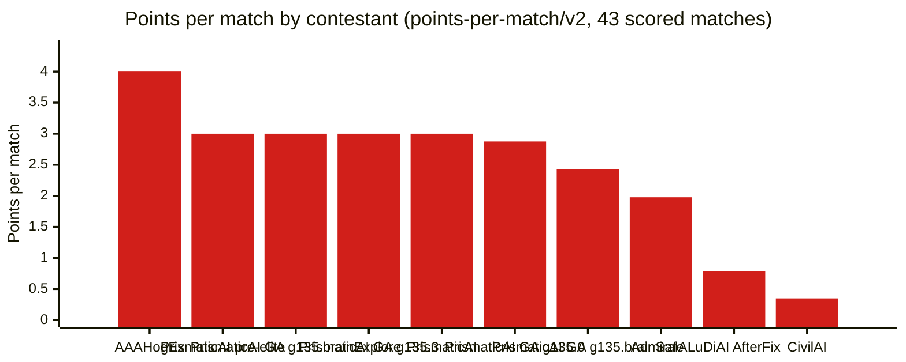
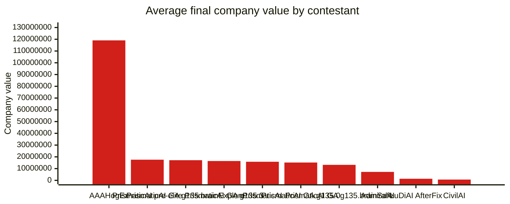
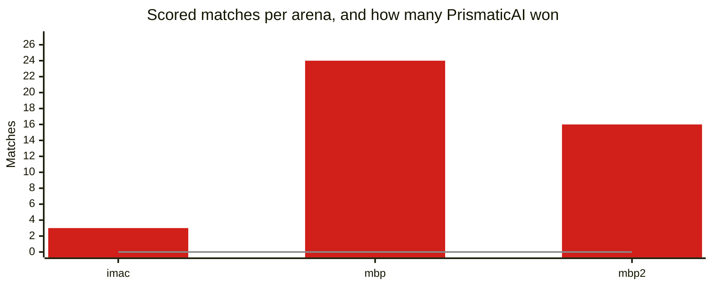

# battle-20261120T112711-cd646fdf

Derived from `battle-20261120T112711-cd646fdf.json` by `tools/research/ai-battle/battle.py report`; do not edit.

- Edition `cd646fdfa5bd672a`: PrismaticAI and referee at `2cab9e0314edf484880fedf08e9fc11d63d5357c`, base set `opengfx-8.0.tar`
- 20-year free-for-all from 1960, map 256x256 temperate, breakdowns 1
- 43 scored match(es) on `imac` (20261119-master-gdf1e05e7d8), `mbp` (20261120-master-m17653b726e), `mbp2` (20261119-master-gdf1e05e7d8)
- Replays: 1 of 2 identical to their original on another arena

| # | Contestant | Played | Wins | Points | Points/match | Avg rank | Avg final value | Squirrel errors | Matches with anomalies |
|---|---|---|---|---|---|---|---|---|---|
| 1 | AAAHogEx | 43 | 43 | 172 | 4.0 | 1.0 | 119.1 M | 0 | 0 |
| 2 | PrismaticAI pre-elite | 9 | 0 | 27 | 3.0 | 2.0 | 17.6 M | 0 | 0 |
| 3 | PrismaticAI GA g135.brainExplore | 7 | 0 | 21 | 3.0 | 2.0 | 17.2 M | 0 | 5 |
| 4 | PrismaticAI GA g135.3 | 6 | 0 | 18 | 3.0 | 2.0 | 16.5 M | 0 | 4 |
| 5 | PrismaticAI | 6 | 0 | 18 | 3.0 | 2.0 | 15.8 M | 0 | 3 |
| 6 | PrismaticAI GA g135.0 | 8 | 0 | 23 | 2.875 | 2.12 | 15.2 M | 0 | 6 |
| 7 | PrismaticAI GA g135.brainSafe | 7 | 0 | 17 | 2.429 | 2.57 | 13.2 M | 0 | 6 |
| 8 | AdmiralAI | 43 | 0 | 85 | 1.977 | 3.02 | 7.2 M | 0 | 2 |
| 9 | LuDiAI AfterFix | 43 | 0 | 34 | 0.791 | 4.21 | 1.4 M | 0 | 1 |
| 10 | CivilAI | 43 | 0 | 15 | 0.349 | 4.65 | 683.5 k | 0 | 10 |

```mermaid
---
config:
  xyChart:
    width: 900
    height: 360
  themeVariables:
    xyChart:
      plotColorPalette: "#d11f1a, #8a8a8a, #0b0b0b, #ece4d6"
---
xychart-beta
    title "Final company value per scored match: winner vs best PrismaticAI"
    x-axis ["m-0001", "m-0002", "m-0003", "m-0004", "m-0005", "m-0006", "m-0007", "m-0008", "m-0009", "m-0010", "m-0011", "m-0012", "m-0013", "m-0014", "m-0015", "m-0016", "m-0017", "m-0018", "m-0019", "m-0020", "m-0021", "m-0022", "m-0023", "m-0024", "m-0025", "m-0026", "m-0027", "m-0028", "m-0036", "m-0037", "m-0038", "m-0039", "m-0040", "m-0041", "m-0042", "m-0043", "m-0044", "m-0049", "m-0050", "m-0055", "m-0057", "m-0058", "m-0059"]
    %% series: Winner | Best PrismaticAI
    %% links: battle-20261120T112711-cd646fdf.md?col=Match&filter=m-0001 | battle-20261120T112711-cd646fdf.md?col=Match&filter=m-0002 | battle-20261120T112711-cd646fdf.md?col=Match&filter=m-0003 | battle-20261120T112711-cd646fdf.md?col=Match&filter=m-0004 | battle-20261120T112711-cd646fdf.md?col=Match&filter=m-0005 | battle-20261120T112711-cd646fdf.md?col=Match&filter=m-0006 | battle-20261120T112711-cd646fdf.md?col=Match&filter=m-0007 | battle-20261120T112711-cd646fdf.md?col=Match&filter=m-0008 | battle-20261120T112711-cd646fdf.md?col=Match&filter=m-0009 | battle-20261120T112711-cd646fdf.md?col=Match&filter=m-0010 | battle-20261120T112711-cd646fdf.md?col=Match&filter=m-0011 | battle-20261120T112711-cd646fdf.md?col=Match&filter=m-0012 | battle-20261120T112711-cd646fdf.md?col=Match&filter=m-0013 | battle-20261120T112711-cd646fdf.md?col=Match&filter=m-0014 | battle-20261120T112711-cd646fdf.md?col=Match&filter=m-0015 | battle-20261120T112711-cd646fdf.md?col=Match&filter=m-0016 | battle-20261120T112711-cd646fdf.md?col=Match&filter=m-0017 | battle-20261120T112711-cd646fdf.md?col=Match&filter=m-0018 | battle-20261120T112711-cd646fdf.md?col=Match&filter=m-0019 | battle-20261120T112711-cd646fdf.md?col=Match&filter=m-0020 | battle-20261120T112711-cd646fdf.md?col=Match&filter=m-0021 | battle-20261120T112711-cd646fdf.md?col=Match&filter=m-0022 | battle-20261120T112711-cd646fdf.md?col=Match&filter=m-0023 | battle-20261120T112711-cd646fdf.md?col=Match&filter=m-0024 | battle-20261120T112711-cd646fdf.md?col=Match&filter=m-0025 | battle-20261120T112711-cd646fdf.md?col=Match&filter=m-0026 | battle-20261120T112711-cd646fdf.md?col=Match&filter=m-0027 | battle-20261120T112711-cd646fdf.md?col=Match&filter=m-0028 | battle-20261120T112711-cd646fdf.md?col=Match&filter=m-0036 | battle-20261120T112711-cd646fdf.md?col=Match&filter=m-0037 | battle-20261120T112711-cd646fdf.md?col=Match&filter=m-0038 | battle-20261120T112711-cd646fdf.md?col=Match&filter=m-0039 | battle-20261120T112711-cd646fdf.md?col=Match&filter=m-0040 | battle-20261120T112711-cd646fdf.md?col=Match&filter=m-0041 | battle-20261120T112711-cd646fdf.md?col=Match&filter=m-0042 | battle-20261120T112711-cd646fdf.md?col=Match&filter=m-0043 | battle-20261120T112711-cd646fdf.md?col=Match&filter=m-0044 | battle-20261120T112711-cd646fdf.md?col=Match&filter=m-0049 | battle-20261120T112711-cd646fdf.md?col=Match&filter=m-0050 | battle-20261120T112711-cd646fdf.md?col=Match&filter=m-0055 | battle-20261120T112711-cd646fdf.md?col=Match&filter=m-0057 | battle-20261120T112711-cd646fdf.md?col=Match&filter=m-0058 | battle-20261120T112711-cd646fdf.md?col=Match&filter=m-0059
    y-axis "Company value" 0 --> 186000000
    bar [135921271, 119888754, 118473007, 122053771, 112262055, 125507613, 113814597, 136763910, 150770740, 105404340, 85214236, 122807208, 123554512, 114570577, 103409489, 114695152, 98655694, 88365674, 103486060, 109837608, 112646785, 106940445, 114537641, 132673823, 144813261, 148678427, 120181315, 137226063, 107647410, 130628151, 104246059, 93276662, 94459373, 92363732, 163373841, 169142423, 154012204, 114312841, 136468021, 114733728, 109404748, 108431434, 103781436]
    line [11306458, 22613576, 18540976, 21720133, 13626701, 20276376, 24871184, 13657958, 19463592, 28887976, 17330539, 9745086, 7169129, 10252546, 417944, 7349624, 13456827, 22095160, 19780951, 9417401, 2315560, 9666559, 12239467, 20419643, 23769986, 11091382, 18656419, 17448979, 14559244, 17979925, 22770978, 18980322, 24219363, 18328751, 7884792, 16400635, 16573675, 17124494, 14946334, 19834028, 14021701, 10792380, 23775558]
```

<!-- battle-charts:begin -->
<!-- derived from battle-20261120T112711-cd646fdf.json by `battle.py render`; `battle.py check` fails when it is stale -->

<!-- battle-charts:end -->

| Seed | Original | Replay | Arenas | Identical |
|---|---|---|---|---|
| 360676870 | m-0013 | m-0048 | mbp2 / mbp | yes |
| 360676870 | m-0012 | m-0056 | imac / mbp | NO |

| Match | Arena | Seed | Winner | Value | Last | Anomalies |
|---|---|---|---|---|---|---|
| m-0001 | mbp | 317917537 | AAAHogEx | 135.9 M | CivilAI | - |
| m-0002 | mbp | 317917537 | AAAHogEx | 119.9 M | LuDiAI AfterFix | PrismaticAI GA g135.0: fleet_drop:137->60 |
| m-0003 | mbp | 317917537 | AAAHogEx | 118.5 M | CivilAI | PrismaticAI GA g135.brainSafe: fleet_drop:176->82 |
| m-0004 | mbp | 317917537 | AAAHogEx | 122.1 M | LuDiAI AfterFix | PrismaticAI GA g135.brainExplore: fleet_drop:129->83; LuDiAI AfterFix: fleet_drop:16->6 |
| m-0005 | mbp | 317917537 | AAAHogEx | 112.3 M | CivilAI | PrismaticAI GA g135.3: fleet_drop:136->51 |
| m-0006 | mbp | 238210730 | AAAHogEx | 125.5 M | LuDiAI AfterFix | CivilAI: fleet_drop:61->31 |
| m-0007 | mbp | 238210730 | AAAHogEx | 113.8 M | LuDiAI AfterFix | - |
| m-0008 | mbp | 238210730 | AAAHogEx | 136.8 M | LuDiAI AfterFix | PrismaticAI GA g135.0: fleet_drop:97->46; CivilAI: fleet_drop:42->22 |
| m-0009 | mbp | 238210730 | AAAHogEx | 150.8 M | LuDiAI AfterFix | PrismaticAI GA g135.brainSafe: fleet_drop:117->66 |
| m-0010 | imac | 238210730 | AAAHogEx | 105.4 M | LuDiAI AfterFix | PrismaticAI GA g135.brainExplore: fleet_drop:129->81 |
| m-0011 | imac | 238210730 | AAAHogEx | 85.2 M | CivilAI | PrismaticAI GA g135.3: fleet_drop:110->66; CivilAI: fleet_drop:90->62 |
| m-0012 | imac | 360676870 | AAAHogEx | 122.8 M | CivilAI | PrismaticAI: fleet_drop:70->47; CivilAI: no_vehicles |
| m-0013 | mbp2 | 360676870 | AAAHogEx | 123.6 M | CivilAI | CivilAI: fleet_drop:46->16 |
| m-0014 | mbp2 | 360676870 | AAAHogEx | 114.6 M | CivilAI | - |
| m-0015 | mbp2 | 360676870 | AAAHogEx | 103.4 M | PrismaticAI GA g135.brainSafe | PrismaticAI GA g135.brainSafe: fleet_drop:26->13 |
| m-0016 | mbp2 | 360676870 | AAAHogEx | 114.7 M | CivilAI | PrismaticAI GA g135.brainExplore: fleet_drop:51->26; CivilAI: fleet_drop:26->2 |
| m-0017 | mbp2 | 360676870 | AAAHogEx | 98.7 M | CivilAI | - |
| m-0018 | mbp2 | 1427208728 | AAAHogEx | 88.4 M | CivilAI | - |
| m-0019 | mbp2 | 1427208728 | AAAHogEx | 103.5 M | LuDiAI AfterFix | - |
| m-0020 | mbp2 | 1427208728 | AAAHogEx | 109.8 M | CivilAI | PrismaticAI GA g135.0: fleet_drop:114->65 |
| m-0021 | mbp2 | 1427208728 | AAAHogEx | 112.6 M | CivilAI | PrismaticAI GA g135.brainSafe: fleet_drop:190->38 |
| m-0022 | mbp2 | 1427208728 | AAAHogEx | 106.9 M | CivilAI | PrismaticAI GA g135.brainExplore: fleet_drop:127->75 |
| m-0023 | mbp2 | 1427208728 | AAAHogEx | 114.5 M | CivilAI | PrismaticAI GA g135.3: fleet_drop:130->79 |
| m-0024 | mbp2 | 1827775499 | AAAHogEx | 132.7 M | CivilAI | PrismaticAI: fleet_drop:113->63 |
| m-0025 | mbp2 | 1827775499 | AAAHogEx | 144.8 M | CivilAI | AdmiralAI: fleet_drop:224->154 |
| m-0026 | mbp2 | 1827775499 | AAAHogEx | 148.7 M | CivilAI | PrismaticAI GA g135.0: fleet_drop:150->73 |
| m-0027 | mbp2 | 1827775499 | AAAHogEx | 120.2 M | CivilAI | PrismaticAI GA g135.brainSafe: fleet_drop:119->67 |
| m-0028 | mbp2 | 1827775499 | AAAHogEx | 137.2 M | CivilAI | CivilAI: fleet_drop:56->19 |
| m-0036 | mbp | 942247280 | AAAHogEx | 107.6 M | CivilAI | PrismaticAI: fleet_drop:132->75 |
| m-0037 | mbp | 942247280 | AAAHogEx | 130.6 M | LuDiAI AfterFix | - |
| m-0038 | mbp | 942247280 | AAAHogEx | 104.2 M | CivilAI | - |
| m-0039 | mbp | 942247280 | AAAHogEx | 93.3 M | CivilAI | - |
| m-0040 | mbp | 942247280 | AAAHogEx | 94.5 M | CivilAI | AdmiralAI: fleet_drop:220->123 |
| m-0041 | mbp | 942247280 | AAAHogEx | 92.4 M | CivilAI | - |
| m-0042 | mbp | 670386801 | AAAHogEx | 163.4 M | CivilAI | - |
| m-0043 | mbp | 670386801 | AAAHogEx | 169.1 M | CivilAI | - |
| m-0044 | mbp | 670386801 | AAAHogEx | 154.0 M | LuDiAI AfterFix | PrismaticAI GA g135.0: fleet_drop:104->59 |
| m-0048 (replay) | mbp | 360676870 | AAAHogEx | 123.6 M | CivilAI | CivilAI: fleet_drop:46->16 |
| m-0049 | mbp | 163624985 | AAAHogEx | 114.3 M | CivilAI | - |
| m-0050 | mbp | 163624985 | AAAHogEx | 136.5 M | CivilAI | PrismaticAI GA g135.0: fleet_drop:132->80 |
| m-0055 | mbp | 832551150 | AAAHogEx | 114.7 M | CivilAI | - |
| m-0056 (replay) | mbp | 360676870 | AAAHogEx | 122.6 M | CivilAI | PrismaticAI: fleet_drop:75->51; CivilAI: no_vehicles |
| m-0057 | mbp | 832551150 | AAAHogEx | 109.4 M | LuDiAI AfterFix | PrismaticAI GA g135.brainSafe: fleet_drop:88->46; CivilAI: fleet_drop:73->38 |
| m-0058 | mbp | 832551150 | AAAHogEx | 108.4 M | LuDiAI AfterFix | PrismaticAI GA g135.brainExplore: fleet_drop:105->48; CivilAI: fleet_drop:80->35 |
| m-0059 | mbp | 832551150 | AAAHogEx | 103.8 M | CivilAI | PrismaticAI GA g135.3: fleet_drop:113->70; CivilAI: fleet_drop:65->42 |
