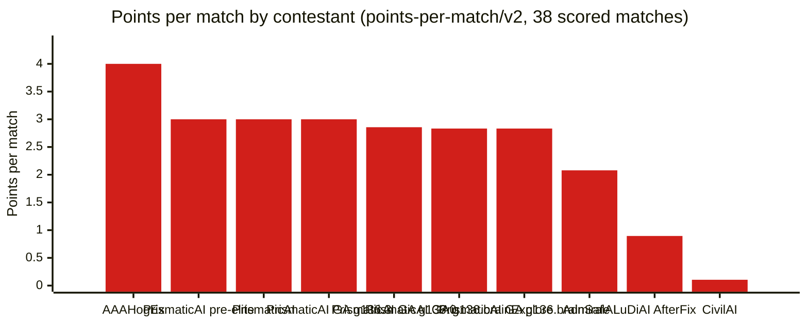
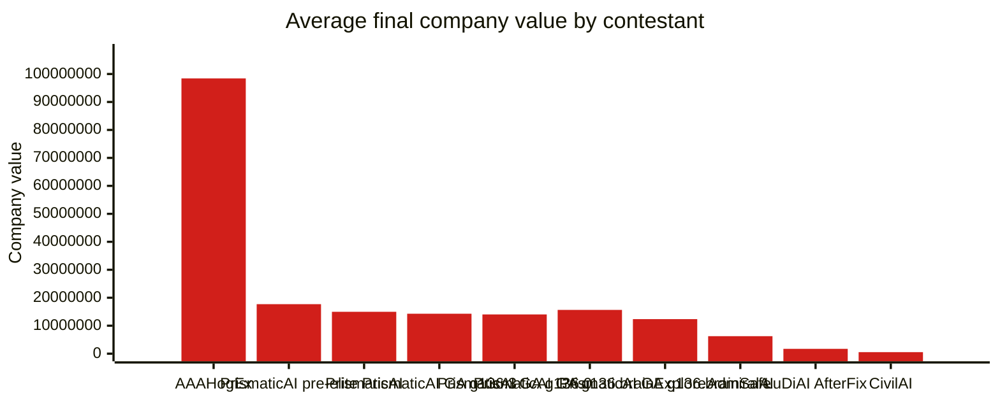
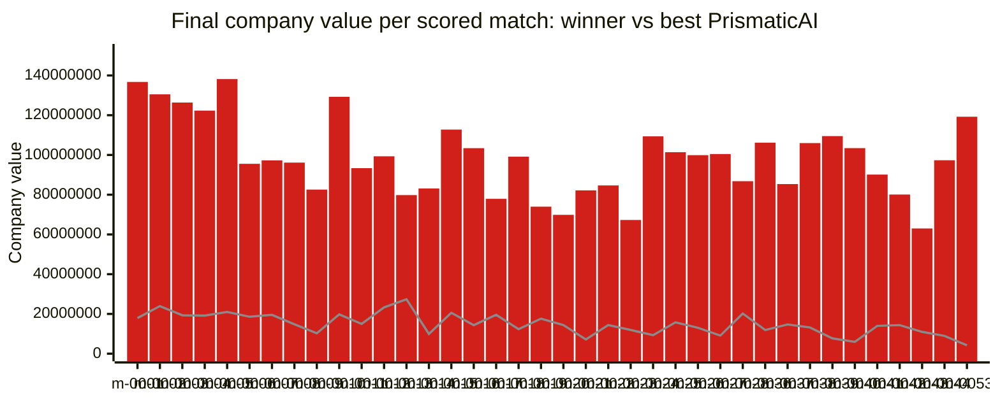
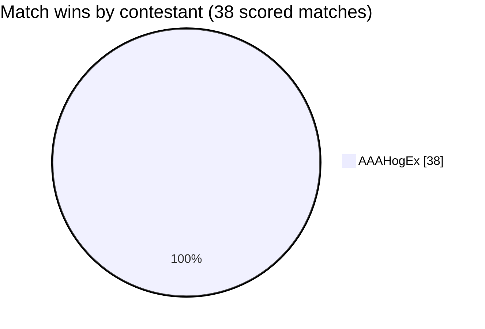
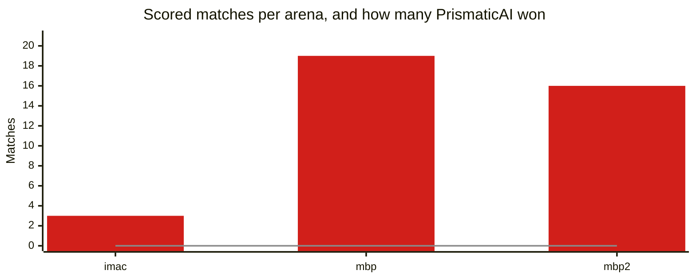

# battle-20261120T113623-f0fb98be

Derived from `battle-20261120T113623-f0fb98be.json` by `tools/research/ai-battle/battle.py report`; do not edit.

- Edition `f0fb98be10d45ad0`: PrismaticAI and referee at `2cab9e0314edf484880fedf08e9fc11d63d5357c`, base set `opengfx-8.0.tar`
- 20-year free-for-all from 1960, map 256x256 temperate, breakdowns 1
- 38 scored match(es) on `imac` (20261119-master-gdf1e05e7d8), `mbp` (20261120-master-m17653b726e), `mbp2` (20261119-master-gdf1e05e7d8)
- Replays: 0 of 0 identical to their original on another arena

| # | Contestant | Played | Wins | Points | Points/match | Avg rank | Avg final value | Squirrel errors | Matches with anomalies |
|---|---|---|---|---|---|---|---|---|---|
| 1 | AAAHogEx | 38 | 38 | 152 | 4.0 | 1.0 | 98.4 M | 0 | 0 |
| 2 | PrismaticAI pre-elite | 7 | 0 | 21 | 3.0 | 2.0 | 17.7 M | 0 | 0 |
| 3 | PrismaticAI | 6 | 0 | 18 | 3.0 | 2.0 | 15.0 M | 0 | 5 |
| 4 | PrismaticAI GA g136.3 | 6 | 0 | 18 | 3.0 | 2.0 | 14.3 M | 0 | 4 |
| 5 | PrismaticAI GA g136.0 | 7 | 0 | 20 | 2.857 | 2.14 | 14.0 M | 0 | 3 |
| 6 | PrismaticAI GA g136.brainExplore | 6 | 0 | 17 | 2.833 | 2.17 | 15.6 M | 0 | 3 |
| 7 | PrismaticAI GA g136.brainSafe | 6 | 0 | 17 | 2.833 | 2.17 | 12.3 M | 0 | 3 |
| 8 | AdmiralAI | 38 | 0 | 79 | 2.079 | 2.92 | 6.3 M | 0 | 6 |
| 9 | LuDiAI AfterFix | 38 | 0 | 34 | 0.895 | 4.11 | 1.7 M | 0 | 0 |
| 10 | CivilAI | 38 | 0 | 4 | 0.105 | 4.89 | 544.7 k | 0 | 7 |

<!-- battle-charts:begin -->
<!-- derived from battle-20261120T113623-f0fb98be.json by `battle.py render`; `battle.py check` fails when it is stale -->

<!-- battle-charts:end -->

| Match | Arena | Seed | Winner | Value | Last | Anomalies |
|---|---|---|---|---|---|---|
| m-0001 | mbp | 1714095344 | AAAHogEx | 136.7 M | CivilAI | AdmiralAI: fleet_drop:103->69 |
| m-0002 | mbp | 1714095344 | AAAHogEx | 130.5 M | CivilAI | - |
| m-0003 | mbp | 1714095344 | AAAHogEx | 126.4 M | CivilAI | PrismaticAI GA g136.brainSafe: fleet_drop:129->53; AdmiralAI: fleet_drop:164->91 |
| m-0004 | mbp | 1714095344 | AAAHogEx | 122.3 M | CivilAI | - |
| m-0005 | mbp | 1714095344 | AAAHogEx | 138.2 M | CivilAI | - |
| m-0006 | mbp | 1541866540 | AAAHogEx | 95.5 M | CivilAI | - |
| m-0007 | mbp | 1541866540 | AAAHogEx | 97.3 M | CivilAI | - |
| m-0008 | mbp | 1541866540 | AAAHogEx | 96.1 M | CivilAI | - |
| m-0009 | mbp | 1541866540 | AAAHogEx | 82.6 M | CivilAI | PrismaticAI GA g136.brainSafe: fleet_drop:122->67 |
| m-0010 | imac | 1541866540 | AAAHogEx | 129.3 M | CivilAI | AdmiralAI: fleet_drop:193->126; CivilAI: no_vehicles |
| m-0011 | imac | 1541866540 | AAAHogEx | 93.4 M | CivilAI | PrismaticAI GA g136.3: fleet_drop:51->33 |
| m-0012 | imac | 1501562222 | AAAHogEx | 99.3 M | CivilAI | PrismaticAI: fleet_drop:124->56 |
| m-0013 | mbp2 | 1501562222 | AAAHogEx | 79.8 M | CivilAI | - |
| m-0014 | mbp2 | 1501562222 | AAAHogEx | 83.1 M | LuDiAI AfterFix | - |
| m-0015 | mbp2 | 1501562222 | AAAHogEx | 112.8 M | CivilAI | CivilAI: fleet_drop:11->6 |
| m-0016 | mbp2 | 1501562222 | AAAHogEx | 103.4 M | CivilAI | PrismaticAI GA g136.brainExplore: fleet_drop:136->85 |
| m-0017 | mbp2 | 1501562222 | AAAHogEx | 77.9 M | CivilAI | PrismaticAI GA g136.3: fleet_drop:97->47; CivilAI: fleet_drop:34->11 |
| m-0018 | mbp2 | 1923270311 | AAAHogEx | 99.1 M | CivilAI | PrismaticAI: fleet_drop:90->38 |
| m-0019 | mbp2 | 1923270311 | AAAHogEx | 74.0 M | CivilAI | - |
| m-0020 | mbp2 | 1923270311 | AAAHogEx | 69.9 M | LuDiAI AfterFix | PrismaticAI GA g136.0: fleet_drop:127->70 |
| m-0021 | mbp2 | 1923270311 | AAAHogEx | 82.2 M | CivilAI | CivilAI: fleet_drop:47->7 |
| m-0022 | mbp2 | 1923270311 | AAAHogEx | 84.7 M | CivilAI | - |
| m-0023 | mbp2 | 1923270311 | AAAHogEx | 67.3 M | CivilAI | PrismaticAI GA g136.3: fleet_drop:55->36 |
| m-0024 | mbp2 | 1011858244 | AAAHogEx | 109.4 M | CivilAI | PrismaticAI: fleet_drop:89->59; CivilAI: fleet_drop:47->9 |
| m-0025 | mbp2 | 1011858244 | AAAHogEx | 101.4 M | CivilAI | - |
| m-0026 | mbp2 | 1011858244 | AAAHogEx | 99.9 M | CivilAI | - |
| m-0027 | mbp2 | 1011858244 | AAAHogEx | 100.5 M | CivilAI | PrismaticAI GA g136.brainSafe: fleet_drop:169->84 |
| m-0028 | mbp2 | 1011858244 | AAAHogEx | 86.8 M | CivilAI | PrismaticAI GA g136.brainExplore: fleet_drop:159->81; AdmiralAI: fleet_drop:168->91 |
| m-0036 | mbp | 498564341 | AAAHogEx | 106.2 M | CivilAI | PrismaticAI: fleet_drop:70->32 |
| m-0037 | mbp | 498564341 | AAAHogEx | 85.3 M | CivilAI | - |
| m-0038 | mbp | 498564341 | AAAHogEx | 106.0 M | CivilAI | PrismaticAI GA g136.0: fleet_drop:72->50; CivilAI: fleet_drop:58->40 |
| m-0039 | mbp | 498564341 | AAAHogEx | 109.5 M | CivilAI | - |
| m-0040 | mbp | 498564341 | AAAHogEx | 103.4 M | CivilAI | AdmiralAI: fleet_drop:463->296; PrismaticAI GA g136.brainExplore: fleet_drop:58->37 |
| m-0041 | mbp | 498564341 | AAAHogEx | 90.1 M | CivilAI | AdmiralAI: fleet_drop:354->244 |
| m-0042 | mbp | 435065061 | AAAHogEx | 80.1 M | CivilAI | PrismaticAI: fleet_drop:72->50 |
| m-0043 | mbp | 435065061 | AAAHogEx | 63.0 M | LuDiAI AfterFix | - |
| m-0044 | mbp | 435065061 | AAAHogEx | 97.3 M | LuDiAI AfterFix | PrismaticAI GA g136.0: fleet_drop:75->45; CivilAI: fleet_drop:33->15 |
| m-0053 | mbp | 1444251616 | AAAHogEx | 119.2 M | CivilAI | PrismaticAI GA g136.3: fleet_drop:97->34 |
