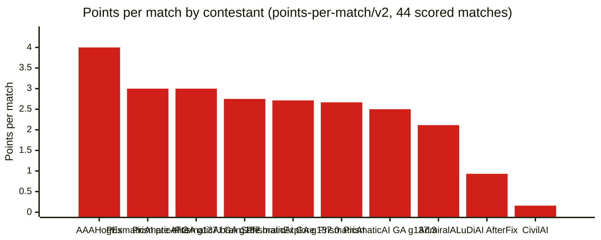
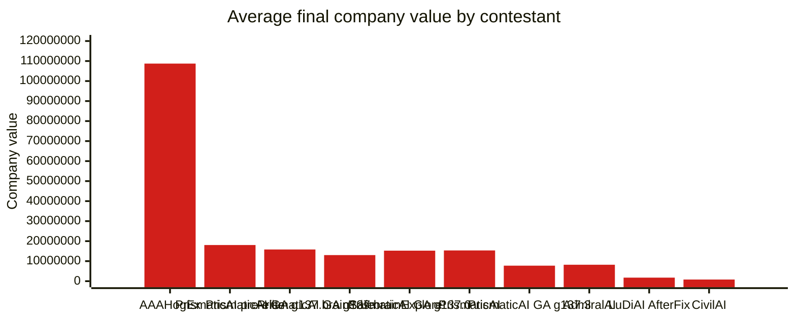
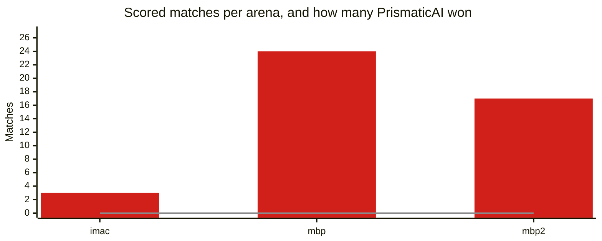

# battle-20261120T114722-4d5f683a

Derived from `battle-20261120T114722-4d5f683a.json` by `tools/research/ai-battle/battle.py report`; do not edit.

- Edition `4d5f683a5d6081d9`: PrismaticAI and referee at `2cab9e0314edf484880fedf08e9fc11d63d5357c`, base set `opengfx-8.0.tar`
- 20-year free-for-all from 1960, map 256x256 temperate, breakdowns 1
- 44 scored match(es) on `imac` (20261119-master-gdf1e05e7d8), `mbp` (20261120-master-m17653b726e), `mbp2` (20261119-master-gdf1e05e7d8)
- Replays: 2 of 2 identical to their original on another arena

| # | Contestant | Played | Wins | Points | Points/match | Avg rank | Avg final value | Squirrel errors | Matches with anomalies |
|---|---|---|---|---|---|---|---|---|---|
| 1 | AAAHogEx | 44 | 44 | 176 | 4.0 | 1.0 | 108.7 M | 0 | 0 |
| 2 | PrismaticAI pre-elite | 10 | 0 | 30 | 3.0 | 2.0 | 18.1 M | 0 | 0 |
| 3 | PrismaticAI GA g137.brainSafe | 7 | 0 | 21 | 3.0 | 2.0 | 15.8 M | 0 | 2 |
| 4 | PrismaticAI GA g137.brainExplore | 8 | 0 | 22 | 2.75 | 2.25 | 13.0 M | 0 | 1 |
| 5 | PrismaticAI GA g137.0 | 7 | 0 | 19 | 2.714 | 2.29 | 15.2 M | 0 | 4 |
| 6 | PrismaticAI | 6 | 0 | 16 | 2.667 | 2.33 | 15.4 M | 0 | 2 |
| 7 | PrismaticAI GA g137.3 | 6 | 0 | 15 | 2.5 | 2.5 | 7.7 M | 0 | 4 |
| 8 | AdmiralAI | 44 | 0 | 93 | 2.114 | 2.89 | 8.2 M | 0 | 3 |
| 9 | LuDiAI AfterFix | 44 | 0 | 41 | 0.932 | 4.07 | 1.8 M | 0 | 0 |
| 10 | CivilAI | 44 | 0 | 7 | 0.159 | 4.84 | 813.6 k | 0 | 4 |

```mermaid
---
config:
  xyChart:
    width: 900
    height: 360
  themeVariables:
    xyChart:
      plotColorPalette: "#d11f1a, #8a8a8a, #0b0b0b, #ece4d6"
---
xychart-beta
    title "Final company value per scored match: winner vs best PrismaticAI"
    x-axis ["m-0001", "m-0002", "m-0003", "m-0004", "m-0005", "m-0006", "m-0007", "m-0008", "m-0009", "m-0010", "m-0011", "m-0012", "m-0013", "m-0014", "m-0015", "m-0016", "m-0017", "m-0018", "m-0019", "m-0020", "m-0021", "m-0022", "m-0023", "m-0024", "m-0025", "m-0026", "m-0027", "m-0028", "m-0036", "m-0037", "m-0038", "m-0039", "m-0040", "m-0041", "m-0042", "m-0043", "m-0044", "m-0045", "m-0046", "m-0049", "m-0055", "m-0058", "m-0059", "m-0067"]
    %% series: Winner | Best PrismaticAI
    %% links: battle-20261120T114722-4d5f683a.md?col=Match&filter=m-0001 | battle-20261120T114722-4d5f683a.md?col=Match&filter=m-0002 | battle-20261120T114722-4d5f683a.md?col=Match&filter=m-0003 | battle-20261120T114722-4d5f683a.md?col=Match&filter=m-0004 | battle-20261120T114722-4d5f683a.md?col=Match&filter=m-0005 | battle-20261120T114722-4d5f683a.md?col=Match&filter=m-0006 | battle-20261120T114722-4d5f683a.md?col=Match&filter=m-0007 | battle-20261120T114722-4d5f683a.md?col=Match&filter=m-0008 | battle-20261120T114722-4d5f683a.md?col=Match&filter=m-0009 | battle-20261120T114722-4d5f683a.md?col=Match&filter=m-0010 | battle-20261120T114722-4d5f683a.md?col=Match&filter=m-0011 | battle-20261120T114722-4d5f683a.md?col=Match&filter=m-0012 | battle-20261120T114722-4d5f683a.md?col=Match&filter=m-0013 | battle-20261120T114722-4d5f683a.md?col=Match&filter=m-0014 | battle-20261120T114722-4d5f683a.md?col=Match&filter=m-0015 | battle-20261120T114722-4d5f683a.md?col=Match&filter=m-0016 | battle-20261120T114722-4d5f683a.md?col=Match&filter=m-0017 | battle-20261120T114722-4d5f683a.md?col=Match&filter=m-0018 | battle-20261120T114722-4d5f683a.md?col=Match&filter=m-0019 | battle-20261120T114722-4d5f683a.md?col=Match&filter=m-0020 | battle-20261120T114722-4d5f683a.md?col=Match&filter=m-0021 | battle-20261120T114722-4d5f683a.md?col=Match&filter=m-0022 | battle-20261120T114722-4d5f683a.md?col=Match&filter=m-0023 | battle-20261120T114722-4d5f683a.md?col=Match&filter=m-0024 | battle-20261120T114722-4d5f683a.md?col=Match&filter=m-0025 | battle-20261120T114722-4d5f683a.md?col=Match&filter=m-0026 | battle-20261120T114722-4d5f683a.md?col=Match&filter=m-0027 | battle-20261120T114722-4d5f683a.md?col=Match&filter=m-0028 | battle-20261120T114722-4d5f683a.md?col=Match&filter=m-0036 | battle-20261120T114722-4d5f683a.md?col=Match&filter=m-0037 | battle-20261120T114722-4d5f683a.md?col=Match&filter=m-0038 | battle-20261120T114722-4d5f683a.md?col=Match&filter=m-0039 | battle-20261120T114722-4d5f683a.md?col=Match&filter=m-0040 | battle-20261120T114722-4d5f683a.md?col=Match&filter=m-0041 | battle-20261120T114722-4d5f683a.md?col=Match&filter=m-0042 | battle-20261120T114722-4d5f683a.md?col=Match&filter=m-0043 | battle-20261120T114722-4d5f683a.md?col=Match&filter=m-0044 | battle-20261120T114722-4d5f683a.md?col=Match&filter=m-0045 | battle-20261120T114722-4d5f683a.md?col=Match&filter=m-0046 | battle-20261120T114722-4d5f683a.md?col=Match&filter=m-0049 | battle-20261120T114722-4d5f683a.md?col=Match&filter=m-0055 | battle-20261120T114722-4d5f683a.md?col=Match&filter=m-0058 | battle-20261120T114722-4d5f683a.md?col=Match&filter=m-0059 | battle-20261120T114722-4d5f683a.md?col=Match&filter=m-0067
    y-axis "Company value" 0 --> 174000000
    bar [76027240, 54131677, 77319158, 81954484, 68674437, 145463685, 132858862, 113109194, 147622436, 143233129, 111091039, 101817818, 100426714, 110750294, 91566967, 75707864, 97877213, 114383023, 106163321, 121769364, 107963023, 106603683, 93047451, 113274960, 133109389, 138884115, 127815687, 134915003, 93245759, 97485874, 76982925, 103885075, 98865563, 88179301, 143077619, 103080301, 95118033, 113576258, 126853616, 92810407, 158010724, 124871777, 113072452, 127370090]
    line [13305271, 11850672, 7707127, 9271594, 6001378, 2426683, 20733888, 16391301, 15383460, 13662217, 3979800, 18517356, 12653788, 14281617, 16118025, 14812286, 8063099, 21144230, 12253696, 12336010, 19793591, 11816680, 9817987, 15923875, 21895454, 14415344, 15412279, 13849376, 12823194, 11615556, 12599024, 14334016, 10908974, 4821586, 21276209, 22972247, 24830361, 22102109, 15912734, 14837991, 33901267, 14014064, 13766891, 16439582]
```

<!-- battle-charts:begin -->
<!-- derived from battle-20261120T114722-4d5f683a.json by `battle.py render`; `battle.py check` fails when it is stale -->

<!-- battle-charts:end -->

| Seed | Original | Replay | Arenas | Identical |
|---|---|---|---|---|
| 450348306 | m-0020 | m-0048 | mbp2 / mbp | yes |
| 543998578 | m-0013 | m-0056 | mbp2 / mbp | yes |

| Match | Arena | Seed | Winner | Value | Last | Anomalies |
|---|---|---|---|---|---|---|
| m-0001 | mbp | 1177366803 | AAAHogEx | 76.0 M | CivilAI | AdmiralAI: fleet_drop:123->76; CivilAI: fleet_drop:82->54 |
| m-0002 | mbp | 1177366803 | AAAHogEx | 54.1 M | CivilAI | PrismaticAI GA g137.0: fleet_drop:77->40; AdmiralAI: fleet_drop:364->239 |
| m-0003 | mbp | 1177366803 | AAAHogEx | 77.3 M | CivilAI | PrismaticAI GA g137.brainSafe: fleet_drop:58->40 |
| m-0004 | mbp | 1177366803 | AAAHogEx | 82.0 M | CivilAI | - |
| m-0005 | mbp | 1177366803 | AAAHogEx | 68.7 M | CivilAI | CivilAI: fleet_drop:48->33 |
| m-0006 | mbp | 99646990 | AAAHogEx | 145.5 M | CivilAI | - |
| m-0007 | mbp | 99646990 | AAAHogEx | 132.9 M | LuDiAI AfterFix | - |
| m-0008 | mbp | 99646990 | AAAHogEx | 113.1 M | CivilAI | - |
| m-0009 | mbp | 99646990 | AAAHogEx | 147.6 M | CivilAI | - |
| m-0010 | imac | 99646990 | AAAHogEx | 143.2 M | CivilAI | - |
| m-0011 | imac | 99646990 | AAAHogEx | 111.1 M | CivilAI | - |
| m-0012 | imac | 543998578 | AAAHogEx | 101.8 M | CivilAI | - |
| m-0013 | mbp2 | 543998578 | AAAHogEx | 100.4 M | CivilAI | - |
| m-0014 | mbp2 | 543998578 | AAAHogEx | 110.8 M | CivilAI | PrismaticAI GA g137.0: fleet_drop:120->65 |
| m-0015 | mbp2 | 543998578 | AAAHogEx | 91.6 M | CivilAI | - |
| m-0016 | mbp2 | 543998578 | AAAHogEx | 75.7 M | CivilAI | - |
| m-0017 | mbp2 | 543998578 | AAAHogEx | 97.9 M | CivilAI | AdmiralAI: fleet_drop:303->202; PrismaticAI GA g137.3: fleet_drop:87->58 |
| m-0018 | mbp2 | 450348306 | AAAHogEx | 114.4 M | CivilAI | CivilAI: no_vehicles |
| m-0019 | mbp2 | 450348306 | AAAHogEx | 106.2 M | CivilAI | CivilAI: fleet_drop:66->45 |
| m-0020 | mbp2 | 450348306 | AAAHogEx | 121.8 M | CivilAI | PrismaticAI GA g137.0: fleet_drop:95->44 |
| m-0021 | mbp2 | 450348306 | AAAHogEx | 108.0 M | CivilAI | - |
| m-0022 | mbp2 | 450348306 | AAAHogEx | 106.6 M | CivilAI | - |
| m-0023 | mbp2 | 450348306 | AAAHogEx | 93.0 M | CivilAI | PrismaticAI GA g137.3: fleet_drop:95->56 |
| m-0024 | mbp2 | 1492043262 | AAAHogEx | 113.3 M | CivilAI | PrismaticAI: fleet_drop:131->76 |
| m-0025 | mbp2 | 1492043262 | AAAHogEx | 133.1 M | CivilAI | - |
| m-0026 | mbp2 | 1492043262 | AAAHogEx | 138.9 M | LuDiAI AfterFix | PrismaticAI GA g137.0: fleet_drop:147->67 |
| m-0027 | mbp2 | 1492043262 | AAAHogEx | 127.8 M | CivilAI | - |
| m-0028 | mbp2 | 1492043262 | AAAHogEx | 134.9 M | CivilAI | - |
| m-0036 | mbp | 1878760977 | AAAHogEx | 93.2 M | CivilAI | - |
| m-0037 | mbp | 1878760977 | AAAHogEx | 97.5 M | CivilAI | - |
| m-0038 | mbp | 1878760977 | AAAHogEx | 77.0 M | CivilAI | - |
| m-0039 | mbp | 1878760977 | AAAHogEx | 103.9 M | CivilAI | PrismaticAI GA g137.brainSafe: fleet_drop:59->28 |
| m-0040 | mbp | 1878760977 | AAAHogEx | 98.9 M | CivilAI | - |
| m-0041 | mbp | 1878760977 | AAAHogEx | 88.2 M | CivilAI | PrismaticAI GA g137.3: fleet_drop:122->40 |
| m-0042 | mbp | 692198401 | AAAHogEx | 143.1 M | CivilAI | PrismaticAI: fleet_drop:89->44 |
| m-0043 | mbp | 692198401 | AAAHogEx | 103.1 M | CivilAI | - |
| m-0044 | mbp | 692198401 | AAAHogEx | 95.1 M | CivilAI | - |
| m-0045 | mbp | 692198401 | AAAHogEx | 113.6 M | LuDiAI AfterFix | - |
| m-0046 | mbp | 692198401 | AAAHogEx | 126.9 M | LuDiAI AfterFix | - |
| m-0048 (replay) | mbp | 450348306 | AAAHogEx | 121.8 M | CivilAI | PrismaticAI GA g137.0: fleet_drop:95->44 |
| m-0049 | mbp2 | 1792457861 | AAAHogEx | 92.8 M | LuDiAI AfterFix | - |
| m-0055 | mbp | 1118964672 | AAAHogEx | 158.0 M | LuDiAI AfterFix | - |
| m-0056 (replay) | mbp | 543998578 | AAAHogEx | 100.4 M | CivilAI | - |
| m-0058 | mbp | 1118964672 | AAAHogEx | 124.9 M | CivilAI | PrismaticAI GA g137.brainExplore: fleet_drop:41->28 |
| m-0059 | mbp | 1118964672 | AAAHogEx | 113.1 M | CivilAI | PrismaticAI GA g137.3: fleet_drop:147->73 |
| m-0067 | mbp | 1699177968 | AAAHogEx | 127.4 M | CivilAI | - |
