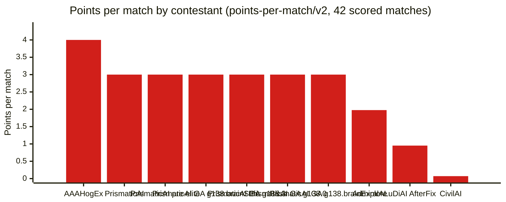
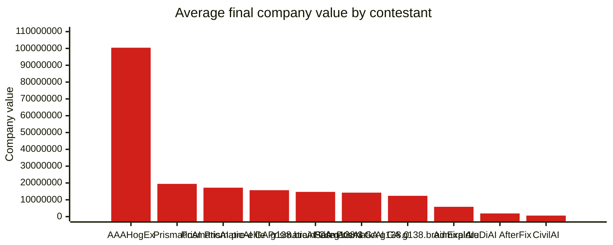
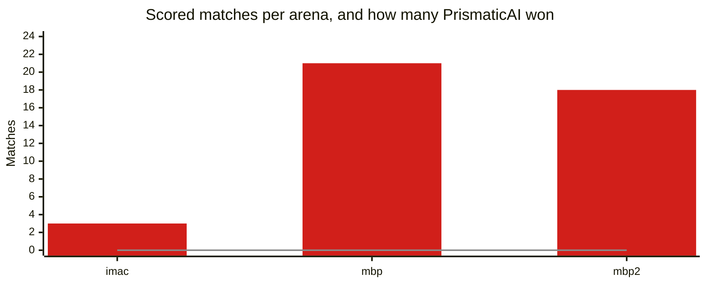

# battle-20261120T115744-7b50c7c1

Derived from `battle-20261120T115744-7b50c7c1.json` by `tools/research/ai-battle/battle.py report`; do not edit.

- Edition `7b50c7c1499efbbc`: PrismaticAI and referee at `2cab9e0314edf484880fedf08e9fc11d63d5357c`, base set `opengfx-8.0.tar`
- 20-year free-for-all from 1960, map 256x256 temperate, breakdowns 1
- 42 scored match(es) on `imac` (20261119-master-gdf1e05e7d8), `mbp` (20261120-master-m17653b726e), `mbp2` (20261119-master-gdf1e05e7d8)
- Replays: 0 of 1 identical to their original on another arena

| # | Contestant | Played | Wins | Points | Points/match | Avg rank | Avg final value | Squirrel errors | Matches with anomalies |
|---|---|---|---|---|---|---|---|---|---|
| 1 | AAAHogEx | 42 | 42 | 168 | 4.0 | 1.0 | 100.4 M | 0 | 0 |
| 2 | PrismaticAI | 7 | 0 | 21 | 3.0 | 2.0 | 19.5 M | 0 | 2 |
| 3 | PrismaticAI pre-elite | 8 | 0 | 24 | 3.0 | 2.0 | 17.2 M | 0 | 0 |
| 4 | PrismaticAI GA g138.brainSafe | 7 | 0 | 21 | 3.0 | 2.0 | 15.7 M | 0 | 2 |
| 5 | PrismaticAI GA g138.3 | 6 | 0 | 18 | 3.0 | 2.0 | 14.7 M | 0 | 1 |
| 6 | PrismaticAI GA g138.0 | 7 | 0 | 21 | 3.0 | 2.0 | 14.3 M | 0 | 2 |
| 7 | PrismaticAI GA g138.brainExplore | 7 | 0 | 21 | 3.0 | 2.0 | 12.4 M | 0 | 6 |
| 8 | AdmiralAI | 42 | 0 | 83 | 1.976 | 3.02 | 5.8 M | 0 | 2 |
| 9 | LuDiAI AfterFix | 42 | 0 | 40 | 0.952 | 4.05 | 1.9 M | 0 | 0 |
| 10 | CivilAI | 42 | 0 | 3 | 0.071 | 4.93 | 618.3 k | 3645 | 12 |

```mermaid
---
config:
  xyChart:
    width: 900
    height: 360
  themeVariables:
    xyChart:
      plotColorPalette: "#d11f1a, #8a8a8a, #0b0b0b, #ece4d6"
---
xychart-beta
    title "Final company value per scored match: winner vs best PrismaticAI"
    x-axis ["m-0001", "m-0002", "m-0003", "m-0004", "m-0005", "m-0006", "m-0007", "m-0008", "m-0009", "m-0010", "m-0011", "m-0012", "m-0013", "m-0014", "m-0015", "m-0016", "m-0017", "m-0018", "m-0019", "m-0020", "m-0021", "m-0022", "m-0023", "m-0024", "m-0025", "m-0026", "m-0027", "m-0028", "m-0036", "m-0037", "m-0038", "m-0039", "m-0040", "m-0041", "m-0042", "m-0043", "m-0044", "m-0045", "m-0047", "m-0054", "m-0055", "m-0058"]
    %% series: Winner | Best PrismaticAI
    %% links: battle-20261120T115744-7b50c7c1.md?col=Match&filter=m-0001 | battle-20261120T115744-7b50c7c1.md?col=Match&filter=m-0002 | battle-20261120T115744-7b50c7c1.md?col=Match&filter=m-0003 | battle-20261120T115744-7b50c7c1.md?col=Match&filter=m-0004 | battle-20261120T115744-7b50c7c1.md?col=Match&filter=m-0005 | battle-20261120T115744-7b50c7c1.md?col=Match&filter=m-0006 | battle-20261120T115744-7b50c7c1.md?col=Match&filter=m-0007 | battle-20261120T115744-7b50c7c1.md?col=Match&filter=m-0008 | battle-20261120T115744-7b50c7c1.md?col=Match&filter=m-0009 | battle-20261120T115744-7b50c7c1.md?col=Match&filter=m-0010 | battle-20261120T115744-7b50c7c1.md?col=Match&filter=m-0011 | battle-20261120T115744-7b50c7c1.md?col=Match&filter=m-0012 | battle-20261120T115744-7b50c7c1.md?col=Match&filter=m-0013 | battle-20261120T115744-7b50c7c1.md?col=Match&filter=m-0014 | battle-20261120T115744-7b50c7c1.md?col=Match&filter=m-0015 | battle-20261120T115744-7b50c7c1.md?col=Match&filter=m-0016 | battle-20261120T115744-7b50c7c1.md?col=Match&filter=m-0017 | battle-20261120T115744-7b50c7c1.md?col=Match&filter=m-0018 | battle-20261120T115744-7b50c7c1.md?col=Match&filter=m-0019 | battle-20261120T115744-7b50c7c1.md?col=Match&filter=m-0020 | battle-20261120T115744-7b50c7c1.md?col=Match&filter=m-0021 | battle-20261120T115744-7b50c7c1.md?col=Match&filter=m-0022 | battle-20261120T115744-7b50c7c1.md?col=Match&filter=m-0023 | battle-20261120T115744-7b50c7c1.md?col=Match&filter=m-0024 | battle-20261120T115744-7b50c7c1.md?col=Match&filter=m-0025 | battle-20261120T115744-7b50c7c1.md?col=Match&filter=m-0026 | battle-20261120T115744-7b50c7c1.md?col=Match&filter=m-0027 | battle-20261120T115744-7b50c7c1.md?col=Match&filter=m-0028 | battle-20261120T115744-7b50c7c1.md?col=Match&filter=m-0036 | battle-20261120T115744-7b50c7c1.md?col=Match&filter=m-0037 | battle-20261120T115744-7b50c7c1.md?col=Match&filter=m-0038 | battle-20261120T115744-7b50c7c1.md?col=Match&filter=m-0039 | battle-20261120T115744-7b50c7c1.md?col=Match&filter=m-0040 | battle-20261120T115744-7b50c7c1.md?col=Match&filter=m-0041 | battle-20261120T115744-7b50c7c1.md?col=Match&filter=m-0042 | battle-20261120T115744-7b50c7c1.md?col=Match&filter=m-0043 | battle-20261120T115744-7b50c7c1.md?col=Match&filter=m-0044 | battle-20261120T115744-7b50c7c1.md?col=Match&filter=m-0045 | battle-20261120T115744-7b50c7c1.md?col=Match&filter=m-0047 | battle-20261120T115744-7b50c7c1.md?col=Match&filter=m-0054 | battle-20261120T115744-7b50c7c1.md?col=Match&filter=m-0055 | battle-20261120T115744-7b50c7c1.md?col=Match&filter=m-0058
    y-axis "Company value" 0 --> 161000000
    bar [97495659, 102852755, 110065503, 94493453, 97016733, 126985852, 127765346, 113176351, 109294286, 116443596, 145693918, 75491328, 63217752, 47283924, 68815772, 51205288, 55379353, 121936248, 82215111, 131614478, 125079981, 146156985, 125413125, 77567217, 85996946, 120257201, 91438270, 85880859, 94473351, 120923626, 94469816, 91332524, 110066772, 91782569, 111272188, 122237704, 123595306, 100793342, 103312151, 100838102, 93157545, 63640353]
    line [14468318, 11591248, 13253075, 15135989, 13957319, 23651251, 20637668, 14933293, 16793919, 19650524, 14474485, 21002920, 17444135, 16227226, 12969539, 9882010, 16950494, 20758401, 14934283, 12981972, 17546483, 14237305, 12808305, 26765935, 16619361, 10064017, 26765643, 11742076, 17782425, 15830205, 18024940, 7816411, 5225700, 15180916, 14442464, 18392810, 15999085, 14899396, 14894761, 11918740, 19271788, 10731590]
```

<!-- battle-charts:begin -->
<!-- derived from battle-20261120T115744-7b50c7c1.json by `battle.py render`; `battle.py check` fails when it is stale -->

<!-- battle-charts:end -->

| Seed | Original | Replay | Arenas | Identical |
|---|---|---|---|---|
| 99970183 | m-0012 | m-0056 | imac / mbp | NO |

| Match | Arena | Seed | Winner | Value | Last | Anomalies |
|---|---|---|---|---|---|---|
| m-0001 | mbp | 1350216948 | AAAHogEx | 97.5 M | CivilAI | - |
| m-0002 | mbp | 1350216948 | AAAHogEx | 102.9 M | CivilAI | PrismaticAI GA g138.0: fleet_drop:68->44 |
| m-0003 | mbp | 1350216948 | AAAHogEx | 110.1 M | CivilAI | CivilAI: fleet_drop:22->14 |
| m-0004 | mbp | 1350216948 | AAAHogEx | 94.5 M | CivilAI | PrismaticAI GA g138.brainExplore: fleet_drop:126->53; CivilAI: fleet_drop:23->6 |
| m-0005 | mbp | 1350216948 | AAAHogEx | 97.0 M | CivilAI | CivilAI: fleet_drop:19->8 |
| m-0006 | mbp | 83361224 | AAAHogEx | 127.0 M | CivilAI | CivilAI: fleet_drop:54->28 |
| m-0007 | mbp | 83361224 | AAAHogEx | 127.8 M | CivilAI | - |
| m-0008 | mbp | 83361224 | AAAHogEx | 113.2 M | CivilAI | - |
| m-0009 | mbp | 83361224 | AAAHogEx | 109.3 M | CivilAI | - |
| m-0010 | imac | 83361224 | AAAHogEx | 116.4 M | CivilAI | CivilAI: fleet_drop:56->38 |
| m-0011 | imac | 83361224 | AAAHogEx | 145.7 M | LuDiAI AfterFix | CivilAI: fleet_drop:29->16 |
| m-0012 | imac | 99970183 | AAAHogEx | 75.5 M | CivilAI | - |
| m-0013 | mbp2 | 99970183 | AAAHogEx | 63.2 M | CivilAI | - |
| m-0014 | mbp2 | 99970183 | AAAHogEx | 47.3 M | LuDiAI AfterFix | CivilAI: fleet_drop:84->39 |
| m-0015 | mbp2 | 99970183 | AAAHogEx | 68.8 M | CivilAI | PrismaticAI GA g138.brainSafe: fleet_drop:54->37 |
| m-0016 | mbp2 | 99970183 | AAAHogEx | 51.2 M | CivilAI | PrismaticAI GA g138.brainExplore: fleet_drop:50->33 |
| m-0017 | mbp2 | 99970183 | AAAHogEx | 55.4 M | CivilAI | PrismaticAI GA g138.3: fleet_drop:66->46 |
| m-0018 | mbp2 | 869931717 | AAAHogEx | 121.9 M | CivilAI | PrismaticAI: fleet_drop:119->73 |
| m-0019 | mbp2 | 869931717 | AAAHogEx | 82.2 M | CivilAI | CivilAI: fleet_drop:63->35 |
| m-0020 | mbp2 | 869931717 | AAAHogEx | 131.6 M | CivilAI | - |
| m-0021 | mbp2 | 869931717 | AAAHogEx | 125.1 M | CivilAI | PrismaticAI GA g138.brainSafe: fleet_drop:99->51; AdmiralAI: fleet_drop:256->166; CivilAI: fleet_drop:46->16 |
| m-0022 | mbp2 | 869931717 | AAAHogEx | 146.2 M | CivilAI | PrismaticAI GA g138.brainExplore: fleet_drop:179->79 |
| m-0023 | mbp2 | 869931717 | AAAHogEx | 125.4 M | CivilAI | - |
| m-0024 | mbp2 | 1663322249 | AAAHogEx | 77.6 M | CivilAI | - |
| m-0025 | mbp2 | 1663322249 | AAAHogEx | 86.0 M | CivilAI | - |
| m-0026 | mbp2 | 1663322249 | AAAHogEx | 120.3 M | LuDiAI AfterFix | PrismaticAI GA g138.0: fleet_drop:69->39 |
| m-0027 | mbp2 | 1663322249 | AAAHogEx | 91.4 M | CivilAI | CivilAI: fleet_drop:17->11 |
| m-0028 | mbp2 | 1663322249 | AAAHogEx | 85.9 M | CivilAI | PrismaticAI GA g138.brainExplore: fleet_drop:93->48 |
| m-0036 | mbp | 620934884 | AAAHogEx | 94.5 M | CivilAI | - |
| m-0037 | mbp | 620934884 | AAAHogEx | 120.9 M | CivilAI | - |
| m-0038 | mbp | 620934884 | AAAHogEx | 94.5 M | CivilAI | CivilAI: squirrel_errors:3645 |
| m-0039 | mbp | 620934884 | AAAHogEx | 91.3 M | CivilAI | - |
| m-0040 | mbp | 620934884 | AAAHogEx | 110.1 M | CivilAI | PrismaticAI GA g138.brainExplore: fleet_drop:129->55 |
| m-0041 | mbp | 620934884 | AAAHogEx | 91.8 M | CivilAI | - |
| m-0042 | mbp | 144330938 | AAAHogEx | 111.3 M | CivilAI | PrismaticAI: fleet_drop:70->41 |
| m-0043 | mbp | 144330938 | AAAHogEx | 122.2 M | CivilAI | - |
| m-0044 | mbp | 144330938 | AAAHogEx | 123.6 M | CivilAI | - |
| m-0045 | mbp2 | 144330938 | AAAHogEx | 100.8 M | CivilAI | - |
| m-0047 | mbp2 | 144330938 | AAAHogEx | 103.3 M | CivilAI | - |
| m-0054 | mbp | 922105667 | AAAHogEx | 100.8 M | CivilAI | - |
| m-0055 | mbp | 922105667 | AAAHogEx | 93.2 M | CivilAI | - |
| m-0056 (replay) | mbp | 99970183 | AAAHogEx | 72.7 M | CivilAI | - |
| m-0058 | mbp | 922105667 | AAAHogEx | 63.6 M | CivilAI | PrismaticAI GA g138.brainExplore: fleet_drop:208->104; AdmiralAI: fleet_drop:239->166; CivilAI: fleet_drop:93->59 |
