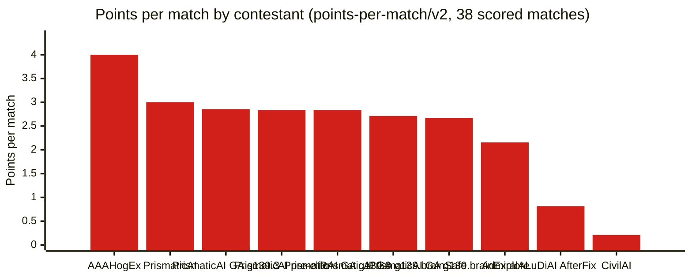
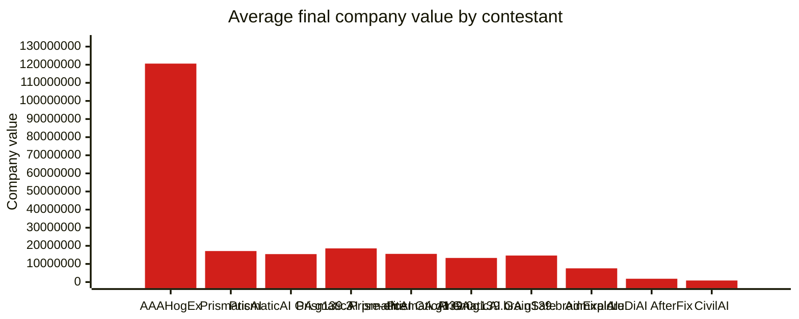
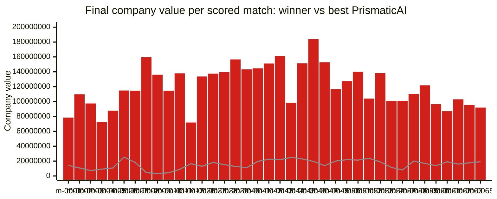
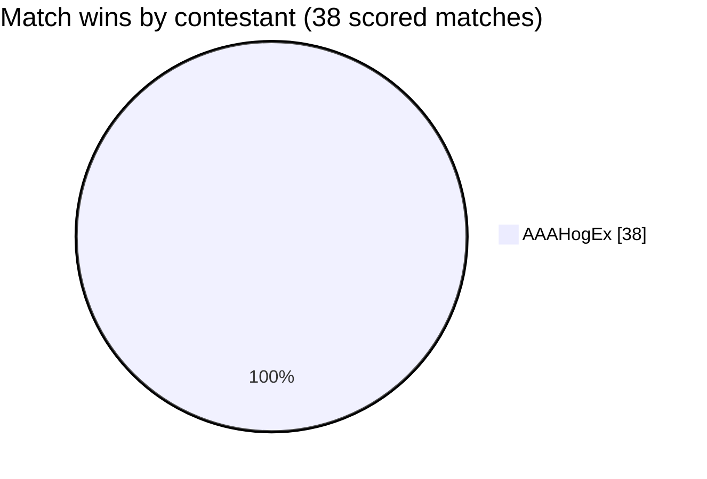
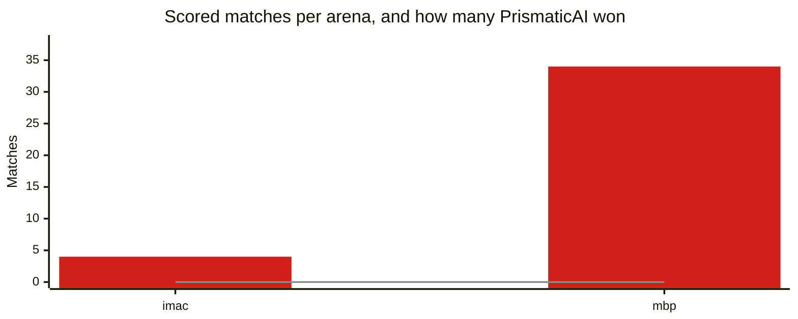

# battle-20261120T121228-165cf79f

Derived from `battle-20261120T121228-165cf79f.json` by `tools/research/ai-battle/battle.py report`; do not edit.

- Edition `165cf79f3d3ae703`: PrismaticAI and referee at `2cab9e0314edf484880fedf08e9fc11d63d5357c`, base set `opengfx-8.0.tar`
- 20-year free-for-all from 1960, map 256x256 temperate, breakdowns 1
- 38 scored match(es) on `imac` (20261119-master-gdf1e05e7d8), `mbp` (20261120-master-m17653b726e)
- Replays: 0 of 2 identical to their original on another arena

| # | Contestant | Played | Wins | Points | Points/match | Avg rank | Avg final value | Squirrel errors | Matches with anomalies |
|---|---|---|---|---|---|---|---|---|---|
| 1 | AAAHogEx | 38 | 38 | 152 | 4.0 | 1.0 | 120.6 M | 0 | 0 |
| 2 | PrismaticAI | 6 | 0 | 18 | 3.0 | 2.0 | 17.1 M | 0 | 3 |
| 3 | PrismaticAI GA g139.3 | 7 | 0 | 20 | 2.857 | 2.14 | 15.4 M | 0 | 1 |
| 4 | PrismaticAI pre-elite | 6 | 0 | 17 | 2.833 | 2.17 | 18.6 M | 0 | 0 |
| 5 | PrismaticAI GA g139.0 | 6 | 0 | 17 | 2.833 | 2.17 | 15.6 M | 0 | 3 |
| 6 | PrismaticAI GA g139.brainSafe | 7 | 0 | 19 | 2.714 | 2.29 | 13.3 M | 0 | 1 |
| 7 | PrismaticAI GA g139.brainExplore | 6 | 0 | 16 | 2.667 | 2.33 | 14.6 M | 0 | 4 |
| 8 | AdmiralAI | 38 | 0 | 82 | 2.158 | 2.84 | 7.6 M | 59 | 2 |
| 9 | LuDiAI AfterFix | 38 | 0 | 31 | 0.816 | 4.18 | 1.8 M | 0 | 0 |
| 10 | CivilAI | 38 | 0 | 8 | 0.211 | 4.79 | 854.9 k | 3705 | 11 |

<!-- battle-charts:begin -->
<!-- derived from battle-20261120T121228-165cf79f.json by `battle.py render`; `battle.py check` fails when it is stale -->

<!-- battle-charts:end -->

| Seed | Original | Replay | Arenas | Identical |
|---|---|---|---|---|
| 541660735 | m-0012 | m-0048 | imac / mbp | NO |
| 274180594 | m-0010 | m-0064 | imac / mbp | NO |

| Match | Arena | Seed | Winner | Value | Last | Anomalies |
|---|---|---|---|---|---|---|
| m-0001 | mbp | 1330084524 | AAAHogEx | 78.5 M | CivilAI | CivilAI: fleet_drop:42->25 |
| m-0002 | mbp | 1330084524 | AAAHogEx | 109.8 M | LuDiAI AfterFix | PrismaticAI GA g139.0: fleet_drop:82->40; AdmiralAI: squirrel_errors:59 |
| m-0003 | mbp | 1330084524 | AAAHogEx | 97.4 M | CivilAI | CivilAI: fleet_drop:75->52 |
| m-0004 | mbp | 1330084524 | AAAHogEx | 72.4 M | CivilAI | - |
| m-0005 | mbp | 1330084524 | AAAHogEx | 87.7 M | CivilAI | CivilAI: fleet_drop:53->31 |
| m-0006 | mbp | 274180594 | AAAHogEx | 114.9 M | CivilAI | PrismaticAI: fleet_drop:91->56; CivilAI: fleet_drop:65->41 |
| m-0007 | mbp | 274180594 | AAAHogEx | 114.7 M | CivilAI | - |
| m-0008 | mbp | 274180594 | AAAHogEx | 159.6 M | CivilAI | PrismaticAI GA g139.0: fleet_drop:72->32 |
| m-0009 | mbp | 274180594 | AAAHogEx | 136.1 M | CivilAI | CivilAI: fleet_drop:68->43 |
| m-0010 | imac | 274180594 | AAAHogEx | 114.6 M | CivilAI | PrismaticAI GA g139.brainExplore: fleet_drop:83->47 |
| m-0011 | imac | 274180594 | AAAHogEx | 137.9 M | CivilAI | - |
| m-0012 | imac | 541660735 | AAAHogEx | 71.8 M | LuDiAI AfterFix | - |
| m-0036 | mbp | 1279640256 | AAAHogEx | 133.7 M | CivilAI | PrismaticAI: fleet_drop:78->36; CivilAI: fleet_drop:33->23 |
| m-0037 | mbp | 1279640256 | AAAHogEx | 137.5 M | LuDiAI AfterFix | - |
| m-0038 | mbp | 1279640256 | AAAHogEx | 139.5 M | CivilAI | - |
| m-0039 | mbp | 1279640256 | AAAHogEx | 156.6 M | CivilAI | - |
| m-0040 | mbp | 1279640256 | AAAHogEx | 143.2 M | CivilAI | PrismaticAI GA g139.brainExplore: fleet_drop:160->62; CivilAI: fleet_drop:62->32 |
| m-0041 | mbp | 1279640256 | AAAHogEx | 144.7 M | CivilAI | - |
| m-0042 | mbp | 1316004505 | AAAHogEx | 151.1 M | CivilAI | - |
| m-0043 | mbp | 1316004505 | AAAHogEx | 161.2 M | CivilAI | - |
| m-0044 | mbp | 1316004505 | AAAHogEx | 98.4 M | CivilAI | PrismaticAI GA g139.0: fleet_drop:135->85; AdmiralAI: fleet_drop:265->155; CivilAI: fleet_drop:29->15 |
| m-0045 | mbp | 1316004505 | AAAHogEx | 151.3 M | CivilAI | - |
| m-0046 | mbp | 1316004505 | AAAHogEx | 183.8 M | CivilAI | PrismaticAI GA g139.brainExplore: fleet_drop:221->127 |
| m-0047 | mbp | 1316004505 | AAAHogEx | 152.8 M | LuDiAI AfterFix | - |
| m-0048 (replay) | mbp | 541660735 | AAAHogEx | 66.1 M | LuDiAI AfterFix | - |
| m-0049 | imac | 18852703 | AAAHogEx | 116.7 M | CivilAI | CivilAI: fleet_drop:49->26 |
| m-0050 | mbp | 18852703 | AAAHogEx | 127.4 M | CivilAI | - |
| m-0051 | mbp | 18852703 | AAAHogEx | 140.0 M | CivilAI | - |
| m-0052 | mbp | 18852703 | AAAHogEx | 104.0 M | CivilAI | PrismaticAI GA g139.brainExplore: fleet_drop:134->90 |
| m-0053 | mbp | 18852703 | AAAHogEx | 138.2 M | CivilAI | - |
| m-0054 | mbp | 1948581473 | AAAHogEx | 100.7 M | CivilAI | - |
| m-0057 | mbp | 1948581473 | AAAHogEx | 101.1 M | LuDiAI AfterFix | CivilAI: fleet_drop:154->100 |
| m-0058 | mbp | 1948581473 | AAAHogEx | 110.3 M | CivilAI | - |
| m-0059 | mbp | 1948581473 | AAAHogEx | 121.8 M | LuDiAI AfterFix | PrismaticAI GA g139.3: fleet_drop:82->45 |
| m-0060 | mbp | 59841626 | AAAHogEx | 96.5 M | LuDiAI AfterFix | PrismaticAI: fleet_drop:79->52; CivilAI: squirrel_errors:3705 |
| m-0061 | mbp | 59841626 | AAAHogEx | 87.0 M | CivilAI | - |
| m-0062 | mbp | 59841626 | AAAHogEx | 103.0 M | CivilAI | - |
| m-0063 | mbp | 59841626 | AAAHogEx | 95.4 M | LuDiAI AfterFix | PrismaticAI GA g139.brainSafe: fleet_drop:135->86 |
| m-0064 (replay) | mbp | 274180594 | AAAHogEx | 131.0 M | CivilAI | PrismaticAI GA g139.brainExplore: fleet_drop:72->36; CivilAI: fleet_drop:71->47 |
| m-0065 | mbp | 59841626 | AAAHogEx | 91.9 M | CivilAI | - |
