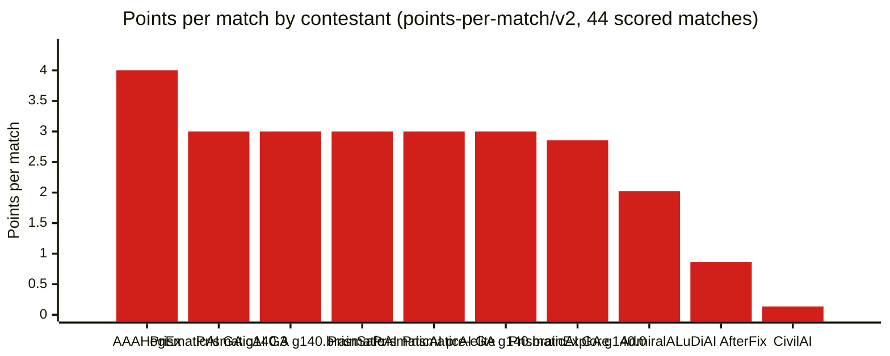
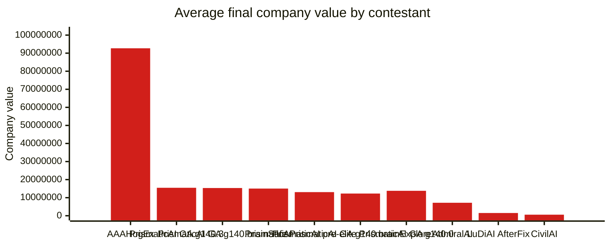
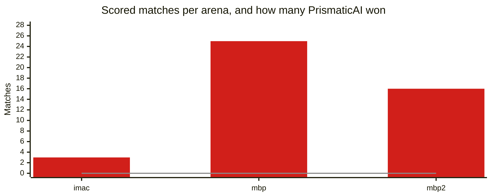

# battle-20261120T122324-454500f3

Derived from `battle-20261120T122324-454500f3.json` by `tools/research/ai-battle/battle.py report`; do not edit.

- Edition `454500f38a2c5c84`: PrismaticAI and referee at `2cab9e0314edf484880fedf08e9fc11d63d5357c`, base set `opengfx-8.0.tar`
- 20-year free-for-all from 1960, map 256x256 temperate, breakdowns 1
- 44 scored match(es) on `imac` (20261119-master-gdf1e05e7d8), `mbp` (20261120-master-m17653b726e), `mbp2` (20261119-master-gdf1e05e7d8)
- Replays: 0 of 1 identical to their original on another arena

| # | Contestant | Played | Wins | Points | Points/match | Avg rank | Avg final value | Squirrel errors | Matches with anomalies |
|---|---|---|---|---|---|---|---|---|---|
| 1 | AAAHogEx | 44 | 44 | 176 | 4.0 | 1.0 | 92.7 M | 100 | 1 |
| 2 | PrismaticAI GA g140.3 | 6 | 0 | 18 | 3.0 | 2.0 | 15.5 M | 0 | 3 |
| 3 | PrismaticAI GA g140.brainSafe | 7 | 0 | 21 | 3.0 | 2.0 | 15.3 M | 0 | 1 |
| 4 | PrismaticAI | 7 | 0 | 21 | 3.0 | 2.0 | 15.0 M | 0 | 1 |
| 5 | PrismaticAI pre-elite | 9 | 0 | 27 | 3.0 | 2.0 | 13.1 M | 0 | 0 |
| 6 | PrismaticAI GA g140.brainExplore | 8 | 0 | 24 | 3.0 | 2.0 | 12.3 M | 0 | 3 |
| 7 | PrismaticAI GA g140.0 | 7 | 0 | 20 | 2.857 | 2.14 | 13.8 M | 0 | 3 |
| 8 | AdmiralAI | 44 | 0 | 89 | 2.023 | 2.98 | 7.2 M | 0 | 0 |
| 9 | LuDiAI AfterFix | 44 | 0 | 38 | 0.864 | 4.14 | 1.5 M | 0 | 2 |
| 10 | CivilAI | 44 | 0 | 6 | 0.136 | 4.86 | 580.6 k | 0 | 7 |

```mermaid
---
config:
  xyChart:
    width: 900
    height: 360
  themeVariables:
    xyChart:
      plotColorPalette: "#d11f1a, #8a8a8a, #0b0b0b, #ece4d6"
---
xychart-beta
    title "Final company value per scored match: winner vs best PrismaticAI"
    x-axis ["m-0001", "m-0002", "m-0003", "m-0004", "m-0005", "m-0006", "m-0007", "m-0008", "m-0009", "m-0010", "m-0011", "m-0012", "m-0013", "m-0014", "m-0015", "m-0016", "m-0017", "m-0018", "m-0019", "m-0020", "m-0021", "m-0022", "m-0023", "m-0024", "m-0025", "m-0026", "m-0027", "m-0028", "m-0036", "m-0037", "m-0038", "m-0039", "m-0040", "m-0041", "m-0042", "m-0043", "m-0044", "m-0045", "m-0046", "m-0055", "m-0058", "m-0059", "m-0060", "m-0061"]
    %% series: Winner | Best PrismaticAI
    %% links: battle-20261120T122324-454500f3.md?col=Match&filter=m-0001 | battle-20261120T122324-454500f3.md?col=Match&filter=m-0002 | battle-20261120T122324-454500f3.md?col=Match&filter=m-0003 | battle-20261120T122324-454500f3.md?col=Match&filter=m-0004 | battle-20261120T122324-454500f3.md?col=Match&filter=m-0005 | battle-20261120T122324-454500f3.md?col=Match&filter=m-0006 | battle-20261120T122324-454500f3.md?col=Match&filter=m-0007 | battle-20261120T122324-454500f3.md?col=Match&filter=m-0008 | battle-20261120T122324-454500f3.md?col=Match&filter=m-0009 | battle-20261120T122324-454500f3.md?col=Match&filter=m-0010 | battle-20261120T122324-454500f3.md?col=Match&filter=m-0011 | battle-20261120T122324-454500f3.md?col=Match&filter=m-0012 | battle-20261120T122324-454500f3.md?col=Match&filter=m-0013 | battle-20261120T122324-454500f3.md?col=Match&filter=m-0014 | battle-20261120T122324-454500f3.md?col=Match&filter=m-0015 | battle-20261120T122324-454500f3.md?col=Match&filter=m-0016 | battle-20261120T122324-454500f3.md?col=Match&filter=m-0017 | battle-20261120T122324-454500f3.md?col=Match&filter=m-0018 | battle-20261120T122324-454500f3.md?col=Match&filter=m-0019 | battle-20261120T122324-454500f3.md?col=Match&filter=m-0020 | battle-20261120T122324-454500f3.md?col=Match&filter=m-0021 | battle-20261120T122324-454500f3.md?col=Match&filter=m-0022 | battle-20261120T122324-454500f3.md?col=Match&filter=m-0023 | battle-20261120T122324-454500f3.md?col=Match&filter=m-0024 | battle-20261120T122324-454500f3.md?col=Match&filter=m-0025 | battle-20261120T122324-454500f3.md?col=Match&filter=m-0026 | battle-20261120T122324-454500f3.md?col=Match&filter=m-0027 | battle-20261120T122324-454500f3.md?col=Match&filter=m-0028 | battle-20261120T122324-454500f3.md?col=Match&filter=m-0036 | battle-20261120T122324-454500f3.md?col=Match&filter=m-0037 | battle-20261120T122324-454500f3.md?col=Match&filter=m-0038 | battle-20261120T122324-454500f3.md?col=Match&filter=m-0039 | battle-20261120T122324-454500f3.md?col=Match&filter=m-0040 | battle-20261120T122324-454500f3.md?col=Match&filter=m-0041 | battle-20261120T122324-454500f3.md?col=Match&filter=m-0042 | battle-20261120T122324-454500f3.md?col=Match&filter=m-0043 | battle-20261120T122324-454500f3.md?col=Match&filter=m-0044 | battle-20261120T122324-454500f3.md?col=Match&filter=m-0045 | battle-20261120T122324-454500f3.md?col=Match&filter=m-0046 | battle-20261120T122324-454500f3.md?col=Match&filter=m-0055 | battle-20261120T122324-454500f3.md?col=Match&filter=m-0058 | battle-20261120T122324-454500f3.md?col=Match&filter=m-0059 | battle-20261120T122324-454500f3.md?col=Match&filter=m-0060 | battle-20261120T122324-454500f3.md?col=Match&filter=m-0061
    y-axis "Company value" 0 --> 172000000
    bar [129524730, 78544103, 101307453, 97415775, 88627114, 53868938, 67403858, 71926191, 73620613, 65742021, 75577815, 84625632, 86412460, 95933702, 85394700, 90964454, 94860568, 71564099, 108644644, 86361141, 94584082, 104573107, 60733412, 98463717, 107063576, 90276983, 112030542, 96620388, 69314852, 83108129, 73171101, 92054707, 75796121, 68911620, 107521287, 156407442, 147296173, 137214474, 137503129, 101807338, 123460225, 108754122, 54380327, 69383611]
    line [5980800, 17200225, 13736683, 7362266, 19829076, 10454916, 12064873, 10240927, 9446029, 8991009, 11837772, 16720381, 12882003, 13080931, 13642039, 12599644, 10637973, 22977036, 14578626, 11334150, 16052532, 10878189, 16984180, 15382939, 13456533, 16805367, 16616708, 15946561, 13725605, 15212425, 17376351, 16746503, 11700667, 12613474, 11454424, 15017805, 10541734, 21144857, 14031967, 12926281, 16740584, 20932298, 14544526, 15577818]
```

<!-- battle-charts:begin -->
<!-- derived from battle-20261120T122324-454500f3.json by `battle.py render`; `battle.py check` fails when it is stale -->

<!-- battle-charts:end -->

| Seed | Original | Replay | Arenas | Identical |
|---|---|---|---|---|
| 235616490 | m-0010 | m-0056 | imac / mbp | NO |

| Match | Arena | Seed | Winner | Value | Last | Anomalies |
|---|---|---|---|---|---|---|
| m-0001 | mbp | 918477391 | AAAHogEx | 129.5 M | CivilAI | - |
| m-0002 | mbp | 918477391 | AAAHogEx | 78.5 M | CivilAI | LuDiAI AfterFix: fleet_drop:131->77 |
| m-0003 | mbp | 918477391 | AAAHogEx | 101.3 M | CivilAI | PrismaticAI GA g140.brainSafe: fleet_drop:84->46 |
| m-0004 | mbp | 918477391 | AAAHogEx | 97.4 M | LuDiAI AfterFix | PrismaticAI GA g140.brainExplore: fleet_drop:59->41 |
| m-0005 | mbp | 918477391 | AAAHogEx | 88.6 M | CivilAI | - |
| m-0006 | mbp | 235616490 | AAAHogEx | 53.9 M | LuDiAI AfterFix | PrismaticAI: fleet_drop:74->48 |
| m-0007 | mbp | 235616490 | AAAHogEx | 67.4 M | CivilAI | - |
| m-0008 | mbp | 235616490 | AAAHogEx | 71.9 M | CivilAI | PrismaticAI GA g140.0: fleet_drop:50->30 |
| m-0009 | mbp | 235616490 | AAAHogEx | 73.6 M | CivilAI | - |
| m-0010 | imac | 235616490 | AAAHogEx | 65.7 M | CivilAI | PrismaticAI GA g140.brainExplore: fleet_drop:90->59 |
| m-0011 | imac | 235616490 | AAAHogEx | 75.6 M | CivilAI | PrismaticAI GA g140.3: fleet_drop:74->51 |
| m-0012 | imac | 1418291222 | AAAHogEx | 84.6 M | CivilAI | - |
| m-0013 | mbp2 | 1418291222 | AAAHogEx | 86.4 M | CivilAI | - |
| m-0014 | mbp2 | 1418291222 | AAAHogEx | 95.9 M | CivilAI | PrismaticAI GA g140.0: fleet_drop:63->44; CivilAI: fleet_drop:48->33 |
| m-0015 | mbp2 | 1418291222 | AAAHogEx | 85.4 M | CivilAI | CivilAI: fleet_drop:17->10 |
| m-0016 | mbp2 | 1418291222 | AAAHogEx | 91.0 M | CivilAI | - |
| m-0017 | mbp2 | 1418291222 | AAAHogEx | 94.9 M | CivilAI | PrismaticAI GA g140.3: fleet_drop:79->49; CivilAI: fleet_drop:12->8 |
| m-0018 | mbp2 | 1806141429 | AAAHogEx | 71.6 M | CivilAI | - |
| m-0019 | mbp2 | 1806141429 | AAAHogEx | 108.6 M | CivilAI | - |
| m-0020 | mbp2 | 1806141429 | AAAHogEx | 86.4 M | CivilAI | PrismaticAI GA g140.0: fleet_drop:53->36 |
| m-0021 | mbp2 | 1806141429 | AAAHogEx | 94.6 M | CivilAI | CivilAI: fleet_drop:70->27 |
| m-0022 | mbp2 | 1806141429 | AAAHogEx | 104.6 M | CivilAI | - |
| m-0023 | mbp2 | 1806141429 | AAAHogEx | 60.7 M | CivilAI | - |
| m-0024 | mbp2 | 1928223891 | AAAHogEx | 98.5 M | LuDiAI AfterFix | - |
| m-0025 | mbp2 | 1928223891 | AAAHogEx | 107.1 M | CivilAI | - |
| m-0026 | mbp2 | 1928223891 | AAAHogEx | 90.3 M | CivilAI | CivilAI: fleet_drop:28->6 |
| m-0027 | mbp2 | 1928223891 | AAAHogEx | 112.0 M | CivilAI | CivilAI: fleet_drop:43->29 |
| m-0028 | mbp2 | 1928223891 | AAAHogEx | 96.6 M | CivilAI | - |
| m-0036 | mbp | 203188703 | AAAHogEx | 69.3 M | CivilAI | - |
| m-0037 | mbp | 203188703 | AAAHogEx | 83.1 M | CivilAI | - |
| m-0038 | mbp | 203188703 | AAAHogEx | 73.2 M | CivilAI | - |
| m-0039 | mbp | 203188703 | AAAHogEx | 92.1 M | CivilAI | - |
| m-0040 | mbp | 203188703 | AAAHogEx | 75.8 M | CivilAI | - |
| m-0041 | mbp | 203188703 | AAAHogEx | 68.9 M | CivilAI | PrismaticAI GA g140.3: fleet_drop:89->47 |
| m-0042 | mbp | 143513066 | AAAHogEx | 107.5 M | CivilAI | - |
| m-0043 | mbp | 143513066 | AAAHogEx | 156.4 M | CivilAI | CivilAI: fleet_drop:14->5 |
| m-0044 | mbp | 143513066 | AAAHogEx | 147.3 M | CivilAI | - |
| m-0045 | mbp | 143513066 | AAAHogEx | 137.2 M | LuDiAI AfterFix | LuDiAI AfterFix: fleet_drop:48->28 |
| m-0046 | mbp | 143513066 | AAAHogEx | 137.5 M | CivilAI | - |
| m-0055 | mbp | 881235706 | AAAHogEx | 101.8 M | CivilAI | - |
| m-0056 (replay) | mbp | 235616490 | AAAHogEx | 66.7 M | CivilAI | - |
| m-0058 | mbp | 881235706 | AAAHogEx | 123.5 M | CivilAI | PrismaticAI GA g140.brainExplore: fleet_drop:101->64 |
| m-0059 | mbp | 881235706 | AAAHogEx | 108.8 M | CivilAI | - |
| m-0060 | mbp | 1974007985 | AAAHogEx | 54.4 M | LuDiAI AfterFix | - |
| m-0061 | mbp | 1974007985 | AAAHogEx | 69.4 M | LuDiAI AfterFix | AAAHogEx: squirrel_errors:100 |
