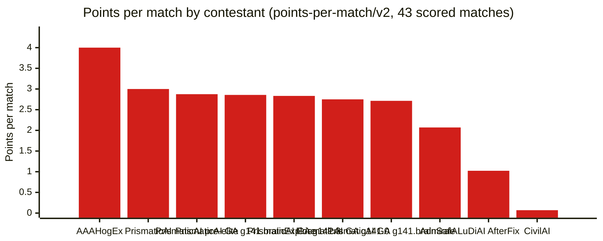
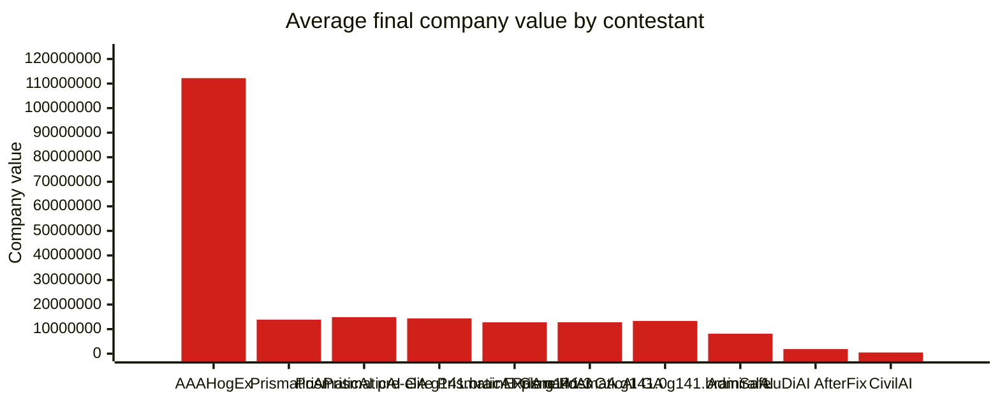
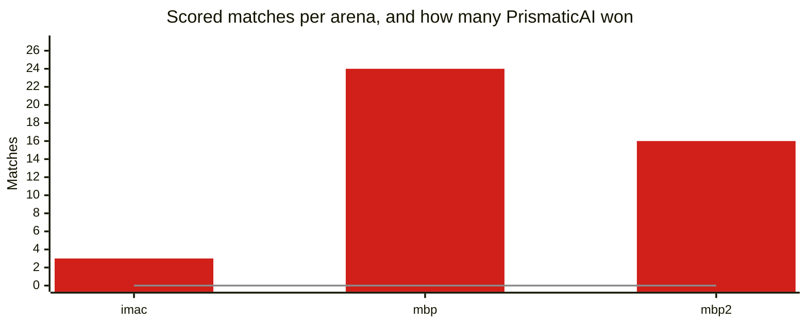

# battle-20261120T123448-fbeba352

Derived from `battle-20261120T123448-fbeba352.json` by `tools/research/ai-battle/battle.py report`; do not edit.

- Edition `fbeba3522a1c4f06`: PrismaticAI and referee at `2cab9e0314edf484880fedf08e9fc11d63d5357c`, base set `opengfx-8.0.tar`
- 20-year free-for-all from 1960, map 256x256 temperate, breakdowns 1
- 43 scored match(es) on `imac` (20261119-master-gdf1e05e7d8), `mbp` (20261120-master-m17653b726e), `mbp2` (20261119-master-gdf1e05e7d8)
- Replays: 0 of 0 identical to their original on another arena

| # | Contestant | Played | Wins | Points | Points/match | Avg rank | Avg final value | Squirrel errors | Matches with anomalies |
|---|---|---|---|---|---|---|---|---|---|
| 1 | AAAHogEx | 43 | 43 | 172 | 4.0 | 1.0 | 112.2 M | 0 | 0 |
| 2 | PrismaticAI | 7 | 0 | 21 | 3.0 | 2.0 | 13.9 M | 0 | 2 |
| 3 | PrismaticAI pre-elite | 8 | 0 | 23 | 2.875 | 2.12 | 14.9 M | 0 | 0 |
| 4 | PrismaticAI GA g141.brainExplore | 7 | 0 | 20 | 2.857 | 2.14 | 14.4 M | 0 | 3 |
| 5 | PrismaticAI GA g141.3 | 6 | 0 | 17 | 2.833 | 2.17 | 12.8 M | 0 | 5 |
| 6 | PrismaticAI GA g141.0 | 8 | 0 | 22 | 2.75 | 2.25 | 12.8 M | 0 | 3 |
| 7 | PrismaticAI GA g141.brainSafe | 7 | 0 | 19 | 2.714 | 2.29 | 13.3 M | 0 | 1 |
| 8 | AdmiralAI | 43 | 0 | 89 | 2.07 | 2.93 | 8.1 M | 0 | 1 |
| 9 | LuDiAI AfterFix | 43 | 0 | 44 | 1.023 | 3.98 | 1.9 M | 0 | 0 |
| 10 | CivilAI | 43 | 0 | 3 | 0.07 | 4.93 | 478.7 k | 0 | 4 |

```mermaid
---
config:
  xyChart:
    width: 900
    height: 360
  themeVariables:
    xyChart:
      plotColorPalette: "#d11f1a, #8a8a8a, #0b0b0b, #ece4d6"
---
xychart-beta
    title "Final company value per scored match: winner vs best PrismaticAI"
    x-axis ["m-0001", "m-0002", "m-0003", "m-0004", "m-0005", "m-0006", "m-0007", "m-0008", "m-0009", "m-0010", "m-0011", "m-0012", "m-0013", "m-0014", "m-0015", "m-0016", "m-0017", "m-0018", "m-0019", "m-0020", "m-0021", "m-0022", "m-0023", "m-0024", "m-0025", "m-0026", "m-0027", "m-0028", "m-0036", "m-0037", "m-0038", "m-0039", "m-0040", "m-0041", "m-0042", "m-0043", "m-0044", "m-0045", "m-0046", "m-0047", "m-0048", "m-0049", "m-0050"]
    %% series: Winner | Best PrismaticAI
    %% links: battle-20261120T123448-fbeba352.md?col=Match&filter=m-0001 | battle-20261120T123448-fbeba352.md?col=Match&filter=m-0002 | battle-20261120T123448-fbeba352.md?col=Match&filter=m-0003 | battle-20261120T123448-fbeba352.md?col=Match&filter=m-0004 | battle-20261120T123448-fbeba352.md?col=Match&filter=m-0005 | battle-20261120T123448-fbeba352.md?col=Match&filter=m-0006 | battle-20261120T123448-fbeba352.md?col=Match&filter=m-0007 | battle-20261120T123448-fbeba352.md?col=Match&filter=m-0008 | battle-20261120T123448-fbeba352.md?col=Match&filter=m-0009 | battle-20261120T123448-fbeba352.md?col=Match&filter=m-0010 | battle-20261120T123448-fbeba352.md?col=Match&filter=m-0011 | battle-20261120T123448-fbeba352.md?col=Match&filter=m-0012 | battle-20261120T123448-fbeba352.md?col=Match&filter=m-0013 | battle-20261120T123448-fbeba352.md?col=Match&filter=m-0014 | battle-20261120T123448-fbeba352.md?col=Match&filter=m-0015 | battle-20261120T123448-fbeba352.md?col=Match&filter=m-0016 | battle-20261120T123448-fbeba352.md?col=Match&filter=m-0017 | battle-20261120T123448-fbeba352.md?col=Match&filter=m-0018 | battle-20261120T123448-fbeba352.md?col=Match&filter=m-0019 | battle-20261120T123448-fbeba352.md?col=Match&filter=m-0020 | battle-20261120T123448-fbeba352.md?col=Match&filter=m-0021 | battle-20261120T123448-fbeba352.md?col=Match&filter=m-0022 | battle-20261120T123448-fbeba352.md?col=Match&filter=m-0023 | battle-20261120T123448-fbeba352.md?col=Match&filter=m-0024 | battle-20261120T123448-fbeba352.md?col=Match&filter=m-0025 | battle-20261120T123448-fbeba352.md?col=Match&filter=m-0026 | battle-20261120T123448-fbeba352.md?col=Match&filter=m-0027 | battle-20261120T123448-fbeba352.md?col=Match&filter=m-0028 | battle-20261120T123448-fbeba352.md?col=Match&filter=m-0036 | battle-20261120T123448-fbeba352.md?col=Match&filter=m-0037 | battle-20261120T123448-fbeba352.md?col=Match&filter=m-0038 | battle-20261120T123448-fbeba352.md?col=Match&filter=m-0039 | battle-20261120T123448-fbeba352.md?col=Match&filter=m-0040 | battle-20261120T123448-fbeba352.md?col=Match&filter=m-0041 | battle-20261120T123448-fbeba352.md?col=Match&filter=m-0042 | battle-20261120T123448-fbeba352.md?col=Match&filter=m-0043 | battle-20261120T123448-fbeba352.md?col=Match&filter=m-0044 | battle-20261120T123448-fbeba352.md?col=Match&filter=m-0045 | battle-20261120T123448-fbeba352.md?col=Match&filter=m-0046 | battle-20261120T123448-fbeba352.md?col=Match&filter=m-0047 | battle-20261120T123448-fbeba352.md?col=Match&filter=m-0048 | battle-20261120T123448-fbeba352.md?col=Match&filter=m-0049 | battle-20261120T123448-fbeba352.md?col=Match&filter=m-0050
    y-axis "Company value" 0 --> 193000000
    bar [162056361, 164795092, 175642845, 167323315, 171036454, 80193184, 94351246, 90722291, 107016695, 106955539, 98426567, 120905618, 92319620, 114517423, 118950863, 102437650, 91009377, 102267242, 96267971, 105346222, 111658605, 105348795, 102785397, 119610616, 116018138, 103609819, 92905016, 128544337, 134618665, 113933983, 125595756, 101107136, 123306764, 109445658, 110566610, 119336769, 79562388, 87187741, 85214789, 100787371, 83481843, 88441223, 119116001]
    line [24105663, 16749297, 21285376, 17285132, 18716196, 12788058, 15649857, 7666254, 9091245, 11033555, 8489881, 8929339, 8255001, 13657869, 6674173, 14766253, 11538520, 11782194, 15746523, 15084627, 13564363, 11839708, 14558364, 20745410, 16639606, 11062100, 16936498, 11264181, 13593918, 13247425, 12581128, 14674427, 21149552, 12562569, 9506830, 10207248, 8242849, 11038289, 13203502, 10745182, 19651957, 15072983, 17269881]
```

<!-- battle-charts:begin -->
<!-- derived from battle-20261120T123448-fbeba352.json by `battle.py render`; `battle.py check` fails when it is stale -->

<!-- battle-charts:end -->

| Match | Arena | Seed | Winner | Value | Last | Anomalies |
|---|---|---|---|---|---|---|
| m-0001 | mbp | 234152319 | AAAHogEx | 162.1 M | CivilAI | - |
| m-0002 | mbp | 234152319 | AAAHogEx | 164.8 M | CivilAI | PrismaticAI GA g141.0: fleet_drop:120->48 |
| m-0003 | mbp | 234152319 | AAAHogEx | 175.6 M | CivilAI | - |
| m-0004 | mbp | 234152319 | AAAHogEx | 167.3 M | CivilAI | PrismaticAI GA g141.brainExplore: fleet_drop:175->73; CivilAI: fleet_drop:34->18 |
| m-0005 | mbp | 234152319 | AAAHogEx | 171.0 M | LuDiAI AfterFix | PrismaticAI GA g141.3: fleet_drop:185->98 |
| m-0006 | mbp | 1073441966 | AAAHogEx | 80.2 M | LuDiAI AfterFix | PrismaticAI: fleet_drop:90->53 |
| m-0007 | mbp | 1073441966 | AAAHogEx | 94.4 M | CivilAI | - |
| m-0008 | mbp | 1073441966 | AAAHogEx | 90.7 M | CivilAI | - |
| m-0009 | mbp | 1073441966 | AAAHogEx | 107.0 M | CivilAI | - |
| m-0010 | imac | 1073441966 | AAAHogEx | 107.0 M | CivilAI | - |
| m-0011 | imac | 1073441966 | AAAHogEx | 98.4 M | CivilAI | PrismaticAI GA g141.3: fleet_drop:92->49 |
| m-0012 | imac | 530834448 | AAAHogEx | 120.9 M | CivilAI | - |
| m-0013 | mbp2 | 530834448 | AAAHogEx | 92.3 M | CivilAI | - |
| m-0014 | mbp2 | 530834448 | AAAHogEx | 114.5 M | CivilAI | - |
| m-0015 | mbp2 | 530834448 | AAAHogEx | 119.0 M | CivilAI | - |
| m-0016 | mbp2 | 530834448 | AAAHogEx | 102.4 M | CivilAI | - |
| m-0017 | mbp2 | 530834448 | AAAHogEx | 91.0 M | CivilAI | - |
| m-0018 | mbp2 | 1296431084 | AAAHogEx | 102.3 M | CivilAI | - |
| m-0019 | mbp2 | 1296431084 | AAAHogEx | 96.3 M | CivilAI | - |
| m-0020 | mbp2 | 1296431084 | AAAHogEx | 105.3 M | CivilAI | - |
| m-0021 | mbp2 | 1296431084 | AAAHogEx | 111.7 M | CivilAI | - |
| m-0022 | mbp2 | 1296431084 | AAAHogEx | 105.3 M | LuDiAI AfterFix | - |
| m-0023 | mbp2 | 1296431084 | AAAHogEx | 102.8 M | CivilAI | PrismaticAI GA g141.3: fleet_drop:108->72 |
| m-0024 | mbp2 | 1401777586 | AAAHogEx | 119.6 M | CivilAI | - |
| m-0025 | mbp2 | 1401777586 | AAAHogEx | 116.0 M | CivilAI | - |
| m-0026 | mbp2 | 1401777586 | AAAHogEx | 103.6 M | CivilAI | PrismaticAI GA g141.0: fleet_drop:75->31 |
| m-0027 | mbp2 | 1401777586 | AAAHogEx | 92.9 M | CivilAI | PrismaticAI GA g141.brainSafe: fleet_drop:59->40 |
| m-0028 | mbp2 | 1401777586 | AAAHogEx | 128.5 M | CivilAI | PrismaticAI GA g141.brainExplore: fleet_drop:131->48 |
| m-0036 | mbp | 815101236 | AAAHogEx | 134.6 M | CivilAI | PrismaticAI: fleet_drop:109->69 |
| m-0037 | mbp | 815101236 | AAAHogEx | 113.9 M | CivilAI | CivilAI: no_vehicles |
| m-0038 | mbp | 815101236 | AAAHogEx | 125.6 M | CivilAI | - |
| m-0039 | mbp | 815101236 | AAAHogEx | 101.1 M | CivilAI | - |
| m-0040 | mbp | 815101236 | AAAHogEx | 123.3 M | CivilAI | PrismaticAI GA g141.brainExplore: fleet_drop:116->76 |
| m-0041 | mbp | 815101236 | AAAHogEx | 109.4 M | CivilAI | PrismaticAI GA g141.3: fleet_drop:97->58 |
| m-0042 | mbp | 978798757 | AAAHogEx | 110.6 M | CivilAI | CivilAI: no_vehicles |
| m-0043 | mbp | 978798757 | AAAHogEx | 119.3 M | CivilAI | - |
| m-0044 | mbp | 978798757 | AAAHogEx | 79.6 M | CivilAI | - |
| m-0045 | mbp | 978798757 | AAAHogEx | 87.2 M | CivilAI | CivilAI: fleet_drop:28->8 |
| m-0046 | mbp | 978798757 | AAAHogEx | 85.2 M | CivilAI | AdmiralAI: fleet_drop:334->213 |
| m-0047 | mbp | 978798757 | AAAHogEx | 100.8 M | CivilAI | PrismaticAI GA g141.3: fleet_drop:109->59 |
| m-0048 | mbp | 1608273438 | AAAHogEx | 83.5 M | CivilAI | - |
| m-0049 | mbp | 1608273438 | AAAHogEx | 88.4 M | CivilAI | - |
| m-0050 | mbp | 1608273438 | AAAHogEx | 119.1 M | CivilAI | PrismaticAI GA g141.0: fleet_drop:86->60 |
