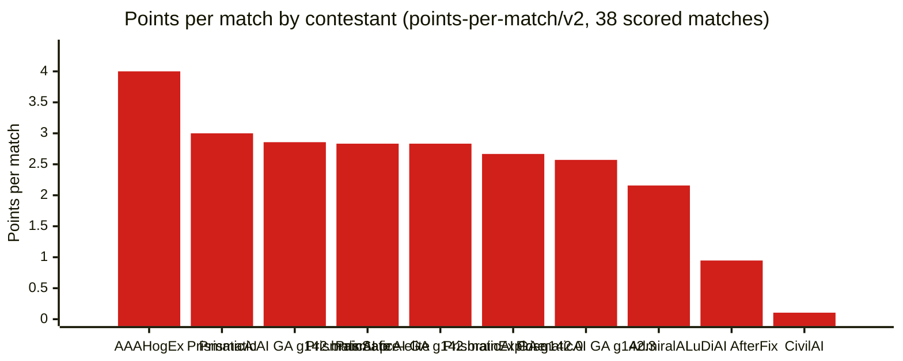
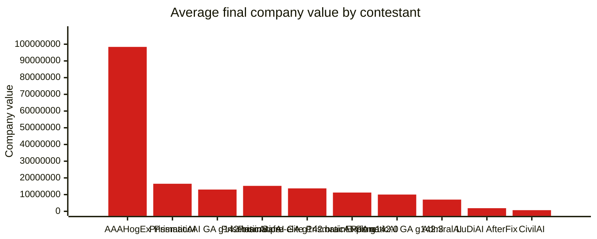
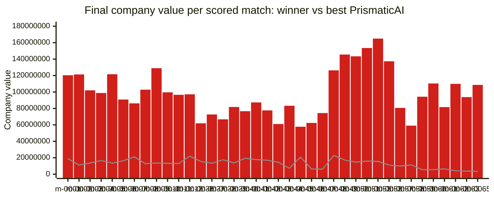
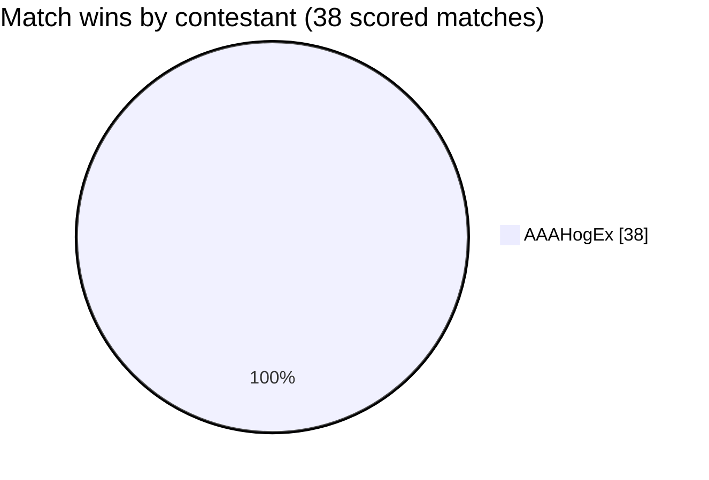
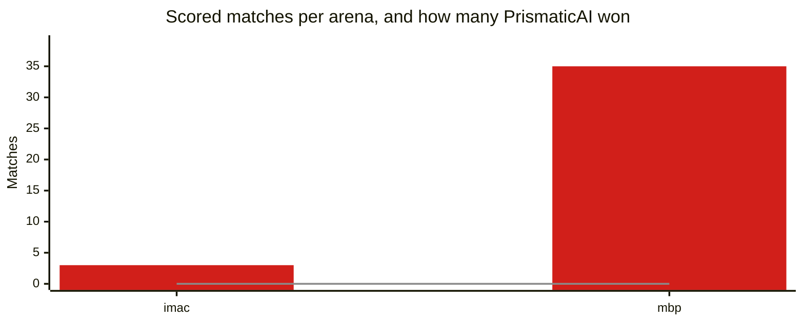

# battle-20261120T131501-dc2a82a9

Derived from `battle-20261120T131501-dc2a82a9.json` by `tools/research/ai-battle/battle.py report`; do not edit.

- Edition `dc2a82a92a2ca74e`: PrismaticAI and referee at `2cab9e0314edf484880fedf08e9fc11d63d5357c`, base set `opengfx-8.0.tar`
- 20-year free-for-all from 1960, map 256x256 temperate, breakdowns 1
- 38 scored match(es) on `imac` (20261119-master-gdf1e05e7d8), `mbp` (20261120-master-m17653b726e)
- Replays: 0 of 1 identical to their original on another arena

| # | Contestant | Played | Wins | Points | Points/match | Avg rank | Avg final value | Squirrel errors | Matches with anomalies |
|---|---|---|---|---|---|---|---|---|---|
| 1 | AAAHogEx | 38 | 38 | 152 | 4.0 | 1.0 | 98.4 M | 0 | 0 |
| 2 | PrismaticAI | 6 | 0 | 18 | 3.0 | 2.0 | 16.5 M | 0 | 2 |
| 3 | PrismaticAI GA g142.brainSafe | 7 | 0 | 20 | 2.857 | 2.14 | 13.0 M | 0 | 4 |
| 4 | PrismaticAI pre-elite | 6 | 0 | 17 | 2.833 | 2.17 | 15.2 M | 0 | 0 |
| 5 | PrismaticAI GA g142.brainExplore | 6 | 0 | 17 | 2.833 | 2.17 | 13.7 M | 0 | 0 |
| 6 | PrismaticAI GA g142.0 | 6 | 0 | 16 | 2.667 | 2.33 | 11.2 M | 0 | 4 |
| 7 | PrismaticAI GA g142.3 | 7 | 0 | 18 | 2.571 | 2.43 | 10.0 M | 0 | 2 |
| 8 | AdmiralAI | 38 | 0 | 82 | 2.158 | 2.84 | 7.0 M | 0 | 1 |
| 9 | LuDiAI AfterFix | 38 | 0 | 36 | 0.947 | 4.05 | 1.9 M | 0 | 1 |
| 10 | CivilAI | 38 | 0 | 4 | 0.105 | 4.89 | 685.7 k | 3665 | 6 |

<!-- battle-charts:begin -->
<!-- derived from battle-20261120T131501-dc2a82a9.json by `battle.py render`; `battle.py check` fails when it is stale -->

<!-- battle-charts:end -->

| Seed | Original | Replay | Arenas | Identical |
|---|---|---|---|---|
| 1408739273 | m-0010 | m-0064 | imac / mbp | NO |

| Match | Arena | Seed | Winner | Value | Last | Anomalies |
|---|---|---|---|---|---|---|
| m-0001 | mbp | 1013410802 | AAAHogEx | 120.4 M | CivilAI | - |
| m-0002 | mbp | 1013410802 | AAAHogEx | 121.3 M | CivilAI | - |
| m-0003 | mbp | 1013410802 | AAAHogEx | 102.0 M | CivilAI | PrismaticAI GA g142.brainSafe: fleet_drop:93->61 |
| m-0004 | mbp | 1013410802 | AAAHogEx | 98.8 M | LuDiAI AfterFix | - |
| m-0005 | mbp | 1013410802 | AAAHogEx | 121.6 M | CivilAI | PrismaticAI GA g142.3: fleet_drop:123->52 |
| m-0006 | mbp | 1408739273 | AAAHogEx | 90.8 M | CivilAI | PrismaticAI: fleet_drop:114->63; CivilAI: fleet_drop:49->6 |
| m-0007 | mbp | 1408739273 | AAAHogEx | 86.2 M | CivilAI | - |
| m-0008 | mbp | 1408739273 | AAAHogEx | 102.8 M | CivilAI | PrismaticAI GA g142.0: fleet_drop:96->38 |
| m-0009 | mbp | 1408739273 | AAAHogEx | 129.0 M | CivilAI | PrismaticAI GA g142.brainSafe: fleet_drop:65->30 |
| m-0010 | imac | 1408739273 | AAAHogEx | 99.6 M | CivilAI | CivilAI: fleet_drop:41->20 |
| m-0011 | imac | 1408739273 | AAAHogEx | 96.6 M | CivilAI | PrismaticAI GA g142.3: fleet_drop:91->53 |
| m-0012 | imac | 175279869 | AAAHogEx | 97.2 M | CivilAI | PrismaticAI: fleet_drop:104->60; CivilAI: fleet_drop:55->38 |
| m-0036 | mbp | 687874934 | AAAHogEx | 61.9 M | CivilAI | - |
| m-0037 | mbp | 687874934 | AAAHogEx | 72.7 M | CivilAI | - |
| m-0038 | mbp | 687874934 | AAAHogEx | 66.7 M | CivilAI | PrismaticAI GA g142.0: fleet_drop:104->47 |
| m-0039 | mbp | 687874934 | AAAHogEx | 81.8 M | CivilAI | - |
| m-0040 | mbp | 687874934 | AAAHogEx | 76.6 M | CivilAI | - |
| m-0041 | mbp | 687874934 | AAAHogEx | 87.3 M | CivilAI | - |
| m-0042 | mbp | 353022817 | AAAHogEx | 77.6 M | CivilAI | - |
| m-0043 | mbp | 353022817 | AAAHogEx | 61.0 M | LuDiAI AfterFix | - |
| m-0044 | mbp | 353022817 | AAAHogEx | 83.2 M | CivilAI | PrismaticAI GA g142.0: fleet_drop:99->51 |
| m-0045 | mbp | 353022817 | AAAHogEx | 57.7 M | CivilAI | - |
| m-0046 | mbp | 353022817 | AAAHogEx | 62.4 M | CivilAI | - |
| m-0047 | mbp | 353022817 | AAAHogEx | 74.4 M | CivilAI | - |
| m-0048 | mbp | 1124960111 | AAAHogEx | 126.3 M | CivilAI | - |
| m-0049 | mbp | 1124960111 | AAAHogEx | 145.6 M | CivilAI | CivilAI: squirrel_errors:3665 |
| m-0050 | mbp | 1124960111 | AAAHogEx | 143.4 M | CivilAI | CivilAI: fleet_drop:59->24 |
| m-0051 | mbp | 1124960111 | AAAHogEx | 153.5 M | CivilAI | PrismaticAI GA g142.brainSafe: fleet_drop:151->82 |
| m-0052 | mbp | 1124960111 | AAAHogEx | 165.0 M | LuDiAI AfterFix | - |
| m-0053 | mbp | 1124960111 | AAAHogEx | 137.4 M | LuDiAI AfterFix | - |
| m-0057 | mbp | 1172564182 | AAAHogEx | 80.7 M | CivilAI | PrismaticAI GA g142.brainSafe: fleet_drop:64->27; LuDiAI AfterFix: fleet_drop:144->96 |
| m-0058 | mbp | 1172564182 | AAAHogEx | 59.1 M | CivilAI | - |
| m-0059 | mbp | 1172564182 | AAAHogEx | 94.3 M | CivilAI | CivilAI: no_vehicles |
| m-0060 | mbp | 254927416 | AAAHogEx | 110.4 M | CivilAI | - |
| m-0061 | mbp | 254927416 | AAAHogEx | 81.6 M | CivilAI | AdmiralAI: fleet_drop:459->316 |
| m-0062 | mbp | 254927416 | AAAHogEx | 109.9 M | CivilAI | PrismaticAI GA g142.0: fleet_drop:72->46 |
| m-0063 | mbp | 254927416 | AAAHogEx | 93.8 M | CivilAI | - |
| m-0064 (replay) | mbp | 1408739273 | AAAHogEx | 115.2 M | CivilAI | CivilAI: fleet_drop:31->18 |
| m-0065 | mbp | 254927416 | AAAHogEx | 108.6 M | CivilAI | - |
