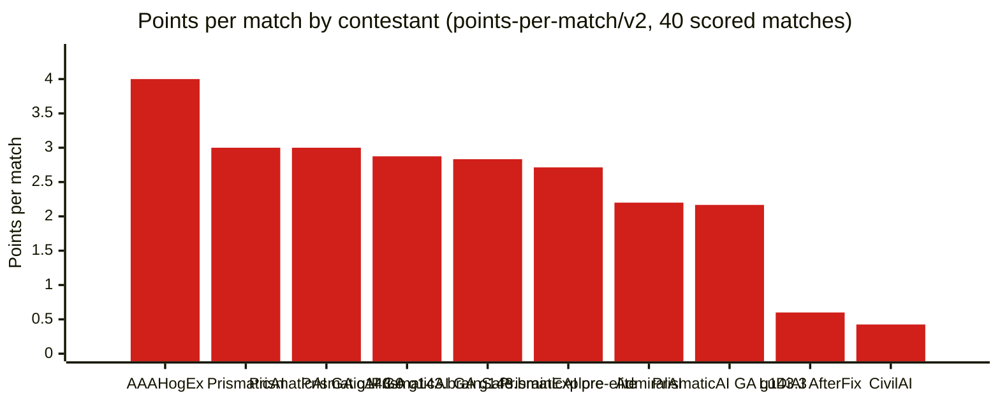
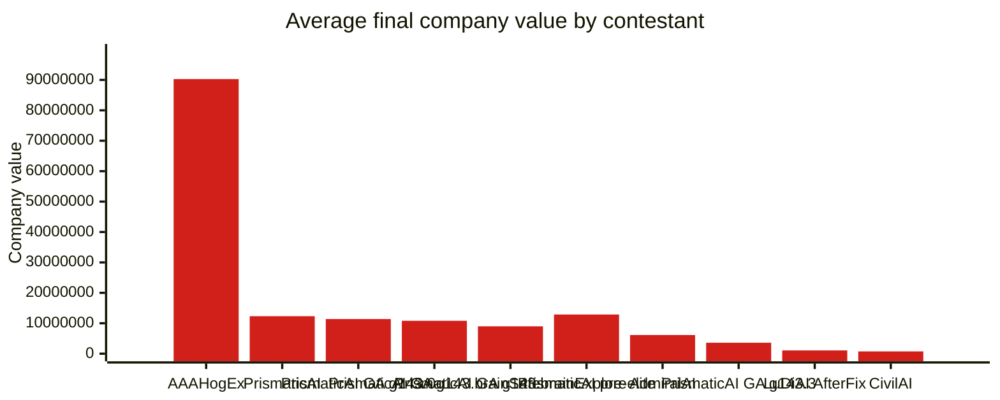
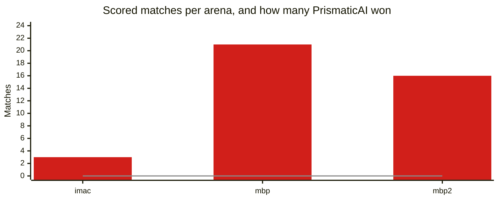

# battle-20261120T132354-9168d156

Derived from `battle-20261120T132354-9168d156.json` by `tools/research/ai-battle/battle.py report`; do not edit.

- Edition `9168d1560da604da`: PrismaticAI and referee at `2cab9e0314edf484880fedf08e9fc11d63d5357c`, base set `opengfx-8.0.tar`
- 20-year free-for-all from 1960, map 256x256 temperate, breakdowns 1
- 40 scored match(es) on `imac` (20261119-master-gdf1e05e7d8), `mbp` (20261120-master-m17653b726e), `mbp2` (20261119-master-gdf1e05e7d8)
- Replays: 0 of 0 identical to their original on another arena

| # | Contestant | Played | Wins | Points | Points/match | Avg rank | Avg final value | Squirrel errors | Matches with anomalies |
|---|---|---|---|---|---|---|---|---|---|
| 1 | AAAHogEx | 40 | 40 | 160 | 4.0 | 1.0 | 90.3 M | 0 | 0 |
| 2 | PrismaticAI | 6 | 0 | 18 | 3.0 | 2.0 | 12.3 M | 0 | 4 |
| 3 | PrismaticAI GA g143.0 | 7 | 0 | 21 | 3.0 | 2.0 | 11.4 M | 0 | 0 |
| 4 | PrismaticAI GA g143.brainSafe | 8 | 0 | 23 | 2.875 | 2.12 | 10.8 M | 0 | 4 |
| 5 | PrismaticAI GA g143.brainExplore | 6 | 0 | 17 | 2.833 | 2.17 | 9.0 M | 0 | 0 |
| 6 | PrismaticAI pre-elite | 7 | 0 | 19 | 2.714 | 2.29 | 12.9 M | 0 | 0 |
| 7 | AdmiralAI | 40 | 0 | 88 | 2.2 | 2.8 | 6.1 M | 0 | 0 |
| 8 | PrismaticAI GA g143.3 | 6 | 0 | 13 | 2.167 | 2.83 | 3.6 M | 0 | 0 |
| 9 | LuDiAI AfterFix | 40 | 0 | 24 | 0.6 | 4.4 | 1.1 M | 0 | 3 |
| 10 | CivilAI | 40 | 0 | 17 | 0.425 | 4.58 | 744.3 k | 3730 | 8 |

```mermaid
---
config:
  xyChart:
    width: 900
    height: 360
  themeVariables:
    xyChart:
      plotColorPalette: "#d11f1a, #8a8a8a, #0b0b0b, #ece4d6"
---
xychart-beta
    title "Final company value per scored match: winner vs best PrismaticAI"
    x-axis ["m-0001", "m-0002", "m-0003", "m-0004", "m-0005", "m-0006", "m-0007", "m-0008", "m-0009", "m-0010", "m-0011", "m-0012", "m-0013", "m-0014", "m-0015", "m-0016", "m-0017", "m-0018", "m-0019", "m-0020", "m-0021", "m-0022", "m-0023", "m-0024", "m-0025", "m-0026", "m-0027", "m-0028", "m-0036", "m-0037", "m-0038", "m-0039", "m-0040", "m-0041", "m-0042", "m-0043", "m-0044", "m-0045", "m-0051", "m-0053"]
    %% series: Winner | Best PrismaticAI
    %% links: battle-20261120T132354-9168d156.md?col=Match&filter=m-0001 | battle-20261120T132354-9168d156.md?col=Match&filter=m-0002 | battle-20261120T132354-9168d156.md?col=Match&filter=m-0003 | battle-20261120T132354-9168d156.md?col=Match&filter=m-0004 | battle-20261120T132354-9168d156.md?col=Match&filter=m-0005 | battle-20261120T132354-9168d156.md?col=Match&filter=m-0006 | battle-20261120T132354-9168d156.md?col=Match&filter=m-0007 | battle-20261120T132354-9168d156.md?col=Match&filter=m-0008 | battle-20261120T132354-9168d156.md?col=Match&filter=m-0009 | battle-20261120T132354-9168d156.md?col=Match&filter=m-0010 | battle-20261120T132354-9168d156.md?col=Match&filter=m-0011 | battle-20261120T132354-9168d156.md?col=Match&filter=m-0012 | battle-20261120T132354-9168d156.md?col=Match&filter=m-0013 | battle-20261120T132354-9168d156.md?col=Match&filter=m-0014 | battle-20261120T132354-9168d156.md?col=Match&filter=m-0015 | battle-20261120T132354-9168d156.md?col=Match&filter=m-0016 | battle-20261120T132354-9168d156.md?col=Match&filter=m-0017 | battle-20261120T132354-9168d156.md?col=Match&filter=m-0018 | battle-20261120T132354-9168d156.md?col=Match&filter=m-0019 | battle-20261120T132354-9168d156.md?col=Match&filter=m-0020 | battle-20261120T132354-9168d156.md?col=Match&filter=m-0021 | battle-20261120T132354-9168d156.md?col=Match&filter=m-0022 | battle-20261120T132354-9168d156.md?col=Match&filter=m-0023 | battle-20261120T132354-9168d156.md?col=Match&filter=m-0024 | battle-20261120T132354-9168d156.md?col=Match&filter=m-0025 | battle-20261120T132354-9168d156.md?col=Match&filter=m-0026 | battle-20261120T132354-9168d156.md?col=Match&filter=m-0027 | battle-20261120T132354-9168d156.md?col=Match&filter=m-0028 | battle-20261120T132354-9168d156.md?col=Match&filter=m-0036 | battle-20261120T132354-9168d156.md?col=Match&filter=m-0037 | battle-20261120T132354-9168d156.md?col=Match&filter=m-0038 | battle-20261120T132354-9168d156.md?col=Match&filter=m-0039 | battle-20261120T132354-9168d156.md?col=Match&filter=m-0040 | battle-20261120T132354-9168d156.md?col=Match&filter=m-0041 | battle-20261120T132354-9168d156.md?col=Match&filter=m-0042 | battle-20261120T132354-9168d156.md?col=Match&filter=m-0043 | battle-20261120T132354-9168d156.md?col=Match&filter=m-0044 | battle-20261120T132354-9168d156.md?col=Match&filter=m-0045 | battle-20261120T132354-9168d156.md?col=Match&filter=m-0051 | battle-20261120T132354-9168d156.md?col=Match&filter=m-0053
    y-axis "Company value" 0 --> 222000000
    bar [85977214, 92313678, 74420553, 86229488, 108388584, 63319627, 47202503, 54078278, 56622430, 66501918, 73036609, 156805613, 124986639, 140563850, 154934767, 129228085, 201843953, 109637161, 84475447, 96486511, 71154403, 103892755, 76680470, 76437506, 83490645, 84859225, 81575598, 69485543, 76098438, 77985639, 65461376, 94527062, 87294535, 77127520, 59191205, 62999827, 54080191, 70270366, 98738538, 132366985]
    line [15409202, 5597085, 8297249, 10160270, 2553518, 8371191, 6956771, 10167525, 9106193, 7295761, 2068147, 24795992, 19914540, 22049724, 15086316, 18256050, 3325320, 4659851, 7558457, 8118755, 8467803, 6525133, 1282499, 14553750, 15436476, 7626548, 12667497, 6547277, 13710288, 19846616, 12011035, 10251347, 5138782, 9335415, 7806772, 5008259, 14152044, 9825432, 12727328, 3021635]
```

<!-- battle-charts:begin -->
<!-- derived from battle-20261120T132354-9168d156.json by `battle.py render`; `battle.py check` fails when it is stale -->

<!-- battle-charts:end -->

| Match | Arena | Seed | Winner | Value | Last | Anomalies |
|---|---|---|---|---|---|---|
| m-0001 | mbp | 256681628 | AAAHogEx | 86.0 M | CivilAI | - |
| m-0002 | mbp | 256681628 | AAAHogEx | 92.3 M | CivilAI | - |
| m-0003 | mbp | 256681628 | AAAHogEx | 74.4 M | CivilAI | PrismaticAI GA g143.brainSafe: fleet_drop:104->66 |
| m-0004 | mbp | 256681628 | AAAHogEx | 86.2 M | LuDiAI AfterFix | CivilAI: fleet_drop:64->43 |
| m-0005 | mbp | 256681628 | AAAHogEx | 108.4 M | CivilAI | - |
| m-0006 | mbp | 1254394244 | AAAHogEx | 63.3 M | LuDiAI AfterFix | - |
| m-0007 | mbp | 1254394244 | AAAHogEx | 47.2 M | LuDiAI AfterFix | - |
| m-0008 | mbp | 1254394244 | AAAHogEx | 54.1 M | LuDiAI AfterFix | - |
| m-0009 | mbp | 1254394244 | AAAHogEx | 56.6 M | LuDiAI AfterFix | - |
| m-0010 | imac | 1254394244 | AAAHogEx | 66.5 M | LuDiAI AfterFix | LuDiAI AfterFix: fleet_drop:38->24 |
| m-0011 | imac | 1254394244 | AAAHogEx | 73.0 M | LuDiAI AfterFix | - |
| m-0012 | imac | 104760850 | AAAHogEx | 156.8 M | CivilAI | PrismaticAI: fleet_drop:162->84 |
| m-0013 | mbp2 | 104760850 | AAAHogEx | 125.0 M | LuDiAI AfterFix | - |
| m-0014 | mbp2 | 104760850 | AAAHogEx | 140.6 M | CivilAI | - |
| m-0015 | mbp2 | 104760850 | AAAHogEx | 154.9 M | LuDiAI AfterFix | CivilAI: squirrel_errors:3730 |
| m-0016 | mbp2 | 104760850 | AAAHogEx | 129.2 M | LuDiAI AfterFix | - |
| m-0017 | mbp2 | 104760850 | AAAHogEx | 201.8 M | CivilAI | CivilAI: fleet_drop:23->16 |
| m-0018 | mbp2 | 1744401419 | AAAHogEx | 109.6 M | CivilAI | PrismaticAI: fleet_drop:66->42 |
| m-0019 | mbp2 | 1744401419 | AAAHogEx | 84.5 M | LuDiAI AfterFix | - |
| m-0020 | mbp2 | 1744401419 | AAAHogEx | 96.5 M | CivilAI | CivilAI: fleet_drop:10->6 |
| m-0021 | mbp2 | 1744401419 | AAAHogEx | 71.2 M | LuDiAI AfterFix | PrismaticAI GA g143.brainSafe: fleet_drop:84->45 |
| m-0022 | mbp2 | 1744401419 | AAAHogEx | 103.9 M | CivilAI | CivilAI: fleet_drop:15->7 |
| m-0023 | mbp2 | 1744401419 | AAAHogEx | 76.7 M | LuDiAI AfterFix | - |
| m-0024 | mbp2 | 1803976288 | AAAHogEx | 76.4 M | CivilAI | - |
| m-0025 | mbp2 | 1803976288 | AAAHogEx | 83.5 M | CivilAI | - |
| m-0026 | mbp2 | 1803976288 | AAAHogEx | 84.9 M | LuDiAI AfterFix | - |
| m-0027 | mbp2 | 1803976288 | AAAHogEx | 81.6 M | CivilAI | - |
| m-0028 | mbp2 | 1803976288 | AAAHogEx | 69.5 M | CivilAI | - |
| m-0036 | mbp | 1066512405 | AAAHogEx | 76.1 M | CivilAI | PrismaticAI: fleet_drop:70->35 |
| m-0037 | mbp | 1066512405 | AAAHogEx | 78.0 M | CivilAI | - |
| m-0038 | mbp | 1066512405 | AAAHogEx | 65.5 M | CivilAI | CivilAI: fleet_drop:61->42 |
| m-0039 | mbp | 1066512405 | AAAHogEx | 94.5 M | CivilAI | PrismaticAI GA g143.brainSafe: fleet_drop:153->93 |
| m-0040 | mbp | 1066512405 | AAAHogEx | 87.3 M | CivilAI | CivilAI: fleet_drop:12->7 |
| m-0041 | mbp | 1066512405 | AAAHogEx | 77.1 M | CivilAI | CivilAI: fleet_drop:35->18 |
| m-0042 | mbp | 550143433 | AAAHogEx | 59.2 M | CivilAI | PrismaticAI: fleet_drop:88->55; LuDiAI AfterFix: fleet_drop:173->118 |
| m-0043 | mbp | 550143433 | AAAHogEx | 63.0 M | CivilAI | - |
| m-0044 | mbp | 550143433 | AAAHogEx | 54.1 M | CivilAI | - |
| m-0045 | mbp | 550143433 | AAAHogEx | 70.3 M | LuDiAI AfterFix | LuDiAI AfterFix: no_vehicles |
| m-0051 | mbp | 1905626766 | AAAHogEx | 98.7 M | LuDiAI AfterFix | PrismaticAI GA g143.brainSafe: fleet_drop:88->55 |
| m-0053 | mbp | 1905626766 | AAAHogEx | 132.4 M | LuDiAI AfterFix | - |
