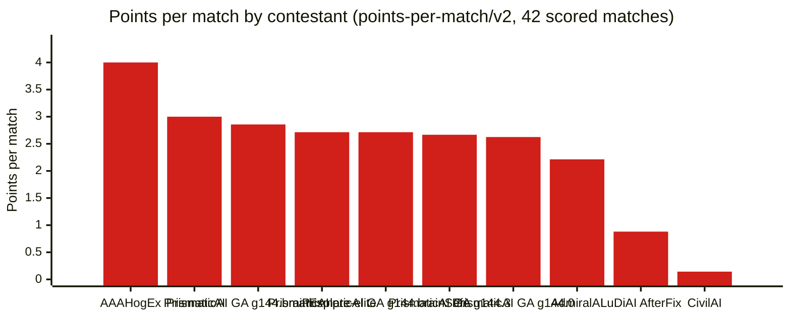
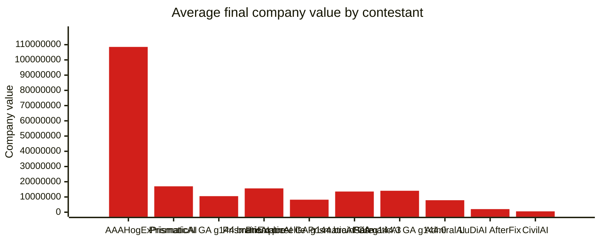
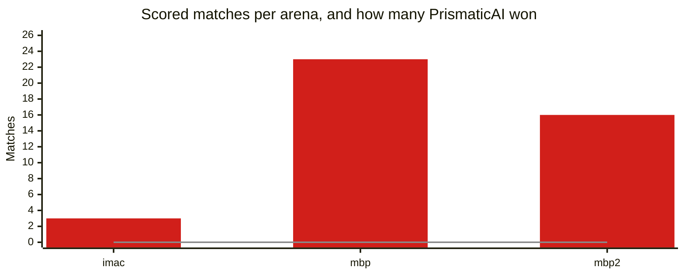

# battle-20261120T133457-d8a58668

Derived from `battle-20261120T133457-d8a58668.json` by `tools/research/ai-battle/battle.py report`; do not edit.

- Edition `d8a5866891e3bae5`: PrismaticAI and referee at `2cab9e0314edf484880fedf08e9fc11d63d5357c`, base set `opengfx-8.0.tar`
- 20-year free-for-all from 1960, map 256x256 temperate, breakdowns 1
- 42 scored match(es) on `imac` (20261119-master-gdf1e05e7d8), `mbp` (20261120-master-m17653b726e), `mbp2` (20261119-master-gdf1e05e7d8)
- Replays: 0 of 1 identical to their original on another arena

| # | Contestant | Played | Wins | Points | Points/match | Avg rank | Avg final value | Squirrel errors | Matches with anomalies |
|---|---|---|---|---|---|---|---|---|---|
| 1 | AAAHogEx | 42 | 42 | 168 | 4.0 | 1.0 | 108.5 M | 0 | 0 |
| 2 | PrismaticAI | 7 | 0 | 21 | 3.0 | 2.0 | 17.0 M | 0 | 4 |
| 3 | PrismaticAI GA g144.brainExplore | 7 | 0 | 20 | 2.857 | 2.14 | 10.5 M | 0 | 1 |
| 4 | PrismaticAI pre-elite | 7 | 0 | 19 | 2.714 | 2.29 | 15.6 M | 0 | 0 |
| 5 | PrismaticAI GA g144.brainSafe | 7 | 0 | 19 | 2.714 | 2.29 | 8.2 M | 0 | 4 |
| 6 | PrismaticAI GA g144.3 | 6 | 0 | 16 | 2.667 | 2.33 | 13.6 M | 0 | 0 |
| 7 | PrismaticAI GA g144.0 | 8 | 0 | 21 | 2.625 | 2.38 | 14.1 M | 0 | 0 |
| 8 | AdmiralAI | 42 | 0 | 93 | 2.214 | 2.79 | 7.9 M | 47 | 2 |
| 9 | LuDiAI AfterFix | 42 | 0 | 37 | 0.881 | 4.12 | 2.0 M | 0 | 1 |
| 10 | CivilAI | 42 | 0 | 6 | 0.143 | 4.86 | 550.2 k | 7293 | 12 |

```mermaid
---
config:
  xyChart:
    width: 900
    height: 360
  themeVariables:
    xyChart:
      plotColorPalette: "#d11f1a, #8a8a8a, #0b0b0b, #ece4d6"
---
xychart-beta
    title "Final company value per scored match: winner vs best PrismaticAI"
    x-axis ["m-0001", "m-0002", "m-0003", "m-0004", "m-0005", "m-0006", "m-0007", "m-0008", "m-0009", "m-0010", "m-0011", "m-0012", "m-0013", "m-0014", "m-0015", "m-0016", "m-0017", "m-0018", "m-0019", "m-0020", "m-0021", "m-0022", "m-0023", "m-0024", "m-0025", "m-0026", "m-0027", "m-0028", "m-0036", "m-0037", "m-0038", "m-0039", "m-0040", "m-0041", "m-0042", "m-0043", "m-0044", "m-0052", "m-0062", "m-0063", "m-0065", "m-0066"]
    %% series: Winner | Best PrismaticAI
    %% links: battle-20261120T133457-d8a58668.md?col=Match&filter=m-0001 | battle-20261120T133457-d8a58668.md?col=Match&filter=m-0002 | battle-20261120T133457-d8a58668.md?col=Match&filter=m-0003 | battle-20261120T133457-d8a58668.md?col=Match&filter=m-0004 | battle-20261120T133457-d8a58668.md?col=Match&filter=m-0005 | battle-20261120T133457-d8a58668.md?col=Match&filter=m-0006 | battle-20261120T133457-d8a58668.md?col=Match&filter=m-0007 | battle-20261120T133457-d8a58668.md?col=Match&filter=m-0008 | battle-20261120T133457-d8a58668.md?col=Match&filter=m-0009 | battle-20261120T133457-d8a58668.md?col=Match&filter=m-0010 | battle-20261120T133457-d8a58668.md?col=Match&filter=m-0011 | battle-20261120T133457-d8a58668.md?col=Match&filter=m-0012 | battle-20261120T133457-d8a58668.md?col=Match&filter=m-0013 | battle-20261120T133457-d8a58668.md?col=Match&filter=m-0014 | battle-20261120T133457-d8a58668.md?col=Match&filter=m-0015 | battle-20261120T133457-d8a58668.md?col=Match&filter=m-0016 | battle-20261120T133457-d8a58668.md?col=Match&filter=m-0017 | battle-20261120T133457-d8a58668.md?col=Match&filter=m-0018 | battle-20261120T133457-d8a58668.md?col=Match&filter=m-0019 | battle-20261120T133457-d8a58668.md?col=Match&filter=m-0020 | battle-20261120T133457-d8a58668.md?col=Match&filter=m-0021 | battle-20261120T133457-d8a58668.md?col=Match&filter=m-0022 | battle-20261120T133457-d8a58668.md?col=Match&filter=m-0023 | battle-20261120T133457-d8a58668.md?col=Match&filter=m-0024 | battle-20261120T133457-d8a58668.md?col=Match&filter=m-0025 | battle-20261120T133457-d8a58668.md?col=Match&filter=m-0026 | battle-20261120T133457-d8a58668.md?col=Match&filter=m-0027 | battle-20261120T133457-d8a58668.md?col=Match&filter=m-0028 | battle-20261120T133457-d8a58668.md?col=Match&filter=m-0036 | battle-20261120T133457-d8a58668.md?col=Match&filter=m-0037 | battle-20261120T133457-d8a58668.md?col=Match&filter=m-0038 | battle-20261120T133457-d8a58668.md?col=Match&filter=m-0039 | battle-20261120T133457-d8a58668.md?col=Match&filter=m-0040 | battle-20261120T133457-d8a58668.md?col=Match&filter=m-0041 | battle-20261120T133457-d8a58668.md?col=Match&filter=m-0042 | battle-20261120T133457-d8a58668.md?col=Match&filter=m-0043 | battle-20261120T133457-d8a58668.md?col=Match&filter=m-0044 | battle-20261120T133457-d8a58668.md?col=Match&filter=m-0052 | battle-20261120T133457-d8a58668.md?col=Match&filter=m-0062 | battle-20261120T133457-d8a58668.md?col=Match&filter=m-0063 | battle-20261120T133457-d8a58668.md?col=Match&filter=m-0065 | battle-20261120T133457-d8a58668.md?col=Match&filter=m-0066
    y-axis "Company value" 0 --> 173000000
    bar [88224166, 86152546, 91476239, 101090309, 106409559, 92033835, 65536647, 66961111, 97081383, 115680313, 75954636, 108914050, 112020988, 103798745, 103255187, 97605486, 89554524, 91497499, 96020486, 107850862, 128896051, 145733913, 113051259, 124801745, 137308014, 157151787, 124843948, 150989032, 115067966, 109590671, 104769302, 148750726, 103582847, 90330616, 124504613, 135137973, 145458249, 110165486, 77034897, 116419085, 94962234, 102680964]
    line [5716153, 4390766, 2935503, 7436590, 2948222, 13636790, 11073862, 11436692, 8286865, 6743381, 18848569, 15618872, 16382479, 13853205, 8558570, 11607097, 13907456, 16463176, 21833269, 11369930, 10237316, 8115287, 10745988, 19833109, 18652781, 20620153, 4906152, 13847551, 17448038, 17400299, 17923103, 14023931, 13585244, 20026934, 18422155, 18343615, 21623118, 12432394, 11368427, 8558143, 14946380, 17568775]
```

<!-- battle-charts:begin -->
<!-- derived from battle-20261120T133457-d8a58668.json by `battle.py render`; `battle.py check` fails when it is stale -->

<!-- battle-charts:end -->

| Seed | Original | Replay | Arenas | Identical |
|---|---|---|---|---|
| 1986980791 | m-0012 | m-0064 | imac / mbp | NO |

| Match | Arena | Seed | Winner | Value | Last | Anomalies |
|---|---|---|---|---|---|---|
| m-0001 | mbp | 1866704569 | AAAHogEx | 88.2 M | CivilAI | CivilAI: no_vehicles |
| m-0002 | mbp | 1866704569 | AAAHogEx | 86.2 M | CivilAI | - |
| m-0003 | mbp | 1866704569 | AAAHogEx | 91.5 M | LuDiAI AfterFix | - |
| m-0004 | mbp | 1866704569 | AAAHogEx | 101.1 M | CivilAI | PrismaticAI GA g144.brainExplore: fleet_drop:95->65; CivilAI: fleet_drop:31->17 |
| m-0005 | mbp | 1866704569 | AAAHogEx | 106.4 M | CivilAI | - |
| m-0006 | mbp | 827438169 | AAAHogEx | 92.0 M | CivilAI | PrismaticAI: fleet_drop:78->46 |
| m-0007 | mbp | 827438169 | AAAHogEx | 65.5 M | CivilAI | CivilAI: squirrel_errors:33 |
| m-0008 | mbp | 827438169 | AAAHogEx | 67.0 M | CivilAI | - |
| m-0009 | mbp | 827438169 | AAAHogEx | 97.1 M | CivilAI | - |
| m-0010 | imac | 827438169 | AAAHogEx | 115.7 M | CivilAI | - |
| m-0011 | imac | 827438169 | AAAHogEx | 76.0 M | CivilAI | CivilAI: fleet_drop:40->23 |
| m-0012 | imac | 1986980791 | AAAHogEx | 108.9 M | CivilAI | PrismaticAI: fleet_drop:77->48 |
| m-0013 | mbp2 | 1986980791 | AAAHogEx | 112.0 M | CivilAI | - |
| m-0014 | mbp2 | 1986980791 | AAAHogEx | 103.8 M | CivilAI | - |
| m-0015 | mbp2 | 1986980791 | AAAHogEx | 103.3 M | LuDiAI AfterFix | PrismaticAI GA g144.brainSafe: fleet_drop:58->34; CivilAI: fleet_drop:46->30 |
| m-0016 | mbp2 | 1986980791 | AAAHogEx | 97.6 M | LuDiAI AfterFix | - |
| m-0017 | mbp2 | 1986980791 | AAAHogEx | 89.6 M | CivilAI | - |
| m-0018 | mbp2 | 1910020625 | AAAHogEx | 91.5 M | CivilAI | LuDiAI AfterFix: fleet_drop:56->37 |
| m-0019 | mbp2 | 1910020625 | AAAHogEx | 96.0 M | CivilAI | - |
| m-0020 | mbp2 | 1910020625 | AAAHogEx | 107.9 M | LuDiAI AfterFix | - |
| m-0021 | mbp2 | 1910020625 | AAAHogEx | 128.9 M | CivilAI | PrismaticAI GA g144.brainSafe: fleet_drop:159->65; CivilAI: fleet_drop:63->34 |
| m-0022 | mbp2 | 1910020625 | AAAHogEx | 145.7 M | CivilAI | - |
| m-0023 | mbp2 | 1910020625 | AAAHogEx | 113.1 M | LuDiAI AfterFix | - |
| m-0024 | mbp2 | 1374507495 | AAAHogEx | 124.8 M | CivilAI | CivilAI: fleet_drop:14->9 |
| m-0025 | mbp2 | 1374507495 | AAAHogEx | 137.3 M | CivilAI | - |
| m-0026 | mbp2 | 1374507495 | AAAHogEx | 157.2 M | CivilAI | AdmiralAI: squirrel_errors:47 |
| m-0027 | mbp2 | 1374507495 | AAAHogEx | 124.8 M | CivilAI | PrismaticAI GA g144.brainSafe: fleet_drop:97->52 |
| m-0028 | mbp2 | 1374507495 | AAAHogEx | 151.0 M | LuDiAI AfterFix | - |
| m-0036 | mbp | 1249719748 | AAAHogEx | 115.1 M | CivilAI | PrismaticAI: fleet_drop:112->71; CivilAI: squirrel_errors:3630 |
| m-0037 | mbp | 1249719748 | AAAHogEx | 109.6 M | CivilAI | - |
| m-0038 | mbp | 1249719748 | AAAHogEx | 104.8 M | CivilAI | - |
| m-0039 | mbp | 1249719748 | AAAHogEx | 148.8 M | CivilAI | - |
| m-0040 | mbp | 1249719748 | AAAHogEx | 103.6 M | CivilAI | CivilAI: squirrel_errors:3630 |
| m-0041 | mbp | 1249719748 | AAAHogEx | 90.3 M | CivilAI | CivilAI: fleet_drop:51->25 |
| m-0042 | mbp | 1076771117 | AAAHogEx | 124.5 M | CivilAI | PrismaticAI: fleet_drop:122->53 |
| m-0043 | mbp | 1076771117 | AAAHogEx | 135.1 M | CivilAI | - |
| m-0044 | mbp | 1076771117 | AAAHogEx | 145.5 M | CivilAI | AdmiralAI: fleet_drop:295->119 |
| m-0052 | mbp | 1214544808 | AAAHogEx | 110.2 M | CivilAI | - |
| m-0062 | mbp | 1757061182 | AAAHogEx | 77.0 M | CivilAI | - |
| m-0063 | mbp | 1757061182 | AAAHogEx | 116.4 M | CivilAI | PrismaticAI GA g144.brainSafe: fleet_drop:150->85; CivilAI: fleet_drop:11->4 |
| m-0064 (replay) | mbp | 1986980791 | AAAHogEx | 109.1 M | CivilAI | PrismaticAI: fleet_drop:71->36 |
| m-0065 | mbp | 1757061182 | AAAHogEx | 95.0 M | CivilAI | CivilAI: fleet_drop:56->32 |
| m-0066 | mbp | 192285663 | AAAHogEx | 102.7 M | CivilAI | - |
