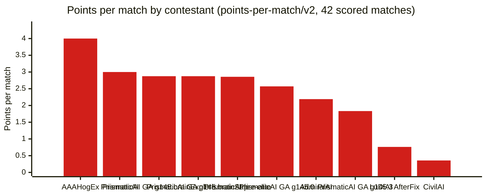
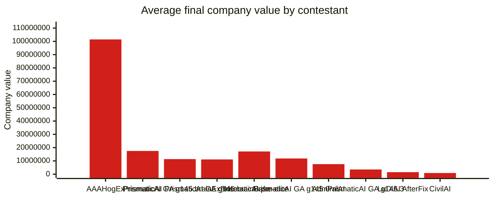
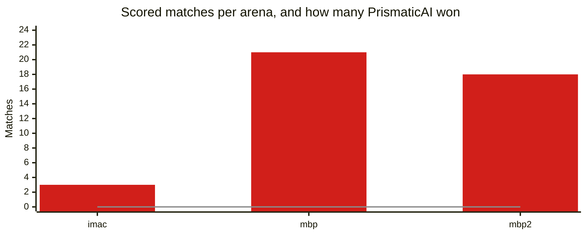

# battle-20261120T134525-b8b04ae2

Derived from `battle-20261120T134525-b8b04ae2.json` by `tools/research/ai-battle/battle.py report`; do not edit.

- Edition `b8b04ae2e4160a32`: PrismaticAI and referee at `2cab9e0314edf484880fedf08e9fc11d63d5357c`, base set `opengfx-8.0.tar`
- 20-year free-for-all from 1960, map 256x256 temperate, breakdowns 1
- 42 scored match(es) on `imac` (20261119-master-gdf1e05e7d8), `mbp` (20261120-master-m17653b726e), `mbp2` (20261119-master-gdf1e05e7d8)
- Replays: 1 of 1 identical to their original on another arena

| # | Contestant | Played | Wins | Points | Points/match | Avg rank | Avg final value | Squirrel errors | Matches with anomalies |
|---|---|---|---|---|---|---|---|---|---|
| 1 | AAAHogEx | 42 | 42 | 168 | 4.0 | 1.0 | 101.5 M | 0 | 0 |
| 2 | PrismaticAI | 6 | 0 | 18 | 3.0 | 2.0 | 17.5 M | 0 | 2 |
| 3 | PrismaticAI GA g145.brainExplore | 8 | 0 | 23 | 2.875 | 2.12 | 11.3 M | 0 | 0 |
| 4 | PrismaticAI GA g145.brainSafe | 8 | 0 | 23 | 2.875 | 2.12 | 11.1 M | 0 | 2 |
| 5 | PrismaticAI pre-elite | 7 | 0 | 20 | 2.857 | 2.14 | 17.1 M | 0 | 0 |
| 6 | PrismaticAI GA g145.0 | 7 | 0 | 18 | 2.571 | 2.43 | 11.8 M | 0 | 0 |
| 7 | AdmiralAI | 42 | 0 | 92 | 2.19 | 2.81 | 7.6 M | 0 | 0 |
| 8 | PrismaticAI GA g145.3 | 6 | 0 | 11 | 1.833 | 3.17 | 3.5 M | 0 | 0 |
| 9 | LuDiAI AfterFix | 42 | 0 | 32 | 0.762 | 4.24 | 1.5 M | 0 | 2 |
| 10 | CivilAI | 42 | 0 | 15 | 0.357 | 4.64 | 883.8 k | 0 | 11 |

```mermaid
---
config:
  xyChart:
    width: 900
    height: 360
  themeVariables:
    xyChart:
      plotColorPalette: "#d11f1a, #8a8a8a, #0b0b0b, #ece4d6"
---
xychart-beta
    title "Final company value per scored match: winner vs best PrismaticAI"
    x-axis ["m-0001", "m-0002", "m-0003", "m-0004", "m-0005", "m-0006", "m-0007", "m-0008", "m-0009", "m-0010", "m-0011", "m-0012", "m-0013", "m-0014", "m-0015", "m-0016", "m-0017", "m-0018", "m-0019", "m-0020", "m-0021", "m-0022", "m-0023", "m-0024", "m-0025", "m-0026", "m-0027", "m-0028", "m-0036", "m-0037", "m-0038", "m-0039", "m-0040", "m-0041", "m-0042", "m-0043", "m-0044", "m-0045", "m-0046", "m-0057", "m-0058", "m-0065"]
    %% series: Winner | Best PrismaticAI
    %% links: battle-20261120T134525-b8b04ae2.md?col=Match&filter=m-0001 | battle-20261120T134525-b8b04ae2.md?col=Match&filter=m-0002 | battle-20261120T134525-b8b04ae2.md?col=Match&filter=m-0003 | battle-20261120T134525-b8b04ae2.md?col=Match&filter=m-0004 | battle-20261120T134525-b8b04ae2.md?col=Match&filter=m-0005 | battle-20261120T134525-b8b04ae2.md?col=Match&filter=m-0006 | battle-20261120T134525-b8b04ae2.md?col=Match&filter=m-0007 | battle-20261120T134525-b8b04ae2.md?col=Match&filter=m-0008 | battle-20261120T134525-b8b04ae2.md?col=Match&filter=m-0009 | battle-20261120T134525-b8b04ae2.md?col=Match&filter=m-0010 | battle-20261120T134525-b8b04ae2.md?col=Match&filter=m-0011 | battle-20261120T134525-b8b04ae2.md?col=Match&filter=m-0012 | battle-20261120T134525-b8b04ae2.md?col=Match&filter=m-0013 | battle-20261120T134525-b8b04ae2.md?col=Match&filter=m-0014 | battle-20261120T134525-b8b04ae2.md?col=Match&filter=m-0015 | battle-20261120T134525-b8b04ae2.md?col=Match&filter=m-0016 | battle-20261120T134525-b8b04ae2.md?col=Match&filter=m-0017 | battle-20261120T134525-b8b04ae2.md?col=Match&filter=m-0018 | battle-20261120T134525-b8b04ae2.md?col=Match&filter=m-0019 | battle-20261120T134525-b8b04ae2.md?col=Match&filter=m-0020 | battle-20261120T134525-b8b04ae2.md?col=Match&filter=m-0021 | battle-20261120T134525-b8b04ae2.md?col=Match&filter=m-0022 | battle-20261120T134525-b8b04ae2.md?col=Match&filter=m-0023 | battle-20261120T134525-b8b04ae2.md?col=Match&filter=m-0024 | battle-20261120T134525-b8b04ae2.md?col=Match&filter=m-0025 | battle-20261120T134525-b8b04ae2.md?col=Match&filter=m-0026 | battle-20261120T134525-b8b04ae2.md?col=Match&filter=m-0027 | battle-20261120T134525-b8b04ae2.md?col=Match&filter=m-0028 | battle-20261120T134525-b8b04ae2.md?col=Match&filter=m-0036 | battle-20261120T134525-b8b04ae2.md?col=Match&filter=m-0037 | battle-20261120T134525-b8b04ae2.md?col=Match&filter=m-0038 | battle-20261120T134525-b8b04ae2.md?col=Match&filter=m-0039 | battle-20261120T134525-b8b04ae2.md?col=Match&filter=m-0040 | battle-20261120T134525-b8b04ae2.md?col=Match&filter=m-0041 | battle-20261120T134525-b8b04ae2.md?col=Match&filter=m-0042 | battle-20261120T134525-b8b04ae2.md?col=Match&filter=m-0043 | battle-20261120T134525-b8b04ae2.md?col=Match&filter=m-0044 | battle-20261120T134525-b8b04ae2.md?col=Match&filter=m-0045 | battle-20261120T134525-b8b04ae2.md?col=Match&filter=m-0046 | battle-20261120T134525-b8b04ae2.md?col=Match&filter=m-0057 | battle-20261120T134525-b8b04ae2.md?col=Match&filter=m-0058 | battle-20261120T134525-b8b04ae2.md?col=Match&filter=m-0065
    y-axis "Company value" 0 --> 159000000
    bar [49339314, 78882428, 54707603, 65196463, 63593091, 96103072, 91437518, 99808086, 121554311, 82853021, 95833678, 113035196, 118208595, 116909461, 115303994, 122421254, 115652641, 100193862, 108707125, 112921743, 125261964, 108611322, 128949078, 118362041, 111576881, 96986522, 73363386, 101032660, 128687156, 123009885, 129529898, 114025481, 144583209, 133740019, 90361635, 98816139, 96769073, 83519672, 102354348, 91768819, 65076904, 71857429]
    line [12624284, 10921474, 10455335, 12391707, 1, 14600162, 10510454, 8274709, 7334912, 7573996, 6230725, 11442926, 9544479, 8639668, 11154200, 12124657, 1920295, 16474493, 20222962, 16357314, 13976015, 9307706, 4336414, 18065481, 26945122, 9614962, 16801434, 18111104, 25701761, 18186872, 13884694, 12177897, 12544190, 2796130, 18589124, 21682849, 14993769, 7811489, 7370069, 9046514, 11356797, 5907679]
```

<!-- battle-charts:begin -->
<!-- derived from battle-20261120T134525-b8b04ae2.json by `battle.py render`; `battle.py check` fails when it is stale -->

<!-- battle-charts:end -->

| Seed | Original | Replay | Arenas | Identical |
|---|---|---|---|---|
| 289036769 | m-0001 | m-0048 | mbp / mbp2 | yes |

| Match | Arena | Seed | Winner | Value | Last | Anomalies |
|---|---|---|---|---|---|---|
| m-0001 | mbp | 289036769 | AAAHogEx | 49.3 M | CivilAI | - |
| m-0002 | mbp | 289036769 | AAAHogEx | 78.9 M | CivilAI | - |
| m-0003 | mbp | 289036769 | AAAHogEx | 54.7 M | LuDiAI AfterFix | - |
| m-0004 | mbp | 289036769 | AAAHogEx | 65.2 M | CivilAI | - |
| m-0005 | mbp | 289036769 | AAAHogEx | 63.6 M | PrismaticAI GA g145.3 | - |
| m-0006 | mbp | 1886871614 | AAAHogEx | 96.1 M | CivilAI | CivilAI: fleet_drop:97->67 |
| m-0007 | mbp | 1886871614 | AAAHogEx | 91.4 M | CivilAI | LuDiAI AfterFix: fleet_drop:157->109; CivilAI: fleet_drop:31->11 |
| m-0008 | mbp | 1886871614 | AAAHogEx | 99.8 M | CivilAI | CivilAI: fleet_drop:20->13 |
| m-0009 | mbp | 1886871614 | AAAHogEx | 121.6 M | CivilAI | PrismaticAI GA g145.brainSafe: fleet_drop:50->33; CivilAI: fleet_drop:25->10 |
| m-0010 | imac | 1886871614 | AAAHogEx | 82.9 M | CivilAI | - |
| m-0011 | imac | 1886871614 | AAAHogEx | 95.8 M | LuDiAI AfterFix | - |
| m-0012 | imac | 1183674684 | AAAHogEx | 113.0 M | CivilAI | CivilAI: fleet_drop:61->32 |
| m-0013 | mbp2 | 1183674684 | AAAHogEx | 118.2 M | LuDiAI AfterFix | - |
| m-0014 | mbp2 | 1183674684 | AAAHogEx | 116.9 M | CivilAI | - |
| m-0015 | mbp2 | 1183674684 | AAAHogEx | 115.3 M | CivilAI | CivilAI: fleet_drop:51->16 |
| m-0016 | mbp2 | 1183674684 | AAAHogEx | 122.4 M | CivilAI | LuDiAI AfterFix: fleet_drop:95->53 |
| m-0017 | mbp2 | 1183674684 | AAAHogEx | 115.7 M | LuDiAI AfterFix | - |
| m-0018 | mbp2 | 336975702 | AAAHogEx | 100.2 M | CivilAI | - |
| m-0019 | mbp2 | 336975702 | AAAHogEx | 108.7 M | CivilAI | - |
| m-0020 | mbp2 | 336975702 | AAAHogEx | 112.9 M | LuDiAI AfterFix | - |
| m-0021 | mbp2 | 336975702 | AAAHogEx | 125.3 M | LuDiAI AfterFix | - |
| m-0022 | mbp2 | 336975702 | AAAHogEx | 108.6 M | LuDiAI AfterFix | - |
| m-0023 | mbp2 | 336975702 | AAAHogEx | 128.9 M | CivilAI | - |
| m-0024 | mbp2 | 1717545346 | AAAHogEx | 118.4 M | LuDiAI AfterFix | PrismaticAI: fleet_drop:90->53 |
| m-0025 | mbp2 | 1717545346 | AAAHogEx | 111.6 M | CivilAI | - |
| m-0026 | mbp2 | 1717545346 | AAAHogEx | 97.0 M | LuDiAI AfterFix | - |
| m-0027 | mbp2 | 1717545346 | AAAHogEx | 73.4 M | CivilAI | - |
| m-0028 | mbp2 | 1717545346 | AAAHogEx | 101.0 M | LuDiAI AfterFix | - |
| m-0036 | mbp | 200748226 | AAAHogEx | 128.7 M | CivilAI | PrismaticAI: fleet_drop:124->57; CivilAI: fleet_drop:28->12 |
| m-0037 | mbp | 200748226 | AAAHogEx | 123.0 M | CivilAI | - |
| m-0038 | mbp | 200748226 | AAAHogEx | 129.5 M | CivilAI | - |
| m-0039 | mbp | 200748226 | AAAHogEx | 114.0 M | CivilAI | - |
| m-0040 | mbp | 200748226 | AAAHogEx | 144.6 M | CivilAI | - |
| m-0041 | mbp | 200748226 | AAAHogEx | 133.7 M | CivilAI | - |
| m-0042 | mbp | 901149690 | AAAHogEx | 90.4 M | LuDiAI AfterFix | - |
| m-0043 | mbp | 901149690 | AAAHogEx | 98.8 M | CivilAI | CivilAI: fleet_drop:32->16 |
| m-0044 | mbp | 901149690 | AAAHogEx | 96.8 M | CivilAI | CivilAI: fleet_drop:33->22 |
| m-0045 | mbp2 | 901149690 | AAAHogEx | 83.5 M | CivilAI | PrismaticAI GA g145.brainSafe: fleet_drop:49->27; CivilAI: fleet_drop:37->14 |
| m-0046 | mbp2 | 901149690 | AAAHogEx | 102.4 M | LuDiAI AfterFix | - |
| m-0048 (replay) | mbp2 | 289036769 | AAAHogEx | 49.3 M | CivilAI | - |
| m-0057 | mbp | 1883832382 | AAAHogEx | 91.8 M | LuDiAI AfterFix | - |
| m-0058 | mbp | 1883832382 | AAAHogEx | 65.1 M | CivilAI | - |
| m-0065 | mbp | 1069305410 | AAAHogEx | 71.9 M | CivilAI | CivilAI: fleet_drop:24->14 |
