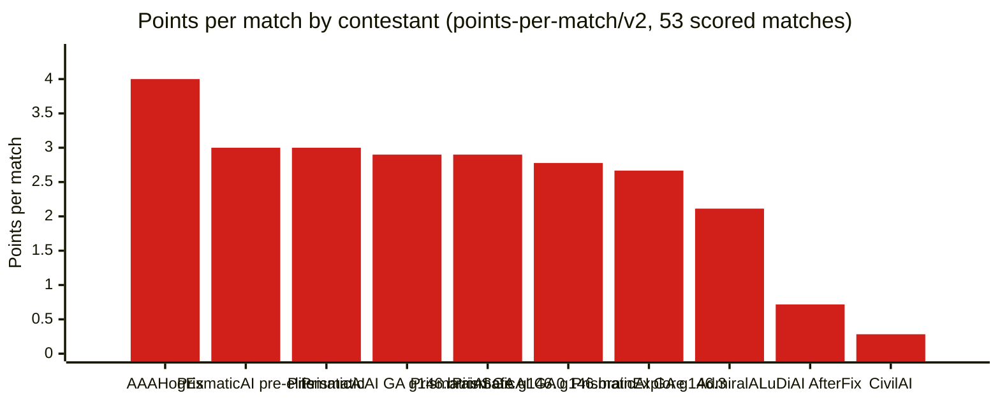
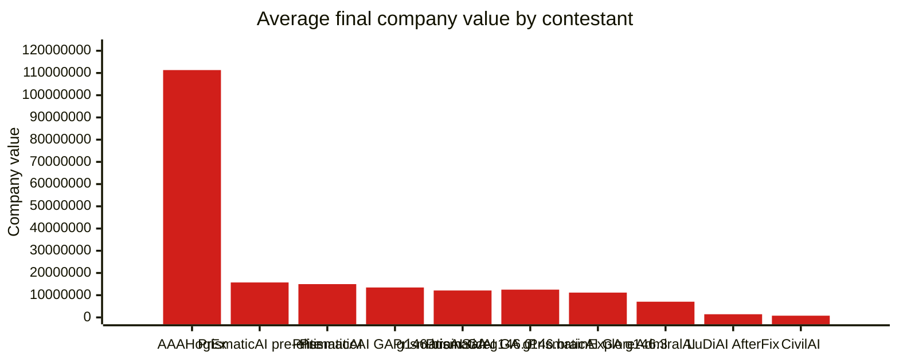
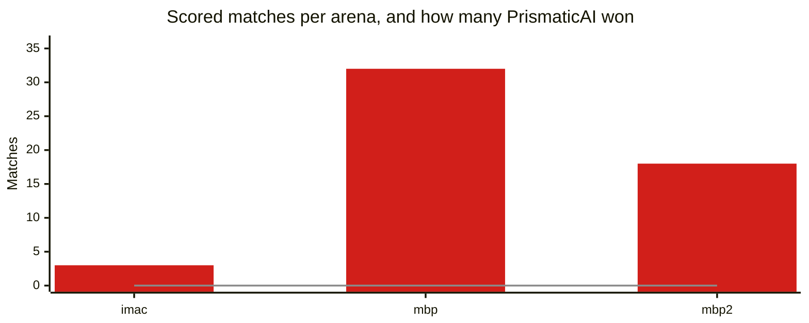

# battle-20261120T140333-033f95a8

Derived from `battle-20261120T140333-033f95a8.json` by `tools/research/ai-battle/battle.py report`; do not edit.

- Edition `033f95a82f6945f1`: PrismaticAI and referee at `2b32ecb6f1049e718e513efb309e963aa0a5205c`, base set `opengfx-8.0.tar`
- 20-year free-for-all from 1960, map 256x256 temperate, breakdowns 1
- 53 scored match(es) on `imac` (20261119-master-gdf1e05e7d8), `mbp` (20261120-master-m17653b726e), `mbp2` (20261119-master-gdf1e05e7d8)
- Replays: 1 of 2 identical to their original on another arena

| # | Contestant | Played | Wins | Points | Points/match | Avg rank | Avg final value | Squirrel errors | Matches with anomalies |
|---|---|---|---|---|---|---|---|---|---|
| 1 | AAAHogEx | 53 | 53 | 212 | 4.0 | 1.0 | 111.3 M | 0 | 0 |
| 2 | PrismaticAI pre-elite | 9 | 0 | 27 | 3.0 | 2.0 | 15.7 M | 0 | 0 |
| 3 | PrismaticAI | 9 | 0 | 27 | 3.0 | 2.0 | 15.0 M | 0 | 5 |
| 4 | PrismaticAI GA g146.brainSafe | 10 | 0 | 29 | 2.9 | 2.1 | 13.5 M | 0 | 0 |
| 5 | PrismaticAI GA g146.0 | 10 | 0 | 29 | 2.9 | 2.1 | 12.1 M | 0 | 0 |
| 6 | PrismaticAI GA g146.brainExplore | 9 | 0 | 25 | 2.778 | 2.22 | 12.5 M | 0 | 0 |
| 7 | PrismaticAI GA g146.3 | 6 | 0 | 16 | 2.667 | 2.33 | 11.2 M | 0 | 0 |
| 8 | AdmiralAI | 53 | 0 | 112 | 2.113 | 2.89 | 7.1 M | 62 | 2 |
| 9 | LuDiAI AfterFix | 53 | 0 | 38 | 0.717 | 4.28 | 1.4 M | 0 | 1 |
| 10 | CivilAI | 53 | 0 | 15 | 0.283 | 4.72 | 778.6 k | 3720 | 14 |

```mermaid
---
config:
  xyChart:
    width: 900
    height: 360
  themeVariables:
    xyChart:
      plotColorPalette: "#d11f1a, #8a8a8a, #0b0b0b, #ece4d6"
---
xychart-beta
    title "Final company value per scored match: winner vs best PrismaticAI"
    x-axis ["m-0001", "m-0002", "m-0003", "m-0004", "m-0005", "m-0006", "m-0007", "m-0008", "m-0009", "m-0010", "m-0011", "m-0012", "m-0013", "m-0014", "m-0015", "m-0016", "m-0017", "m-0018", "m-0019", "m-0020", "m-0021", "m-0022", "m-0023", "m-0024", "m-0025", "m-0026", "m-0027", "m-0028", "m-0036", "m-0037", "m-0038", "m-0039", "m-0040", "m-0041", "m-0042", "m-0043", "m-0044", "m-0045", "m-0046", "m-0050", "m-0051", "m-0052", "m-0060", "m-0061", "m-0062", "m-0063", "m-0066", "m-0073", "m-0074", "m-0075", "m-0076", "m-0077", "m-0078"]
    %% series: Winner | Best PrismaticAI
    %% links: battle-20261120T140333-033f95a8.md?col=Match&filter=m-0001 | battle-20261120T140333-033f95a8.md?col=Match&filter=m-0002 | battle-20261120T140333-033f95a8.md?col=Match&filter=m-0003 | battle-20261120T140333-033f95a8.md?col=Match&filter=m-0004 | battle-20261120T140333-033f95a8.md?col=Match&filter=m-0005 | battle-20261120T140333-033f95a8.md?col=Match&filter=m-0006 | battle-20261120T140333-033f95a8.md?col=Match&filter=m-0007 | battle-20261120T140333-033f95a8.md?col=Match&filter=m-0008 | battle-20261120T140333-033f95a8.md?col=Match&filter=m-0009 | battle-20261120T140333-033f95a8.md?col=Match&filter=m-0010 | battle-20261120T140333-033f95a8.md?col=Match&filter=m-0011 | battle-20261120T140333-033f95a8.md?col=Match&filter=m-0012 | battle-20261120T140333-033f95a8.md?col=Match&filter=m-0013 | battle-20261120T140333-033f95a8.md?col=Match&filter=m-0014 | battle-20261120T140333-033f95a8.md?col=Match&filter=m-0015 | battle-20261120T140333-033f95a8.md?col=Match&filter=m-0016 | battle-20261120T140333-033f95a8.md?col=Match&filter=m-0017 | battle-20261120T140333-033f95a8.md?col=Match&filter=m-0018 | battle-20261120T140333-033f95a8.md?col=Match&filter=m-0019 | battle-20261120T140333-033f95a8.md?col=Match&filter=m-0020 | battle-20261120T140333-033f95a8.md?col=Match&filter=m-0021 | battle-20261120T140333-033f95a8.md?col=Match&filter=m-0022 | battle-20261120T140333-033f95a8.md?col=Match&filter=m-0023 | battle-20261120T140333-033f95a8.md?col=Match&filter=m-0024 | battle-20261120T140333-033f95a8.md?col=Match&filter=m-0025 | battle-20261120T140333-033f95a8.md?col=Match&filter=m-0026 | battle-20261120T140333-033f95a8.md?col=Match&filter=m-0027 | battle-20261120T140333-033f95a8.md?col=Match&filter=m-0028 | battle-20261120T140333-033f95a8.md?col=Match&filter=m-0036 | battle-20261120T140333-033f95a8.md?col=Match&filter=m-0037 | battle-20261120T140333-033f95a8.md?col=Match&filter=m-0038 | battle-20261120T140333-033f95a8.md?col=Match&filter=m-0039 | battle-20261120T140333-033f95a8.md?col=Match&filter=m-0040 | battle-20261120T140333-033f95a8.md?col=Match&filter=m-0041 | battle-20261120T140333-033f95a8.md?col=Match&filter=m-0042 | battle-20261120T140333-033f95a8.md?col=Match&filter=m-0043 | battle-20261120T140333-033f95a8.md?col=Match&filter=m-0044 | battle-20261120T140333-033f95a8.md?col=Match&filter=m-0045 | battle-20261120T140333-033f95a8.md?col=Match&filter=m-0046 | battle-20261120T140333-033f95a8.md?col=Match&filter=m-0050 | battle-20261120T140333-033f95a8.md?col=Match&filter=m-0051 | battle-20261120T140333-033f95a8.md?col=Match&filter=m-0052 | battle-20261120T140333-033f95a8.md?col=Match&filter=m-0060 | battle-20261120T140333-033f95a8.md?col=Match&filter=m-0061 | battle-20261120T140333-033f95a8.md?col=Match&filter=m-0062 | battle-20261120T140333-033f95a8.md?col=Match&filter=m-0063 | battle-20261120T140333-033f95a8.md?col=Match&filter=m-0066 | battle-20261120T140333-033f95a8.md?col=Match&filter=m-0073 | battle-20261120T140333-033f95a8.md?col=Match&filter=m-0074 | battle-20261120T140333-033f95a8.md?col=Match&filter=m-0075 | battle-20261120T140333-033f95a8.md?col=Match&filter=m-0076 | battle-20261120T140333-033f95a8.md?col=Match&filter=m-0077 | battle-20261120T140333-033f95a8.md?col=Match&filter=m-0078
    y-axis "Company value" 0 --> 193000000
    bar [102946272, 101771764, 105798744, 85640037, 116906111, 84335331, 90842006, 77011401, 85874216, 106397258, 90744754, 69657104, 71121146, 80263085, 77631548, 96024403, 102038893, 154808331, 175100408, 165983628, 149891836, 144078850, 127789494, 134002800, 165777534, 167185379, 130209075, 157722997, 134370850, 110525755, 128902051, 125677981, 127797167, 134503526, 107452839, 102532548, 107427000, 103989026, 105039999, 136292346, 118467279, 122197423, 101708972, 91245149, 97072474, 95184226, 104539040, 89917547, 86355080, 107072663, 67133662, 86905330, 89888992]
    line [14702501, 10467807, 15412614, 12079486, 9146242, 12218471, 14908988, 11196682, 11998125, 15336701, 13674835, 20209492, 17716096, 19987675, 14201168, 6750815, 10841266, 19987472, 17499983, 16036940, 14651540, 13790591, 10459783, 13805656, 16298829, 12595917, 14852269, 10005043, 13589003, 13492293, 10499003, 12345056, 10939371, 18602871, 16073652, 20548028, 14081376, 17622354, 12065967, 12207287, 13480004, 19401122, 17629179, 15958124, 5455922, 11934947, 5963904, 10449209, 8649543, 8203411, 12129377, 4277469, 15402518]
```

<!-- battle-charts:begin -->
<!-- derived from battle-20261120T140333-033f95a8.json by `battle.py render`; `battle.py check` fails when it is stale -->

<!-- battle-charts:end -->

| Seed | Original | Replay | Arenas | Identical |
|---|---|---|---|---|
| 270379568 | m-0001 | m-0048 | mbp / mbp2 | yes |
| 1199094800 | m-0010 | m-0064 | imac / mbp | NO |

| Match | Arena | Seed | Winner | Value | Last | Anomalies |
|---|---|---|---|---|---|---|
| m-0001 | mbp | 270379568 | AAAHogEx | 102.9 M | LuDiAI AfterFix | - |
| m-0002 | mbp | 270379568 | AAAHogEx | 101.8 M | CivilAI | CivilAI: fleet_drop:48->33 |
| m-0003 | mbp | 270379568 | AAAHogEx | 105.8 M | CivilAI | - |
| m-0004 | mbp | 270379568 | AAAHogEx | 85.6 M | CivilAI | - |
| m-0005 | mbp | 270379568 | AAAHogEx | 116.9 M | CivilAI | - |
| m-0006 | mbp | 1199094800 | AAAHogEx | 84.3 M | CivilAI | - |
| m-0007 | mbp | 1199094800 | AAAHogEx | 90.8 M | CivilAI | - |
| m-0008 | mbp | 1199094800 | AAAHogEx | 77.0 M | CivilAI | CivilAI: fleet_drop:49->21 |
| m-0009 | mbp | 1199094800 | AAAHogEx | 85.9 M | CivilAI | - |
| m-0010 | imac | 1199094800 | AAAHogEx | 106.4 M | CivilAI | - |
| m-0011 | imac | 1199094800 | AAAHogEx | 90.7 M | CivilAI | - |
| m-0012 | imac | 1038445515 | AAAHogEx | 69.7 M | LuDiAI AfterFix | - |
| m-0013 | mbp2 | 1038445515 | AAAHogEx | 71.1 M | CivilAI | CivilAI: fleet_drop:58->37 |
| m-0014 | mbp2 | 1038445515 | AAAHogEx | 80.3 M | CivilAI | - |
| m-0015 | mbp2 | 1038445515 | AAAHogEx | 77.6 M | CivilAI | - |
| m-0016 | mbp2 | 1038445515 | AAAHogEx | 96.0 M | LuDiAI AfterFix | - |
| m-0017 | mbp2 | 1038445515 | AAAHogEx | 102.0 M | CivilAI | CivilAI: fleet_drop:12->7 |
| m-0018 | mbp2 | 1840322746 | AAAHogEx | 154.8 M | CivilAI | PrismaticAI: fleet_drop:111->54; CivilAI: squirrel_errors:3720 |
| m-0019 | mbp2 | 1840322746 | AAAHogEx | 175.1 M | LuDiAI AfterFix | - |
| m-0020 | mbp2 | 1840322746 | AAAHogEx | 166.0 M | CivilAI | - |
| m-0021 | mbp2 | 1840322746 | AAAHogEx | 149.9 M | CivilAI | - |
| m-0022 | mbp2 | 1840322746 | AAAHogEx | 144.1 M | LuDiAI AfterFix | - |
| m-0023 | mbp2 | 1840322746 | AAAHogEx | 127.8 M | LuDiAI AfterFix | - |
| m-0024 | mbp2 | 82869769 | AAAHogEx | 134.0 M | CivilAI | CivilAI: fleet_drop:38->14 |
| m-0025 | mbp2 | 82869769 | AAAHogEx | 165.8 M | LuDiAI AfterFix | - |
| m-0026 | mbp2 | 82869769 | AAAHogEx | 167.2 M | CivilAI | - |
| m-0027 | mbp2 | 82869769 | AAAHogEx | 130.2 M | CivilAI | CivilAI: fleet_drop:20->12 |
| m-0028 | mbp2 | 82869769 | AAAHogEx | 157.7 M | CivilAI | CivilAI: fleet_drop:35->15 |
| m-0036 | mbp | 1679819194 | AAAHogEx | 134.4 M | LuDiAI AfterFix | PrismaticAI: fleet_drop:73->48 |
| m-0037 | mbp | 1679819194 | AAAHogEx | 110.5 M | CivilAI | - |
| m-0038 | mbp | 1679819194 | AAAHogEx | 128.9 M | CivilAI | CivilAI: fleet_drop:54->36 |
| m-0039 | mbp | 1679819194 | AAAHogEx | 125.7 M | LuDiAI AfterFix | - |
| m-0040 | mbp | 1679819194 | AAAHogEx | 127.8 M | LuDiAI AfterFix | - |
| m-0041 | mbp | 1679819194 | AAAHogEx | 134.5 M | LuDiAI AfterFix | - |
| m-0042 | mbp | 36309093 | AAAHogEx | 107.5 M | CivilAI | PrismaticAI: fleet_drop:122->70 |
| m-0043 | mbp | 36309093 | AAAHogEx | 102.5 M | CivilAI | - |
| m-0044 | mbp | 36309093 | AAAHogEx | 107.4 M | LuDiAI AfterFix | CivilAI: fleet_drop:59->39 |
| m-0045 | mbp2 | 36309093 | AAAHogEx | 104.0 M | CivilAI | - |
| m-0046 | mbp | 36309093 | AAAHogEx | 105.0 M | LuDiAI AfterFix | - |
| m-0048 (replay) | mbp2 | 270379568 | AAAHogEx | 102.9 M | LuDiAI AfterFix | - |
| m-0050 | mbp | 53927033 | AAAHogEx | 136.3 M | CivilAI | AdmiralAI: squirrel_errors:62, fleet_drop:164->110 |
| m-0051 | mbp | 53927033 | AAAHogEx | 118.5 M | CivilAI | - |
| m-0052 | mbp | 53927033 | AAAHogEx | 122.2 M | CivilAI | CivilAI: fleet_drop:13->9 |
| m-0060 | mbp | 8901520 | AAAHogEx | 101.7 M | CivilAI | - |
| m-0061 | mbp | 8901520 | AAAHogEx | 91.2 M | CivilAI | AdmiralAI: fleet_drop:326->224 |
| m-0062 | mbp | 8901520 | AAAHogEx | 97.1 M | CivilAI | CivilAI: fleet_drop:43->10 |
| m-0063 | mbp | 8901520 | AAAHogEx | 95.2 M | CivilAI | CivilAI: fleet_drop:46->16 |
| m-0064 (replay) | mbp | 1199094800 | AAAHogEx | 108.6 M | CivilAI | CivilAI: fleet_drop:33->16 |
| m-0066 | mbp2 | 1621261115 | AAAHogEx | 104.5 M | LuDiAI AfterFix | PrismaticAI: fleet_drop:64->36; LuDiAI AfterFix: fleet_drop:28->19 |
| m-0073 | mbp | 137545773 | AAAHogEx | 89.9 M | CivilAI | - |
| m-0074 | mbp | 137545773 | AAAHogEx | 86.4 M | CivilAI | CivilAI: fleet_drop:155->108 |
| m-0075 | mbp | 137545773 | AAAHogEx | 107.1 M | CivilAI | - |
| m-0076 | mbp | 137545773 | AAAHogEx | 67.1 M | CivilAI | - |
| m-0077 | mbp | 137545773 | AAAHogEx | 86.9 M | CivilAI | - |
| m-0078 | mbp | 1063463174 | AAAHogEx | 89.9 M | LuDiAI AfterFix | PrismaticAI: fleet_drop:80->40 |
