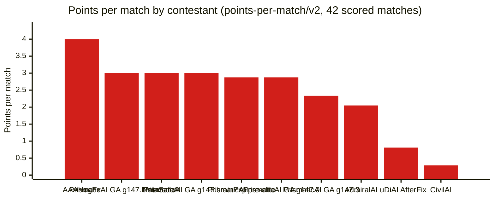
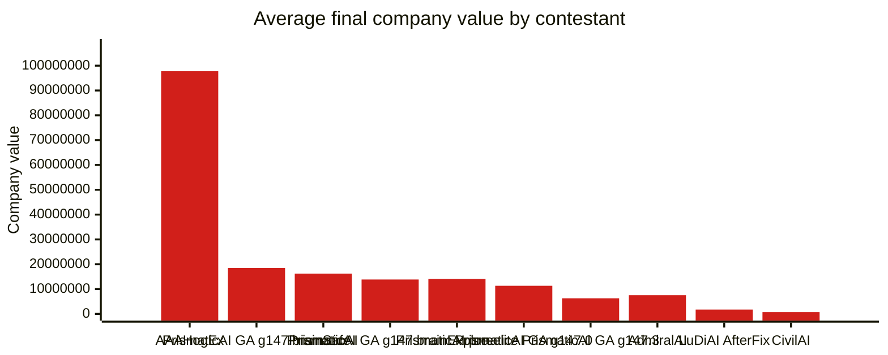
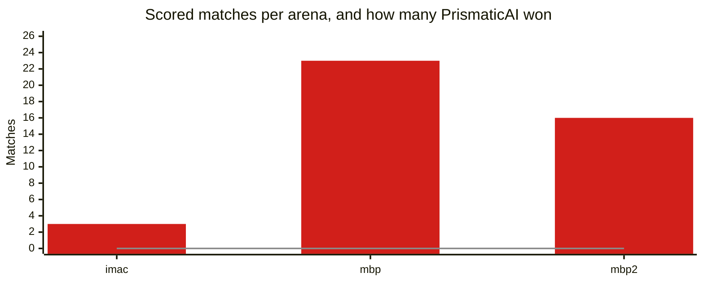

# battle-20261120T141325-d711236d

Derived from `battle-20261120T141325-d711236d.json` by `tools/research/ai-battle/battle.py report`; do not edit.

- Edition `d711236d4637fb1a`: PrismaticAI and referee at `2b32ecb6f1049e718e513efb309e963aa0a5205c`, base set `opengfx-8.0.tar`
- 20-year free-for-all from 1960, map 256x256 temperate, breakdowns 1
- 42 scored match(es) on `imac` (20261119-master-gdf1e05e7d8), `mbp` (20261120-master-m17653b726e), `mbp2` (20261119-master-gdf1e05e7d8)
- Replays: 0 of 1 identical to their original on another arena

| # | Contestant | Played | Wins | Points | Points/match | Avg rank | Avg final value | Squirrel errors | Matches with anomalies |
|---|---|---|---|---|---|---|---|---|---|
| 1 | AAAHogEx | 42 | 42 | 168 | 4.0 | 1.0 | 97.8 M | 0 | 0 |
| 2 | PrismaticAI GA g147.brainSafe | 8 | 0 | 24 | 3.0 | 2.0 | 18.5 M | 0 | 0 |
| 3 | PrismaticAI | 6 | 0 | 18 | 3.0 | 2.0 | 16.2 M | 0 | 4 |
| 4 | PrismaticAI GA g147.brainExplore | 6 | 0 | 18 | 3.0 | 2.0 | 13.9 M | 0 | 0 |
| 5 | PrismaticAI pre-elite | 8 | 0 | 23 | 2.875 | 2.12 | 14.0 M | 0 | 0 |
| 6 | PrismaticAI GA g147.0 | 8 | 0 | 23 | 2.875 | 2.12 | 11.3 M | 0 | 1 |
| 7 | PrismaticAI GA g147.3 | 6 | 0 | 14 | 2.333 | 2.67 | 6.3 M | 0 | 0 |
| 8 | AdmiralAI | 42 | 0 | 86 | 2.048 | 2.95 | 7.5 M | 57 | 2 |
| 9 | LuDiAI AfterFix | 42 | 0 | 34 | 0.81 | 4.19 | 1.7 M | 0 | 1 |
| 10 | CivilAI | 42 | 0 | 12 | 0.286 | 4.71 | 709.2 k | 0 | 5 |

```mermaid
---
config:
  xyChart:
    width: 900
    height: 360
  themeVariables:
    xyChart:
      plotColorPalette: "#d11f1a, #8a8a8a, #0b0b0b, #ece4d6"
---
xychart-beta
    title "Final company value per scored match: winner vs best PrismaticAI"
    x-axis ["m-0001", "m-0002", "m-0003", "m-0004", "m-0005", "m-0006", "m-0007", "m-0008", "m-0009", "m-0010", "m-0011", "m-0012", "m-0013", "m-0014", "m-0015", "m-0016", "m-0017", "m-0018", "m-0019", "m-0020", "m-0021", "m-0022", "m-0023", "m-0024", "m-0025", "m-0026", "m-0027", "m-0028", "m-0036", "m-0037", "m-0038", "m-0039", "m-0040", "m-0041", "m-0042", "m-0043", "m-0044", "m-0045", "m-0047", "m-0049", "m-0050", "m-0051"]
    %% series: Winner | Best PrismaticAI
    %% links: battle-20261120T141325-d711236d.md?col=Match&filter=m-0001 | battle-20261120T141325-d711236d.md?col=Match&filter=m-0002 | battle-20261120T141325-d711236d.md?col=Match&filter=m-0003 | battle-20261120T141325-d711236d.md?col=Match&filter=m-0004 | battle-20261120T141325-d711236d.md?col=Match&filter=m-0005 | battle-20261120T141325-d711236d.md?col=Match&filter=m-0006 | battle-20261120T141325-d711236d.md?col=Match&filter=m-0007 | battle-20261120T141325-d711236d.md?col=Match&filter=m-0008 | battle-20261120T141325-d711236d.md?col=Match&filter=m-0009 | battle-20261120T141325-d711236d.md?col=Match&filter=m-0010 | battle-20261120T141325-d711236d.md?col=Match&filter=m-0011 | battle-20261120T141325-d711236d.md?col=Match&filter=m-0012 | battle-20261120T141325-d711236d.md?col=Match&filter=m-0013 | battle-20261120T141325-d711236d.md?col=Match&filter=m-0014 | battle-20261120T141325-d711236d.md?col=Match&filter=m-0015 | battle-20261120T141325-d711236d.md?col=Match&filter=m-0016 | battle-20261120T141325-d711236d.md?col=Match&filter=m-0017 | battle-20261120T141325-d711236d.md?col=Match&filter=m-0018 | battle-20261120T141325-d711236d.md?col=Match&filter=m-0019 | battle-20261120T141325-d711236d.md?col=Match&filter=m-0020 | battle-20261120T141325-d711236d.md?col=Match&filter=m-0021 | battle-20261120T141325-d711236d.md?col=Match&filter=m-0022 | battle-20261120T141325-d711236d.md?col=Match&filter=m-0023 | battle-20261120T141325-d711236d.md?col=Match&filter=m-0024 | battle-20261120T141325-d711236d.md?col=Match&filter=m-0025 | battle-20261120T141325-d711236d.md?col=Match&filter=m-0026 | battle-20261120T141325-d711236d.md?col=Match&filter=m-0027 | battle-20261120T141325-d711236d.md?col=Match&filter=m-0028 | battle-20261120T141325-d711236d.md?col=Match&filter=m-0036 | battle-20261120T141325-d711236d.md?col=Match&filter=m-0037 | battle-20261120T141325-d711236d.md?col=Match&filter=m-0038 | battle-20261120T141325-d711236d.md?col=Match&filter=m-0039 | battle-20261120T141325-d711236d.md?col=Match&filter=m-0040 | battle-20261120T141325-d711236d.md?col=Match&filter=m-0041 | battle-20261120T141325-d711236d.md?col=Match&filter=m-0042 | battle-20261120T141325-d711236d.md?col=Match&filter=m-0043 | battle-20261120T141325-d711236d.md?col=Match&filter=m-0044 | battle-20261120T141325-d711236d.md?col=Match&filter=m-0045 | battle-20261120T141325-d711236d.md?col=Match&filter=m-0047 | battle-20261120T141325-d711236d.md?col=Match&filter=m-0049 | battle-20261120T141325-d711236d.md?col=Match&filter=m-0050 | battle-20261120T141325-d711236d.md?col=Match&filter=m-0051
    y-axis "Company value" 0 --> 154000000
    bar [77345384, 70179987, 87688450, 76160206, 112123196, 75972778, 60293553, 94396322, 80992972, 81003703, 87868722, 100269160, 108658129, 85933867, 111337378, 109376949, 97595833, 102042304, 126216840, 119646850, 139918564, 105594258, 104548770, 93334201, 105247055, 96941771, 104280491, 96002511, 117990006, 104707765, 123423010, 76973458, 116518413, 98149441, 104185721, 106258735, 95768512, 109427073, 97921195, 83194006, 77999749, 82360688]
    line [20957196, 10709061, 19933295, 16109754, 5379449, 20144375, 16094960, 10617890, 18763719, 15239604, 3223509, 16270068, 18827984, 13327717, 19023687, 16043041, 9079275, 16227363, 14194072, 6847323, 18143295, 13194815, 4091300, 12737547, 9693093, 13563667, 14910275, 5689892, 18182422, 12235866, 14437759, 24770545, 16849908, 11857960, 13694485, 6071843, 8501373, 12330591, 4026920, 14284372, 12514701, 20323626]
```

<!-- battle-charts:begin -->
<!-- derived from battle-20261120T141325-d711236d.json by `battle.py render`; `battle.py check` fails when it is stale -->

<!-- battle-charts:end -->

| Seed | Original | Replay | Arenas | Identical |
|---|---|---|---|---|
| 1523102731 | m-0012 | m-0048 | imac / mbp | NO |

| Match | Arena | Seed | Winner | Value | Last | Anomalies |
|---|---|---|---|---|---|---|
| m-0001 | mbp | 213112904 | AAAHogEx | 77.3 M | CivilAI | - |
| m-0002 | mbp | 213112904 | AAAHogEx | 70.2 M | LuDiAI AfterFix | LuDiAI AfterFix: fleet_drop:16->6 |
| m-0003 | mbp | 213112904 | AAAHogEx | 87.7 M | CivilAI | - |
| m-0004 | mbp | 213112904 | AAAHogEx | 76.2 M | CivilAI | - |
| m-0005 | mbp | 213112904 | AAAHogEx | 112.1 M | CivilAI | - |
| m-0006 | mbp | 594348404 | AAAHogEx | 76.0 M | AdmiralAI | PrismaticAI: fleet_drop:97->67 |
| m-0007 | mbp | 594348404 | AAAHogEx | 60.3 M | CivilAI | - |
| m-0008 | mbp | 594348404 | AAAHogEx | 94.4 M | LuDiAI AfterFix | - |
| m-0009 | mbp | 594348404 | AAAHogEx | 81.0 M | CivilAI | - |
| m-0010 | imac | 594348404 | AAAHogEx | 81.0 M | CivilAI | - |
| m-0011 | imac | 594348404 | AAAHogEx | 87.9 M | CivilAI | - |
| m-0012 | imac | 1523102731 | AAAHogEx | 100.3 M | CivilAI | PrismaticAI: fleet_drop:92->49 |
| m-0013 | mbp2 | 1523102731 | AAAHogEx | 108.7 M | CivilAI | - |
| m-0014 | mbp2 | 1523102731 | AAAHogEx | 85.9 M | CivilAI | - |
| m-0015 | mbp2 | 1523102731 | AAAHogEx | 111.3 M | LuDiAI AfterFix | CivilAI: fleet_drop:32->3 |
| m-0016 | mbp2 | 1523102731 | AAAHogEx | 109.4 M | CivilAI | CivilAI: fleet_drop:56->28 |
| m-0017 | mbp2 | 1523102731 | AAAHogEx | 97.6 M | CivilAI | - |
| m-0018 | mbp2 | 406497449 | AAAHogEx | 102.0 M | LuDiAI AfterFix | PrismaticAI: fleet_drop:115->71 |
| m-0019 | mbp2 | 406497449 | AAAHogEx | 126.2 M | CivilAI | - |
| m-0020 | mbp2 | 406497449 | AAAHogEx | 119.6 M | LuDiAI AfterFix | CivilAI: fleet_drop:97->58 |
| m-0021 | mbp2 | 406497449 | AAAHogEx | 139.9 M | LuDiAI AfterFix | AdmiralAI: squirrel_errors:57 |
| m-0022 | mbp2 | 406497449 | AAAHogEx | 105.6 M | LuDiAI AfterFix | - |
| m-0023 | mbp2 | 406497449 | AAAHogEx | 104.5 M | CivilAI | - |
| m-0024 | mbp2 | 1456154668 | AAAHogEx | 93.3 M | CivilAI | - |
| m-0025 | mbp2 | 1456154668 | AAAHogEx | 105.2 M | CivilAI | - |
| m-0026 | mbp2 | 1456154668 | AAAHogEx | 96.9 M | CivilAI | - |
| m-0027 | mbp2 | 1456154668 | AAAHogEx | 104.3 M | CivilAI | - |
| m-0028 | mbp2 | 1456154668 | AAAHogEx | 96.0 M | CivilAI | - |
| m-0036 | mbp | 1238034559 | AAAHogEx | 118.0 M | CivilAI | PrismaticAI: fleet_drop:86->41 |
| m-0037 | mbp | 1238034559 | AAAHogEx | 104.7 M | CivilAI | - |
| m-0038 | mbp | 1238034559 | AAAHogEx | 123.4 M | LuDiAI AfterFix | - |
| m-0039 | mbp | 1238034559 | AAAHogEx | 77.0 M | CivilAI | CivilAI: fleet_drop:54->35 |
| m-0040 | mbp | 1238034559 | AAAHogEx | 116.5 M | CivilAI | - |
| m-0041 | mbp | 1238034559 | AAAHogEx | 98.1 M | CivilAI | - |
| m-0042 | mbp | 164438188 | AAAHogEx | 104.2 M | CivilAI | - |
| m-0043 | mbp | 164438188 | AAAHogEx | 106.3 M | CivilAI | - |
| m-0044 | mbp | 164438188 | AAAHogEx | 95.8 M | LuDiAI AfterFix | PrismaticAI GA g147.0: fleet_drop:76->49 |
| m-0045 | mbp | 164438188 | AAAHogEx | 109.4 M | LuDiAI AfterFix | - |
| m-0047 | mbp | 164438188 | AAAHogEx | 97.9 M | CivilAI | - |
| m-0048 (replay) | mbp | 1523102731 | AAAHogEx | 96.2 M | CivilAI | PrismaticAI: fleet_drop:92->64 |
| m-0049 | mbp | 60665295 | AAAHogEx | 83.2 M | CivilAI | CivilAI: fleet_drop:43->21 |
| m-0050 | mbp | 60665295 | AAAHogEx | 78.0 M | CivilAI | AdmiralAI: fleet_drop:206->141 |
| m-0051 | mbp | 60665295 | AAAHogEx | 82.4 M | CivilAI | - |
