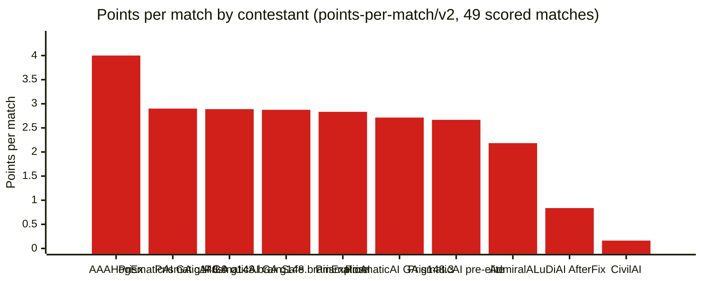
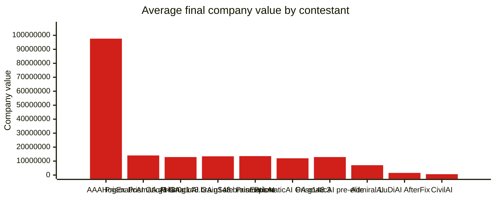
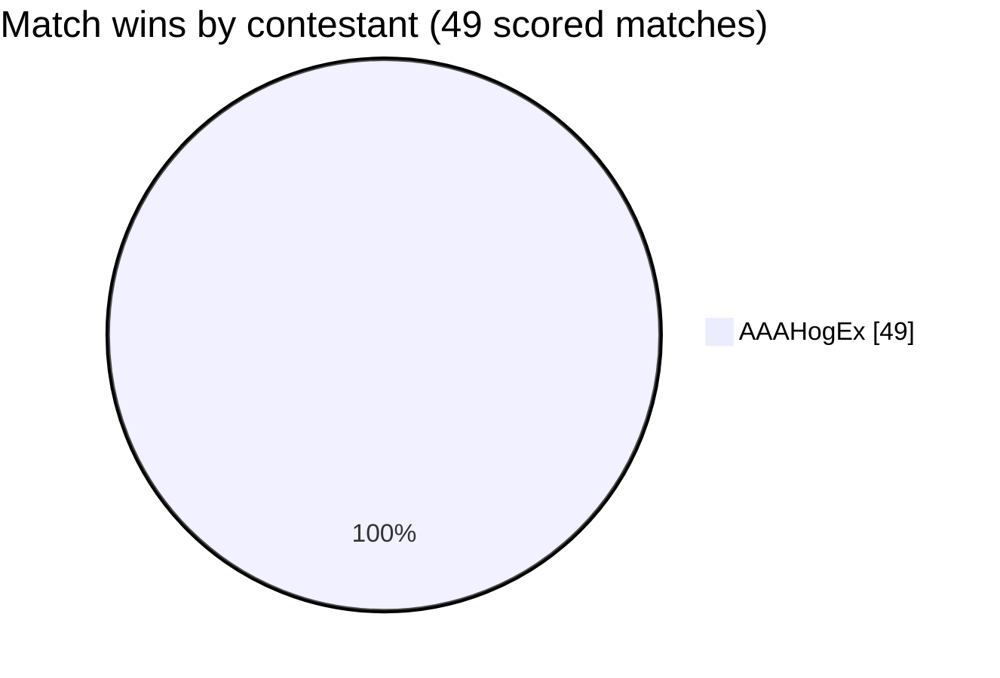
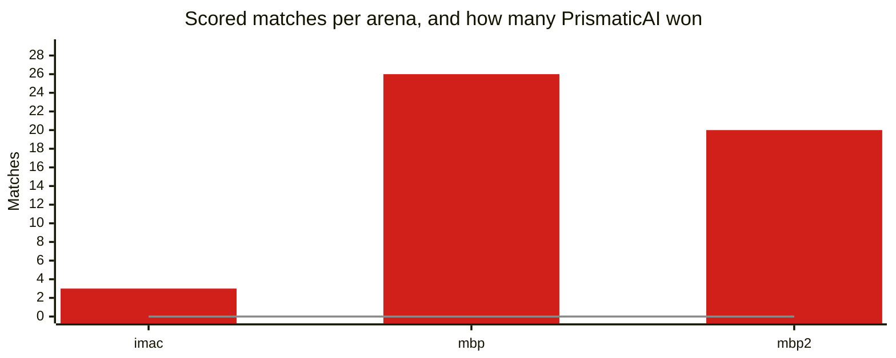

# battle-20261120T142504-d845a0ed

Derived from `battle-20261120T142504-d845a0ed.json` by `tools/research/ai-battle/battle.py report`; do not edit.

- Edition `d845a0eda983b87f`: PrismaticAI and referee at `2b32ecb6f1049e718e513efb309e963aa0a5205c`, base set `opengfx-8.0.tar`
- 20-year free-for-all from 1960, map 256x256 temperate, breakdowns 1
- 49 scored match(es) on `imac` (20261119-master-gdf1e05e7d8), `mbp` (20261120-master-m17653b726e), `mbp2` (20261119-master-gdf1e05e7d8)
- Replays: 0 of 1 identical to their original on another arena

| # | Contestant | Played | Wins | Points | Points/match | Avg rank | Avg final value | Squirrel errors | Matches with anomalies |
|---|---|---|---|---|---|---|---|---|---|
| 1 | AAAHogEx | 49 | 49 | 196 | 4.0 | 1.0 | 97.6 M | 0 | 0 |
| 2 | PrismaticAI GA g148.0 | 10 | 0 | 29 | 2.9 | 2.1 | 14.0 M | 0 | 0 |
| 3 | PrismaticAI GA g148.brainSafe | 9 | 0 | 26 | 2.889 | 2.11 | 12.9 M | 0 | 0 |
| 4 | PrismaticAI GA g148.brainExplore | 8 | 0 | 23 | 2.875 | 2.12 | 13.4 M | 0 | 1 |
| 5 | PrismaticAI | 6 | 0 | 17 | 2.833 | 2.17 | 13.6 M | 0 | 1 |
| 6 | PrismaticAI GA g148.3 | 7 | 0 | 19 | 2.714 | 2.29 | 12.0 M | 0 | 2 |
| 7 | PrismaticAI pre-elite | 9 | 0 | 24 | 2.667 | 2.33 | 12.9 M | 0 | 1 |
| 8 | AdmiralAI | 49 | 0 | 107 | 2.184 | 2.82 | 7.1 M | 129 | 3 |
| 9 | LuDiAI AfterFix | 49 | 0 | 41 | 0.837 | 4.16 | 1.5 M | 0 | 0 |
| 10 | CivilAI | 49 | 0 | 8 | 0.163 | 4.84 | 637.5 k | 0 | 11 |

```mermaid
---
config:
  xyChart:
    width: 900
    height: 360
  themeVariables:
    xyChart:
      plotColorPalette: "#d11f1a, #8a8a8a, #0b0b0b, #ece4d6"
---
xychart-beta
    title "Final company value per scored match: winner vs best PrismaticAI"
    x-axis ["m-0001", "m-0002", "m-0003", "m-0004", "m-0005", "m-0006", "m-0007", "m-0008", "m-0009", "m-0010", "m-0011", "m-0012", "m-0013", "m-0014", "m-0015", "m-0016", "m-0017", "m-0018", "m-0019", "m-0020", "m-0021", "m-0022", "m-0023", "m-0024", "m-0025", "m-0026", "m-0027", "m-0028", "m-0036", "m-0037", "m-0038", "m-0039", "m-0040", "m-0041", "m-0042", "m-0043", "m-0044", "m-0045", "m-0046", "m-0047", "m-0049", "m-0050", "m-0051", "m-0052", "m-0053", "m-0061", "m-0062", "m-0063", "m-0068"]
    %% series: Winner | Best PrismaticAI
    %% links: battle-20261120T142504-d845a0ed.md?col=Match&filter=m-0001 | battle-20261120T142504-d845a0ed.md?col=Match&filter=m-0002 | battle-20261120T142504-d845a0ed.md?col=Match&filter=m-0003 | battle-20261120T142504-d845a0ed.md?col=Match&filter=m-0004 | battle-20261120T142504-d845a0ed.md?col=Match&filter=m-0005 | battle-20261120T142504-d845a0ed.md?col=Match&filter=m-0006 | battle-20261120T142504-d845a0ed.md?col=Match&filter=m-0007 | battle-20261120T142504-d845a0ed.md?col=Match&filter=m-0008 | battle-20261120T142504-d845a0ed.md?col=Match&filter=m-0009 | battle-20261120T142504-d845a0ed.md?col=Match&filter=m-0010 | battle-20261120T142504-d845a0ed.md?col=Match&filter=m-0011 | battle-20261120T142504-d845a0ed.md?col=Match&filter=m-0012 | battle-20261120T142504-d845a0ed.md?col=Match&filter=m-0013 | battle-20261120T142504-d845a0ed.md?col=Match&filter=m-0014 | battle-20261120T142504-d845a0ed.md?col=Match&filter=m-0015 | battle-20261120T142504-d845a0ed.md?col=Match&filter=m-0016 | battle-20261120T142504-d845a0ed.md?col=Match&filter=m-0017 | battle-20261120T142504-d845a0ed.md?col=Match&filter=m-0018 | battle-20261120T142504-d845a0ed.md?col=Match&filter=m-0019 | battle-20261120T142504-d845a0ed.md?col=Match&filter=m-0020 | battle-20261120T142504-d845a0ed.md?col=Match&filter=m-0021 | battle-20261120T142504-d845a0ed.md?col=Match&filter=m-0022 | battle-20261120T142504-d845a0ed.md?col=Match&filter=m-0023 | battle-20261120T142504-d845a0ed.md?col=Match&filter=m-0024 | battle-20261120T142504-d845a0ed.md?col=Match&filter=m-0025 | battle-20261120T142504-d845a0ed.md?col=Match&filter=m-0026 | battle-20261120T142504-d845a0ed.md?col=Match&filter=m-0027 | battle-20261120T142504-d845a0ed.md?col=Match&filter=m-0028 | battle-20261120T142504-d845a0ed.md?col=Match&filter=m-0036 | battle-20261120T142504-d845a0ed.md?col=Match&filter=m-0037 | battle-20261120T142504-d845a0ed.md?col=Match&filter=m-0038 | battle-20261120T142504-d845a0ed.md?col=Match&filter=m-0039 | battle-20261120T142504-d845a0ed.md?col=Match&filter=m-0040 | battle-20261120T142504-d845a0ed.md?col=Match&filter=m-0041 | battle-20261120T142504-d845a0ed.md?col=Match&filter=m-0042 | battle-20261120T142504-d845a0ed.md?col=Match&filter=m-0043 | battle-20261120T142504-d845a0ed.md?col=Match&filter=m-0044 | battle-20261120T142504-d845a0ed.md?col=Match&filter=m-0045 | battle-20261120T142504-d845a0ed.md?col=Match&filter=m-0046 | battle-20261120T142504-d845a0ed.md?col=Match&filter=m-0047 | battle-20261120T142504-d845a0ed.md?col=Match&filter=m-0049 | battle-20261120T142504-d845a0ed.md?col=Match&filter=m-0050 | battle-20261120T142504-d845a0ed.md?col=Match&filter=m-0051 | battle-20261120T142504-d845a0ed.md?col=Match&filter=m-0052 | battle-20261120T142504-d845a0ed.md?col=Match&filter=m-0053 | battle-20261120T142504-d845a0ed.md?col=Match&filter=m-0061 | battle-20261120T142504-d845a0ed.md?col=Match&filter=m-0062 | battle-20261120T142504-d845a0ed.md?col=Match&filter=m-0063 | battle-20261120T142504-d845a0ed.md?col=Match&filter=m-0068
    y-axis "Company value" 0 --> 159000000
    bar [101436745, 102483400, 96699109, 92637571, 98731060, 120936973, 89774813, 118672148, 99359342, 127375337, 104421597, 77462924, 99078718, 101755719, 102787462, 84643323, 79637591, 94005980, 101721240, 98417086, 115173508, 111188564, 115531544, 80896778, 93030677, 99202879, 94908364, 96317633, 89658648, 83028056, 79743050, 120089528, 79547029, 84838329, 84144932, 87801030, 75092128, 104994356, 78359255, 108631713, 116116102, 107779332, 121912000, 99871555, 96978189, 73668635, 73625896, 75153568, 144459131]
    line [9243795, 8924195, 11630154, 8532126, 11989706, 20246212, 22101126, 19927605, 18275337, 15109148, 14913465, 13722185, 11639885, 12889583, 8660298, 15944591, 13757346, 15640180, 16431668, 14756350, 16647620, 18615393, 13299718, 5171190, 7908405, 5360996, 14710915, 7158889, 9391964, 15195464, 16427000, 10015682, 14384303, 11347764, 17199521, 17117940, 21903919, 15974255, 15385816, 8461119, 7975803, 14131670, 6689283, 12158339, 10216654, 8382612, 13574202, 13319130, 12440242]
```

<!-- battle-charts:begin -->
<!-- derived from battle-20261120T142504-d845a0ed.json by `battle.py render`; `battle.py check` fails when it is stale -->

<!-- battle-charts:end -->

| Seed | Original | Replay | Arenas | Identical |
|---|---|---|---|---|
| 1539537155 | m-0010 | m-0064 | imac / mbp | NO |

| Match | Arena | Seed | Winner | Value | Last | Anomalies |
|---|---|---|---|---|---|---|
| m-0001 | mbp | 602183437 | AAAHogEx | 101.4 M | CivilAI | AdmiralAI: fleet_drop:286->197 |
| m-0002 | mbp | 602183437 | AAAHogEx | 102.5 M | CivilAI | - |
| m-0003 | mbp | 602183437 | AAAHogEx | 96.7 M | CivilAI | - |
| m-0004 | mbp | 602183437 | AAAHogEx | 92.6 M | CivilAI | CivilAI: fleet_drop:63->28 |
| m-0005 | mbp | 602183437 | AAAHogEx | 98.7 M | CivilAI | - |
| m-0006 | mbp | 1539537155 | AAAHogEx | 120.9 M | CivilAI | - |
| m-0007 | mbp | 1539537155 | AAAHogEx | 89.8 M | CivilAI | - |
| m-0008 | mbp | 1539537155 | AAAHogEx | 118.7 M | CivilAI | - |
| m-0009 | mbp | 1539537155 | AAAHogEx | 99.4 M | CivilAI | CivilAI: fleet_drop:28->17 |
| m-0010 | imac | 1539537155 | AAAHogEx | 127.4 M | CivilAI | - |
| m-0011 | imac | 1539537155 | AAAHogEx | 104.4 M | CivilAI | CivilAI: no_vehicles |
| m-0012 | imac | 1464093297 | AAAHogEx | 77.5 M | CivilAI | CivilAI: fleet_drop:11->7 |
| m-0013 | mbp2 | 1464093297 | AAAHogEx | 99.1 M | CivilAI | - |
| m-0014 | mbp2 | 1464093297 | AAAHogEx | 101.8 M | CivilAI | - |
| m-0015 | mbp2 | 1464093297 | AAAHogEx | 102.8 M | LuDiAI AfterFix | - |
| m-0016 | mbp2 | 1464093297 | AAAHogEx | 84.6 M | CivilAI | - |
| m-0017 | mbp2 | 1464093297 | AAAHogEx | 79.6 M | CivilAI | - |
| m-0018 | mbp2 | 145131641 | AAAHogEx | 94.0 M | CivilAI | PrismaticAI: fleet_drop:95->37 |
| m-0019 | mbp2 | 145131641 | AAAHogEx | 101.7 M | LuDiAI AfterFix | - |
| m-0020 | mbp2 | 145131641 | AAAHogEx | 98.4 M | LuDiAI AfterFix | - |
| m-0021 | mbp2 | 145131641 | AAAHogEx | 115.2 M | CivilAI | - |
| m-0022 | mbp2 | 145131641 | AAAHogEx | 111.2 M | CivilAI | - |
| m-0023 | mbp2 | 145131641 | AAAHogEx | 115.5 M | LuDiAI AfterFix | PrismaticAI GA g148.3: fleet_drop:61->39 |
| m-0024 | mbp2 | 781312997 | AAAHogEx | 80.9 M | CivilAI | CivilAI: fleet_drop:24->14 |
| m-0025 | mbp2 | 781312997 | AAAHogEx | 93.0 M | CivilAI | - |
| m-0026 | mbp2 | 781312997 | AAAHogEx | 99.2 M | LuDiAI AfterFix | - |
| m-0027 | mbp2 | 781312997 | AAAHogEx | 94.9 M | CivilAI | - |
| m-0028 | mbp2 | 781312997 | AAAHogEx | 96.3 M | CivilAI | - |
| m-0036 | mbp | 1497210251 | AAAHogEx | 89.7 M | LuDiAI AfterFix | - |
| m-0037 | mbp | 1497210251 | AAAHogEx | 83.0 M | CivilAI | CivilAI: fleet_drop:15->8 |
| m-0038 | mbp | 1497210251 | AAAHogEx | 79.7 M | CivilAI | - |
| m-0039 | mbp | 1497210251 | AAAHogEx | 120.1 M | CivilAI | - |
| m-0040 | mbp | 1497210251 | AAAHogEx | 79.5 M | CivilAI | - |
| m-0041 | mbp | 1497210251 | AAAHogEx | 84.8 M | CivilAI | CivilAI: fleet_drop:26->11 |
| m-0042 | mbp | 504621565 | AAAHogEx | 84.1 M | CivilAI | - |
| m-0043 | mbp | 504621565 | AAAHogEx | 87.8 M | CivilAI | - |
| m-0044 | mbp | 504621565 | AAAHogEx | 75.1 M | CivilAI | - |
| m-0045 | mbp | 504621565 | AAAHogEx | 105.0 M | CivilAI | AdmiralAI: squirrel_errors:72 |
| m-0046 | mbp2 | 504621565 | AAAHogEx | 78.4 M | CivilAI | AdmiralAI: squirrel_errors:57; CivilAI: fleet_drop:20->10 |
| m-0047 | mbp2 | 504621565 | AAAHogEx | 108.6 M | CivilAI | PrismaticAI GA g148.3: fleet_drop:45->24; CivilAI: no_vehicles |
| m-0049 | mbp2 | 772412695 | AAAHogEx | 116.1 M | LuDiAI AfterFix | CivilAI: fleet_drop:61->21 |
| m-0050 | mbp | 772412695 | AAAHogEx | 107.8 M | CivilAI | - |
| m-0051 | mbp | 772412695 | AAAHogEx | 121.9 M | CivilAI | - |
| m-0052 | mbp | 772412695 | AAAHogEx | 99.9 M | CivilAI | PrismaticAI GA g148.brainExplore: fleet_drop:57->38 |
| m-0053 | mbp2 | 772412695 | AAAHogEx | 97.0 M | LuDiAI AfterFix | - |
| m-0061 | mbp | 1403306689 | AAAHogEx | 73.7 M | CivilAI | PrismaticAI pre-elite: fleet_drop:61->42 |
| m-0062 | mbp | 1403306689 | AAAHogEx | 73.6 M | CivilAI | CivilAI: no_vehicles |
| m-0063 | mbp | 1403306689 | AAAHogEx | 75.2 M | CivilAI | - |
| m-0064 (replay) | mbp | 1539537155 | AAAHogEx | 115.5 M | CivilAI | - |
| m-0068 | mbp | 1395791669 | AAAHogEx | 144.5 M | CivilAI | - |
