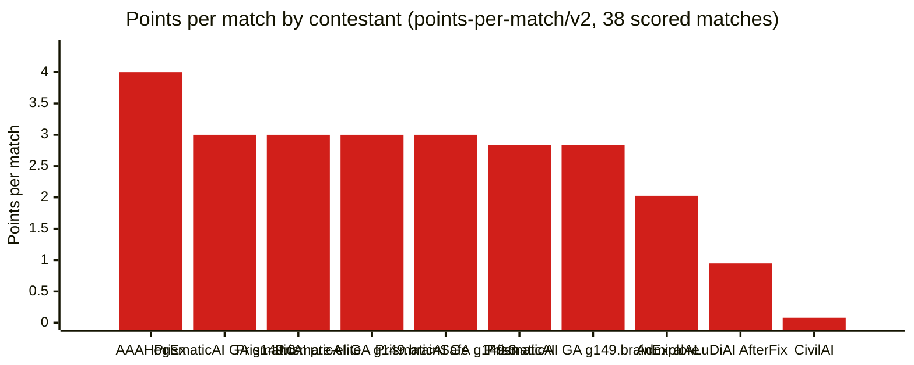
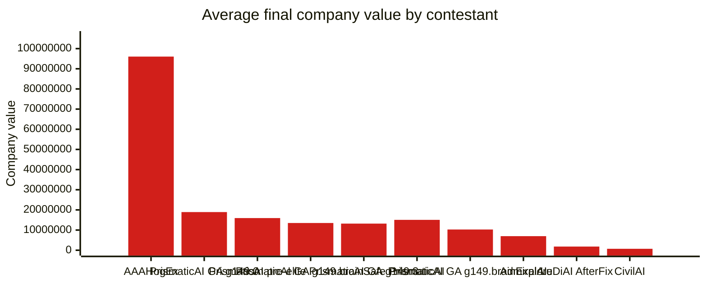
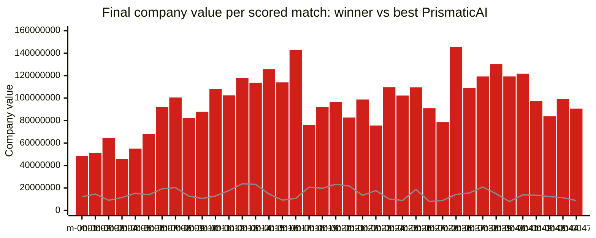
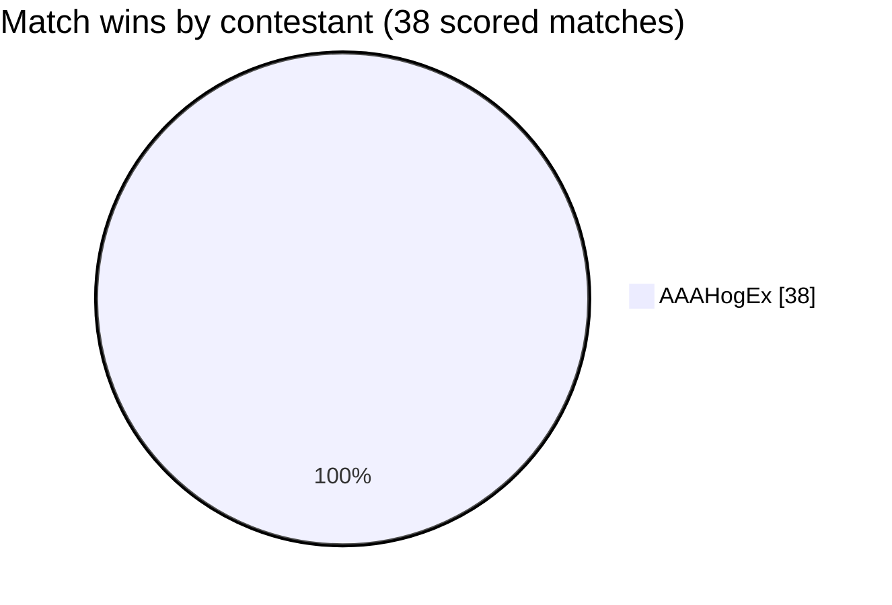
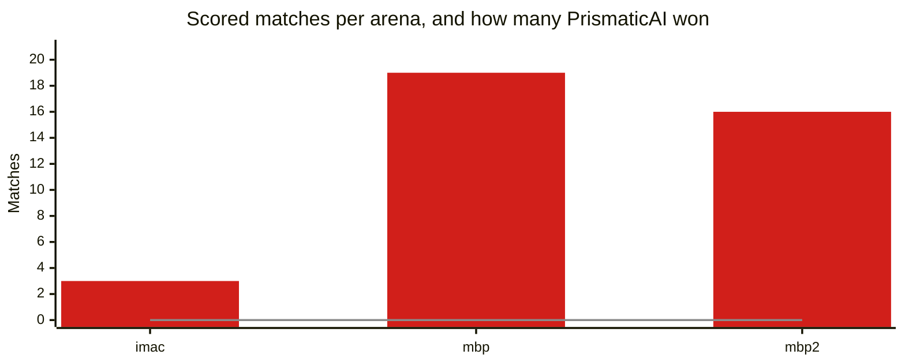

# battle-20261120T143424-b8d71dc9

Derived from `battle-20261120T143424-b8d71dc9.json` by `tools/research/ai-battle/battle.py report`; do not edit.

- Edition `b8d71dc990c6a308`: PrismaticAI and referee at `2b32ecb6f1049e718e513efb309e963aa0a5205c`, base set `opengfx-8.0.tar`
- 20-year free-for-all from 1960, map 256x256 temperate, breakdowns 1
- 38 scored match(es) on `imac` (20261119-master-gdf1e05e7d8), `mbp` (20261120-master-m17653b726e), `mbp2` (20261119-master-gdf1e05e7d8)
- Replays: 0 of 1 identical to their original on another arena

| # | Contestant | Played | Wins | Points | Points/match | Avg rank | Avg final value | Squirrel errors | Matches with anomalies |
|---|---|---|---|---|---|---|---|---|---|
| 1 | AAAHogEx | 38 | 38 | 152 | 4.0 | 1.0 | 96.0 M | 0 | 0 |
| 2 | PrismaticAI GA g149.0 | 7 | 0 | 21 | 3.0 | 2.0 | 18.9 M | 0 | 0 |
| 3 | PrismaticAI pre-elite | 7 | 0 | 21 | 3.0 | 2.0 | 15.9 M | 0 | 0 |
| 4 | PrismaticAI GA g149.brainSafe | 6 | 0 | 18 | 3.0 | 2.0 | 13.5 M | 0 | 0 |
| 5 | PrismaticAI GA g149.3 | 6 | 0 | 18 | 3.0 | 2.0 | 13.2 M | 0 | 0 |
| 6 | PrismaticAI | 6 | 0 | 17 | 2.833 | 2.17 | 15.1 M | 0 | 2 |
| 7 | PrismaticAI GA g149.brainExplore | 6 | 0 | 17 | 2.833 | 2.17 | 10.3 M | 0 | 4 |
| 8 | AdmiralAI | 38 | 0 | 77 | 2.026 | 2.97 | 7.0 M | 0 | 1 |
| 9 | LuDiAI AfterFix | 38 | 0 | 36 | 0.947 | 4.05 | 1.8 M | 0 | 1 |
| 10 | CivilAI | 38 | 0 | 3 | 0.079 | 4.92 | 707.3 k | 0 | 2 |

<!-- battle-charts:begin -->
<!-- derived from battle-20261120T143424-b8d71dc9.json by `battle.py render`; `battle.py check` fails when it is stale -->

<!-- battle-charts:end -->

| Seed | Original | Replay | Arenas | Identical |
|---|---|---|---|---|
| 392118219 | m-0011 | m-0048 | imac / mbp | NO |

| Match | Arena | Seed | Winner | Value | Last | Anomalies |
|---|---|---|---|---|---|---|
| m-0001 | mbp | 737010860 | AAAHogEx | 48.5 M | CivilAI | - |
| m-0002 | mbp | 737010860 | AAAHogEx | 51.3 M | CivilAI | - |
| m-0003 | mbp | 737010860 | AAAHogEx | 64.6 M | CivilAI | - |
| m-0004 | mbp | 737010860 | AAAHogEx | 45.8 M | CivilAI | - |
| m-0005 | mbp | 737010860 | AAAHogEx | 55.0 M | CivilAI | - |
| m-0006 | mbp | 392118219 | AAAHogEx | 68.0 M | CivilAI | - |
| m-0007 | mbp | 392118219 | AAAHogEx | 92.1 M | CivilAI | - |
| m-0008 | mbp | 392118219 | AAAHogEx | 100.5 M | CivilAI | - |
| m-0009 | mbp | 392118219 | AAAHogEx | 82.4 M | CivilAI | - |
| m-0010 | imac | 392118219 | AAAHogEx | 87.9 M | CivilAI | PrismaticAI GA g149.brainExplore: fleet_drop:97->56 |
| m-0011 | imac | 392118219 | AAAHogEx | 108.4 M | CivilAI | - |
| m-0012 | imac | 1774392286 | AAAHogEx | 102.5 M | CivilAI | PrismaticAI: fleet_drop:99->57 |
| m-0013 | mbp2 | 1774392286 | AAAHogEx | 117.9 M | CivilAI | - |
| m-0014 | mbp2 | 1774392286 | AAAHogEx | 113.6 M | CivilAI | - |
| m-0015 | mbp2 | 1774392286 | AAAHogEx | 125.7 M | LuDiAI AfterFix | - |
| m-0016 | mbp2 | 1774392286 | AAAHogEx | 114.0 M | CivilAI | PrismaticAI GA g149.brainExplore: fleet_drop:170->83 |
| m-0017 | mbp2 | 1774392286 | AAAHogEx | 142.9 M | CivilAI | AdmiralAI: fleet_drop:195->118 |
| m-0018 | mbp2 | 846822002 | AAAHogEx | 76.1 M | CivilAI | CivilAI: fleet_drop:75->47 |
| m-0019 | mbp2 | 846822002 | AAAHogEx | 91.9 M | CivilAI | - |
| m-0020 | mbp2 | 846822002 | AAAHogEx | 96.6 M | CivilAI | - |
| m-0021 | mbp2 | 846822002 | AAAHogEx | 82.7 M | LuDiAI AfterFix | LuDiAI AfterFix: fleet_drop:50->31 |
| m-0022 | mbp2 | 846822002 | AAAHogEx | 98.8 M | CivilAI | PrismaticAI GA g149.brainExplore: fleet_drop:192->111 |
| m-0023 | mbp2 | 846822002 | AAAHogEx | 75.6 M | CivilAI | - |
| m-0024 | mbp2 | 1696717221 | AAAHogEx | 109.7 M | CivilAI | - |
| m-0025 | mbp2 | 1696717221 | AAAHogEx | 102.3 M | CivilAI | - |
| m-0026 | mbp2 | 1696717221 | AAAHogEx | 109.6 M | CivilAI | - |
| m-0027 | mbp2 | 1696717221 | AAAHogEx | 91.0 M | CivilAI | - |
| m-0028 | mbp2 | 1696717221 | AAAHogEx | 78.7 M | CivilAI | - |
| m-0036 | mbp | 472154457 | AAAHogEx | 145.5 M | CivilAI | PrismaticAI: fleet_drop:147->88 |
| m-0037 | mbp | 472154457 | AAAHogEx | 109.0 M | CivilAI | - |
| m-0038 | mbp | 472154457 | AAAHogEx | 119.3 M | CivilAI | - |
| m-0039 | mbp | 472154457 | AAAHogEx | 130.3 M | LuDiAI AfterFix | - |
| m-0040 | mbp | 472154457 | AAAHogEx | 119.3 M | CivilAI | PrismaticAI GA g149.brainExplore: fleet_drop:136->84 |
| m-0041 | mbp | 472154457 | AAAHogEx | 121.7 M | CivilAI | - |
| m-0042 | mbp | 997946858 | AAAHogEx | 97.2 M | CivilAI | CivilAI: fleet_drop:59->15 |
| m-0043 | mbp | 997946858 | AAAHogEx | 83.8 M | CivilAI | - |
| m-0044 | mbp | 997946858 | AAAHogEx | 99.2 M | CivilAI | - |
| m-0047 | mbp | 997946858 | AAAHogEx | 90.6 M | CivilAI | - |
| m-0048 (replay) | mbp | 392118219 | AAAHogEx | 107.6 M | CivilAI | LuDiAI AfterFix: fleet_drop:49->34 |
