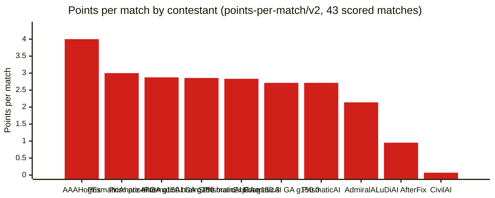
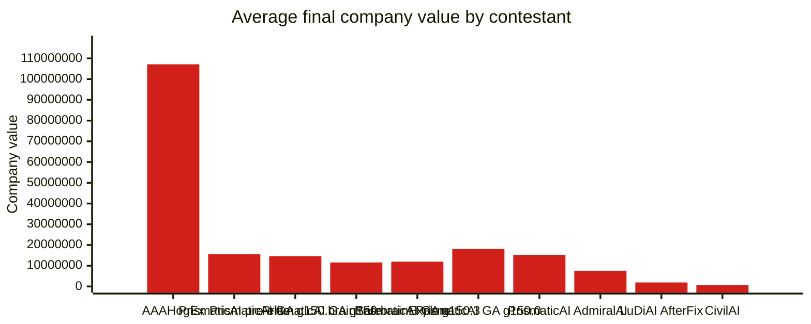
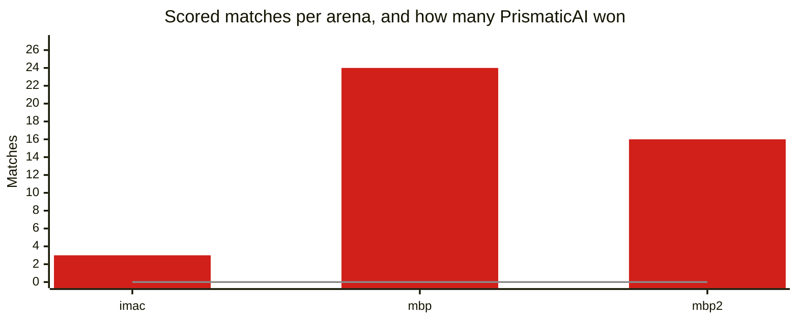

# battle-20261120T144450-5f6252ec

Derived from `battle-20261120T144450-5f6252ec.json` by `tools/research/ai-battle/battle.py report`; do not edit.

- Edition `5f6252ecf2cb4745`: PrismaticAI and referee at `2b32ecb6f1049e718e513efb309e963aa0a5205c`, base set `opengfx-8.0.tar`
- 20-year free-for-all from 1960, map 256x256 temperate, breakdowns 1
- 43 scored match(es) on `imac` (20261119-master-gdf1e05e7d8), `mbp` (20261120-master-m17653b726e), `mbp2` (20261119-master-gdf1e05e7d8)
- Replays: 1 of 1 identical to their original on another arena

| # | Contestant | Played | Wins | Points | Points/match | Avg rank | Avg final value | Squirrel errors | Matches with anomalies |
|---|---|---|---|---|---|---|---|---|---|
| 1 | AAAHogEx | 43 | 43 | 172 | 4.0 | 1.0 | 107.2 M | 0 | 0 |
| 2 | PrismaticAI pre-elite | 8 | 0 | 24 | 3.0 | 2.0 | 15.6 M | 0 | 0 |
| 3 | PrismaticAI GA g150.brainSafe | 8 | 0 | 23 | 2.875 | 2.12 | 14.6 M | 0 | 7 |
| 4 | PrismaticAI GA g150.brainExplore | 7 | 0 | 20 | 2.857 | 2.14 | 11.6 M | 0 | 5 |
| 5 | PrismaticAI GA g150.3 | 6 | 0 | 17 | 2.833 | 2.17 | 12.0 M | 0 | 0 |
| 6 | PrismaticAI GA g150.0 | 7 | 0 | 19 | 2.714 | 2.29 | 18.1 M | 0 | 0 |
| 7 | PrismaticAI | 7 | 0 | 19 | 2.714 | 2.29 | 15.2 M | 0 | 3 |
| 8 | AdmiralAI | 43 | 0 | 92 | 2.14 | 2.86 | 7.6 M | 0 | 3 |
| 9 | LuDiAI AfterFix | 43 | 0 | 41 | 0.953 | 4.05 | 1.9 M | 0 | 1 |
| 10 | CivilAI | 43 | 0 | 3 | 0.07 | 4.93 | 688.8 k | 0 | 7 |

```mermaid
---
config:
  xyChart:
    width: 900
    height: 360
  themeVariables:
    xyChart:
      plotColorPalette: "#d11f1a, #8a8a8a, #0b0b0b, #ece4d6"
---
xychart-beta
    title "Final company value per scored match: winner vs best PrismaticAI"
    x-axis ["m-0001", "m-0002", "m-0003", "m-0004", "m-0005", "m-0006", "m-0007", "m-0008", "m-0009", "m-0010", "m-0011", "m-0012", "m-0013", "m-0014", "m-0015", "m-0016", "m-0017", "m-0018", "m-0019", "m-0020", "m-0021", "m-0022", "m-0023", "m-0024", "m-0025", "m-0026", "m-0027", "m-0028", "m-0036", "m-0037", "m-0038", "m-0039", "m-0040", "m-0041", "m-0042", "m-0043", "m-0044", "m-0054", "m-0055", "m-0057", "m-0058", "m-0059", "m-0063"]
    %% series: Winner | Best PrismaticAI
    %% links: battle-20261120T144450-5f6252ec.md?col=Match&filter=m-0001 | battle-20261120T144450-5f6252ec.md?col=Match&filter=m-0002 | battle-20261120T144450-5f6252ec.md?col=Match&filter=m-0003 | battle-20261120T144450-5f6252ec.md?col=Match&filter=m-0004 | battle-20261120T144450-5f6252ec.md?col=Match&filter=m-0005 | battle-20261120T144450-5f6252ec.md?col=Match&filter=m-0006 | battle-20261120T144450-5f6252ec.md?col=Match&filter=m-0007 | battle-20261120T144450-5f6252ec.md?col=Match&filter=m-0008 | battle-20261120T144450-5f6252ec.md?col=Match&filter=m-0009 | battle-20261120T144450-5f6252ec.md?col=Match&filter=m-0010 | battle-20261120T144450-5f6252ec.md?col=Match&filter=m-0011 | battle-20261120T144450-5f6252ec.md?col=Match&filter=m-0012 | battle-20261120T144450-5f6252ec.md?col=Match&filter=m-0013 | battle-20261120T144450-5f6252ec.md?col=Match&filter=m-0014 | battle-20261120T144450-5f6252ec.md?col=Match&filter=m-0015 | battle-20261120T144450-5f6252ec.md?col=Match&filter=m-0016 | battle-20261120T144450-5f6252ec.md?col=Match&filter=m-0017 | battle-20261120T144450-5f6252ec.md?col=Match&filter=m-0018 | battle-20261120T144450-5f6252ec.md?col=Match&filter=m-0019 | battle-20261120T144450-5f6252ec.md?col=Match&filter=m-0020 | battle-20261120T144450-5f6252ec.md?col=Match&filter=m-0021 | battle-20261120T144450-5f6252ec.md?col=Match&filter=m-0022 | battle-20261120T144450-5f6252ec.md?col=Match&filter=m-0023 | battle-20261120T144450-5f6252ec.md?col=Match&filter=m-0024 | battle-20261120T144450-5f6252ec.md?col=Match&filter=m-0025 | battle-20261120T144450-5f6252ec.md?col=Match&filter=m-0026 | battle-20261120T144450-5f6252ec.md?col=Match&filter=m-0027 | battle-20261120T144450-5f6252ec.md?col=Match&filter=m-0028 | battle-20261120T144450-5f6252ec.md?col=Match&filter=m-0036 | battle-20261120T144450-5f6252ec.md?col=Match&filter=m-0037 | battle-20261120T144450-5f6252ec.md?col=Match&filter=m-0038 | battle-20261120T144450-5f6252ec.md?col=Match&filter=m-0039 | battle-20261120T144450-5f6252ec.md?col=Match&filter=m-0040 | battle-20261120T144450-5f6252ec.md?col=Match&filter=m-0041 | battle-20261120T144450-5f6252ec.md?col=Match&filter=m-0042 | battle-20261120T144450-5f6252ec.md?col=Match&filter=m-0043 | battle-20261120T144450-5f6252ec.md?col=Match&filter=m-0044 | battle-20261120T144450-5f6252ec.md?col=Match&filter=m-0054 | battle-20261120T144450-5f6252ec.md?col=Match&filter=m-0055 | battle-20261120T144450-5f6252ec.md?col=Match&filter=m-0057 | battle-20261120T144450-5f6252ec.md?col=Match&filter=m-0058 | battle-20261120T144450-5f6252ec.md?col=Match&filter=m-0059 | battle-20261120T144450-5f6252ec.md?col=Match&filter=m-0063
    y-axis "Company value" 0 --> 156000000
    bar [102764846, 85351764, 101685355, 87991369, 116966452, 108914069, 110128771, 84301788, 63718481, 81098374, 105721245, 140485009, 114831765, 107570676, 142244920, 138488499, 99018711, 123299401, 116468173, 108957680, 136041902, 120167929, 116209916, 139225296, 125593406, 111129323, 112973344, 104730762, 115477472, 116655611, 108177618, 100959613, 88891889, 105536158, 101880747, 97028438, 83201169, 114569894, 106715197, 101285008, 98350317, 76824038, 85980387]
    line [22314576, 20599325, 15373761, 14643868, 13073642, 8394298, 6717651, 9497321, 16928189, 12414541, 10329670, 16686467, 12074077, 12210211, 10728434, 5569529, 14591760, 21706185, 25379266, 28954014, 17840046, 20298643, 14303955, 17372060, 16213454, 15527026, 10440390, 5165250, 21347010, 21760156, 25557038, 13137295, 14949687, 10017215, 16152257, 9585604, 14264176, 4902861, 11005455, 16549899, 8040445, 9660007, 16061020]
```

<!-- battle-charts:begin -->
<!-- derived from battle-20261120T144450-5f6252ec.json by `battle.py render`; `battle.py check` fails when it is stale -->

<!-- battle-charts:end -->

| Seed | Original | Replay | Arenas | Identical |
|---|---|---|---|---|
| 1370078470 | m-0013 | m-0056 | mbp2 / mbp | yes |

| Match | Arena | Seed | Winner | Value | Last | Anomalies |
|---|---|---|---|---|---|---|
| m-0001 | mbp | 1452177999 | AAAHogEx | 102.8 M | CivilAI | - |
| m-0002 | mbp | 1452177999 | AAAHogEx | 85.4 M | CivilAI | - |
| m-0003 | mbp | 1452177999 | AAAHogEx | 101.7 M | CivilAI | PrismaticAI GA g150.brainSafe: fleet_drop:70->47 |
| m-0004 | mbp | 1452177999 | AAAHogEx | 88.0 M | CivilAI | PrismaticAI GA g150.brainExplore: fleet_drop:159->55; AdmiralAI: fleet_drop:249->173 |
| m-0005 | mbp | 1452177999 | AAAHogEx | 117.0 M | CivilAI | AdmiralAI: fleet_drop:309->185; LuDiAI AfterFix: fleet_drop:81->48; CivilAI: fleet_drop:51->21 |
| m-0006 | mbp | 1419885763 | AAAHogEx | 108.9 M | CivilAI | - |
| m-0007 | mbp | 1419885763 | AAAHogEx | 110.1 M | CivilAI | - |
| m-0008 | mbp | 1419885763 | AAAHogEx | 84.3 M | CivilAI | - |
| m-0009 | mbp | 1419885763 | AAAHogEx | 63.7 M | CivilAI | PrismaticAI GA g150.brainSafe: fleet_drop:105->49 |
| m-0010 | imac | 1419885763 | AAAHogEx | 81.1 M | CivilAI | - |
| m-0011 | imac | 1419885763 | AAAHogEx | 105.7 M | CivilAI | - |
| m-0012 | imac | 1370078470 | AAAHogEx | 140.5 M | CivilAI | - |
| m-0013 | mbp2 | 1370078470 | AAAHogEx | 114.8 M | CivilAI | - |
| m-0014 | mbp2 | 1370078470 | AAAHogEx | 107.6 M | CivilAI | - |
| m-0015 | mbp2 | 1370078470 | AAAHogEx | 142.2 M | CivilAI | - |
| m-0016 | mbp2 | 1370078470 | AAAHogEx | 138.5 M | CivilAI | - |
| m-0017 | mbp2 | 1370078470 | AAAHogEx | 99.0 M | CivilAI | - |
| m-0018 | mbp2 | 334692788 | AAAHogEx | 123.3 M | CivilAI | - |
| m-0019 | mbp2 | 334692788 | AAAHogEx | 116.5 M | LuDiAI AfterFix | CivilAI: fleet_drop:57->33 |
| m-0020 | mbp2 | 334692788 | AAAHogEx | 109.0 M | LuDiAI AfterFix | - |
| m-0021 | mbp2 | 334692788 | AAAHogEx | 136.0 M | LuDiAI AfterFix | PrismaticAI GA g150.brainSafe: fleet_drop:186->85 |
| m-0022 | mbp2 | 334692788 | AAAHogEx | 120.2 M | CivilAI | PrismaticAI GA g150.brainExplore: fleet_drop:207->134 |
| m-0023 | mbp2 | 334692788 | AAAHogEx | 116.2 M | CivilAI | - |
| m-0024 | mbp2 | 687686263 | AAAHogEx | 139.2 M | CivilAI | PrismaticAI: fleet_drop:112->66 |
| m-0025 | mbp2 | 687686263 | AAAHogEx | 125.6 M | CivilAI | CivilAI: fleet_drop:45->31 |
| m-0026 | mbp2 | 687686263 | AAAHogEx | 111.1 M | CivilAI | - |
| m-0027 | mbp2 | 687686263 | AAAHogEx | 113.0 M | CivilAI | PrismaticAI GA g150.brainSafe: fleet_drop:110->59 |
| m-0028 | mbp2 | 687686263 | AAAHogEx | 104.7 M | CivilAI | PrismaticAI GA g150.brainExplore: fleet_drop:161->57 |
| m-0036 | mbp | 356549129 | AAAHogEx | 115.5 M | CivilAI | - |
| m-0037 | mbp | 356549129 | AAAHogEx | 116.7 M | CivilAI | - |
| m-0038 | mbp | 356549129 | AAAHogEx | 108.2 M | CivilAI | CivilAI: fleet_drop:36->25 |
| m-0039 | mbp | 356549129 | AAAHogEx | 101.0 M | CivilAI | PrismaticAI GA g150.brainSafe: fleet_drop:162->88 |
| m-0040 | mbp | 356549129 | AAAHogEx | 88.9 M | CivilAI | PrismaticAI GA g150.brainExplore: fleet_drop:249->87 |
| m-0041 | mbp | 356549129 | AAAHogEx | 105.5 M | CivilAI | - |
| m-0042 | mbp | 303671140 | AAAHogEx | 101.9 M | CivilAI | PrismaticAI: fleet_drop:128->70 |
| m-0043 | mbp | 303671140 | AAAHogEx | 97.0 M | CivilAI | - |
| m-0044 | mbp | 303671140 | AAAHogEx | 83.2 M | CivilAI | - |
| m-0054 | mbp | 1140999319 | AAAHogEx | 114.6 M | CivilAI | PrismaticAI: fleet_drop:51->29; CivilAI: fleet_drop:59->33 |
| m-0055 | mbp | 1140999319 | AAAHogEx | 106.7 M | CivilAI | AdmiralAI: fleet_drop:173->121; CivilAI: fleet_drop:31->18 |
| m-0056 (replay) | mbp | 1370078470 | AAAHogEx | 114.8 M | CivilAI | - |
| m-0057 | mbp | 1140999319 | AAAHogEx | 101.3 M | CivilAI | PrismaticAI GA g150.brainSafe: fleet_drop:95->47 |
| m-0058 | mbp | 1140999319 | AAAHogEx | 98.4 M | CivilAI | PrismaticAI GA g150.brainExplore: fleet_drop:86->32; CivilAI: fleet_drop:49->22 |
| m-0059 | mbp | 1140999319 | AAAHogEx | 76.8 M | CivilAI | - |
| m-0063 | mbp | 1571434090 | AAAHogEx | 86.0 M | CivilAI | PrismaticAI GA g150.brainSafe: fleet_drop:146->61 |
