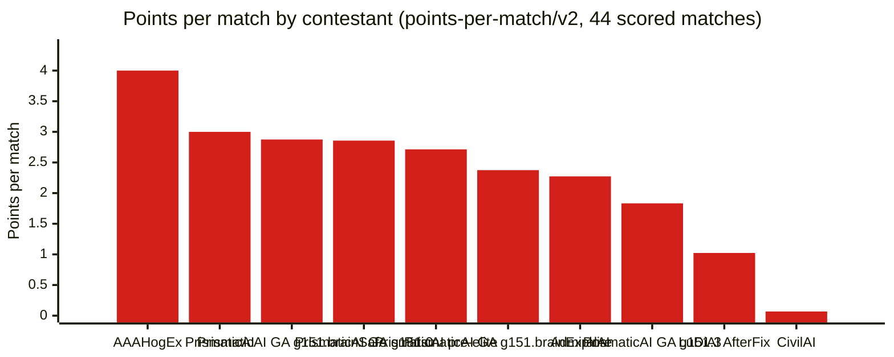
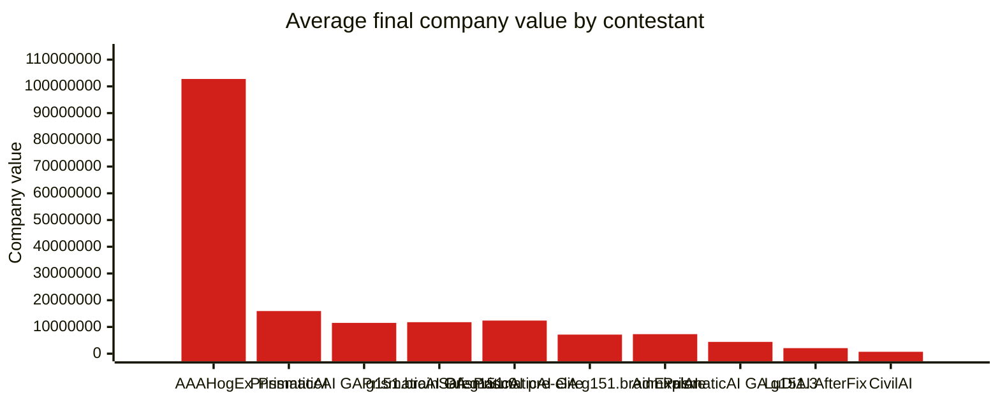
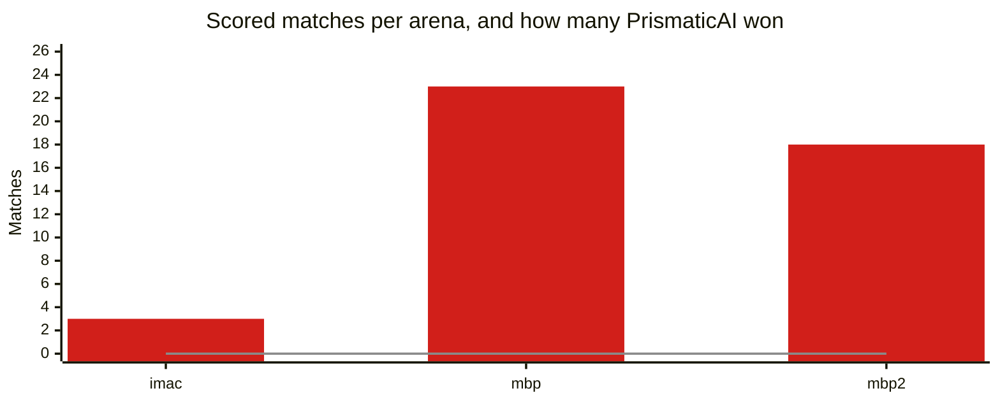

# battle-20261120T145517-cc329e96

Derived from `battle-20261120T145517-cc329e96.json` by `tools/research/ai-battle/battle.py report`; do not edit.

- Edition `cc329e96c220707e`: PrismaticAI and referee at `2b32ecb6f1049e718e513efb309e963aa0a5205c`, base set `opengfx-8.0.tar`
- 20-year free-for-all from 1960, map 256x256 temperate, breakdowns 1
- 44 scored match(es) on `imac` (20261119-master-gdf1e05e7d8), `mbp` (20261120-master-m17653b726e), `mbp2` (20261119-master-gdf1e05e7d8)
- Replays: 0 of 0 identical to their original on another arena

| # | Contestant | Played | Wins | Points | Points/match | Avg rank | Avg final value | Squirrel errors | Matches with anomalies |
|---|---|---|---|---|---|---|---|---|---|
| 1 | AAAHogEx | 44 | 44 | 176 | 4.0 | 1.0 | 102.8 M | 0 | 0 |
| 2 | PrismaticAI | 8 | 0 | 24 | 3.0 | 2.0 | 15.9 M | 0 | 6 |
| 3 | PrismaticAI GA g151.brainSafe | 8 | 0 | 23 | 2.875 | 2.12 | 11.5 M | 0 | 6 |
| 4 | PrismaticAI GA g151.0 | 7 | 0 | 20 | 2.857 | 2.14 | 11.8 M | 0 | 5 |
| 5 | PrismaticAI pre-elite | 7 | 0 | 19 | 2.714 | 2.29 | 12.4 M | 0 | 0 |
| 6 | PrismaticAI GA g151.brainExplore | 8 | 0 | 19 | 2.375 | 2.62 | 7.1 M | 0 | 5 |
| 7 | AdmiralAI | 44 | 0 | 100 | 2.273 | 2.73 | 7.3 M | 116 | 4 |
| 8 | PrismaticAI GA g151.3 | 6 | 0 | 11 | 1.833 | 3.17 | 4.4 M | 0 | 3 |
| 9 | LuDiAI AfterFix | 44 | 0 | 45 | 1.023 | 3.98 | 2.1 M | 0 | 1 |
| 10 | CivilAI | 44 | 0 | 3 | 0.068 | 4.93 | 705.1 k | 0 | 5 |

```mermaid
---
config:
  xyChart:
    width: 900
    height: 360
  themeVariables:
    xyChart:
      plotColorPalette: "#d11f1a, #8a8a8a, #0b0b0b, #ece4d6"
---
xychart-beta
    title "Final company value per scored match: winner vs best PrismaticAI"
    x-axis ["m-0001", "m-0002", "m-0003", "m-0004", "m-0005", "m-0006", "m-0007", "m-0008", "m-0009", "m-0010", "m-0011", "m-0012", "m-0013", "m-0014", "m-0015", "m-0016", "m-0017", "m-0018", "m-0019", "m-0020", "m-0021", "m-0022", "m-0023", "m-0024", "m-0025", "m-0026", "m-0027", "m-0028", "m-0036", "m-0037", "m-0038", "m-0039", "m-0040", "m-0041", "m-0042", "m-0043", "m-0044", "m-0045", "m-0046", "m-0057", "m-0058", "m-0059", "m-0060", "m-0066"]
    %% series: Winner | Best PrismaticAI
    %% links: battle-20261120T145517-cc329e96.md?col=Match&filter=m-0001 | battle-20261120T145517-cc329e96.md?col=Match&filter=m-0002 | battle-20261120T145517-cc329e96.md?col=Match&filter=m-0003 | battle-20261120T145517-cc329e96.md?col=Match&filter=m-0004 | battle-20261120T145517-cc329e96.md?col=Match&filter=m-0005 | battle-20261120T145517-cc329e96.md?col=Match&filter=m-0006 | battle-20261120T145517-cc329e96.md?col=Match&filter=m-0007 | battle-20261120T145517-cc329e96.md?col=Match&filter=m-0008 | battle-20261120T145517-cc329e96.md?col=Match&filter=m-0009 | battle-20261120T145517-cc329e96.md?col=Match&filter=m-0010 | battle-20261120T145517-cc329e96.md?col=Match&filter=m-0011 | battle-20261120T145517-cc329e96.md?col=Match&filter=m-0012 | battle-20261120T145517-cc329e96.md?col=Match&filter=m-0013 | battle-20261120T145517-cc329e96.md?col=Match&filter=m-0014 | battle-20261120T145517-cc329e96.md?col=Match&filter=m-0015 | battle-20261120T145517-cc329e96.md?col=Match&filter=m-0016 | battle-20261120T145517-cc329e96.md?col=Match&filter=m-0017 | battle-20261120T145517-cc329e96.md?col=Match&filter=m-0018 | battle-20261120T145517-cc329e96.md?col=Match&filter=m-0019 | battle-20261120T145517-cc329e96.md?col=Match&filter=m-0020 | battle-20261120T145517-cc329e96.md?col=Match&filter=m-0021 | battle-20261120T145517-cc329e96.md?col=Match&filter=m-0022 | battle-20261120T145517-cc329e96.md?col=Match&filter=m-0023 | battle-20261120T145517-cc329e96.md?col=Match&filter=m-0024 | battle-20261120T145517-cc329e96.md?col=Match&filter=m-0025 | battle-20261120T145517-cc329e96.md?col=Match&filter=m-0026 | battle-20261120T145517-cc329e96.md?col=Match&filter=m-0027 | battle-20261120T145517-cc329e96.md?col=Match&filter=m-0028 | battle-20261120T145517-cc329e96.md?col=Match&filter=m-0036 | battle-20261120T145517-cc329e96.md?col=Match&filter=m-0037 | battle-20261120T145517-cc329e96.md?col=Match&filter=m-0038 | battle-20261120T145517-cc329e96.md?col=Match&filter=m-0039 | battle-20261120T145517-cc329e96.md?col=Match&filter=m-0040 | battle-20261120T145517-cc329e96.md?col=Match&filter=m-0041 | battle-20261120T145517-cc329e96.md?col=Match&filter=m-0042 | battle-20261120T145517-cc329e96.md?col=Match&filter=m-0043 | battle-20261120T145517-cc329e96.md?col=Match&filter=m-0044 | battle-20261120T145517-cc329e96.md?col=Match&filter=m-0045 | battle-20261120T145517-cc329e96.md?col=Match&filter=m-0046 | battle-20261120T145517-cc329e96.md?col=Match&filter=m-0057 | battle-20261120T145517-cc329e96.md?col=Match&filter=m-0058 | battle-20261120T145517-cc329e96.md?col=Match&filter=m-0059 | battle-20261120T145517-cc329e96.md?col=Match&filter=m-0060 | battle-20261120T145517-cc329e96.md?col=Match&filter=m-0066
    y-axis "Company value" 0 --> 142000000
    bar [104127653, 107432578, 100937312, 102738219, 119649233, 97407100, 111575388, 102272237, 97529294, 103416183, 99632827, 115781791, 111988258, 127692270, 101708488, 108137653, 116818236, 104538107, 109317164, 111932291, 87243926, 117762705, 90698718, 63804890, 74689404, 85155872, 75134360, 63393523, 129067785, 97846097, 118385650, 120383179, 129074916, 113941803, 103343608, 85055489, 77781592, 75684748, 81503524, 125549982, 112786490, 107655570, 113236908, 118079493]
    line [16393538, 17395853, 11479012, 5950313, 9836407, 13492441, 19385307, 8782193, 15413966, 1856607, 5843731, 12670161, 5769649, 7638900, 10681714, 4115977, 2195684, 14676205, 15799866, 9534788, 11439613, 6439670, 3080532, 11176920, 10375075, 12735185, 4856123, 10414172, 20392024, 13732749, 17754557, 13035885, 7851717, 2080652, 15012149, 5203072, 8588015, 9401735, 10446068, 15844942, 9958141, 3394705, 21360059, 18766718]
```

<!-- battle-charts:begin -->
<!-- derived from battle-20261120T145517-cc329e96.json by `battle.py render`; `battle.py check` fails when it is stale -->

<!-- battle-charts:end -->

| Match | Arena | Seed | Winner | Value | Last | Anomalies |
|---|---|---|---|---|---|---|
| m-0001 | mbp | 759224276 | AAAHogEx | 104.1 M | CivilAI | - |
| m-0002 | mbp | 759224276 | AAAHogEx | 107.4 M | CivilAI | PrismaticAI GA g151.0: fleet_drop:143->88 |
| m-0003 | mbp | 759224276 | AAAHogEx | 100.9 M | CivilAI | PrismaticAI GA g151.brainSafe: fleet_drop:99->51 |
| m-0004 | mbp | 759224276 | AAAHogEx | 102.7 M | CivilAI | PrismaticAI GA g151.brainExplore: fleet_drop:118->36 |
| m-0005 | mbp | 759224276 | AAAHogEx | 119.6 M | CivilAI | PrismaticAI GA g151.3: fleet_drop:173->90 |
| m-0006 | mbp | 1310211440 | AAAHogEx | 97.4 M | CivilAI | PrismaticAI: fleet_drop:105->66; CivilAI: fleet_drop:41->25 |
| m-0007 | mbp | 1310211440 | AAAHogEx | 111.6 M | CivilAI | - |
| m-0008 | mbp | 1310211440 | AAAHogEx | 102.3 M | CivilAI | PrismaticAI GA g151.0: fleet_drop:133->57 |
| m-0009 | mbp | 1310211440 | AAAHogEx | 97.5 M | CivilAI | PrismaticAI GA g151.brainSafe: fleet_drop:67->42; AdmiralAI: squirrel_errors:44; CivilAI: fleet_drop:59->25 |
| m-0010 | imac | 1310211440 | AAAHogEx | 103.4 M | CivilAI | PrismaticAI GA g151.brainExplore: fleet_drop:129->42 |
| m-0011 | imac | 1310211440 | AAAHogEx | 99.6 M | CivilAI | PrismaticAI GA g151.3: fleet_drop:126->65 |
| m-0012 | imac | 1667570708 | AAAHogEx | 115.8 M | CivilAI | PrismaticAI: fleet_drop:107->62 |
| m-0013 | mbp2 | 1667570708 | AAAHogEx | 112.0 M | CivilAI | - |
| m-0014 | mbp2 | 1667570708 | AAAHogEx | 127.7 M | CivilAI | - |
| m-0015 | mbp2 | 1667570708 | AAAHogEx | 101.7 M | LuDiAI AfterFix | PrismaticAI GA g151.brainSafe: fleet_drop:133->66 |
| m-0016 | mbp2 | 1667570708 | AAAHogEx | 108.1 M | CivilAI | PrismaticAI GA g151.brainExplore: fleet_drop:148->85; LuDiAI AfterFix: fleet_drop:117->79; CivilAI: fleet_drop:47->14 |
| m-0017 | mbp2 | 1667570708 | AAAHogEx | 116.8 M | CivilAI | - |
| m-0018 | mbp2 | 1849277030 | AAAHogEx | 104.5 M | CivilAI | PrismaticAI: fleet_drop:157->101 |
| m-0019 | mbp2 | 1849277030 | AAAHogEx | 109.3 M | CivilAI | - |
| m-0020 | mbp2 | 1849277030 | AAAHogEx | 111.9 M | CivilAI | PrismaticAI GA g151.0: fleet_drop:88->61 |
| m-0021 | mbp2 | 1849277030 | AAAHogEx | 87.2 M | CivilAI | PrismaticAI GA g151.brainSafe: fleet_drop:101->65 |
| m-0022 | mbp2 | 1849277030 | AAAHogEx | 117.8 M | CivilAI | - |
| m-0023 | mbp2 | 1849277030 | AAAHogEx | 90.7 M | CivilAI | AdmiralAI: fleet_drop:280->157 |
| m-0024 | mbp2 | 1547673943 | AAAHogEx | 63.8 M | CivilAI | - |
| m-0025 | mbp2 | 1547673943 | AAAHogEx | 74.7 M | CivilAI | AdmiralAI: fleet_drop:185->126 |
| m-0026 | mbp2 | 1547673943 | AAAHogEx | 85.2 M | CivilAI | PrismaticAI GA g151.0: fleet_drop:97->63 |
| m-0027 | mbp2 | 1547673943 | AAAHogEx | 75.1 M | CivilAI | PrismaticAI GA g151.brainSafe: fleet_drop:85->45 |
| m-0028 | mbp2 | 1547673943 | AAAHogEx | 63.4 M | LuDiAI AfterFix | PrismaticAI GA g151.brainExplore: fleet_drop:187->62 |
| m-0036 | mbp | 860985213 | AAAHogEx | 129.1 M | CivilAI | PrismaticAI: fleet_drop:119->68 |
| m-0037 | mbp | 860985213 | AAAHogEx | 97.8 M | CivilAI | - |
| m-0038 | mbp | 860985213 | AAAHogEx | 118.4 M | CivilAI | PrismaticAI GA g151.0: fleet_drop:127->83 |
| m-0039 | mbp | 860985213 | AAAHogEx | 120.4 M | CivilAI | - |
| m-0040 | mbp | 860985213 | AAAHogEx | 129.1 M | CivilAI | PrismaticAI GA g151.brainExplore: fleet_drop:231->96 |
| m-0041 | mbp | 860985213 | AAAHogEx | 113.9 M | CivilAI | PrismaticAI GA g151.3: fleet_drop:137->60 |
| m-0042 | mbp | 1995771416 | AAAHogEx | 103.3 M | CivilAI | PrismaticAI: fleet_drop:113->69 |
| m-0043 | mbp | 1995771416 | AAAHogEx | 85.1 M | CivilAI | CivilAI: fleet_drop:15->10 |
| m-0044 | mbp | 1995771416 | AAAHogEx | 77.8 M | CivilAI | - |
| m-0045 | mbp2 | 1995771416 | AAAHogEx | 75.7 M | CivilAI | PrismaticAI GA g151.brainSafe: fleet_drop:70->45 |
| m-0046 | mbp2 | 1995771416 | AAAHogEx | 81.5 M | CivilAI | - |
| m-0057 | mbp | 712736997 | AAAHogEx | 125.5 M | CivilAI | AdmiralAI: squirrel_errors:72; CivilAI: fleet_drop:65->44 |
| m-0058 | mbp | 712736997 | AAAHogEx | 112.8 M | CivilAI | - |
| m-0059 | mbp | 712736997 | AAAHogEx | 107.7 M | LuDiAI AfterFix | - |
| m-0060 | mbp | 855485619 | AAAHogEx | 113.2 M | CivilAI | - |
| m-0066 | mbp | 1679236145 | AAAHogEx | 118.1 M | CivilAI | PrismaticAI: fleet_drop:143->97 |
