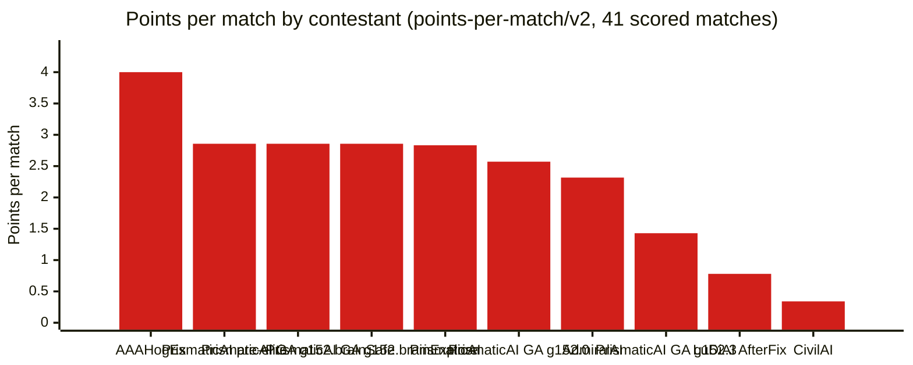
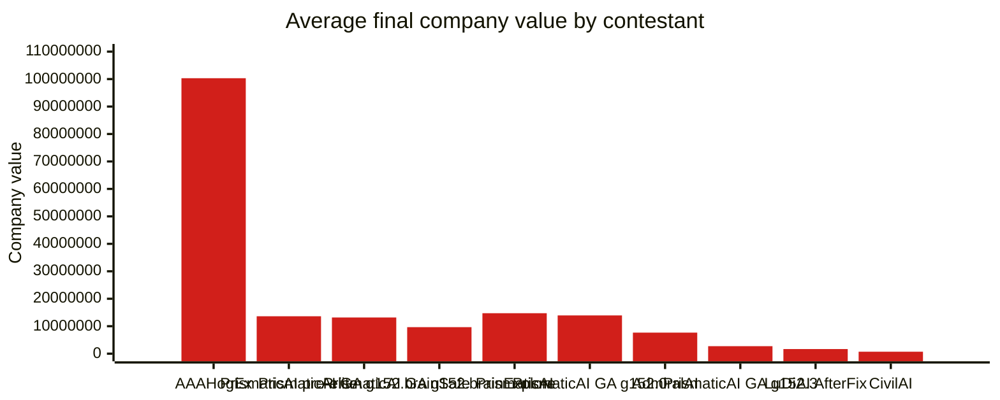
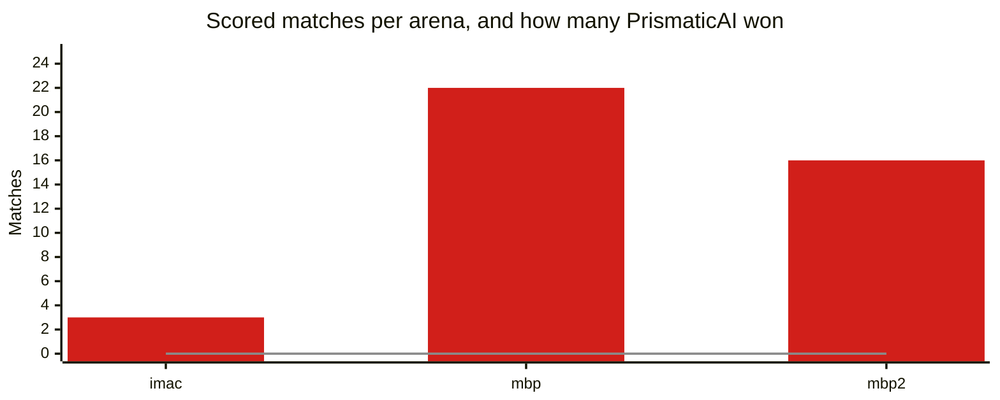

# battle-20261120T150530-6f7457c4

Derived from `battle-20261120T150530-6f7457c4.json` by `tools/research/ai-battle/battle.py report`; do not edit.

- Edition `6f7457c42f9fe25d`: PrismaticAI and referee at `2b32ecb6f1049e718e513efb309e963aa0a5205c`, base set `opengfx-8.0.tar`
- 20-year free-for-all from 1960, map 256x256 temperate, breakdowns 1
- 41 scored match(es) on `imac` (20261119-master-gdf1e05e7d8), `mbp` (20261120-master-m17653b726e), `mbp2` (20261119-master-gdf1e05e7d8)
- Replays: 1 of 1 identical to their original on another arena

| # | Contestant | Played | Wins | Points | Points/match | Avg rank | Avg final value | Squirrel errors | Matches with anomalies |
|---|---|---|---|---|---|---|---|---|---|
| 1 | AAAHogEx | 41 | 41 | 164 | 4.0 | 1.0 | 100.3 M | 0 | 0 |
| 2 | PrismaticAI pre-elite | 7 | 0 | 20 | 2.857 | 2.14 | 13.6 M | 0 | 0 |
| 3 | PrismaticAI GA g152.brainSafe | 7 | 0 | 20 | 2.857 | 2.14 | 13.2 M | 0 | 0 |
| 4 | PrismaticAI GA g152.brainExplore | 7 | 0 | 20 | 2.857 | 2.14 | 9.7 M | 0 | 2 |
| 5 | PrismaticAI | 6 | 0 | 17 | 2.833 | 2.17 | 14.7 M | 0 | 3 |
| 6 | PrismaticAI GA g152.0 | 7 | 0 | 18 | 2.571 | 2.43 | 13.9 M | 0 | 3 |
| 7 | AdmiralAI | 41 | 0 | 95 | 2.317 | 2.68 | 7.7 M | 44 | 1 |
| 8 | PrismaticAI GA g152.3 | 7 | 0 | 10 | 1.429 | 3.57 | 2.7 M | 0 | 4 |
| 9 | LuDiAI AfterFix | 41 | 0 | 32 | 0.78 | 4.22 | 1.7 M | 0 | 0 |
| 10 | CivilAI | 41 | 0 | 14 | 0.341 | 4.66 | 710.3 k | 7370 | 6 |

```mermaid
---
config:
  xyChart:
    width: 900
    height: 360
  themeVariables:
    xyChart:
      plotColorPalette: "#d11f1a, #8a8a8a, #0b0b0b, #ece4d6"
---
xychart-beta
    title "Final company value per scored match: winner vs best PrismaticAI"
    x-axis ["m-0001", "m-0002", "m-0003", "m-0004", "m-0005", "m-0006", "m-0007", "m-0008", "m-0009", "m-0010", "m-0011", "m-0012", "m-0013", "m-0014", "m-0015", "m-0016", "m-0017", "m-0018", "m-0019", "m-0020", "m-0021", "m-0022", "m-0023", "m-0024", "m-0025", "m-0026", "m-0027", "m-0028", "m-0036", "m-0037", "m-0038", "m-0039", "m-0040", "m-0041", "m-0042", "m-0043", "m-0044", "m-0057", "m-0058", "m-0059", "m-0065"]
    %% series: Winner | Best PrismaticAI
    %% links: battle-20261120T150530-6f7457c4.md?col=Match&filter=m-0001 | battle-20261120T150530-6f7457c4.md?col=Match&filter=m-0002 | battle-20261120T150530-6f7457c4.md?col=Match&filter=m-0003 | battle-20261120T150530-6f7457c4.md?col=Match&filter=m-0004 | battle-20261120T150530-6f7457c4.md?col=Match&filter=m-0005 | battle-20261120T150530-6f7457c4.md?col=Match&filter=m-0006 | battle-20261120T150530-6f7457c4.md?col=Match&filter=m-0007 | battle-20261120T150530-6f7457c4.md?col=Match&filter=m-0008 | battle-20261120T150530-6f7457c4.md?col=Match&filter=m-0009 | battle-20261120T150530-6f7457c4.md?col=Match&filter=m-0010 | battle-20261120T150530-6f7457c4.md?col=Match&filter=m-0011 | battle-20261120T150530-6f7457c4.md?col=Match&filter=m-0012 | battle-20261120T150530-6f7457c4.md?col=Match&filter=m-0013 | battle-20261120T150530-6f7457c4.md?col=Match&filter=m-0014 | battle-20261120T150530-6f7457c4.md?col=Match&filter=m-0015 | battle-20261120T150530-6f7457c4.md?col=Match&filter=m-0016 | battle-20261120T150530-6f7457c4.md?col=Match&filter=m-0017 | battle-20261120T150530-6f7457c4.md?col=Match&filter=m-0018 | battle-20261120T150530-6f7457c4.md?col=Match&filter=m-0019 | battle-20261120T150530-6f7457c4.md?col=Match&filter=m-0020 | battle-20261120T150530-6f7457c4.md?col=Match&filter=m-0021 | battle-20261120T150530-6f7457c4.md?col=Match&filter=m-0022 | battle-20261120T150530-6f7457c4.md?col=Match&filter=m-0023 | battle-20261120T150530-6f7457c4.md?col=Match&filter=m-0024 | battle-20261120T150530-6f7457c4.md?col=Match&filter=m-0025 | battle-20261120T150530-6f7457c4.md?col=Match&filter=m-0026 | battle-20261120T150530-6f7457c4.md?col=Match&filter=m-0027 | battle-20261120T150530-6f7457c4.md?col=Match&filter=m-0028 | battle-20261120T150530-6f7457c4.md?col=Match&filter=m-0036 | battle-20261120T150530-6f7457c4.md?col=Match&filter=m-0037 | battle-20261120T150530-6f7457c4.md?col=Match&filter=m-0038 | battle-20261120T150530-6f7457c4.md?col=Match&filter=m-0039 | battle-20261120T150530-6f7457c4.md?col=Match&filter=m-0040 | battle-20261120T150530-6f7457c4.md?col=Match&filter=m-0041 | battle-20261120T150530-6f7457c4.md?col=Match&filter=m-0042 | battle-20261120T150530-6f7457c4.md?col=Match&filter=m-0043 | battle-20261120T150530-6f7457c4.md?col=Match&filter=m-0044 | battle-20261120T150530-6f7457c4.md?col=Match&filter=m-0057 | battle-20261120T150530-6f7457c4.md?col=Match&filter=m-0058 | battle-20261120T150530-6f7457c4.md?col=Match&filter=m-0059 | battle-20261120T150530-6f7457c4.md?col=Match&filter=m-0065
    y-axis "Company value" 0 --> 174000000
    bar [83933172, 62617602, 61942611, 69853786, 94302736, 118035505, 129302811, 109723364, 108745805, 125522633, 142342067, 80440027, 90346015, 40155638, 78272770, 95010527, 89994843, 85563337, 108900299, 92749444, 104287653, 97336305, 103512579, 92753161, 85095719, 75094252, 65434797, 52076693, 133062409, 105360042, 141713826, 146262809, 147772148, 130431569, 158478701, 133733162, 121776663, 85573191, 75603702, 105966118, 83841555]
    line [13330223, 12443614, 16613064, 9532250, 1430700, 13806929, 12240226, 6740869, 9077187, 9240285, 1085342, 15635369, 14458296, 20537948, 9198226, 9822733, 1573739, 12550562, 11075769, 16925477, 14163118, 11130719, 2225537, 13359782, 14541978, 8532079, 11543374, 12574637, 10873929, 12639312, 10942697, 14473315, 10223937, 7331725, 22175586, 17061464, 21366172, 17156245, 5060355, 5432961, 1]
```

<!-- battle-charts:begin -->
<!-- derived from battle-20261120T150530-6f7457c4.json by `battle.py render`; `battle.py check` fails when it is stale -->

<!-- battle-charts:end -->

| Seed | Original | Replay | Arenas | Identical |
|---|---|---|---|---|
| 203500596 | m-0013 | m-0056 | mbp2 / mbp | yes |

| Match | Arena | Seed | Winner | Value | Last | Anomalies |
|---|---|---|---|---|---|---|
| m-0001 | mbp | 684992538 | AAAHogEx | 83.9 M | CivilAI | - |
| m-0002 | mbp | 684992538 | AAAHogEx | 62.6 M | CivilAI | PrismaticAI GA g152.0: fleet_drop:65->36 |
| m-0003 | mbp | 684992538 | AAAHogEx | 61.9 M | CivilAI | CivilAI: squirrel_errors:3625 |
| m-0004 | mbp | 684992538 | AAAHogEx | 69.9 M | CivilAI | - |
| m-0005 | mbp | 684992538 | AAAHogEx | 94.3 M | CivilAI | PrismaticAI GA g152.3: fleet_drop:93->51 |
| m-0006 | mbp | 378873276 | AAAHogEx | 118.0 M | CivilAI | - |
| m-0007 | mbp | 378873276 | AAAHogEx | 129.3 M | CivilAI | - |
| m-0008 | mbp | 378873276 | AAAHogEx | 109.7 M | CivilAI | - |
| m-0009 | mbp | 378873276 | AAAHogEx | 108.7 M | CivilAI | - |
| m-0010 | imac | 378873276 | AAAHogEx | 125.5 M | CivilAI | - |
| m-0011 | imac | 378873276 | AAAHogEx | 142.3 M | CivilAI | - |
| m-0012 | imac | 203500596 | AAAHogEx | 80.4 M | LuDiAI AfterFix | PrismaticAI: fleet_drop:121->63 |
| m-0013 | mbp2 | 203500596 | AAAHogEx | 90.3 M | LuDiAI AfterFix | - |
| m-0014 | mbp2 | 203500596 | AAAHogEx | 40.2 M | LuDiAI AfterFix | - |
| m-0015 | mbp2 | 203500596 | AAAHogEx | 78.3 M | CivilAI | CivilAI: fleet_drop:27->18 |
| m-0016 | mbp2 | 203500596 | AAAHogEx | 95.0 M | LuDiAI AfterFix | PrismaticAI GA g152.brainExplore: fleet_drop:185->125 |
| m-0017 | mbp2 | 203500596 | AAAHogEx | 90.0 M | LuDiAI AfterFix | - |
| m-0018 | mbp2 | 1092831957 | AAAHogEx | 85.6 M | LuDiAI AfterFix | PrismaticAI: fleet_drop:120->80 |
| m-0019 | mbp2 | 1092831957 | AAAHogEx | 108.9 M | LuDiAI AfterFix | CivilAI: no_vehicles |
| m-0020 | mbp2 | 1092831957 | AAAHogEx | 92.7 M | LuDiAI AfterFix | - |
| m-0021 | mbp2 | 1092831957 | AAAHogEx | 104.3 M | CivilAI | - |
| m-0022 | mbp2 | 1092831957 | AAAHogEx | 97.3 M | LuDiAI AfterFix | - |
| m-0023 | mbp2 | 1092831957 | AAAHogEx | 103.5 M | LuDiAI AfterFix | - |
| m-0024 | mbp2 | 88758106 | AAAHogEx | 92.8 M | CivilAI | PrismaticAI: fleet_drop:79->55; CivilAI: squirrel_errors:3745 |
| m-0025 | mbp2 | 88758106 | AAAHogEx | 85.1 M | CivilAI | - |
| m-0026 | mbp2 | 88758106 | AAAHogEx | 75.1 M | CivilAI | CivilAI: no_vehicles |
| m-0027 | mbp2 | 88758106 | AAAHogEx | 65.4 M | CivilAI | CivilAI: fleet_drop:45->19 |
| m-0028 | mbp2 | 88758106 | AAAHogEx | 52.1 M | CivilAI | - |
| m-0036 | mbp | 234733975 | AAAHogEx | 133.1 M | CivilAI | - |
| m-0037 | mbp | 234733975 | AAAHogEx | 105.4 M | CivilAI | - |
| m-0038 | mbp | 234733975 | AAAHogEx | 141.7 M | CivilAI | PrismaticAI GA g152.0: fleet_drop:139->66 |
| m-0039 | mbp | 234733975 | AAAHogEx | 146.3 M | CivilAI | - |
| m-0040 | mbp | 234733975 | AAAHogEx | 147.8 M | CivilAI | PrismaticAI GA g152.brainExplore: fleet_drop:159->97 |
| m-0041 | mbp | 234733975 | AAAHogEx | 130.4 M | CivilAI | PrismaticAI GA g152.3: fleet_drop:199->114 |
| m-0042 | mbp | 783327243 | AAAHogEx | 158.5 M | CivilAI | - |
| m-0043 | mbp | 783327243 | AAAHogEx | 133.7 M | CivilAI | AdmiralAI: squirrel_errors:44 |
| m-0044 | mbp | 783327243 | AAAHogEx | 121.8 M | CivilAI | PrismaticAI GA g152.0: fleet_drop:189->112 |
| m-0056 (replay) | mbp | 203500596 | AAAHogEx | 90.3 M | LuDiAI AfterFix | - |
| m-0057 | mbp | 662417712 | AAAHogEx | 85.6 M | CivilAI | - |
| m-0058 | mbp | 662417712 | AAAHogEx | 75.6 M | CivilAI | - |
| m-0059 | mbp | 662417712 | AAAHogEx | 106.0 M | LuDiAI AfterFix | PrismaticAI GA g152.3: fleet_drop:74->40 |
| m-0065 | mbp | 464398984 | AAAHogEx | 83.8 M | PrismaticAI GA g152.3 | PrismaticAI GA g152.3: fleet_drop:22->9 |
