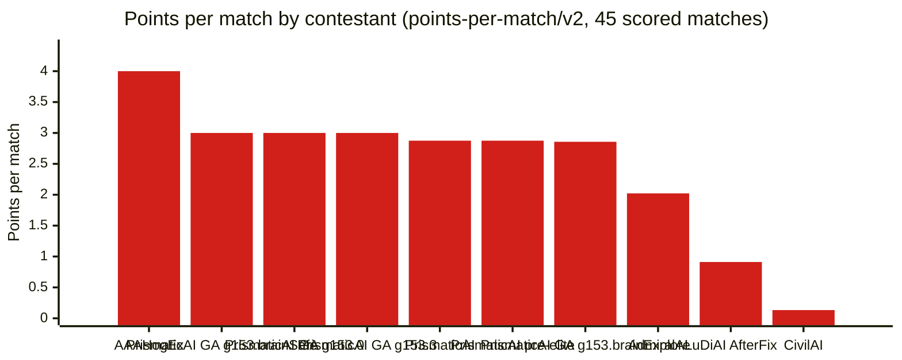
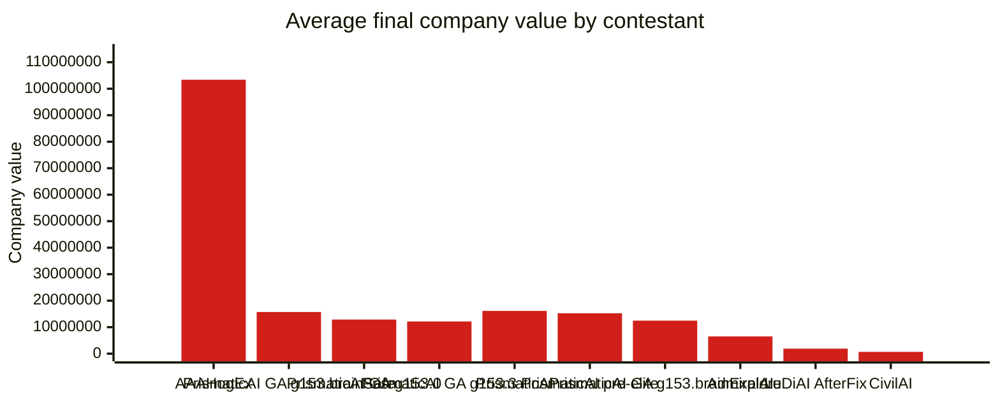
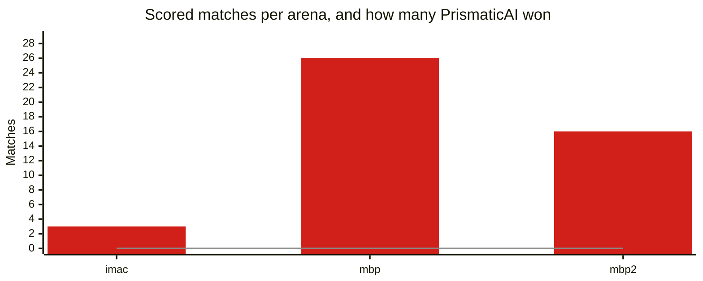

# battle-20261120T151611-3466e2f0

Derived from `battle-20261120T151611-3466e2f0.json` by `tools/research/ai-battle/battle.py report`; do not edit.

- Edition `3466e2f0f0654acb`: PrismaticAI and referee at `2b32ecb6f1049e718e513efb309e963aa0a5205c`, base set `opengfx-8.0.tar`
- 20-year free-for-all from 1960, map 256x256 temperate, breakdowns 1
- 45 scored match(es) on `imac` (20261119-master-gdf1e05e7d8), `mbp` (20261120-master-m17653b726e), `mbp2` (20261119-master-gdf1e05e7d8)
- Replays: 0 of 0 identical to their original on another arena

| # | Contestant | Played | Wins | Points | Points/match | Avg rank | Avg final value | Squirrel errors | Matches with anomalies |
|---|---|---|---|---|---|---|---|---|---|
| 1 | AAAHogEx | 45 | 45 | 180 | 4.0 | 1.0 | 103.4 M | 0 | 0 |
| 2 | PrismaticAI GA g153.brainSafe | 8 | 0 | 24 | 3.0 | 2.0 | 15.7 M | 0 | 1 |
| 3 | PrismaticAI GA g153.0 | 8 | 0 | 24 | 3.0 | 2.0 | 12.9 M | 0 | 0 |
| 4 | PrismaticAI GA g153.3 | 6 | 0 | 18 | 3.0 | 2.0 | 12.1 M | 0 | 2 |
| 5 | PrismaticAI | 8 | 0 | 23 | 2.875 | 2.12 | 16.1 M | 0 | 4 |
| 6 | PrismaticAI pre-elite | 8 | 0 | 23 | 2.875 | 2.12 | 15.2 M | 0 | 1 |
| 7 | PrismaticAI GA g153.brainExplore | 7 | 0 | 20 | 2.857 | 2.14 | 12.5 M | 0 | 0 |
| 8 | AdmiralAI | 45 | 0 | 91 | 2.022 | 2.98 | 6.5 M | 0 | 1 |
| 9 | LuDiAI AfterFix | 45 | 0 | 41 | 0.911 | 4.09 | 1.9 M | 0 | 1 |
| 10 | CivilAI | 45 | 0 | 6 | 0.133 | 4.87 | 669.3 k | 0 | 10 |

```mermaid
---
config:
  xyChart:
    width: 900
    height: 360
  themeVariables:
    xyChart:
      plotColorPalette: "#d11f1a, #8a8a8a, #0b0b0b, #ece4d6"
---
xychart-beta
    title "Final company value per scored match: winner vs best PrismaticAI"
    x-axis ["m-0001", "m-0002", "m-0003", "m-0004", "m-0005", "m-0006", "m-0007", "m-0008", "m-0009", "m-0010", "m-0011", "m-0012", "m-0013", "m-0014", "m-0015", "m-0016", "m-0017", "m-0018", "m-0019", "m-0020", "m-0021", "m-0022", "m-0023", "m-0024", "m-0025", "m-0026", "m-0027", "m-0028", "m-0036", "m-0037", "m-0038", "m-0039", "m-0040", "m-0041", "m-0042", "m-0043", "m-0044", "m-0045", "m-0046", "m-0047", "m-0048", "m-0049", "m-0050", "m-0051", "m-0054"]
    %% series: Winner | Best PrismaticAI
    %% links: battle-20261120T151611-3466e2f0.md?col=Match&filter=m-0001 | battle-20261120T151611-3466e2f0.md?col=Match&filter=m-0002 | battle-20261120T151611-3466e2f0.md?col=Match&filter=m-0003 | battle-20261120T151611-3466e2f0.md?col=Match&filter=m-0004 | battle-20261120T151611-3466e2f0.md?col=Match&filter=m-0005 | battle-20261120T151611-3466e2f0.md?col=Match&filter=m-0006 | battle-20261120T151611-3466e2f0.md?col=Match&filter=m-0007 | battle-20261120T151611-3466e2f0.md?col=Match&filter=m-0008 | battle-20261120T151611-3466e2f0.md?col=Match&filter=m-0009 | battle-20261120T151611-3466e2f0.md?col=Match&filter=m-0010 | battle-20261120T151611-3466e2f0.md?col=Match&filter=m-0011 | battle-20261120T151611-3466e2f0.md?col=Match&filter=m-0012 | battle-20261120T151611-3466e2f0.md?col=Match&filter=m-0013 | battle-20261120T151611-3466e2f0.md?col=Match&filter=m-0014 | battle-20261120T151611-3466e2f0.md?col=Match&filter=m-0015 | battle-20261120T151611-3466e2f0.md?col=Match&filter=m-0016 | battle-20261120T151611-3466e2f0.md?col=Match&filter=m-0017 | battle-20261120T151611-3466e2f0.md?col=Match&filter=m-0018 | battle-20261120T151611-3466e2f0.md?col=Match&filter=m-0019 | battle-20261120T151611-3466e2f0.md?col=Match&filter=m-0020 | battle-20261120T151611-3466e2f0.md?col=Match&filter=m-0021 | battle-20261120T151611-3466e2f0.md?col=Match&filter=m-0022 | battle-20261120T151611-3466e2f0.md?col=Match&filter=m-0023 | battle-20261120T151611-3466e2f0.md?col=Match&filter=m-0024 | battle-20261120T151611-3466e2f0.md?col=Match&filter=m-0025 | battle-20261120T151611-3466e2f0.md?col=Match&filter=m-0026 | battle-20261120T151611-3466e2f0.md?col=Match&filter=m-0027 | battle-20261120T151611-3466e2f0.md?col=Match&filter=m-0028 | battle-20261120T151611-3466e2f0.md?col=Match&filter=m-0036 | battle-20261120T151611-3466e2f0.md?col=Match&filter=m-0037 | battle-20261120T151611-3466e2f0.md?col=Match&filter=m-0038 | battle-20261120T151611-3466e2f0.md?col=Match&filter=m-0039 | battle-20261120T151611-3466e2f0.md?col=Match&filter=m-0040 | battle-20261120T151611-3466e2f0.md?col=Match&filter=m-0041 | battle-20261120T151611-3466e2f0.md?col=Match&filter=m-0042 | battle-20261120T151611-3466e2f0.md?col=Match&filter=m-0043 | battle-20261120T151611-3466e2f0.md?col=Match&filter=m-0044 | battle-20261120T151611-3466e2f0.md?col=Match&filter=m-0045 | battle-20261120T151611-3466e2f0.md?col=Match&filter=m-0046 | battle-20261120T151611-3466e2f0.md?col=Match&filter=m-0047 | battle-20261120T151611-3466e2f0.md?col=Match&filter=m-0048 | battle-20261120T151611-3466e2f0.md?col=Match&filter=m-0049 | battle-20261120T151611-3466e2f0.md?col=Match&filter=m-0050 | battle-20261120T151611-3466e2f0.md?col=Match&filter=m-0051 | battle-20261120T151611-3466e2f0.md?col=Match&filter=m-0054
    y-axis "Company value" 0 --> 178000000
    bar [149054354, 162049447, 149429530, 144359303, 146774930, 75385239, 90159901, 93112733, 104753586, 58718245, 79739880, 78808978, 80909993, 88999438, 88049050, 78552000, 56329100, 97385049, 105348837, 106112952, 74307610, 76285730, 132666222, 99796693, 83521070, 94764300, 117710737, 138809318, 93163079, 95974336, 135211249, 99512807, 87314924, 95533271, 106101208, 107356924, 110256258, 125335532, 108598951, 92486247, 106256140, 93361850, 106923795, 124414980, 112727114]
    line [15138893, 17781138, 23416544, 15797168, 15281903, 8878596, 8766781, 10232488, 14917038, 5929570, 8690043, 22576732, 12681511, 13062686, 10673369, 5992168, 12851837, 18681107, 18389989, 9205399, 15342649, 15325953, 10163587, 16706109, 11984902, 11414341, 16457716, 15222281, 21346858, 19364150, 12352595, 18641367, 16415353, 14910806, 7781013, 16417235, 12681119, 15226502, 12538590, 10976497, 17822686, 19243336, 16263906, 11111268, 15298652]
```

<!-- battle-charts:begin -->
<!-- derived from battle-20261120T151611-3466e2f0.json by `battle.py render`; `battle.py check` fails when it is stale -->

<!-- battle-charts:end -->

| Match | Arena | Seed | Winner | Value | Last | Anomalies |
|---|---|---|---|---|---|---|
| m-0001 | mbp | 1820820722 | AAAHogEx | 149.1 M | CivilAI | CivilAI: fleet_drop:16->11 |
| m-0002 | mbp | 1820820722 | AAAHogEx | 162.0 M | CivilAI | - |
| m-0003 | mbp | 1820820722 | AAAHogEx | 149.4 M | CivilAI | - |
| m-0004 | mbp | 1820820722 | AAAHogEx | 144.4 M | CivilAI | CivilAI: fleet_drop:72->18 |
| m-0005 | mbp | 1820820722 | AAAHogEx | 146.8 M | CivilAI | PrismaticAI GA g153.3: fleet_drop:224->120 |
| m-0006 | mbp | 488012307 | AAAHogEx | 75.4 M | CivilAI | PrismaticAI: fleet_drop:47->32 |
| m-0007 | mbp | 488012307 | AAAHogEx | 90.2 M | CivilAI | PrismaticAI pre-elite: fleet_drop:65->42; CivilAI: fleet_drop:55->37 |
| m-0008 | mbp | 488012307 | AAAHogEx | 93.1 M | AdmiralAI | CivilAI: fleet_drop:55->28 |
| m-0009 | mbp | 488012307 | AAAHogEx | 104.8 M | CivilAI | - |
| m-0010 | imac | 488012307 | AAAHogEx | 58.7 M | CivilAI | CivilAI: fleet_drop:46->22 |
| m-0011 | imac | 488012307 | AAAHogEx | 79.7 M | CivilAI | CivilAI: fleet_drop:30->3 |
| m-0012 | imac | 1913648804 | AAAHogEx | 78.8 M | CivilAI | CivilAI: fleet_drop:26->2 |
| m-0013 | mbp2 | 1913648804 | AAAHogEx | 80.9 M | CivilAI | - |
| m-0014 | mbp2 | 1913648804 | AAAHogEx | 89.0 M | CivilAI | - |
| m-0015 | mbp2 | 1913648804 | AAAHogEx | 88.0 M | LuDiAI AfterFix | - |
| m-0016 | mbp2 | 1913648804 | AAAHogEx | 78.6 M | LuDiAI AfterFix | - |
| m-0017 | mbp2 | 1913648804 | AAAHogEx | 56.3 M | LuDiAI AfterFix | - |
| m-0018 | mbp2 | 220765308 | AAAHogEx | 97.4 M | CivilAI | - |
| m-0019 | mbp2 | 220765308 | AAAHogEx | 105.3 M | CivilAI | - |
| m-0020 | mbp2 | 220765308 | AAAHogEx | 106.1 M | CivilAI | - |
| m-0021 | mbp2 | 220765308 | AAAHogEx | 74.3 M | CivilAI | - |
| m-0022 | mbp2 | 220765308 | AAAHogEx | 76.3 M | CivilAI | - |
| m-0023 | mbp2 | 220765308 | AAAHogEx | 132.7 M | CivilAI | - |
| m-0024 | mbp2 | 1499459769 | AAAHogEx | 99.8 M | CivilAI | - |
| m-0025 | mbp2 | 1499459769 | AAAHogEx | 83.5 M | CivilAI | - |
| m-0026 | mbp2 | 1499459769 | AAAHogEx | 94.8 M | CivilAI | CivilAI: fleet_drop:13->5 |
| m-0027 | mbp2 | 1499459769 | AAAHogEx | 117.7 M | CivilAI | - |
| m-0028 | mbp2 | 1499459769 | AAAHogEx | 138.8 M | CivilAI | - |
| m-0036 | mbp | 249218886 | AAAHogEx | 93.2 M | CivilAI | - |
| m-0037 | mbp | 249218886 | AAAHogEx | 96.0 M | CivilAI | - |
| m-0038 | mbp | 249218886 | AAAHogEx | 135.2 M | CivilAI | LuDiAI AfterFix: fleet_drop:68->36 |
| m-0039 | mbp | 249218886 | AAAHogEx | 99.5 M | CivilAI | - |
| m-0040 | mbp | 249218886 | AAAHogEx | 87.3 M | LuDiAI AfterFix | - |
| m-0041 | mbp | 249218886 | AAAHogEx | 95.5 M | CivilAI | PrismaticAI GA g153.3: fleet_drop:139->88 |
| m-0042 | mbp | 117069879 | AAAHogEx | 106.1 M | CivilAI | PrismaticAI: fleet_drop:126->73 |
| m-0043 | mbp | 117069879 | AAAHogEx | 107.4 M | CivilAI | CivilAI: fleet_drop:12->4 |
| m-0044 | mbp | 117069879 | AAAHogEx | 110.3 M | CivilAI | - |
| m-0045 | mbp | 117069879 | AAAHogEx | 125.3 M | CivilAI | CivilAI: fleet_drop:52->22 |
| m-0046 | mbp | 117069879 | AAAHogEx | 108.6 M | LuDiAI AfterFix | - |
| m-0047 | mbp | 117069879 | AAAHogEx | 92.5 M | CivilAI | - |
| m-0048 | mbp | 1582845520 | AAAHogEx | 106.3 M | CivilAI | PrismaticAI: fleet_drop:138->81 |
| m-0049 | mbp | 1582845520 | AAAHogEx | 93.4 M | CivilAI | - |
| m-0050 | mbp | 1582845520 | AAAHogEx | 106.9 M | CivilAI | - |
| m-0051 | mbp | 1582845520 | AAAHogEx | 124.4 M | CivilAI | PrismaticAI GA g153.brainSafe: fleet_drop:48->30 |
| m-0054 | mbp | 895549591 | AAAHogEx | 112.7 M | CivilAI | PrismaticAI: fleet_drop:96->53; AdmiralAI: fleet_drop:187->103 |
