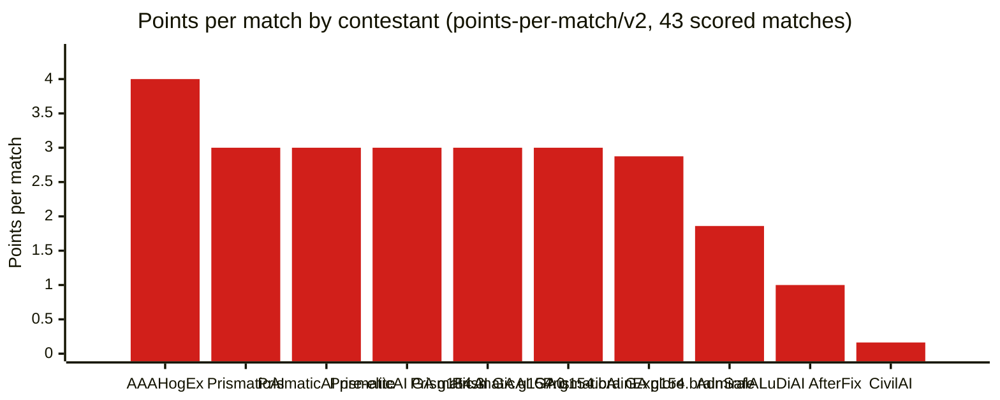
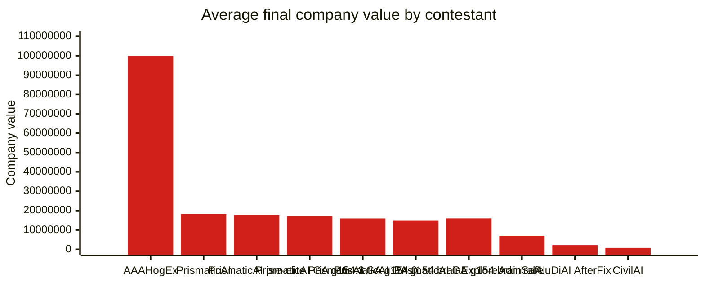
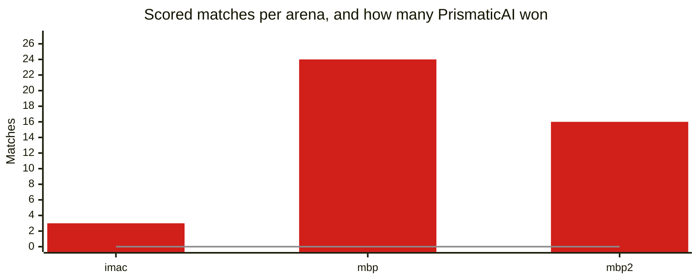

# battle-20261120T152558-3198f440

Derived from `battle-20261120T152558-3198f440.json` by `tools/research/ai-battle/battle.py report`; do not edit.

- Edition `3198f44009e8f118`: PrismaticAI and referee at `2b32ecb6f1049e718e513efb309e963aa0a5205c`, base set `opengfx-8.0.tar`
- 20-year free-for-all from 1960, map 256x256 temperate, breakdowns 1
- 43 scored match(es) on `imac` (20261119-master-gdf1e05e7d8), `mbp` (20261120-master-m17653b726e), `mbp2` (20261119-master-gdf1e05e7d8)
- Replays: 0 of 1 identical to their original on another arena

| # | Contestant | Played | Wins | Points | Points/match | Avg rank | Avg final value | Squirrel errors | Matches with anomalies |
|---|---|---|---|---|---|---|---|---|---|
| 1 | AAAHogEx | 43 | 43 | 172 | 4.0 | 1.0 | 99.9 M | 0 | 0 |
| 2 | PrismaticAI | 6 | 0 | 18 | 3.0 | 2.0 | 18.2 M | 0 | 0 |
| 3 | PrismaticAI pre-elite | 8 | 0 | 24 | 3.0 | 2.0 | 17.8 M | 0 | 0 |
| 4 | PrismaticAI GA g154.3 | 6 | 0 | 18 | 3.0 | 2.0 | 17.1 M | 0 | 0 |
| 5 | PrismaticAI GA g154.0 | 8 | 0 | 24 | 3.0 | 2.0 | 16.0 M | 0 | 0 |
| 6 | PrismaticAI GA g154.brainExplore | 7 | 0 | 21 | 3.0 | 2.0 | 14.8 M | 0 | 0 |
| 7 | PrismaticAI GA g154.brainSafe | 8 | 0 | 23 | 2.875 | 2.12 | 16.0 M | 0 | 0 |
| 8 | AdmiralAI | 43 | 0 | 80 | 1.86 | 3.14 | 7.0 M | 0 | 3 |
| 9 | LuDiAI AfterFix | 43 | 0 | 43 | 1.0 | 4.0 | 2.1 M | 0 | 1 |
| 10 | CivilAI | 43 | 0 | 7 | 0.163 | 4.84 | 781.6 k | 3673 | 9 |

```mermaid
---
config:
  xyChart:
    width: 900
    height: 360
  themeVariables:
    xyChart:
      plotColorPalette: "#d11f1a, #8a8a8a, #0b0b0b, #ece4d6"
---
xychart-beta
    title "Final company value per scored match: winner vs best PrismaticAI"
    x-axis ["m-0001", "m-0002", "m-0003", "m-0004", "m-0005", "m-0006", "m-0007", "m-0008", "m-0009", "m-0010", "m-0011", "m-0012", "m-0013", "m-0014", "m-0015", "m-0016", "m-0017", "m-0018", "m-0019", "m-0020", "m-0021", "m-0022", "m-0023", "m-0024", "m-0025", "m-0026", "m-0027", "m-0028", "m-0036", "m-0037", "m-0038", "m-0039", "m-0040", "m-0041", "m-0042", "m-0043", "m-0044", "m-0045", "m-0046", "m-0047", "m-0049", "m-0050", "m-0051"]
    %% series: Winner | Best PrismaticAI
    %% links: battle-20261120T152558-3198f440.md?col=Match&filter=m-0001 | battle-20261120T152558-3198f440.md?col=Match&filter=m-0002 | battle-20261120T152558-3198f440.md?col=Match&filter=m-0003 | battle-20261120T152558-3198f440.md?col=Match&filter=m-0004 | battle-20261120T152558-3198f440.md?col=Match&filter=m-0005 | battle-20261120T152558-3198f440.md?col=Match&filter=m-0006 | battle-20261120T152558-3198f440.md?col=Match&filter=m-0007 | battle-20261120T152558-3198f440.md?col=Match&filter=m-0008 | battle-20261120T152558-3198f440.md?col=Match&filter=m-0009 | battle-20261120T152558-3198f440.md?col=Match&filter=m-0010 | battle-20261120T152558-3198f440.md?col=Match&filter=m-0011 | battle-20261120T152558-3198f440.md?col=Match&filter=m-0012 | battle-20261120T152558-3198f440.md?col=Match&filter=m-0013 | battle-20261120T152558-3198f440.md?col=Match&filter=m-0014 | battle-20261120T152558-3198f440.md?col=Match&filter=m-0015 | battle-20261120T152558-3198f440.md?col=Match&filter=m-0016 | battle-20261120T152558-3198f440.md?col=Match&filter=m-0017 | battle-20261120T152558-3198f440.md?col=Match&filter=m-0018 | battle-20261120T152558-3198f440.md?col=Match&filter=m-0019 | battle-20261120T152558-3198f440.md?col=Match&filter=m-0020 | battle-20261120T152558-3198f440.md?col=Match&filter=m-0021 | battle-20261120T152558-3198f440.md?col=Match&filter=m-0022 | battle-20261120T152558-3198f440.md?col=Match&filter=m-0023 | battle-20261120T152558-3198f440.md?col=Match&filter=m-0024 | battle-20261120T152558-3198f440.md?col=Match&filter=m-0025 | battle-20261120T152558-3198f440.md?col=Match&filter=m-0026 | battle-20261120T152558-3198f440.md?col=Match&filter=m-0027 | battle-20261120T152558-3198f440.md?col=Match&filter=m-0028 | battle-20261120T152558-3198f440.md?col=Match&filter=m-0036 | battle-20261120T152558-3198f440.md?col=Match&filter=m-0037 | battle-20261120T152558-3198f440.md?col=Match&filter=m-0038 | battle-20261120T152558-3198f440.md?col=Match&filter=m-0039 | battle-20261120T152558-3198f440.md?col=Match&filter=m-0040 | battle-20261120T152558-3198f440.md?col=Match&filter=m-0041 | battle-20261120T152558-3198f440.md?col=Match&filter=m-0042 | battle-20261120T152558-3198f440.md?col=Match&filter=m-0043 | battle-20261120T152558-3198f440.md?col=Match&filter=m-0044 | battle-20261120T152558-3198f440.md?col=Match&filter=m-0045 | battle-20261120T152558-3198f440.md?col=Match&filter=m-0046 | battle-20261120T152558-3198f440.md?col=Match&filter=m-0047 | battle-20261120T152558-3198f440.md?col=Match&filter=m-0049 | battle-20261120T152558-3198f440.md?col=Match&filter=m-0050 | battle-20261120T152558-3198f440.md?col=Match&filter=m-0051
    y-axis "Company value" 0 --> 199000000
    bar [103942989, 89636561, 85914670, 81470198, 87742725, 96583545, 86575103, 83695982, 93317475, 99690004, 79144319, 180664191, 135174255, 151867353, 135789240, 147597706, 178594588, 64122376, 94706344, 63651502, 90993245, 94257044, 82609216, 90026992, 98450485, 112304426, 92220947, 68780402, 93240667, 100727938, 104830360, 116739752, 99067107, 99401419, 83489860, 79863050, 74229710, 76903381, 100410327, 82328787, 86988133, 119787534, 108582800]
    line [16617939, 15819225, 16361997, 17860421, 18560027, 16505374, 17183775, 18141995, 5122448, 11687450, 13850586, 16282701, 15505272, 16641959, 20182826, 12875987, 21660722, 23760382, 26219028, 14680730, 21122491, 16925695, 16418495, 18904923, 14321151, 11002476, 12967516, 8597802, 17177439, 20449460, 13185043, 13690303, 20231427, 17447900, 16819708, 14548521, 20168163, 25125871, 15225580, 14668104, 17407535, 18046873, 13293492]
```

<!-- battle-charts:begin -->
<!-- derived from battle-20261120T152558-3198f440.json by `battle.py render`; `battle.py check` fails when it is stale -->

<!-- battle-charts:end -->

| Seed | Original | Replay | Arenas | Identical |
|---|---|---|---|---|
| 115833242 | m-0010 | m-0048 | imac / mbp | NO |

| Match | Arena | Seed | Winner | Value | Last | Anomalies |
|---|---|---|---|---|---|---|
| m-0001 | mbp | 190405370 | AAAHogEx | 103.9 M | CivilAI | CivilAI: fleet_drop:51->30 |
| m-0002 | mbp | 190405370 | AAAHogEx | 89.6 M | CivilAI | - |
| m-0003 | mbp | 190405370 | AAAHogEx | 85.9 M | CivilAI | CivilAI: fleet_drop:119->65 |
| m-0004 | mbp | 190405370 | AAAHogEx | 81.5 M | CivilAI | - |
| m-0005 | mbp | 190405370 | AAAHogEx | 87.7 M | CivilAI | LuDiAI AfterFix: fleet_drop:88->55 |
| m-0006 | mbp | 115833242 | AAAHogEx | 96.6 M | CivilAI | - |
| m-0007 | mbp | 115833242 | AAAHogEx | 86.6 M | CivilAI | - |
| m-0008 | mbp | 115833242 | AAAHogEx | 83.7 M | CivilAI | - |
| m-0009 | mbp | 115833242 | AAAHogEx | 93.3 M | CivilAI | - |
| m-0010 | imac | 115833242 | AAAHogEx | 99.7 M | CivilAI | CivilAI: fleet_drop:40->12 |
| m-0011 | imac | 115833242 | AAAHogEx | 79.1 M | CivilAI | - |
| m-0012 | imac | 289215096 | AAAHogEx | 180.7 M | CivilAI | - |
| m-0013 | mbp2 | 289215096 | AAAHogEx | 135.2 M | CivilAI | CivilAI: squirrel_errors:33 |
| m-0014 | mbp2 | 289215096 | AAAHogEx | 151.9 M | CivilAI | - |
| m-0015 | mbp2 | 289215096 | AAAHogEx | 135.8 M | CivilAI | - |
| m-0016 | mbp2 | 289215096 | AAAHogEx | 147.6 M | CivilAI | CivilAI: fleet_drop:14->8 |
| m-0017 | mbp2 | 289215096 | AAAHogEx | 178.6 M | CivilAI | AdmiralAI: fleet_drop:301->182 |
| m-0018 | mbp2 | 66173326 | AAAHogEx | 64.1 M | LuDiAI AfterFix | CivilAI: fleet_drop:74->39 |
| m-0019 | mbp2 | 66173326 | AAAHogEx | 94.7 M | LuDiAI AfterFix | - |
| m-0020 | mbp2 | 66173326 | AAAHogEx | 63.7 M | CivilAI | - |
| m-0021 | mbp2 | 66173326 | AAAHogEx | 91.0 M | CivilAI | - |
| m-0022 | mbp2 | 66173326 | AAAHogEx | 94.3 M | CivilAI | - |
| m-0023 | mbp2 | 66173326 | AAAHogEx | 82.6 M | LuDiAI AfterFix | - |
| m-0024 | mbp2 | 1418169512 | AAAHogEx | 90.0 M | CivilAI | - |
| m-0025 | mbp2 | 1418169512 | AAAHogEx | 98.5 M | CivilAI | - |
| m-0026 | mbp2 | 1418169512 | AAAHogEx | 112.3 M | CivilAI | - |
| m-0027 | mbp2 | 1418169512 | AAAHogEx | 92.2 M | LuDiAI AfterFix | CivilAI: squirrel_errors:3640 |
| m-0028 | mbp2 | 1418169512 | AAAHogEx | 68.8 M | CivilAI | - |
| m-0036 | mbp | 1644019104 | AAAHogEx | 93.2 M | CivilAI | - |
| m-0037 | mbp | 1644019104 | AAAHogEx | 100.7 M | CivilAI | AdmiralAI: fleet_drop:451->296 |
| m-0038 | mbp | 1644019104 | AAAHogEx | 104.8 M | LuDiAI AfterFix | - |
| m-0039 | mbp | 1644019104 | AAAHogEx | 116.7 M | CivilAI | - |
| m-0040 | mbp | 1644019104 | AAAHogEx | 99.1 M | CivilAI | - |
| m-0041 | mbp | 1644019104 | AAAHogEx | 99.4 M | CivilAI | - |
| m-0042 | mbp | 697665168 | AAAHogEx | 83.5 M | CivilAI | CivilAI: fleet_drop:21->12 |
| m-0043 | mbp | 697665168 | AAAHogEx | 79.9 M | CivilAI | - |
| m-0044 | mbp | 697665168 | AAAHogEx | 74.2 M | CivilAI | - |
| m-0045 | mbp | 697665168 | AAAHogEx | 76.9 M | CivilAI | - |
| m-0046 | mbp | 697665168 | AAAHogEx | 100.4 M | CivilAI | - |
| m-0047 | mbp | 697665168 | AAAHogEx | 82.3 M | CivilAI | CivilAI: fleet_drop:55->38 |
| m-0048 (replay) | mbp | 115833242 | AAAHogEx | 102.7 M | CivilAI | CivilAI: fleet_drop:42->18 |
| m-0049 | mbp | 698541995 | AAAHogEx | 87.0 M | CivilAI | - |
| m-0050 | mbp | 698541995 | AAAHogEx | 119.8 M | AdmiralAI | - |
| m-0051 | mbp | 698541995 | AAAHogEx | 108.6 M | AdmiralAI | AdmiralAI: fleet_drop:33->21 |
