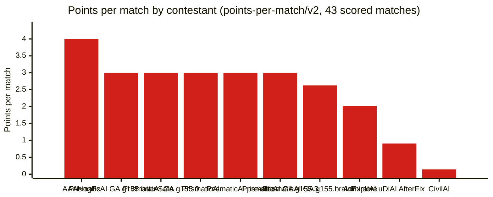
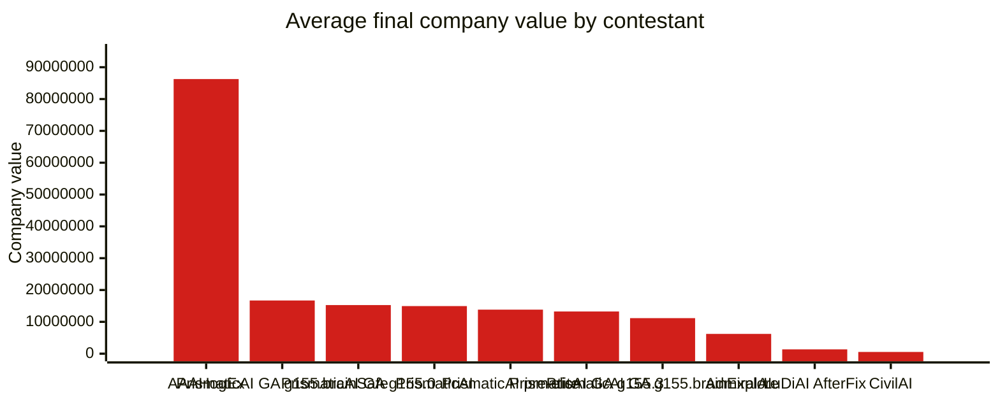
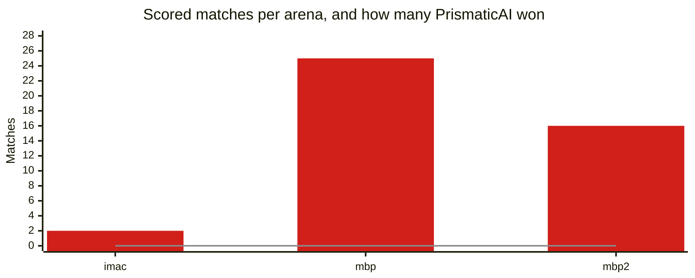

# battle-20261120T153542-7fcdd213

Derived from `battle-20261120T153542-7fcdd213.json` by `tools/research/ai-battle/battle.py report`; do not edit.

- Edition `7fcdd21368423a82`: PrismaticAI and referee at `2b32ecb6f1049e718e513efb309e963aa0a5205c`, base set `opengfx-8.0.tar`
- 20-year free-for-all from 1960, map 256x256 temperate, breakdowns 1
- 43 scored match(es) on `imac` (20261119-master-gdf1e05e7d8), `mbp` (20261120-master-m17653b726e), `mbp2` (20261119-master-gdf1e05e7d8)
- Replays: 0 of 1 identical to their original on another arena

| # | Contestant | Played | Wins | Points | Points/match | Avg rank | Avg final value | Squirrel errors | Matches with anomalies |
|---|---|---|---|---|---|---|---|---|---|
| 1 | AAAHogEx | 43 | 43 | 172 | 4.0 | 1.0 | 86.3 M | 0 | 0 |
| 2 | PrismaticAI GA g155.brainSafe | 8 | 0 | 24 | 3.0 | 2.0 | 16.7 M | 0 | 0 |
| 3 | PrismaticAI GA g155.0 | 8 | 0 | 24 | 3.0 | 2.0 | 15.3 M | 0 | 0 |
| 4 | PrismaticAI | 5 | 0 | 15 | 3.0 | 2.0 | 14.9 M | 0 | 2 |
| 5 | PrismaticAI pre-elite | 8 | 0 | 24 | 3.0 | 2.0 | 13.8 M | 0 | 0 |
| 6 | PrismaticAI GA g155.3 | 6 | 0 | 18 | 3.0 | 2.0 | 13.3 M | 0 | 0 |
| 7 | PrismaticAI GA g155.brainExplore | 8 | 0 | 21 | 2.625 | 2.38 | 11.2 M | 0 | 0 |
| 8 | AdmiralAI | 43 | 0 | 87 | 2.023 | 2.98 | 6.2 M | 59 | 6 |
| 9 | LuDiAI AfterFix | 43 | 0 | 39 | 0.907 | 4.09 | 1.4 M | 0 | 0 |
| 10 | CivilAI | 43 | 0 | 6 | 0.14 | 4.86 | 540.8 k | 0 | 8 |

```mermaid
---
config:
  xyChart:
    width: 900
    height: 360
  themeVariables:
    xyChart:
      plotColorPalette: "#d11f1a, #8a8a8a, #0b0b0b, #ece4d6"
---
xychart-beta
    title "Final company value per scored match: winner vs best PrismaticAI"
    x-axis ["m-0001", "m-0002", "m-0003", "m-0004", "m-0005", "m-0006", "m-0007", "m-0008", "m-0009", "m-0010", "m-0011", "m-0013", "m-0014", "m-0015", "m-0016", "m-0017", "m-0018", "m-0019", "m-0020", "m-0021", "m-0022", "m-0023", "m-0024", "m-0025", "m-0026", "m-0027", "m-0028", "m-0036", "m-0037", "m-0038", "m-0039", "m-0040", "m-0041", "m-0042", "m-0043", "m-0044", "m-0045", "m-0046", "m-0049", "m-0050", "m-0051", "m-0052", "m-0053"]
    %% series: Winner | Best PrismaticAI
    %% links: battle-20261120T153542-7fcdd213.md?col=Match&filter=m-0001 | battle-20261120T153542-7fcdd213.md?col=Match&filter=m-0002 | battle-20261120T153542-7fcdd213.md?col=Match&filter=m-0003 | battle-20261120T153542-7fcdd213.md?col=Match&filter=m-0004 | battle-20261120T153542-7fcdd213.md?col=Match&filter=m-0005 | battle-20261120T153542-7fcdd213.md?col=Match&filter=m-0006 | battle-20261120T153542-7fcdd213.md?col=Match&filter=m-0007 | battle-20261120T153542-7fcdd213.md?col=Match&filter=m-0008 | battle-20261120T153542-7fcdd213.md?col=Match&filter=m-0009 | battle-20261120T153542-7fcdd213.md?col=Match&filter=m-0010 | battle-20261120T153542-7fcdd213.md?col=Match&filter=m-0011 | battle-20261120T153542-7fcdd213.md?col=Match&filter=m-0013 | battle-20261120T153542-7fcdd213.md?col=Match&filter=m-0014 | battle-20261120T153542-7fcdd213.md?col=Match&filter=m-0015 | battle-20261120T153542-7fcdd213.md?col=Match&filter=m-0016 | battle-20261120T153542-7fcdd213.md?col=Match&filter=m-0017 | battle-20261120T153542-7fcdd213.md?col=Match&filter=m-0018 | battle-20261120T153542-7fcdd213.md?col=Match&filter=m-0019 | battle-20261120T153542-7fcdd213.md?col=Match&filter=m-0020 | battle-20261120T153542-7fcdd213.md?col=Match&filter=m-0021 | battle-20261120T153542-7fcdd213.md?col=Match&filter=m-0022 | battle-20261120T153542-7fcdd213.md?col=Match&filter=m-0023 | battle-20261120T153542-7fcdd213.md?col=Match&filter=m-0024 | battle-20261120T153542-7fcdd213.md?col=Match&filter=m-0025 | battle-20261120T153542-7fcdd213.md?col=Match&filter=m-0026 | battle-20261120T153542-7fcdd213.md?col=Match&filter=m-0027 | battle-20261120T153542-7fcdd213.md?col=Match&filter=m-0028 | battle-20261120T153542-7fcdd213.md?col=Match&filter=m-0036 | battle-20261120T153542-7fcdd213.md?col=Match&filter=m-0037 | battle-20261120T153542-7fcdd213.md?col=Match&filter=m-0038 | battle-20261120T153542-7fcdd213.md?col=Match&filter=m-0039 | battle-20261120T153542-7fcdd213.md?col=Match&filter=m-0040 | battle-20261120T153542-7fcdd213.md?col=Match&filter=m-0041 | battle-20261120T153542-7fcdd213.md?col=Match&filter=m-0042 | battle-20261120T153542-7fcdd213.md?col=Match&filter=m-0043 | battle-20261120T153542-7fcdd213.md?col=Match&filter=m-0044 | battle-20261120T153542-7fcdd213.md?col=Match&filter=m-0045 | battle-20261120T153542-7fcdd213.md?col=Match&filter=m-0046 | battle-20261120T153542-7fcdd213.md?col=Match&filter=m-0049 | battle-20261120T153542-7fcdd213.md?col=Match&filter=m-0050 | battle-20261120T153542-7fcdd213.md?col=Match&filter=m-0051 | battle-20261120T153542-7fcdd213.md?col=Match&filter=m-0052 | battle-20261120T153542-7fcdd213.md?col=Match&filter=m-0053
    y-axis "Company value" 0 --> 142000000
    bar [83981593, 91816794, 92888657, 106070264, 101587081, 96560708, 85076696, 78019237, 85739660, 112237807, 69539080, 128822453, 119113017, 90036335, 112646718, 84972342, 75926978, 68828790, 65385008, 63673068, 51465940, 68196584, 87066273, 54417513, 65113239, 92149569, 63492494, 66880248, 64620749, 82116615, 77293295, 87447705, 89479309, 75363820, 102043062, 80089734, 118927541, 75336287, 107490671, 106832910, 103639296, 86892787, 90572454]
    line [11507376, 11362622, 11072038, 9511664, 10287947, 13513434, 9760550, 15616994, 13406740, 4065571, 11048099, 16430044, 18197333, 17790496, 16150703, 18409502, 15375922, 12187183, 11126741, 13778478, 9753851, 9892090, 16724906, 13115777, 15934873, 15592651, 12140748, 12000935, 17424085, 13252564, 17590623, 4712525, 15381898, 17132860, 15643182, 19326177, 20605809, 15340423, 14581723, 17341170, 23829396, 17617819, 14494360]
```

<!-- battle-charts:begin -->
<!-- derived from battle-20261120T153542-7fcdd213.json by `battle.py render`; `battle.py check` fails when it is stale -->

<!-- battle-charts:end -->

| Seed | Original | Replay | Arenas | Identical |
|---|---|---|---|---|
| 1963069286 | m-0011 | m-0056 | imac / mbp | NO |

| Match | Arena | Seed | Winner | Value | Last | Anomalies |
|---|---|---|---|---|---|---|
| m-0001 | mbp | 1836496469 | AAAHogEx | 84.0 M | CivilAI | - |
| m-0002 | mbp | 1836496469 | AAAHogEx | 91.8 M | CivilAI | - |
| m-0003 | mbp | 1836496469 | AAAHogEx | 92.9 M | CivilAI | - |
| m-0004 | mbp | 1836496469 | AAAHogEx | 106.1 M | CivilAI | - |
| m-0005 | mbp | 1836496469 | AAAHogEx | 101.6 M | CivilAI | - |
| m-0006 | mbp | 1963069286 | AAAHogEx | 96.6 M | CivilAI | - |
| m-0007 | mbp | 1963069286 | AAAHogEx | 85.1 M | CivilAI | - |
| m-0008 | mbp | 1963069286 | AAAHogEx | 78.0 M | LuDiAI AfterFix | - |
| m-0009 | mbp | 1963069286 | AAAHogEx | 85.7 M | CivilAI | - |
| m-0010 | imac | 1963069286 | AAAHogEx | 112.2 M | CivilAI | - |
| m-0011 | imac | 1963069286 | AAAHogEx | 69.5 M | CivilAI | CivilAI: no_vehicles |
| m-0013 | mbp2 | 779720341 | AAAHogEx | 128.8 M | CivilAI | CivilAI: fleet_drop:42->27 |
| m-0014 | mbp2 | 779720341 | AAAHogEx | 119.1 M | CivilAI | AdmiralAI: fleet_drop:298->198 |
| m-0015 | mbp2 | 779720341 | AAAHogEx | 90.0 M | CivilAI | - |
| m-0016 | mbp2 | 779720341 | AAAHogEx | 112.6 M | LuDiAI AfterFix | CivilAI: fleet_drop:25->6 |
| m-0017 | mbp2 | 779720341 | AAAHogEx | 85.0 M | CivilAI | CivilAI: fleet_drop:50->30 |
| m-0018 | mbp2 | 1282341852 | AAAHogEx | 75.9 M | CivilAI | AdmiralAI: fleet_drop:466->321 |
| m-0019 | mbp2 | 1282341852 | AAAHogEx | 68.8 M | AdmiralAI | - |
| m-0020 | mbp2 | 1282341852 | AAAHogEx | 65.4 M | CivilAI | - |
| m-0021 | mbp2 | 1282341852 | AAAHogEx | 63.7 M | CivilAI | - |
| m-0022 | mbp2 | 1282341852 | AAAHogEx | 51.5 M | CivilAI | AdmiralAI: squirrel_errors:59 |
| m-0023 | mbp2 | 1282341852 | AAAHogEx | 68.2 M | CivilAI | CivilAI: fleet_drop:57->33 |
| m-0024 | mbp2 | 593329087 | AAAHogEx | 87.1 M | CivilAI | PrismaticAI: fleet_drop:63->42 |
| m-0025 | mbp2 | 593329087 | AAAHogEx | 54.4 M | CivilAI | - |
| m-0026 | mbp2 | 593329087 | AAAHogEx | 65.1 M | CivilAI | AdmiralAI: fleet_drop:232->152 |
| m-0027 | mbp2 | 593329087 | AAAHogEx | 92.1 M | CivilAI | AdmiralAI: fleet_drop:137->88 |
| m-0028 | mbp2 | 593329087 | AAAHogEx | 63.5 M | CivilAI | - |
| m-0036 | mbp | 1754553186 | AAAHogEx | 66.9 M | CivilAI | - |
| m-0037 | mbp | 1754553186 | AAAHogEx | 64.6 M | CivilAI | CivilAI: fleet_drop:56->18 |
| m-0038 | mbp | 1754553186 | AAAHogEx | 82.1 M | CivilAI | - |
| m-0039 | mbp | 1754553186 | AAAHogEx | 77.3 M | CivilAI | - |
| m-0040 | mbp | 1754553186 | AAAHogEx | 87.4 M | CivilAI | - |
| m-0041 | mbp | 1754553186 | AAAHogEx | 89.5 M | CivilAI | - |
| m-0042 | mbp | 1774177899 | AAAHogEx | 75.4 M | LuDiAI AfterFix | PrismaticAI: fleet_drop:126->82; CivilAI: fleet_drop:131->66 |
| m-0043 | mbp | 1774177899 | AAAHogEx | 102.0 M | CivilAI | - |
| m-0044 | mbp | 1774177899 | AAAHogEx | 80.1 M | CivilAI | - |
| m-0045 | mbp | 1774177899 | AAAHogEx | 118.9 M | CivilAI | AdmiralAI: fleet_drop:261->109 |
| m-0046 | mbp | 1774177899 | AAAHogEx | 75.3 M | LuDiAI AfterFix | - |
| m-0049 | mbp | 65131373 | AAAHogEx | 107.5 M | CivilAI | CivilAI: fleet_drop:29->12 |
| m-0050 | mbp | 65131373 | AAAHogEx | 106.8 M | CivilAI | - |
| m-0051 | mbp | 65131373 | AAAHogEx | 103.6 M | CivilAI | - |
| m-0052 | mbp | 65131373 | AAAHogEx | 86.9 M | CivilAI | - |
| m-0053 | mbp | 65131373 | AAAHogEx | 90.6 M | CivilAI | - |
| m-0056 (replay) | mbp | 1963069286 | AAAHogEx | 64.3 M | CivilAI | CivilAI: no_vehicles |
