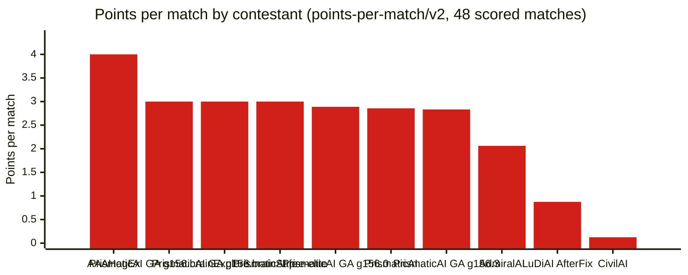
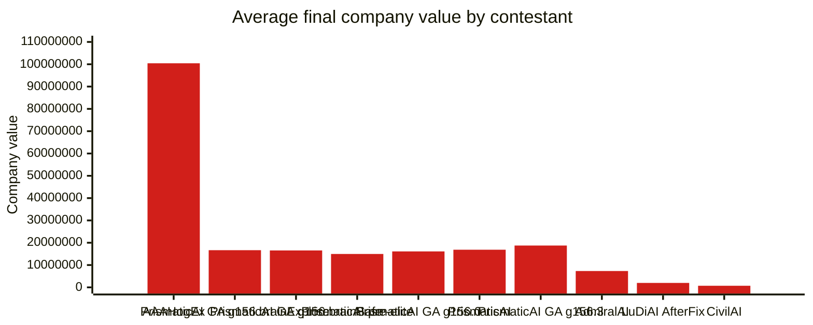
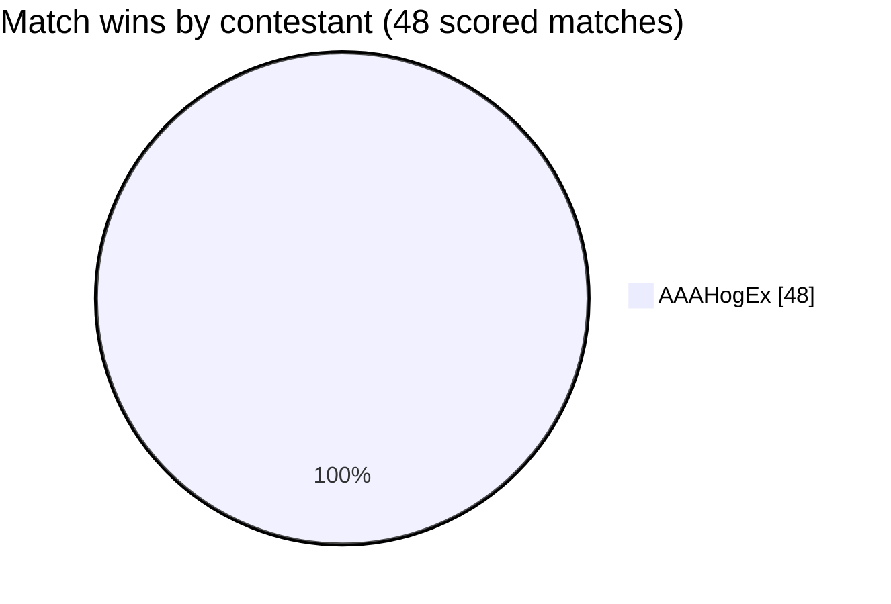
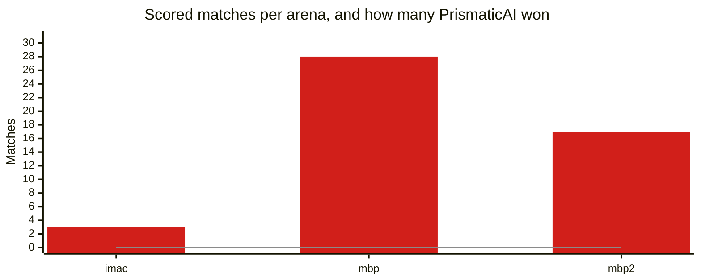

# battle-20261120T154856-81da57f4

Derived from `battle-20261120T154856-81da57f4.json` by `tools/research/ai-battle/battle.py report`; do not edit.

- Edition `81da57f436ce11cf`: PrismaticAI and referee at `2b32ecb6f1049e718e513efb309e963aa0a5205c`, base set `opengfx-8.0.tar`
- 20-year free-for-all from 1960, map 256x256 temperate, breakdowns 1
- 48 scored match(es) on `imac` (20261119-master-gdf1e05e7d8), `mbp` (20261120-master-m17653b726e), `mbp2` (20261119-master-gdf1e05e7d8)
- Replays: 2 of 2 identical to their original on another arena

| # | Contestant | Played | Wins | Points | Points/match | Avg rank | Avg final value | Squirrel errors | Matches with anomalies |
|---|---|---|---|---|---|---|---|---|---|
| 1 | AAAHogEx | 48 | 48 | 192 | 4.0 | 1.0 | 100.4 M | 0 | 0 |
| 2 | PrismaticAI GA g156.brainExplore | 8 | 0 | 24 | 3.0 | 2.0 | 16.7 M | 0 | 4 |
| 3 | PrismaticAI GA g156.brainSafe | 9 | 0 | 27 | 3.0 | 2.0 | 16.5 M | 0 | 0 |
| 4 | PrismaticAI pre-elite | 9 | 0 | 27 | 3.0 | 2.0 | 15.0 M | 0 | 0 |
| 5 | PrismaticAI GA g156.0 | 9 | 0 | 26 | 2.889 | 2.11 | 16.1 M | 0 | 1 |
| 6 | PrismaticAI | 7 | 0 | 20 | 2.857 | 2.14 | 16.9 M | 0 | 3 |
| 7 | PrismaticAI GA g156.3 | 6 | 0 | 17 | 2.833 | 2.17 | 18.7 M | 0 | 0 |
| 8 | AdmiralAI | 48 | 0 | 99 | 2.062 | 2.94 | 7.3 M | 57 | 3 |
| 9 | LuDiAI AfterFix | 48 | 0 | 42 | 0.875 | 4.12 | 2.0 M | 0 | 1 |
| 10 | CivilAI | 48 | 0 | 6 | 0.125 | 4.88 | 710.6 k | 0 | 8 |

```mermaid
---
config:
  xyChart:
    width: 900
    height: 360
  themeVariables:
    xyChart:
      plotColorPalette: "#d11f1a, #8a8a8a, #0b0b0b, #ece4d6"
---
xychart-beta
    title "Final company value per scored match: winner vs best PrismaticAI"
    x-axis ["m-0001", "m-0002", "m-0003", "m-0004", "m-0005", "m-0006", "m-0007", "m-0008", "m-0009", "m-0010", "m-0011", "m-0012", "m-0013", "m-0014", "m-0015", "m-0016", "m-0017", "m-0018", "m-0019", "m-0020", "m-0021", "m-0022", "m-0023", "m-0024", "m-0025", "m-0026", "m-0027", "m-0028", "m-0036", "m-0037", "m-0038", "m-0039", "m-0040", "m-0041", "m-0042", "m-0043", "m-0044", "m-0045", "m-0046", "m-0047", "m-0049", "m-0050", "m-0051", "m-0054", "m-0055", "m-0069", "m-0070", "m-0074"]
    %% series: Winner | Best PrismaticAI
    %% links: battle-20261120T154856-81da57f4.md?col=Match&filter=m-0001 | battle-20261120T154856-81da57f4.md?col=Match&filter=m-0002 | battle-20261120T154856-81da57f4.md?col=Match&filter=m-0003 | battle-20261120T154856-81da57f4.md?col=Match&filter=m-0004 | battle-20261120T154856-81da57f4.md?col=Match&filter=m-0005 | battle-20261120T154856-81da57f4.md?col=Match&filter=m-0006 | battle-20261120T154856-81da57f4.md?col=Match&filter=m-0007 | battle-20261120T154856-81da57f4.md?col=Match&filter=m-0008 | battle-20261120T154856-81da57f4.md?col=Match&filter=m-0009 | battle-20261120T154856-81da57f4.md?col=Match&filter=m-0010 | battle-20261120T154856-81da57f4.md?col=Match&filter=m-0011 | battle-20261120T154856-81da57f4.md?col=Match&filter=m-0012 | battle-20261120T154856-81da57f4.md?col=Match&filter=m-0013 | battle-20261120T154856-81da57f4.md?col=Match&filter=m-0014 | battle-20261120T154856-81da57f4.md?col=Match&filter=m-0015 | battle-20261120T154856-81da57f4.md?col=Match&filter=m-0016 | battle-20261120T154856-81da57f4.md?col=Match&filter=m-0017 | battle-20261120T154856-81da57f4.md?col=Match&filter=m-0018 | battle-20261120T154856-81da57f4.md?col=Match&filter=m-0019 | battle-20261120T154856-81da57f4.md?col=Match&filter=m-0020 | battle-20261120T154856-81da57f4.md?col=Match&filter=m-0021 | battle-20261120T154856-81da57f4.md?col=Match&filter=m-0022 | battle-20261120T154856-81da57f4.md?col=Match&filter=m-0023 | battle-20261120T154856-81da57f4.md?col=Match&filter=m-0024 | battle-20261120T154856-81da57f4.md?col=Match&filter=m-0025 | battle-20261120T154856-81da57f4.md?col=Match&filter=m-0026 | battle-20261120T154856-81da57f4.md?col=Match&filter=m-0027 | battle-20261120T154856-81da57f4.md?col=Match&filter=m-0028 | battle-20261120T154856-81da57f4.md?col=Match&filter=m-0036 | battle-20261120T154856-81da57f4.md?col=Match&filter=m-0037 | battle-20261120T154856-81da57f4.md?col=Match&filter=m-0038 | battle-20261120T154856-81da57f4.md?col=Match&filter=m-0039 | battle-20261120T154856-81da57f4.md?col=Match&filter=m-0040 | battle-20261120T154856-81da57f4.md?col=Match&filter=m-0041 | battle-20261120T154856-81da57f4.md?col=Match&filter=m-0042 | battle-20261120T154856-81da57f4.md?col=Match&filter=m-0043 | battle-20261120T154856-81da57f4.md?col=Match&filter=m-0044 | battle-20261120T154856-81da57f4.md?col=Match&filter=m-0045 | battle-20261120T154856-81da57f4.md?col=Match&filter=m-0046 | battle-20261120T154856-81da57f4.md?col=Match&filter=m-0047 | battle-20261120T154856-81da57f4.md?col=Match&filter=m-0049 | battle-20261120T154856-81da57f4.md?col=Match&filter=m-0050 | battle-20261120T154856-81da57f4.md?col=Match&filter=m-0051 | battle-20261120T154856-81da57f4.md?col=Match&filter=m-0054 | battle-20261120T154856-81da57f4.md?col=Match&filter=m-0055 | battle-20261120T154856-81da57f4.md?col=Match&filter=m-0069 | battle-20261120T154856-81da57f4.md?col=Match&filter=m-0070 | battle-20261120T154856-81da57f4.md?col=Match&filter=m-0074
    y-axis "Company value" 0 --> 161000000
    bar [116066023, 103232402, 102947190, 118256156, 135588535, 130617292, 121994962, 90502894, 98380462, 146095563, 142374383, 120974881, 123541349, 107762146, 108134896, 129930504, 144419652, 104294861, 71746587, 72993343, 88313816, 69684233, 52051285, 59836944, 63669092, 73071374, 64466762, 70415415, 124283280, 131891379, 132503732, 134126995, 124598575, 98488021, 91882733, 74646962, 66870985, 92551756, 88957696, 74082789, 108987909, 122071039, 75225683, 77517209, 82845199, 94175659, 94689125, 99238537]
    line [12182738, 2857147, 6610588, 4263497, 5828594, 17269866, 22750852, 21271019, 22826125, 20684276, 13009596, 23097337, 19279926, 16033023, 14589705, 17593642, 24204328, 19561157, 17970441, 20702811, 22958012, 24008821, 29658511, 19813033, 12947258, 13901186, 15460462, 14576269, 11729581, 10005764, 19175510, 13454756, 21330212, 22783999, 17318314, 15407421, 12943833, 15895901, 13365181, 16967353, 15867176, 18106705, 17432485, 9288881, 8264481, 19635308, 17445537, 19981582]
```

<!-- battle-charts:begin -->
<!-- derived from battle-20261120T154856-81da57f4.json by `battle.py render`; `battle.py check` fails when it is stale -->

<!-- battle-charts:end -->

| Seed | Original | Replay | Arenas | Identical |
|---|---|---|---|---|
| 328428870 | m-0019 | m-0048 | mbp2 / mbp | yes |
| 328428870 | m-0022 | m-0056 | mbp2 / mbp | yes |

| Match | Arena | Seed | Winner | Value | Last | Anomalies |
|---|---|---|---|---|---|---|
| m-0001 | mbp | 756496726 | AAAHogEx | 116.1 M | CivilAI | - |
| m-0002 | mbp | 756496726 | AAAHogEx | 103.2 M | CivilAI | PrismaticAI GA g156.0: fleet_drop:53->37; CivilAI: fleet_drop:51->30 |
| m-0003 | mbp | 756496726 | AAAHogEx | 102.9 M | CivilAI | - |
| m-0004 | mbp | 756496726 | AAAHogEx | 118.3 M | CivilAI | PrismaticAI GA g156.brainExplore: fleet_drop:92->37; CivilAI: fleet_drop:48->20 |
| m-0005 | mbp | 756496726 | AAAHogEx | 135.6 M | CivilAI | - |
| m-0006 | mbp | 1393059998 | AAAHogEx | 130.6 M | CivilAI | - |
| m-0007 | mbp | 1393059998 | AAAHogEx | 122.0 M | CivilAI | - |
| m-0008 | mbp | 1393059998 | AAAHogEx | 90.5 M | CivilAI | - |
| m-0009 | mbp | 1393059998 | AAAHogEx | 98.4 M | CivilAI | - |
| m-0010 | imac | 1393059998 | AAAHogEx | 146.1 M | CivilAI | PrismaticAI GA g156.brainExplore: fleet_drop:136->94 |
| m-0011 | imac | 1393059998 | AAAHogEx | 142.4 M | LuDiAI AfterFix | CivilAI: fleet_drop:74->42 |
| m-0012 | imac | 1784441867 | AAAHogEx | 121.0 M | CivilAI | PrismaticAI: fleet_drop:116->60 |
| m-0013 | mbp2 | 1784441867 | AAAHogEx | 123.5 M | CivilAI | - |
| m-0014 | mbp2 | 1784441867 | AAAHogEx | 107.8 M | CivilAI | AdmiralAI: fleet_drop:295->183 |
| m-0015 | mbp2 | 1784441867 | AAAHogEx | 108.1 M | CivilAI | CivilAI: fleet_drop:55->25 |
| m-0016 | mbp2 | 1784441867 | AAAHogEx | 129.9 M | CivilAI | PrismaticAI GA g156.brainExplore: fleet_drop:194->70 |
| m-0017 | mbp2 | 1784441867 | AAAHogEx | 144.4 M | CivilAI | - |
| m-0018 | mbp2 | 328428870 | AAAHogEx | 104.3 M | CivilAI | PrismaticAI: fleet_drop:101->55; CivilAI: fleet_drop:81->52 |
| m-0019 | mbp2 | 328428870 | AAAHogEx | 71.7 M | CivilAI | - |
| m-0020 | mbp2 | 328428870 | AAAHogEx | 73.0 M | CivilAI | - |
| m-0021 | mbp2 | 328428870 | AAAHogEx | 88.3 M | LuDiAI AfterFix | - |
| m-0022 | mbp2 | 328428870 | AAAHogEx | 69.7 M | CivilAI | - |
| m-0023 | mbp2 | 328428870 | AAAHogEx | 52.1 M | CivilAI | CivilAI: fleet_drop:98->68 |
| m-0024 | mbp2 | 260414010 | AAAHogEx | 59.8 M | CivilAI | CivilAI: fleet_drop:31->10 |
| m-0025 | mbp2 | 260414010 | AAAHogEx | 63.7 M | CivilAI | - |
| m-0026 | mbp2 | 260414010 | AAAHogEx | 73.1 M | CivilAI | - |
| m-0027 | mbp2 | 260414010 | AAAHogEx | 64.5 M | CivilAI | CivilAI: fleet_drop:38->10 |
| m-0028 | mbp2 | 260414010 | AAAHogEx | 70.4 M | CivilAI | LuDiAI AfterFix: fleet_drop:96->60 |
| m-0036 | mbp | 1386471521 | AAAHogEx | 124.3 M | CivilAI | - |
| m-0037 | mbp | 1386471521 | AAAHogEx | 131.9 M | CivilAI | AdmiralAI: fleet_drop:475->219 |
| m-0038 | mbp | 1386471521 | AAAHogEx | 132.5 M | CivilAI | - |
| m-0039 | mbp | 1386471521 | AAAHogEx | 134.1 M | CivilAI | - |
| m-0040 | mbp | 1386471521 | AAAHogEx | 124.6 M | CivilAI | AdmiralAI: squirrel_errors:57 |
| m-0041 | mbp | 1386471521 | AAAHogEx | 98.5 M | CivilAI | - |
| m-0042 | mbp | 68761391 | AAAHogEx | 91.9 M | CivilAI | PrismaticAI: fleet_drop:74->48 |
| m-0043 | mbp | 68761391 | AAAHogEx | 74.6 M | LuDiAI AfterFix | - |
| m-0044 | mbp | 68761391 | AAAHogEx | 66.9 M | LuDiAI AfterFix | - |
| m-0045 | mbp | 68761391 | AAAHogEx | 92.6 M | CivilAI | - |
| m-0046 | mbp | 68761391 | AAAHogEx | 89.0 M | CivilAI | PrismaticAI GA g156.brainExplore: fleet_drop:76->52 |
| m-0047 | mbp2 | 68761391 | AAAHogEx | 74.1 M | CivilAI | - |
| m-0048 (replay) | mbp | 328428870 | AAAHogEx | 71.7 M | CivilAI | - |
| m-0049 | mbp | 1335685113 | AAAHogEx | 109.0 M | CivilAI | - |
| m-0050 | mbp | 1335685113 | AAAHogEx | 122.1 M | LuDiAI AfterFix | - |
| m-0051 | mbp | 1335685113 | AAAHogEx | 75.2 M | LuDiAI AfterFix | - |
| m-0054 | mbp | 288639947 | AAAHogEx | 77.5 M | CivilAI | - |
| m-0055 | mbp | 288639947 | AAAHogEx | 82.8 M | CivilAI | - |
| m-0056 (replay) | mbp | 328428870 | AAAHogEx | 69.7 M | CivilAI | - |
| m-0069 | mbp | 1096323944 | AAAHogEx | 94.2 M | CivilAI | - |
| m-0070 | mbp | 1096323944 | AAAHogEx | 94.7 M | CivilAI | - |
| m-0074 | mbp | 1001776804 | AAAHogEx | 99.2 M | CivilAI | - |
