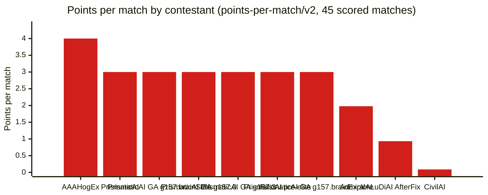
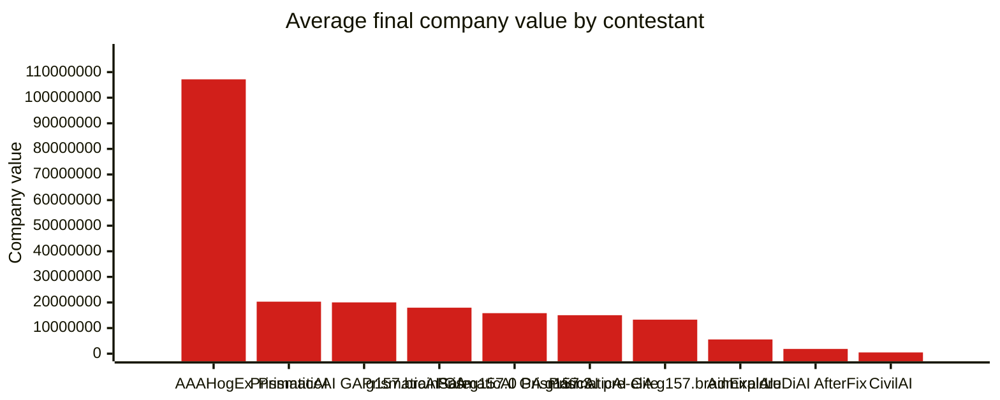
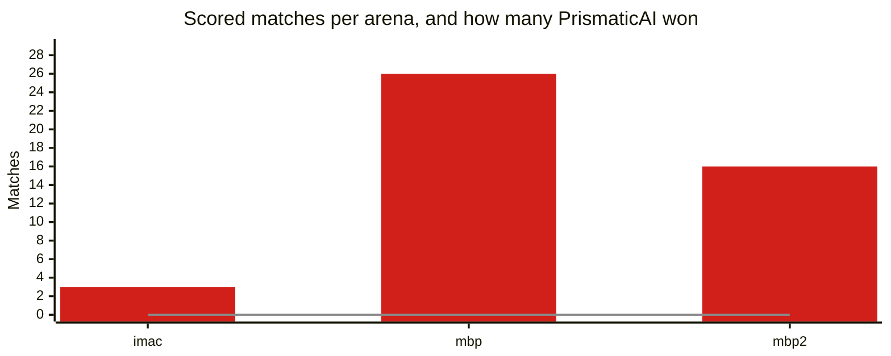

# battle-20261120T155949-9e6f95e1

Derived from `battle-20261120T155949-9e6f95e1.json` by `tools/research/ai-battle/battle.py report`; do not edit.

- Edition `9e6f95e16ba0c744`: PrismaticAI and referee at `2b32ecb6f1049e718e513efb309e963aa0a5205c`, base set `opengfx-8.0.tar`
- 20-year free-for-all from 1960, map 256x256 temperate, breakdowns 1
- 45 scored match(es) on `imac` (20261119-master-gdf1e05e7d8), `mbp` (20261120-master-m17653b726e), `mbp2` (20261119-master-gdf1e05e7d8)
- Replays: 1 of 1 identical to their original on another arena

| # | Contestant | Played | Wins | Points | Points/match | Avg rank | Avg final value | Squirrel errors | Matches with anomalies |
|---|---|---|---|---|---|---|---|---|---|
| 1 | AAAHogEx | 45 | 45 | 180 | 4.0 | 1.0 | 107.2 M | 0 | 0 |
| 2 | PrismaticAI | 6 | 0 | 18 | 3.0 | 2.0 | 20.3 M | 0 | 4 |
| 3 | PrismaticAI GA g157.brainSafe | 8 | 0 | 24 | 3.0 | 2.0 | 20.0 M | 0 | 0 |
| 4 | PrismaticAI GA g157.0 | 8 | 0 | 24 | 3.0 | 2.0 | 18.0 M | 0 | 0 |
| 5 | PrismaticAI GA g157.3 | 7 | 0 | 21 | 3.0 | 2.0 | 15.8 M | 0 | 0 |
| 6 | PrismaticAI pre-elite | 8 | 0 | 24 | 3.0 | 2.0 | 15.0 M | 0 | 0 |
| 7 | PrismaticAI GA g157.brainExplore | 8 | 0 | 24 | 3.0 | 2.0 | 13.3 M | 0 | 0 |
| 8 | AdmiralAI | 45 | 0 | 89 | 1.978 | 3.02 | 5.6 M | 59 | 2 |
| 9 | LuDiAI AfterFix | 45 | 0 | 42 | 0.933 | 4.07 | 1.9 M | 0 | 3 |
| 10 | CivilAI | 45 | 0 | 4 | 0.089 | 4.91 | 478.4 k | 0 | 7 |

```mermaid
---
config:
  xyChart:
    width: 900
    height: 360
  themeVariables:
    xyChart:
      plotColorPalette: "#d11f1a, #8a8a8a, #0b0b0b, #ece4d6"
---
xychart-beta
    title "Final company value per scored match: winner vs best PrismaticAI"
    x-axis ["m-0001", "m-0002", "m-0003", "m-0004", "m-0005", "m-0006", "m-0007", "m-0008", "m-0009", "m-0010", "m-0011", "m-0012", "m-0013", "m-0014", "m-0015", "m-0016", "m-0017", "m-0018", "m-0019", "m-0020", "m-0021", "m-0022", "m-0023", "m-0024", "m-0025", "m-0026", "m-0027", "m-0028", "m-0036", "m-0037", "m-0038", "m-0039", "m-0040", "m-0041", "m-0042", "m-0043", "m-0044", "m-0045", "m-0046", "m-0047", "m-0049", "m-0050", "m-0051", "m-0052", "m-0053"]
    %% series: Winner | Best PrismaticAI
    %% links: battle-20261120T155949-9e6f95e1.md?col=Match&filter=m-0001 | battle-20261120T155949-9e6f95e1.md?col=Match&filter=m-0002 | battle-20261120T155949-9e6f95e1.md?col=Match&filter=m-0003 | battle-20261120T155949-9e6f95e1.md?col=Match&filter=m-0004 | battle-20261120T155949-9e6f95e1.md?col=Match&filter=m-0005 | battle-20261120T155949-9e6f95e1.md?col=Match&filter=m-0006 | battle-20261120T155949-9e6f95e1.md?col=Match&filter=m-0007 | battle-20261120T155949-9e6f95e1.md?col=Match&filter=m-0008 | battle-20261120T155949-9e6f95e1.md?col=Match&filter=m-0009 | battle-20261120T155949-9e6f95e1.md?col=Match&filter=m-0010 | battle-20261120T155949-9e6f95e1.md?col=Match&filter=m-0011 | battle-20261120T155949-9e6f95e1.md?col=Match&filter=m-0012 | battle-20261120T155949-9e6f95e1.md?col=Match&filter=m-0013 | battle-20261120T155949-9e6f95e1.md?col=Match&filter=m-0014 | battle-20261120T155949-9e6f95e1.md?col=Match&filter=m-0015 | battle-20261120T155949-9e6f95e1.md?col=Match&filter=m-0016 | battle-20261120T155949-9e6f95e1.md?col=Match&filter=m-0017 | battle-20261120T155949-9e6f95e1.md?col=Match&filter=m-0018 | battle-20261120T155949-9e6f95e1.md?col=Match&filter=m-0019 | battle-20261120T155949-9e6f95e1.md?col=Match&filter=m-0020 | battle-20261120T155949-9e6f95e1.md?col=Match&filter=m-0021 | battle-20261120T155949-9e6f95e1.md?col=Match&filter=m-0022 | battle-20261120T155949-9e6f95e1.md?col=Match&filter=m-0023 | battle-20261120T155949-9e6f95e1.md?col=Match&filter=m-0024 | battle-20261120T155949-9e6f95e1.md?col=Match&filter=m-0025 | battle-20261120T155949-9e6f95e1.md?col=Match&filter=m-0026 | battle-20261120T155949-9e6f95e1.md?col=Match&filter=m-0027 | battle-20261120T155949-9e6f95e1.md?col=Match&filter=m-0028 | battle-20261120T155949-9e6f95e1.md?col=Match&filter=m-0036 | battle-20261120T155949-9e6f95e1.md?col=Match&filter=m-0037 | battle-20261120T155949-9e6f95e1.md?col=Match&filter=m-0038 | battle-20261120T155949-9e6f95e1.md?col=Match&filter=m-0039 | battle-20261120T155949-9e6f95e1.md?col=Match&filter=m-0040 | battle-20261120T155949-9e6f95e1.md?col=Match&filter=m-0041 | battle-20261120T155949-9e6f95e1.md?col=Match&filter=m-0042 | battle-20261120T155949-9e6f95e1.md?col=Match&filter=m-0043 | battle-20261120T155949-9e6f95e1.md?col=Match&filter=m-0044 | battle-20261120T155949-9e6f95e1.md?col=Match&filter=m-0045 | battle-20261120T155949-9e6f95e1.md?col=Match&filter=m-0046 | battle-20261120T155949-9e6f95e1.md?col=Match&filter=m-0047 | battle-20261120T155949-9e6f95e1.md?col=Match&filter=m-0049 | battle-20261120T155949-9e6f95e1.md?col=Match&filter=m-0050 | battle-20261120T155949-9e6f95e1.md?col=Match&filter=m-0051 | battle-20261120T155949-9e6f95e1.md?col=Match&filter=m-0052 | battle-20261120T155949-9e6f95e1.md?col=Match&filter=m-0053
    y-axis "Company value" 0 --> 176000000
    bar [83695681, 104938930, 79867544, 87121283, 70430475, 85760878, 122643061, 90340023, 96114744, 83728133, 119167284, 108692582, 92168111, 92451491, 114312948, 108200783, 108703471, 134763755, 139154745, 133387264, 141596206, 150450592, 160406989, 71574319, 79316730, 65260770, 84372214, 53752475, 119883996, 109337504, 100089373, 118958283, 99859725, 95564988, 116593097, 118396648, 103022126, 106635828, 122916263, 114552244, 130229284, 119267401, 129952428, 132595513, 122690344]
    line [13313119, 16342003, 15542093, 16444729, 20625588, 25088696, 12151893, 17101649, 24594754, 12504582, 14869883, 20780341, 17697354, 21099583, 19031297, 9032815, 17624180, 14277331, 14530600, 17486447, 21335559, 7000975, 12294716, 26206681, 20138571, 18470071, 14128269, 16679192, 13110006, 12327386, 7399665, 18437243, 8317730, 9341931, 22426530, 13956320, 22682507, 20341139, 19006806, 17690172, 16097040, 23105048, 26848623, 17333263, 18325260]
```

<!-- battle-charts:begin -->
<!-- derived from battle-20261120T155949-9e6f95e1.json by `battle.py render`; `battle.py check` fails when it is stale -->

<!-- battle-charts:end -->

| Seed | Original | Replay | Arenas | Identical |
|---|---|---|---|---|
| 1937462822 | m-0024 | m-0048 | mbp2 / mbp | yes |

| Match | Arena | Seed | Winner | Value | Last | Anomalies |
|---|---|---|---|---|---|---|
| m-0001 | mbp | 832697866 | AAAHogEx | 83.7 M | CivilAI | - |
| m-0002 | mbp | 832697866 | AAAHogEx | 104.9 M | LuDiAI AfterFix | LuDiAI AfterFix: no_vehicles |
| m-0003 | mbp | 832697866 | AAAHogEx | 79.9 M | CivilAI | - |
| m-0004 | mbp | 832697866 | AAAHogEx | 87.1 M | CivilAI | - |
| m-0005 | mbp | 832697866 | AAAHogEx | 70.4 M | CivilAI | CivilAI: no_vehicles |
| m-0006 | mbp | 109248212 | AAAHogEx | 85.8 M | CivilAI | PrismaticAI: fleet_drop:101->64 |
| m-0007 | mbp | 109248212 | AAAHogEx | 122.6 M | LuDiAI AfterFix | AdmiralAI: squirrel_errors:59 |
| m-0008 | mbp | 109248212 | AAAHogEx | 90.3 M | CivilAI | CivilAI: no_vehicles |
| m-0009 | mbp | 109248212 | AAAHogEx | 96.1 M | CivilAI | - |
| m-0010 | imac | 109248212 | AAAHogEx | 83.7 M | CivilAI | - |
| m-0011 | imac | 109248212 | AAAHogEx | 119.2 M | CivilAI | - |
| m-0012 | imac | 429466746 | AAAHogEx | 108.7 M | CivilAI | PrismaticAI: fleet_drop:68->38 |
| m-0013 | mbp2 | 429466746 | AAAHogEx | 92.2 M | CivilAI | - |
| m-0014 | mbp2 | 429466746 | AAAHogEx | 92.5 M | CivilAI | CivilAI: fleet_drop:50->12 |
| m-0015 | mbp2 | 429466746 | AAAHogEx | 114.3 M | CivilAI | - |
| m-0016 | mbp2 | 429466746 | AAAHogEx | 108.2 M | CivilAI | - |
| m-0017 | mbp2 | 429466746 | AAAHogEx | 108.7 M | CivilAI | - |
| m-0018 | mbp2 | 1956455842 | AAAHogEx | 134.8 M | CivilAI | CivilAI: fleet_drop:72->48 |
| m-0019 | mbp2 | 1956455842 | AAAHogEx | 139.2 M | CivilAI | - |
| m-0020 | mbp2 | 1956455842 | AAAHogEx | 133.4 M | LuDiAI AfterFix | LuDiAI AfterFix: fleet_drop:28->10 |
| m-0021 | mbp2 | 1956455842 | AAAHogEx | 141.6 M | LuDiAI AfterFix | - |
| m-0022 | mbp2 | 1956455842 | AAAHogEx | 150.5 M | CivilAI | LuDiAI AfterFix: fleet_drop:63->39 |
| m-0023 | mbp2 | 1956455842 | AAAHogEx | 160.4 M | CivilAI | - |
| m-0024 | mbp2 | 1937462822 | AAAHogEx | 71.6 M | CivilAI | PrismaticAI: fleet_drop:112->59 |
| m-0025 | mbp2 | 1937462822 | AAAHogEx | 79.3 M | CivilAI | - |
| m-0026 | mbp2 | 1937462822 | AAAHogEx | 65.3 M | CivilAI | - |
| m-0027 | mbp2 | 1937462822 | AAAHogEx | 84.4 M | CivilAI | - |
| m-0028 | mbp2 | 1937462822 | AAAHogEx | 53.8 M | CivilAI | - |
| m-0036 | mbp | 682887805 | AAAHogEx | 119.9 M | CivilAI | - |
| m-0037 | mbp | 682887805 | AAAHogEx | 109.3 M | CivilAI | CivilAI: fleet_drop:11->7 |
| m-0038 | mbp | 682887805 | AAAHogEx | 100.1 M | CivilAI | - |
| m-0039 | mbp | 682887805 | AAAHogEx | 119.0 M | CivilAI | - |
| m-0040 | mbp | 682887805 | AAAHogEx | 99.9 M | CivilAI | AdmiralAI: fleet_drop:151->103; CivilAI: no_vehicles |
| m-0041 | mbp | 682887805 | AAAHogEx | 95.6 M | CivilAI | - |
| m-0042 | mbp | 365006892 | AAAHogEx | 116.6 M | CivilAI | PrismaticAI: fleet_drop:80->40 |
| m-0043 | mbp | 365006892 | AAAHogEx | 118.4 M | CivilAI | - |
| m-0044 | mbp | 365006892 | AAAHogEx | 103.0 M | CivilAI | - |
| m-0045 | mbp | 365006892 | AAAHogEx | 106.6 M | CivilAI | - |
| m-0046 | mbp | 365006892 | AAAHogEx | 122.9 M | CivilAI | CivilAI: fleet_drop:10->5 |
| m-0047 | mbp | 365006892 | AAAHogEx | 114.6 M | CivilAI | - |
| m-0048 (replay) | mbp | 1937462822 | AAAHogEx | 71.6 M | CivilAI | PrismaticAI: fleet_drop:112->59 |
| m-0049 | mbp | 106256264 | AAAHogEx | 130.2 M | CivilAI | - |
| m-0050 | mbp | 106256264 | AAAHogEx | 119.3 M | CivilAI | - |
| m-0051 | mbp | 106256264 | AAAHogEx | 130.0 M | CivilAI | - |
| m-0052 | mbp | 106256264 | AAAHogEx | 132.6 M | CivilAI | - |
| m-0053 | mbp | 106256264 | AAAHogEx | 122.7 M | CivilAI | - |
