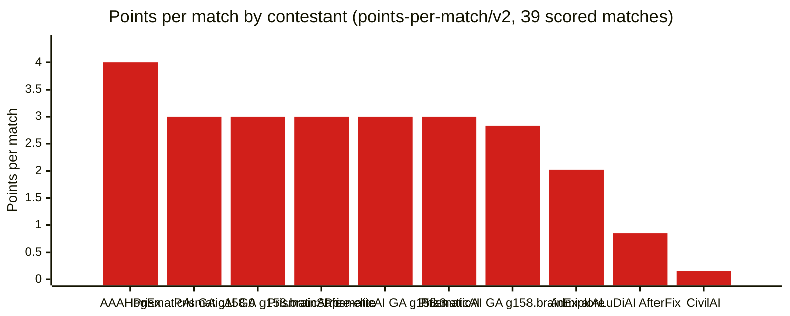
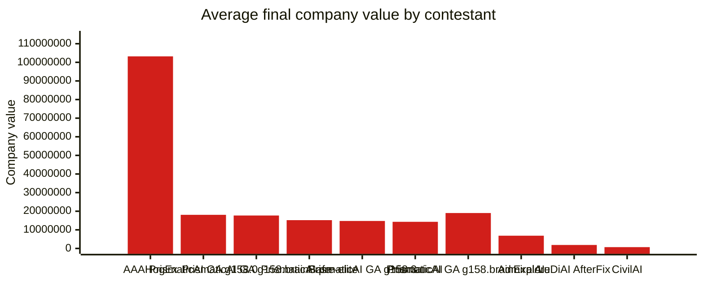
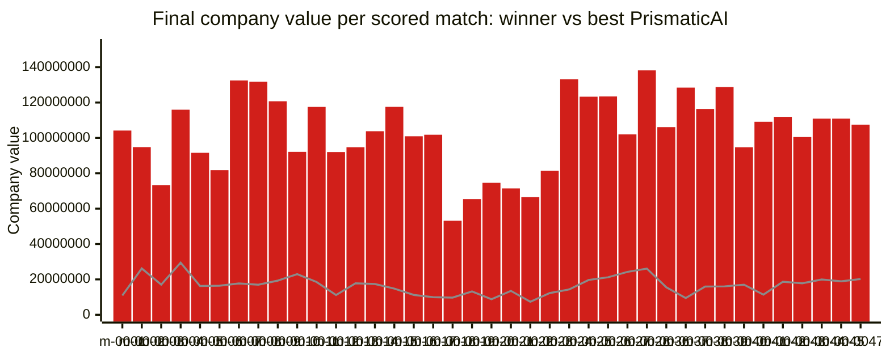
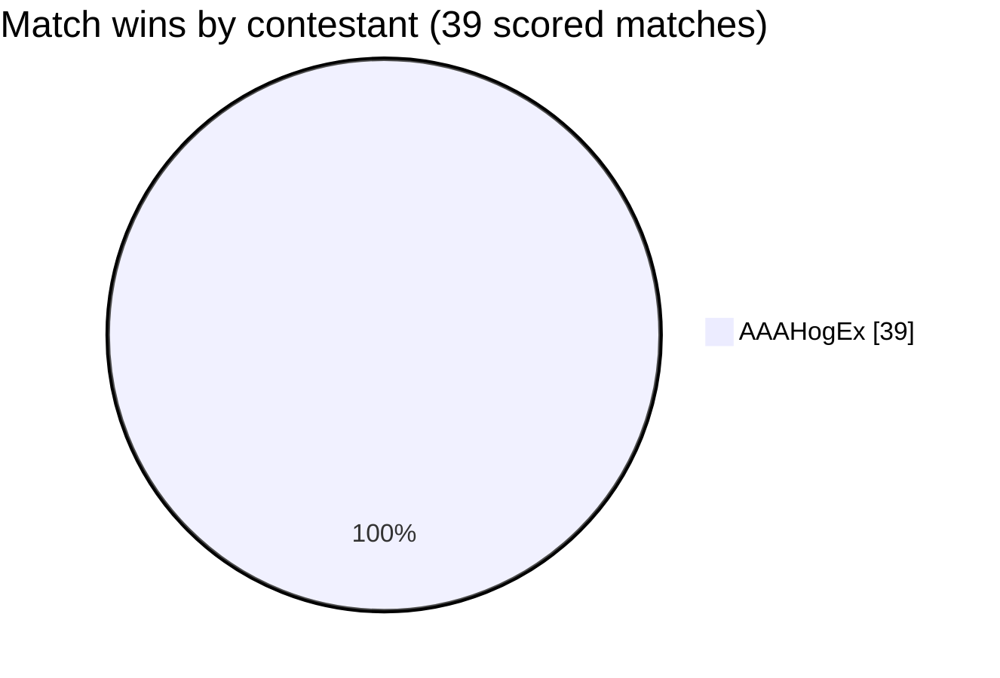
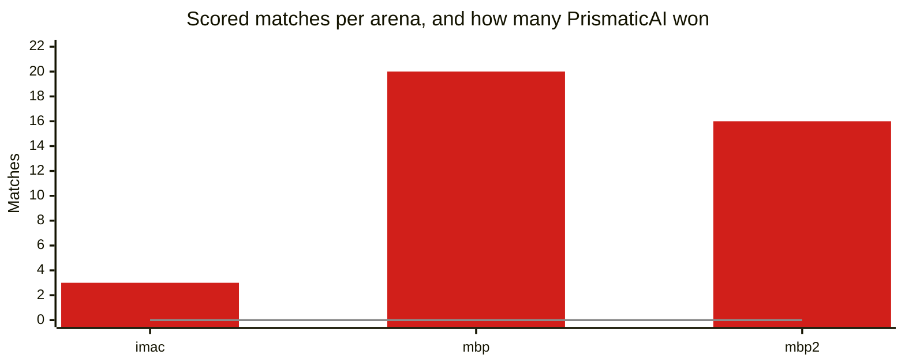

# battle-20261120T161043-c00449e7

Derived from `battle-20261120T161043-c00449e7.json` by `tools/research/ai-battle/battle.py report`; do not edit.

- Edition `c00449e7e192b286`: PrismaticAI and referee at `2b32ecb6f1049e718e513efb309e963aa0a5205c`, base set `opengfx-8.0.tar`
- 20-year free-for-all from 1960, map 256x256 temperate, breakdowns 1
- 39 scored match(es) on `imac` (20261119-master-gdf1e05e7d8), `mbp` (20261120-master-m17653b726e), `mbp2` (20261119-master-gdf1e05e7d8)
- Replays: 1 of 1 identical to their original on another arena

| # | Contestant | Played | Wins | Points | Points/match | Avg rank | Avg final value | Squirrel errors | Matches with anomalies |
|---|---|---|---|---|---|---|---|---|---|
| 1 | AAAHogEx | 39 | 39 | 156 | 4.0 | 1.0 | 103.2 M | 0 | 0 |
| 2 | PrismaticAI GA g158.0 | 7 | 0 | 21 | 3.0 | 2.0 | 18.1 M | 0 | 0 |
| 3 | PrismaticAI GA g158.brainSafe | 7 | 0 | 21 | 3.0 | 2.0 | 17.7 M | 0 | 0 |
| 4 | PrismaticAI pre-elite | 7 | 0 | 21 | 3.0 | 2.0 | 15.2 M | 0 | 0 |
| 5 | PrismaticAI GA g158.3 | 6 | 0 | 18 | 3.0 | 2.0 | 14.8 M | 0 | 0 |
| 6 | PrismaticAI | 6 | 0 | 18 | 3.0 | 2.0 | 14.3 M | 0 | 0 |
| 7 | PrismaticAI GA g158.brainExplore | 6 | 0 | 17 | 2.833 | 2.17 | 19.0 M | 0 | 0 |
| 8 | AdmiralAI | 39 | 0 | 79 | 2.026 | 2.97 | 6.8 M | 0 | 2 |
| 9 | LuDiAI AfterFix | 39 | 0 | 33 | 0.846 | 4.15 | 1.9 M | 0 | 1 |
| 10 | CivilAI | 39 | 0 | 6 | 0.154 | 4.85 | 705.0 k | 11330 | 7 |

<!-- battle-charts:begin -->
<!-- derived from battle-20261120T161043-c00449e7.json by `battle.py render`; `battle.py check` fails when it is stale -->

<!-- battle-charts:end -->

| Seed | Original | Replay | Arenas | Identical |
|---|---|---|---|---|
| 812026453 | m-0014 | m-0048 | mbp2 / mbp | yes |

| Match | Arena | Seed | Winner | Value | Last | Anomalies |
|---|---|---|---|---|---|---|
| m-0001 | mbp | 1757195292 | AAAHogEx | 104.2 M | CivilAI | - |
| m-0002 | mbp | 1757195292 | AAAHogEx | 94.8 M | CivilAI | - |
| m-0003 | mbp | 1757195292 | AAAHogEx | 73.3 M | CivilAI | - |
| m-0004 | mbp | 1757195292 | AAAHogEx | 115.9 M | CivilAI | - |
| m-0005 | mbp | 1757195292 | AAAHogEx | 91.6 M | CivilAI | - |
| m-0006 | mbp | 1012228281 | AAAHogEx | 81.8 M | CivilAI | - |
| m-0007 | mbp | 1012228281 | AAAHogEx | 132.5 M | CivilAI | - |
| m-0008 | mbp | 1012228281 | AAAHogEx | 131.8 M | CivilAI | CivilAI: fleet_drop:12->5 |
| m-0009 | mbp | 1012228281 | AAAHogEx | 120.7 M | CivilAI | CivilAI: squirrel_errors:3990 |
| m-0010 | imac | 1012228281 | AAAHogEx | 92.1 M | LuDiAI AfterFix | - |
| m-0011 | imac | 1012228281 | AAAHogEx | 117.5 M | CivilAI | AdmiralAI: fleet_drop:448->270 |
| m-0012 | imac | 812026453 | AAAHogEx | 92.0 M | CivilAI | - |
| m-0013 | mbp2 | 812026453 | AAAHogEx | 94.7 M | CivilAI | - |
| m-0014 | mbp2 | 812026453 | AAAHogEx | 103.8 M | CivilAI | CivilAI: fleet_drop:56->31 |
| m-0015 | mbp2 | 812026453 | AAAHogEx | 117.6 M | CivilAI | CivilAI: squirrel_errors:3640 |
| m-0016 | mbp2 | 812026453 | AAAHogEx | 100.9 M | CivilAI | - |
| m-0017 | mbp2 | 812026453 | AAAHogEx | 101.8 M | CivilAI | - |
| m-0018 | mbp2 | 423962092 | AAAHogEx | 53.1 M | CivilAI | - |
| m-0019 | mbp2 | 423962092 | AAAHogEx | 65.4 M | CivilAI | - |
| m-0020 | mbp2 | 423962092 | AAAHogEx | 74.6 M | CivilAI | - |
| m-0021 | mbp2 | 423962092 | AAAHogEx | 71.4 M | CivilAI | - |
| m-0022 | mbp2 | 423962092 | AAAHogEx | 66.5 M | CivilAI | - |
| m-0023 | mbp2 | 423962092 | AAAHogEx | 81.4 M | LuDiAI AfterFix | AdmiralAI: fleet_drop:305->193 |
| m-0024 | mbp2 | 1221529662 | AAAHogEx | 133.2 M | CivilAI | - |
| m-0025 | mbp2 | 1221529662 | AAAHogEx | 123.3 M | CivilAI | - |
| m-0026 | mbp2 | 1221529662 | AAAHogEx | 123.4 M | CivilAI | - |
| m-0027 | mbp2 | 1221529662 | AAAHogEx | 102.0 M | CivilAI | CivilAI: fleet_drop:23->10 |
| m-0028 | mbp2 | 1221529662 | AAAHogEx | 138.2 M | CivilAI | - |
| m-0036 | mbp | 1952742737 | AAAHogEx | 106.1 M | CivilAI | - |
| m-0037 | mbp | 1952742737 | AAAHogEx | 128.4 M | CivilAI | - |
| m-0038 | mbp | 1952742737 | AAAHogEx | 116.4 M | LuDiAI AfterFix | - |
| m-0039 | mbp | 1952742737 | AAAHogEx | 128.8 M | CivilAI | CivilAI: squirrel_errors:3700 |
| m-0040 | mbp | 1952742737 | AAAHogEx | 94.7 M | CivilAI | LuDiAI AfterFix: fleet_drop:39->24; CivilAI: fleet_drop:17->10 |
| m-0041 | mbp | 1952742737 | AAAHogEx | 109.1 M | CivilAI | - |
| m-0042 | mbp | 1039354023 | AAAHogEx | 111.9 M | CivilAI | - |
| m-0043 | mbp | 1039354023 | AAAHogEx | 100.5 M | LuDiAI AfterFix | - |
| m-0044 | mbp | 1039354023 | AAAHogEx | 110.9 M | CivilAI | - |
| m-0045 | mbp | 1039354023 | AAAHogEx | 110.9 M | LuDiAI AfterFix | - |
| m-0047 | mbp | 1039354023 | AAAHogEx | 107.5 M | LuDiAI AfterFix | - |
| m-0048 (replay) | mbp | 812026453 | AAAHogEx | 103.8 M | CivilAI | CivilAI: fleet_drop:56->31 |
